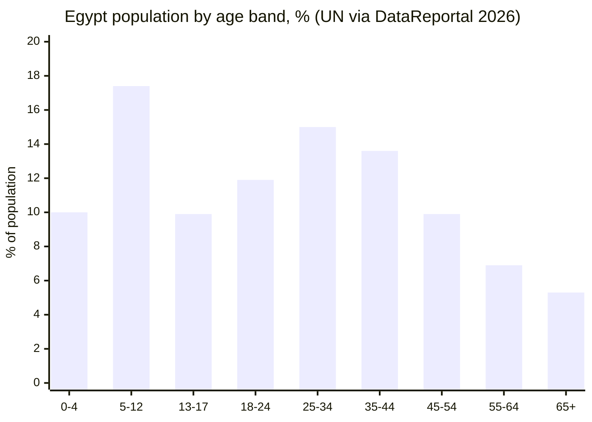
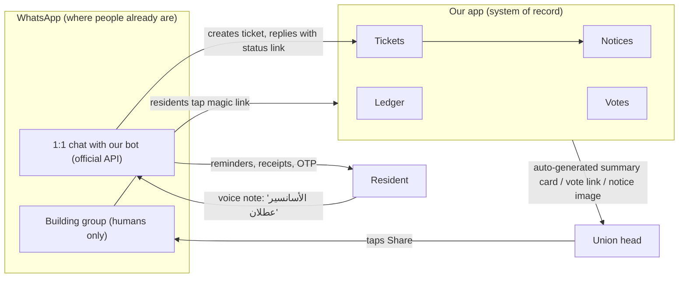
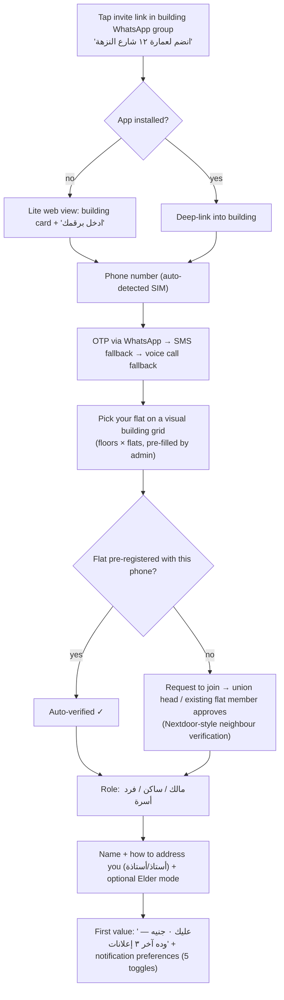

# 12 — UX & Design Research: A Residential-Building App for Egypt

**Research angle:** UX, interaction design, information architecture, and screen-level recommendations
**Market:** Egypt only (Arab and international products studied for borrowable patterns)
**Date of research:** 2026-10-12
**Author role:** UX researcher + product manager

> **How to read this file.** Every factual claim carries a source URL. Anything I derived myself is marked **ESTIMATE** or **RECOMMENDATION** with reasoning. Review quotes are copied from public Google Play listings (fetched 2026-10-12). Where I could not find data, I say so.

---

## 0. Executive summary: the 15 UX decisions that matter most

| # | Decision | Why (evidence) |
|---|---|---|
| 1 | **Android-first, light, fast**: aim for an install under 15 MB, a cold start under 2 s on a 2–3 GB RAM phone, and pass Android Vitals | Android holds about 83% of Egyptian mobile OS share (83.4% in Sep-2026) [corrected] ([Statcounter](https://gs.statcounter.com/os-market-share/mobile/egypt)). The market is price-sensitive, especially under USD 150 ([Ecofin/Fitch](https://www.ecofinagency.com/news-industry/2608-48166-egypt-s-2-5b-to-4-8b-smartphone-surge-set-to-reshape-africa-s-tech-map-by-2031)). Google found that each extra 6 MB of APK cuts install conversion by about 1%, and more in emerging markets ([Google Play, Medium](https://medium.com/googleplaydev/shrinking-apks-growing-installs-5d3fcba23ce2)) |
| 2 | **WhatsApp is the front door; the app is the system of record** | WhatsApp is the default communication layer in Egypt (about 56M users, [World Population Review](https://worldpopulationreview.com/country-rankings/whatsapp-users-by-country)). Competitors already pitch themselves as replacing "paper ledgers and WhatsApp chats" (Amarati and Imarti Play descriptions) |
| 3 | **Redesign the founder's "bot inside the building WhatsApp group" idea.** The official API cannot do it at building scale | Meta's Groups API allows **max 8 participants**, is **invite-only**, and **cannot import existing groups** ([Meta docs](https://developers.facebook.com/docs/whatsapp/cloud-api/groups), [Periskope](https://periskope.app/blog/whatsapp-groups-api-requirements-eligibility-limits)). Unofficial libraries risk number bans ([LumaDock](https://lumadock.com/tutorials/hermes-whatsapp-baileys-gateway?currency=1)). Section 10 gives the UX alternative |
| 4 | **Phone OTP plus a magic invite link**, with no passwords and no email | Password reset is a top complaint in Egyptian apps. One TMG Life review says: "I forgot my password, trying to reset but it keeps giving me error" ([TMG Life Play](https://play.google.com/store/apps/details?id=com.tmglife.app)). InstaPay's SMS registration fails on some devices ([InstaPay Play](https://play.google.com/store/apps/details?id=com.egyptianbanks.instapay)) |
| 5 | **Egyptian colloquial microcopy** (ammiya), not MSA and not Levantine | Amarati, the top-rated competitor, is written in Palestinian/Levantine dialect ("ما في خلافات", "بدو يركض"), which feels foreign to Egyptians. Saknna uses an Egyptian tone ([saknna.com](https://www.saknna.com)). Egyptian fintechs hire for Egyptian-dialect UX writers ([Khazna job](https://careers.speedinvest.com/companies/khazna/jobs/72544331-ux-writer)) |
| 6 | **Elder mode and a family delegate** | About 21% of Egypt's population is 45+ (the 45–54, 55–64 and 65+ bands sum to 22.1%) ([DataReportal 2026](https://datareportal.com/reports/digital-2026-egypt)). Building owners skew older. Illiteracy is still double-digit (female 21.4%, rural 20.3% in 2024) ([Amwal Al Ghad / CAPMAS](https://amwalalghad.com/q397)) |
| 7 | **Voice input everywhere, with AI turning speech into structured data** | Off-the-shelf ASR is weaker on dialect, and fine-tuned Egyptian models close the gap ([Interspeech 2025](https://www.isca-archive.org/interspeech_2025/ozyilmaz25_interspeech.html), [NADI 2025](https://huggingface.co/papers?q=subtasks)). Voice notes are culturally normal in the region ([Sandy Times](https://sandytimes.ae/articles/4839-the-voice-note-epidemic-we-need-to-talk-about)) |
| 8 | **A transparent ledger as the hero feature** | Egyptian occupants' unions have weak legal power to collect. The cited Youm7 article mentions no fine; it says only that an owner must settle union dues before selling a unit. The "EGP 100/yr fine" is [unverified] ([Youm7](https://www.youm7.com/6352079)). Experts call for separate accounts and spending disclosure ([Banker.news](https://banker.news/154253)). Social trust therefore has to do what the law cannot |
| 9 | **Social-proof payment nudges** ("31 of 40 flats paid") | In the HMRC letter trial, payment rose from 67.5% to 83% using local social norms ([IRPP Policy Options](https://policyoptions.irpp.org/2013/06/making-inroads/)) |
| 10 | **Role-based UIs**: one app with role-aware home screens, plus an ultra-simple doorman mode | MyGate and NoBrokerHood both split guard and resident flows ([Capterra NoBrokerHood](https://www.capterra.co.uk/software/206966/nobrokerhood)). Imarti already ships manager, treasurer and member roles ([Imarti Play](https://play.google.com/store/apps/details?id=com.craftfuture.imarti)) |
| 11 | **Never mix ads or marketplace promos into the notification stream** | MyGate's 2026 reviews are dominated by "ad platform" anger, e.g. "They mix ads into society notifications meaning notifications need to be disabled entirely" ([MyGate Play](https://play.google.com/store/apps/details?id=com.mygate.user)) |
| 12 | **Ticket timeline like Talabat order tracking, with honest ETAs** | Talabat reviews punish ETAs that change: "The written time for tracking orders keeps on changing" ([Talabat Play](https://play.google.com/store/apps/details?id=com.talabat)). TMG Life: "booked a plumbing service months ago and i'm still waiting" |
| 13 | **Offline-tolerant ledger and doorman logs** (queue and sync) | Egyptian app reviews are full of "something went wrong" and failed-sync complaints (Vodafone, Fawry, TMG Life; quotes in §3) |
| 14 | **Don't over-harden security checks** (root and accessibility blocks) | InstaPay and TMG Life block phones with accessibility services or "security issue detected: 501", which locks out legitimate users, including blind users ([InstaPay Play](https://play.google.com/store/apps/details?id=com.egyptianbanks.instapay), [TMG Life Play](https://play.google.com/store/apps/details?id=com.tmglife.app)) |
| 15 | **Human-reachable support inside the app**, through a WhatsApp support line and an in-app chat with an SLA | "Worst customer service" is the single most repeated phrase across InstaPay, Fawry, Vodafone and Talabat reviews (§3) |

---

## 1. The Egyptian digital context (design constraints)

### 1.1 Key numbers

| Metric | Value | Source | Design implication |
|---|---|---|---|
| Population (Oct-2025) | 119M, median age 24.5 | [DataReportal 2026](https://datareportal.com/reports/digital-2026-egypt) | Young tenants, older owners: design for both |
| Internet users (Oct-2025) | 98.2M (82.7%) | [DataReportal 2026](https://datareportal.com/reports/digital-2026-egypt) | Nearly everyone in urban buildings is reachable |
| Offline population | 20.6M (17.3%) | same | Doormen and some elderly owners may be offline: support SMS, voice, or a family proxy |
| Mobile connections | 121M (102% of pop.) | same | Many people have dual SIMs, so OTP must handle a number change |
| Mobile internet subscriptions (Dec-2025) | 92.6M | [Zawya/IDSC](https://www.zawya.com/en/business/technology-and-telecom/egypts-mobile-internet-users-hit-926mln-in-december-2025-idsc-hwrcfjnz) | Mobile-first, not desktop-first |
| Median mobile download speed | 56.45 Mbps (Aug-2025, +120% YoY) | [DataReportal 2026](https://datareportal.com/reports/digital-2026-egypt) | Speed is improving, but **data cost** is the constraint, not speed |
| Android share | ~83% (83.4%, Sep-2026) [corrected] | [Statcounter](https://gs.statcounter.com/os-market-share/mobile/egypt) | Build Android first. iOS can follow, or use cross-platform |
| Facebook ad reach | 51.6M (68.8% of adults) | [DataReportal 2026](https://datareportal.com/reports/digital-2026-egypt) | Facebook groups for compounds are a distribution channel (see the growth file) |
| WhatsApp users | ~56M (2024) | [World Population Review](https://worldpopulationreview.com/country-rankings/whatsapp-users-by-country) | WhatsApp patterns (voice notes, ticks, chat bubbles) are the mental model |
| Mobile wallets | 60M by end-2025; 46.3M active (Q2-2025); Vodafone Cash 55% of wallets | [Business Today Egypt/CBE](https://www.businesstodayegypt.com/amp/4/7346/Egypt-mobile-wallet-transactions-hit-EGP-4T-as-user-base), [MEA Tech Watch/NTRA](https://meatechwatch.com/?p=33679) | Wallet pay must be a top-level option |
| InstaPay | 11.5M users (Nov-2024, CBE official); 263M transactions in Q1-2025 | [Business Today Egypt/CBE](https://www.businesstodayegypt.com/amp/1/5465/Egypt-to-enable-Gulf-remittances-via-InstaPay-in-2-months) [corrected source: the Egyptian Streets link gives only 2.16M users in InstaPay's first year], [Arab Finance](https://arabfinance.com/en/news/newdetails/29811) | "Pay via InstaPay" plus a payment proof (screenshot) upload is a must |
| Fawry | 54.1M users, 300k+ service points (Q2-2025); myFawry 24.2M downloads [unverified; the latest figure confirmed is 17.3M at Dec-2024, per Forbes ME] | [TechCabal](https://techcabal.com/2026/04/20/how-fawry-built-a-profitable-fintech/), [MEA Tech Watch](https://meatechwatch.com/?p=48097) | Fawry reference codes serve cash payers (elderly owners) |
| Illiteracy | Fell 9.2 points 2017→2024; female 21.4%, male 12%, urban 11.9%, rural 20.3% | [CAPMAS press release 2025](https://www.capmas.gov.eg/Admin/News/PressRelease/2025914112835_محو%20الامية%202025%20بعد%20التعديل%20عربي.pdf), [Amwal Al Ghad](https://amwalalghad.com/q397) | Icons with labels, voice, and pictures of meters and receipts |
| Telecom price pressure | NTRA price hikes in Jan-2025; operators asked for up to 30% more in 2026 | [Technext24](https://technext24.com/2025/02/18/nigerias-internet-costs-and-7-countries/), [MEA Tech Watch](https://meatechwatch.com/?p=48767) | Treat data as expensive: compress images and use a Lite mode |

**ESTIMATE: overall illiteracy rate in 2024 ≈ 16–17%.** This is derived as 25.8% (2017 census) minus 9.2 points. It is my own calculation, not a published figure.

**Data gap:** I found no Egyptian statistic on smartphone use by people aged 55+. MCIT and CAPMAS publish household ICT tables, but none were accessible with an age band. Recommendation: treat elderly owners as a key persona and validate with field interviews (see §20).

### 1.2 Population age structure (chart)



Interpretation: about 47% of people are aged 18–54, the core tenants and young owners. About 12% are 55+, a small share of the population but a large share of **apartment owners and union heads**. That last point is an **ESTIMATE** based on ownership typically skewing older. Field validation is needed.

---

## 2. Competitive and benchmark UX audit

### 2.1 Direct competitors (building/union apps)

| Product | Facts (sourced) | UX strengths | UX weaknesses / gaps |
|---|---|---|---|
| **Amarati — عمارتي** (`com.amarati.app`) | Rating **4.7** from 43 reviews; **1K+ installs** [corrected]. Description: "built by heads of real building committees in **Palestine**". Features: auto monthly invoices; **photo of water/gas meter, app calculates consumption per flat**; cash-payment reporting with admin confirm/reject; **monthly summary as an image shared to WhatsApp in one tap**; "Cairo" font; "big buttons… suitable for all ages"; "we don't touch your money" ([Play](https://play.google.com/store/apps/details?id=com.amarati.app)) | Excellent focus on the union head's monthly pain. The meter-photo idea and the WhatsApp summary image are clever. It is explicitly elderly-friendly | **Levantine dialect** copy ("ما في"، "بدو"، "بحسب"), so it is not Egyptian. It is small. No marketplace, maintenance tickets or doorman role is described. No payment rails |
| **Imarti — عمارتي - إدارة اتحاد الملّاك** (`com.craftfuture.imarti`) | Egyptian developer (address: Haram, Giza). **100+ installs** [corrected]. Features: monthly subscriptions per flat; per-member debt statement; categorised expenses; live balance; **emergency fund campaigns**; **voting on decisions**; complaints channel; **roles: manager, treasurer, member**; **service providers with ratings and offer countdown timers**; Arabic + English ([Play](https://play.google.com/store/apps/details?id=com.craftfuture.imarti)) | The closest to our vision, and it already has a marketplace seed (offers). Voting plus an archive of decisions is a trust feature | Its changelog reveals basic RTL bugs: "fixes in text direction", "numeric fields now accept Arabic-keyboard digits", "financial figures no longer show zero when refresh fails". These show the RTL and number-handling pitfalls we must get right from day one. No visible rating count |
| **Saknna / سَكَنة** ([saknna.com](https://www.saknna.com)) | Web app/PWA (no store download). Finance, maintenance, residents, automatic payment reminders, **Arabic AI assistant** summarising building status, Excel/CSV import. Paid: EGP 450/month (≤5 units) up to EGP 7,500 (compounds), 14-day trial. Claims "500+" buildings (unverified) | Egyptian tone. Strong admin tooling. The AI assistant is already present. The PWA avoids install friction | **Paid from day one**, which conflicts with mass free adoption. It is admin-centric and residents are passive. The PWA lacks reliable push on some Android setups (**ESTIMATE**) |
| **TMG Life** (Talaat Moustafa compounds: Madinaty, Rehab…) (`com.tmglife.app`) | 50,000+ installs, **4.8** (1,159 ratings). Bill pay, club membership, **NFC electricity-card recharge**, service booking, community news ([Play](https://play.google.com/store/apps/details?id=com.tmglife.app)) | NFC utility recharge is a beloved utility ("شحن سريع وارحم من الطوابير"). The 5-star reviews are about **utility, not community** | Reviews: "booked a plumbing service months ago and i'm still waiting"; "security issue detected: 501"; "always logs out on its own"; "Electricity charge not work with honor x9b"; "للدعايه فقط وليس لخدمه السكان"; "صنايعية… مش ملتزمين ولا بيحترموا مواعيدهم" |

### 2.2 International pattern sources

| Product | Patterns worth borrowing | Anti-patterns to avoid (evidence) |
|---|---|---|
| **MyGate** (India, 5M+ installs) ([Play](https://play.google.com/store/apps/details?id=com.mygate.user)) | Real-time visitor approve/reject. **Pre-approval** reduces calls. **Leave at gate**. Escalation from app to primary phone to secondary phone. **Daily help attendance** with entry/exit logs and ratings ([MyGate pre-approval](https://mygate.com/blog/feature-in-focus/pre-approval/), [MyGate daily help](https://mygate.com/daily-help-management/), [FAQs](https://mygate.com/faqs/)) | 2026 reviews: "an ad platform now", "**mix ads into society notifications**", "Removed the HELPDESK option from Quick Access", "an x that has to be clicked exactly at the centre else open the ad", convenience fees "not even displayed properly", "notifications not received… battery optimization", "feed refreshes to the top every time you leave the app". A guard-side sync failure let a rejected visitor in ([Capterra](https://www.capterra.com/p/212555/MyGate/reviews/?page=3)) |
| **NoBrokerHood** (India) | Dues and receipts, multi-rail payment, photo complaints, facility booking, SOS, role-based tools for guards and admins ([NoBrokerHood](https://www.nobrokerhood.com/solutions/society-management-system), [Capterra](https://www.capterra.co.uk/software/206966/nobrokerhood)) | Reviewers found the feature breadth overwhelming for new users. The same was said of MyGate on [G2](https://www.g2.com/products/mygate/reviews_and_filters) |
| **Nextdoor** (US) | **Verified-address membership**. Neighbours verify neighbours by invitation, and invite letters can only come from verified members ([Nextdoor invitations](https://go.nextdoor.com/invitations), [Startup Grind](https://www.startupgrind.com/blog/90000-neighborhoods-and-counting-how-nextdoor-hacked-growth-with-the-usps/)). **Kindness Reminder**: 1 in 5 who saw it edited their comment, giving 20% fewer negative comments. Later 35–36% edited or withheld. The −15% drop in violating content applies to the classic and AI Kindness Reminders **combined**, not to the AI version alone [corrected]. 26% of users who saw an AI rewrite adopted it ([Nextdoor blog](https://blog.nextdoor.com/2019/09/18/announcing-our-new-feature-to-promote-kindness-in-neighborhoods), [Transparency Report](https://about.nextdoor.com/wp-content/uploads/2024/02/Nextdoor-Transparency-Report-2024-2023-Reflection.pdf)) | Reviews: "The notifications never stop… they invent new notification types", "feed is never in newest posts", sponsored-ad overload ([Play](https://play.google.com/store/apps/details?id=com.nextdoor)) |

### 2.3 What Egyptians are already trained on

| App | Scale (sourced) | Learned mental models we should reuse | Pain points we should fix |
|---|---|---|---|
| **InstaPay** | 10M+ installs, 4.3★ (~114K ratings as of 2026-10-12) [corrected] ([Play](https://play.google.com/store/apps/details?id=com.egyptianbanks.instapay)) | `name@instapay` addresses (IPA), instant transfer, transaction receipt screenshots shared on WhatsApp as "proof" ([Egypt Telegraph](https://www.egypttelegraph.com/article/200642)) | "registration… forces users to send an SMS to an international number"; "android 15… does not trigger the premium sms prompt"; crashes when other apps hold accessibility permission; long support waits |
| **myFawry** | 10M+ installs, 3.9★ (~178K ratings) [corrected] ([Play](https://play.google.com/store/apps/details?id=com.fawry.myfawry)) | **Reference code** paid in cash at a kiosk. Bill categories and biller grids. One review asks for "push notifications if there is a new bill due" | Login errors after updates; a bill showing "pending" while money is deducted; a fee per invoice for same-name bills. One review praises a later version as "compatible… with screen readers" (Arabic review, Aug-2026), which shows Egyptian blind users exist and give feedback |
| **Ana Vodafone / Vodafone Cash** | 50M+ installs, 4.4★ (2.34M) ([Play](https://play.google.com/store/apps/details?id=com.emeint.android.myservices)) | Wallet PIN, balance-at-a-glance, recharge tiles | "Bad UX & UI. Too cluttered, so many deals, promotions… Difficult to find what you're looking for"; "Oops! Something went wrong" |
| **Talabat** | 50M+ installs, 4.3★ (~546K ratings) [corrected] ([Play](https://play.google.com/store/apps/details?id=com.talabat)) | Live order-status timeline, rider ETA, ratings after delivery, vouchers | Hidden fees, misleading discount display, ETAs that change, complaint windows that are too short, "silence the customer with a voucher" |
| **Telda** | 1.5M downloads, 500k active (2023) ([Forbes ME](https://www.forbesmiddleeast.com/lists/the-middle-easts-fintech-50/telda/)); 30k sign-ups in its first month ([Egyptian Streets](https://egyptianstreets.com/2021/06/29/egypt-welcomes-its-first-money-app/)) | Fully digital sign-up with phone + national ID, a playful youth-friendly tone, **@username** payments, now linked to InstaPay ([Arab Finance](https://arabfinance.com/en/news/newdetails/banque-du-caire-and-telda-connect-prepaid-mastercard-to-instapay)) | n/a (no review data pulled) |

**Synthesis.** Egyptians are fluent in four interaction models:

1. **WhatsApp chat** (bubbles, voice notes, ticks, groups)
2. **Wallet/fintech** (PIN, balance card, receipt screenshot)
3. **Fawry reference code** (pay cash anywhere)
4. **Talabat tracking** (status timeline + rating)

Our app should feel like a mix of these four and should introduce **no new interaction paradigm**.

---

## 3. Review mining: Egyptian pain points mapped to design principles

I extracted reviews from the Egyptian Play pages (gl=EG, both English and Arabic). The Arabic quotes are verbatim.

| Pain theme | Verbatim evidence (app, source) | Design principle for us |
|---|---|---|
| **Login and OTP fragility** | "لن اتمكن من تسجيل الدخول… رسالة لم يتم تسجيل رقم الهاتف" (InstaPay); "after changing phone… no SMS received. Fixed after replacing the SIM" (InstaPay, Arabic); "always logs out on its own" (TMG Life) | OTP over **WhatsApp first, SMS fallback, and a voice-call fallback**. Long-lived sessions (90 days plus biometric). Number change via a "trusted member re-verifies" flow |
| **Updates break the app** | "بعد التحديث التطبيق لا بفتح ويخرج لوحده" (Fawry); "App keeps crashing on splash screen" (InstaPay); "The new update is making the app load very slowly" (TMG Life) | Staged rollouts (5% → 20% → 100%), crash-free sessions ≥ 99.5% as a release gate, a server-driven kill switch, and a test matrix of low-end devices (Samsung A-series, Honor, Xiaomi Redmi, Oppo) |
| **Over-zealous security blocks** | "security issue detected: 501" (TMG Life); InstaPay refuses to open if any app holds accessibility permission | No root or accessibility blocking in a building app. Use risk-based checks only for payments, and never break screen readers |
| **Support is unreachable** | "waited 40 minutes… he closed the chat" (InstaPay); "Worst customer service ever" (Fawry); "There is no one to talk to" (Talabat) | Visible "كلمنا على واتساب" support, ticket IDs for support issues, and **union head as first-line support** with an escalation path |
| **Clutter and ads** | "Too cluttered, so many deals, promotions" (Vodafone); "an ad platform now" (MyGate); "للدعايه فقط وليس لخدمه السكان" (TMG Life) | **Hard rule:** the home screen shows building utility first, with at most one marketplace card. Notifications are 100% about the user's own building |
| **Hidden fees** | "convenience fees… not even displayed properly" (MyGate); "Hidden charges all the time" (Talabat); per-invoice fees (Fawry) | Fee shown before the confirm button, one combined payment for multiple dues, and a free rail available (manual InstaPay with proof) |
| **Service providers no-show** | "booked a plumbing service months ago and i'm still waiting" (TMG Life); "صنايعية… مش ملتزمين ولا بيحترموا مواعيدهم" (TMG Life) | The phase-2 marketplace needs **confirmed slot + live status + no-show guarantee**. Never launch a booking feature without fulfilment SLAs |
| **Notifications missing or too many** | "Notifications are often not received… battery optimization" (MyGate); "notifications never stop… they invent new notification types" (Nextdoor) | Fewer, smarter notification categories (5, not 50). A per-category toggle in one screen. An in-app check for battery optimisation with **device-specific** instructions (Xiaomi, Oppo, Honor). An SMS/WhatsApp fallback for critical alerts |
| **Feed position lost** | "refreshes your feed to the very latest post, and you can't continue from where you left" (MyGate) | Preserve scroll position. A "new posts ↑" pill instead of an auto-jump |
| **Payment status lag** | "payment… does not register immediately… line was suspended" (Vodafone); "one of them still pending" (Fawry) | Explicit states: *بانتظار التأكيد / اتأكد / مرفوض*, each with a timestamp and who confirmed |

---

## 4. Users, roles and personas

### 4.1 Role catalogue

| Role (Arabic label in UI) | Who | Primary jobs-to-be-done | Device and literacy assumptions |
|---|---|---|---|
| **مالك / مالكة** Owner | Owns a flat; may live in it or rent it out; may live abroad (Gulf) | See dues and balance, pay, vote, see spending, follow repairs | Mid-range or older phone. Possibly 55+. Possibly abroad (remote voting and payment are key) |
| **ساكن / مستأجر** Tenant | Rents the flat | Report problems, get notices (water cut, elevator), pay the share the owner delegates, find a technician | Young, fluent, price-sensitive |
| **رئيس الاتحاد** Union head / building admin | Elected owner who runs the building | Collect money, track who paid, approve spending, assign the doorman, announce, call meetings | Usually an older male owner (**ESTIMATE**). Overloaded. Today runs it from a notebook plus WhatsApp |
| **أمين الصندوق** Treasurer | Handles cash | Record income and expenses, upload receipts, monthly statement | Same as above. Needs fast data entry |
| **البواب / حارس العقار** Doorman | Lives in the building | Receive requests, log deliveries and visitors, report issues, collect cash (common), get tips | Low-end Android or a shared phone. Low literacy is likely. **Voice-first** |
| **الفني** Technician (plumber, electrician, elevator company) | Vendor | Receive job, call resident, update status, send invoice photo, get paid | Low-end phone, WhatsApp-native |
| **إدارة الكمبوند** Compound admin / facility manager | Professional management company or developer | Multi-building dashboards, bulk billing, ticket SLA, gate access, announcements | Desktop web plus mobile |
| **فرد أسرة** Family delegate | Son or daughter managing an elderly parent's flat | Act on behalf: pay, vote by proxy, receive alerts | Fluent, often in another city or abroad |

### 4.2 Three priority personas

1. **Hagg Mahmoud, 63, retired, union head in Heliopolis.** Keeps a paper ledger. Sends voice notes in the building WhatsApp group. Arguments over "مين دفع ومين مدفعش" exhaust him. **Win:** he records income by voice ("الشقة ٥ دفعت ٣٠٠ جنيه كاش") and sends the WhatsApp summary image in one tap.
2. **Nour, 29, tenant in a Sheikh Zayed compound.** Wants elevator outage alerts, a trusted plumber, and to stop being spammed in the 200-person compound group. **Win:** personalised alerts and a one-tap "عطل" report with a status timeline.
3. **Am Sayed, 48, doorman.** Owns a basic Android phone and reads slowly. **Win:** a 4-button doorman home, voice notes as tasks, residents' requests read aloud, and a visible thank-you and tips history.

---

## 5. Design principles (the "north star" rules)

1. **"زي الواتساب"**: if a pattern exists in WhatsApp, reuse it (bubbles, voice-note hold-to-record, ticks, reply-swipe).
2. **Utility before community before commerce.** Order the home screen by that priority, and never let commerce interrupt utility.
3. **One screen, one job, one big button.** Primary action at the bottom, thumb-reachable, full width.
4. **Every number has a story.** Any figure (balance, dues) is tappable and expands into the transactions behind it.
5. **Never a dead end.** Every error offers "جرّب تاني" plus "كلّمنا".
6. **Speak Egyptian.** Friendly ammiya, respectful forms ("حضرتك" in sensitive or financial contexts).
7. **Trust is visible.** Who recorded it, when, with which receipt, and who confirmed it.
8. **Light on data, kind to old phones.**
9. **Notifications are a promise, not a megaphone.** Only things about *my* flat, *my* building, or *my* request.
10. **AI is a helper that shows its work.** AI-extracted data is always shown for confirmation before saving.

---

## 6. Arabic RTL and typography specification

### 6.1 RTL rules

| Element | Rule | Source |
|---|---|---|
| Layout | Mirror the whole layout. Navigation starts at the right, back arrow points right | [Material bidirectionality](https://m2.material.io/go/design-bidirectionality) |
| Directional icons | Mirror arrows, back/forward, progress, and "send" | same |
| Non-directional icons | Don't mirror (camera, phone, checkmark, clock face) | same |
| Timelines and progress | Time flows right to left in RTL. Ticket timelines are vertical, so they are direction-safe | same |
| Charts | **Don't mirror charts or graphs**. Keep axes conventional, but put labels in Arabic | [Material m1](https://m1.material.io/usability/bidirectionality.html) |
| Phone numbers, IBAN, IPA | Always LTR-isolated (`⁦…⁩`) inside RTL text | [Mozilla RTL guidelines](https://firefox-source-docs.mozilla.org/code-quality/coding-style/rtl_guidelines.html) |
| Mixed text | Use bidi isolation for names that mix Arabic and Latin, e.g. "Mivida B12" | same |
| Undo/redo, refresh | Ambiguous: choose one convention and test it | [Material m1](https://m1.material.io/usability/bidirectionality.html) |

### 6.2 Numerals

- Evidence: Egyptian usage is mixed. Eastern Arabic digits (٠١٢٣) are common in print and consumer contexts, while Western digits (0123) are common in fintech and ride-hailing ([App Screenshot Studio](https://appscreenshotstudio.com/blog/arabic-app-store-screenshots-4-typography-tripwires-2026)). No rigorous Egyptian survey was found.
- **RECOMMENDATION:**
  - Store all numbers as Western digits and format them at render time.
  - **Accept both digit sets in every input**. Imarti had to ship a fix because "numeric fields… now accept numbers from the Arabic keyboard" ([Imarti Play](https://play.google.com/store/apps/details?id=com.craftfuture.imarti)).
  - Default display: **Western digits for money and phone numbers** (consistent with InstaPay, Vodafone Cash and bank SMS). Offer a toggle in settings.
  - Currency format: `1,250 ج.م` or `1,250 جنيه`, with the currency after the number in Arabic UI.

### 6.3 Typography

| Token | Arabic size (sp) | Weight | Use |
|---|---|---|---|
| Display | 28 | Bold | Balance figure, dues amount |
| Title | 20 | SemiBold | Screen titles |
| Body-L | 17 | Regular | Default body in **Elder mode** |
| Body | 15–16 | Regular | Default body |
| Caption | 13 | Regular | Timestamps (never below 12) |

- Arabic glyphs look smaller than Latin at the same size, so increase line-height to about 1.5–1.7 ([font guidance aggregate](https://sa.sothebysinstitute.com/font-for-arabic-text)). Weak source: this guidance comes from a designer, not a standard.
- Candidate fonts (all open-licence Google Fonts): **IBM Plex Sans Arabic**, **Cairo** (used by Amarati), **Noto Sans Arabic**, and **Tajawal**. **RECOMMENDATION:** Use IBM Plex Sans Arabic or Noto Sans Arabic for body text, since they are highly legible at small sizes and offer many weights. Cairo works for headings. Subset the fonts to Arabic + Latin + digits to save MBs.
- Respect the Android system font scale up to 200% without layout breakage. This matters for Elder mode.

---

## 7. Microcopy: an Egyptian-dialect voice and tone guide

### 7.1 Voice

- **Voice:** a respectful neighbour, the way a polite, helpful son of the building would talk. Warm, short and clear.
- **Formality ladder:**
  - Casual ammiya for everyday actions ("يلا نبدأ").
  - Respectful ammiya for money and conflicts ("حضرتك عليك ٣٠٠ جنيه").
  - Near-MSA only for legal text and the bylaws (لائحة) of the occupants' union.
- **Avoid:** Levantine forms (بدّو، هلّق، ما في). Gulf forms (وش، زين). Heavy MSA (يُرجى التكرم). English loanwords where a common Egyptian word exists. Keep loanwords Egyptians actually use: "أبلكيشن", "لينك", "كود".
- Hire or contract an Egyptian UX writer. Egyptian fintechs (Khazna, MoneyFellows) hire specifically for Egyptian-dialect UX writing ([Khazna](https://careers.speedinvest.com/companies/khazna/jobs/72544331-ux-writer), [MoneyFellows](https://jobs.mevp.com/companies/moneyfellows/jobs/41334034-bilingual-ux-writer-english-arabic-part-time)). Local agency rates are reported at about USD 70–150/hr ([TechBehemoths](https://techbehemoths.com/company/arabic-ux-writing)).

### 7.2 Copy bank (RECOMMENDATION)

| Context | ❌ Avoid | ✅ Use (Egyptian) |
|---|---|---|
| Onboarding CTA | ابدأ الآن بإنشاء حساب | **يلا ندخل عمارتك** |
| OTP | أدخل رمز التحقق المرسل | **اكتب الكود اللي جالك على واتساب** |
| OTP not received | لم يتم استلام الرمز؟ | **الكود مجاش؟ ابعتهولي SMS / كلّمني بمكالمة** |
| Dues reminder | يرجى سداد المستحقات | **فاضل ٣ أيام على اشتراك أكتوبر — ٣٠٠ جنيه. ٣١ من ٤٠ شقة دفعوا 👏** |
| Overdue (firm but kind) | لديك مستحقات متأخرة | **حضرتك عليك اشتراك شهرين. لو في ظرف، كلّم رئيس الاتحاد وهو يقسّطهالك** |
| Payment proof | قم برفع إيصال الدفع | **صوّر إيصال إنستاباي أو سكرين شوت** |
| Pending confirmation | قيد المراجعة | **مستني تأكيد أمين الصندوق ⏳** |
| Report issue | إنشاء طلب صيانة | **في حاجة بايظة؟** |
| Elevator alert | تنبيه: الأسانسير معطل | **الأسانسير واقف دلوقتي 🛗 — الفني جاي الساعة ٤** |
| Water cut | انقطاع المياه | **المية هتقطع بكرة من ٩ لـ ٢ — خزّنوا مية** |
| Empty ledger | لا توجد بيانات | **لسه مفيش مصاريف الشهر ده. أول ما أمين الصندوق يسجّل هتلاقيها هنا** |
| Error | حدث خطأ ما | **النت شكله فصل. حفظنا اللي كتبته وهنبعته أول ما يرجع** |
| Doorman thanks | تقييم الخدمة | **اشكر عم سيد 🙏** |
| Vote | التصويت على القرار | **رأيك إيه؟ دهان السلم بـ ١٢ ألف** |

**Gender:** Arabic verbs are gendered. Ask "أنادي حضرتك إزاي؟ (أستاذ / أستاذة)" in onboarding, and generate gender-correct strings ("دفعت / دفعتي" is avoided by using passive or neutral forms where possible).

---

## 8. Designing for low digital literacy and older owners

### 8.1 Evidence-based guidelines

| Guideline | Value | Source |
|---|---|---|
| Touch target | Android/Material **48 dp** minimum. WCAG 2.2 AA floor 24 px. AAA 44 px. For tremor and arthritis, practitioners recommend about 60 px | [Deque/axe](https://dequeuniversity.com/rules/axe/4.6/target-size), [CVS Health a11y](https://github.com/cvs-health/android-view-accessibility-techniques/blob/main/doc/basics/MinimumTouchTargetSize.md), [Glance](https://thisisglance.com/learning-centre/how-do-i-design-apps-for-elderly-people) |
| Simplify; enlarge and space controls | The most significant cross-study rules for 60+ users (systematic review of 28 guidelines) | [JMIR mHealth 2023](https://doaj.org/article/c2b8350ce24e45a88314c2880bf75690) |
| Evidence caveat | Only 15% of reviewed papers empirically validated their guidelines | [OzCHI 2024](https://outbox.eait.uq.edu.au/uqsville/OzCHI2024/Long%20Papers/Design%20for%20Older%20People%20-%20Improving%20the%20Usability%20of%20Mobile%20Apps%20through%20Targeted%20Design%20Recommendations.pdf) |
| User-controllable font enlargement | Often overlooked; must exist | [Bentley UX Center](https://www.bentley.edu/centers/user-experience-center/designing-mobile-experiences-seniors-mind) |
| Icons always paired with text labels; avoid complex gestures | Consensus across sources | [arXiv 2504.12690](https://arxiv.org/html/2504.12690v1) |

### 8.2 Our patterns

1. **Elder mode (وضع مبسّط)**, offered at onboarding if the user picks a large font or after a hesitation signal (**ESTIMATE**: e.g., more than 3 back-taps on a screen):
   - 4 giant tiles: **ادفع / بلّغ عن مشكلة / أخبار العمارة / كلّم البواب**.
   - Body text 17 sp+, buttons 56–64 dp, no swipe-only actions, no hidden long-press menus.
   - Read-aloud (TTS) on every notification and statement ("اسمع").
2. **Family delegate (توكيل للعيلة)**. An owner invites a son or daughter as a delegate with scoped permissions (pay, vote by proxy, receive alerts). This solves "elderly owner offline" and "owner abroad" together. The pattern is inspired by MyGate's family-member approvals ([MyGate FAQs](https://mygate.com/faqs/)).
3. **Assisted onboarding.** The union head or doorman can **pre-register** flats (flat number, owner name, phone). The owner then only confirms the OTP. Nobody types an address.
4. **Cash is a first-class citizen.** "دفعت كاش للبواب/لأمين الصندوق" → the collector confirms with one tap → a receipt goes to the owner on WhatsApp. Amarati validates this pattern ([Play](https://play.google.com/store/apps/details?id=com.amarati.app)).
5. **Undo instead of "Are you sure?"** dialogs, for non-financial actions.
6. **Pictures over words.** Icons for common faults (elevator, water, electricity, gas, cleanliness, noise), with photo-first reporting.
7. **Screen-reader support**: proper content descriptions in Arabic, and no blocking of accessibility services. Egyptian blind users publicly reward apps that work with screen readers (myFawry Arabic review, Aug-2026, [Play](https://play.google.com/store/apps/details?id=com.fawry.myfawry)).

---

## 9. Voice-first and AI input (founder idea #2, UX side)

### 9.1 Where AI removes friction (ranked by UX value)

| # | AI use case | User | Interaction pattern | Notes |
|---|---|---|---|---|
| 1 | **Voice to ledger entry**: "دفعنا للكهربائي ٤٥٠ جنيه تصليح نور السلم" → expense {category: electricity/maintenance, amount: 450, vendor: electrician, note} | Treasurer, union head | Hold-to-talk (WhatsApp mic UX), then a **confirmation card** with editable chips, then save | Must show its work (principle 10) |
| 2 | **Receipt/invoice OCR**: photo of a handwritten Egyptian invoice or InstaPay screenshot → amount, date, payer | Treasurer, residents | Camera, then auto-crop, then a pre-filled form | InstaPay screenshots have a consistent layout, so they are very parseable (**ESTIMATE**) |
| 3 | **Meter photo to consumption** (water/gas/electric sub-meters) | Union head | Camera with framing guide, then the reading with a confidence score, then a per-flat split | Pioneered by Amarati ([Play](https://play.google.com/store/apps/details?id=com.amarati.app)) |
| 4 | **Voice to maintenance ticket**: "الحنفية في المطبخ بتنقط" → category plumbing, urgency low, suggested technician | Resident, doorman | Mic or voice note, then a ticket preview | |
| 5 | **Announcement writer**: bullet thoughts → polite Egyptian announcement, plus a TTS version for doorman and elderly | Union head | "اكتبلي إعلان" button | Same "kindness reminder" spirit ([Nextdoor](https://blog.nextdoor.com/2019/09/18/announcing-our-new-feature-to-promote-kindness-in-neighborhoods)) |
| 6 | **Tone guard on posts and comments**: detects insults in the building feed and suggests a calmer rewrite | Everyone | Inline nudge before posting | Nextdoor's version: 35–36% of flagged users edited or withheld ([Transparency report](https://about.nextdoor.com/wp-content/uploads/2024/02/Nextdoor-Transparency-Report-2024-2023-Reflection.pdf)) |
| 7 | **Ask the building** (Q&A over the ledger, decisions and bylaws): "صرفنا كام على الأسانسير السنة دي؟" | Owners | Chat box with cited answers (links to ledger rows) | Saknna already has an "Arabic AI assistant" ([saknna.com](https://www.saknna.com)), so this is table stakes |
| 8 | **Monthly summary generation**: an image or PDF digest, and a 60-second voice digest | Everyone | Auto, shared to WhatsApp | |
| 9 | **Smart notification ranking**: decide channel and urgency per user (see §14) | System | Invisible | |

### 9.2 ASR reality check

- Dialectal Arabic ASR is still hard. In the NADI 2025 multi-dialect task, a strong system averaged **38.54% WER** across 8 dialects ([ELYADATA & LIA, NADI 2025](https://huggingface.co/papers?q=subtasks)). Fine-tuning Whisper on limited dialect data narrows the gap ([Interspeech 2025](https://www.isca-archive.org/interspeech_2025/ozyilmaz25_interspeech.html)). Community Egyptian Whisper checkpoints exist but are unbenchmarked ([HF model](https://huggingface.co/AbdelrahmanHassan/whisper-large-v3-egyptian-arabic)).
- **UX consequence:** never auto-commit voice-derived data. Always show a confirmation card, with numbers highlighted large. The structured-extraction step (LLM) can fix many transcription errors because the schema is narrow (amount, flat, category). This is an **ESTIMATE** to validate in testing.
- Store the **original audio** attached to the record. It is also a trust feature: "listen to what the treasurer said".

### 9.3 Voice-note UX spec

- Hold-to-record mic (WhatsApp-identical), slide to cancel, lock for long notes, waveform playback, and 1.5×/2× speed.
- Transcript shown under the voice note, collapsed, with a "اعرض الكلام مكتوب" toggle.

---

## 10. WhatsApp-like interaction and the "building group bot" (founder idea #3)

### 10.1 Hard constraints (sourced)

| Constraint | Detail | Source |
|---|---|---|
| Groups API size | **Max 8 participants** per group (including the business) | [Meta Cloud API Groups](https://developers.facebook.com/docs/whatsapp/cloud-api/groups), [Periskope](https://periskope.app/blog/whatsapp-groups-api-requirements-eligibility-limits) |
| Eligibility | Requires an **Official Business Account** (OBA) | same |
| Joining | Invite-link only. The business cannot add members | same |
| Existing groups | **Cannot import or migrate existing WhatsApp groups** | [Periskope](https://periskope.app/blog/whatsapp-groups-api-requirements-eligibility-limits) |
| Billing | Per recipient, so one group message counts as up to 7 deliveries | same |
| AI policy | From 15-Jan-2026, general-purpose AI assistants are barred from the Business Platform. Business-specific bots (support, bookings, notifications) are allowed | [respond.io](https://respond.io/blog/whatsapp-general-purpose-chatbots-ban), [Business Standard](https://www.business-standard.com/technology/tech-news/meta-bans-ai-chatbots-from-whatsapp-business-api-chatgpt-to-shut-down-jan-2026-125102200335_1.html) |
| Unofficial libraries (Baileys, whatsapp-web.js) | Not sanctioned. Numbers can be banned when heuristics flag spam. Protocol changes break them | [LumaDock](https://lumadock.com/tutorials/hermes-whatsapp-baileys-gateway?currency=1), [Hermes docs](https://hermesagent.org.cn/en/docs/user-guide/messaging/whatsapp) |
| OTP pricing (indicative) | Egypt authentication about USD 0.006/msg; "authentication-international" about USD 0.078 (third-party table, undated) | [Chatalog](https://chatalog.ai/en/pricing-whatsapp-conversation-fees-2025/) |

**Conclusion.** A bot that silently joins a 40–200-member building group and reads everything is **not possible on the official API**. On unofficial stacks it is **fragile and a ban risk**, which could kill the core distribution channel. It is also a **privacy and trust** problem: residents did not consent to an AI reading their chats.

### 10.2 The UX alternative: "Bawwab Bot" (البواب الذكي)

The bot is a building concierge **inside WhatsApp 1:1**, plus **shareable artefacts** posted into the existing group by humans. The resulting experience is close to what the founder wants.



**Patterns:**

1. **Share-to-group artefacts.** Every important object (monthly statement, vote, notice, payment leaderboard) has a "ابعت للجروب" button. It produces a **rich image card plus a short text plus a magic link**. Amarati proves the demand: "ملخص شهري لعمارتك كصورة، بضغطة واحدة بتوصل لمجموعة الواتساب" ([Play](https://play.google.com/store/apps/details?id=com.amarati.app)).
2. **Magic links** (`app.link/b/7Q2K`). They open the exact object. Non-installed users get a lightweight web view (PWA) with OTP, which is the install funnel.
3. **1:1 bot ("كلّم العمارة")**: residents message or voice-note the bot to:
   - report a fault
   - ask "عليا كام؟"
   - get a receipt
   - vote ("١" / "٢" quick replies)
   - pay (payment link)
   This is a business-specific bot, so it stays within Meta policy (**ESTIMATE** of compliance; confirm with Meta BSP).
4. **"Forward to bot" bridge.** If someone posts "المية مقطوعة؟" in the human group, any member can **forward that message to the bot**. The bot turns it into a notice or ticket and replies with a link the member pastes back. Humans stay in control and consent is clear.
5. **Committee micro-group (≤8)**: an official Groups-API group for the **union committee** (head, treasurer, 2–3 members, doorman). It fits the 8-member cap and lets the bot act as a real group member for the people who run the building.
6. **WhatsApp-native visuals in-app**: building feed bubbles, voice notes, read ticks ("✓✓ شافها ٢٨ ساكن"), and reply-swipe.

---

## 11. Onboarding: phone OTP, invite links, building claim

### 11.1 Flow (target: under 60 seconds from link tap to first value)



### 11.2 Key screen rules

| Screen | Rules |
|---|---|
| Phone entry | Prefill +20. Accept 01xxxxxxxxx and Eastern digits. Detect the SIM number with the Android Phone Number Hint API (no permission needed). Show the **operator logo** (Vodafone/Orange/e&/WE) as a confirmation cue (**RECOMMENDATION**) |
| OTP | Autofill via the SMS Retriever API and WhatsApp one-tap autofill. A 30-second resend timer, then "ابعتهولي بمكالمة". This avoids InstaPay's failure mode (SMS to an international number; the premium-SMS prompt not triggered on Android 15, per [Play reviews](https://play.google.com/store/apps/details?id=com.egyptianbanks.instapay)) |
| Flat picker | A **visual building** (stacked floors with flat chips) rather than a dropdown. It doubles as the social-proof map: green = joined, grey = not yet |
| Building creation (first user) | Name, area (map pin), floors, flats per floor. The skeleton is auto-generated. Excel/CSV import of the existing owner list is available, as Saknna offers ([saknna.com](https://www.saknna.com)). Optional photo of the paper ledger page for **AI OCR import** |
| Permissions | Ask for notifications **after** first value, with an explanation ("عشان نقولك لو المية هتقطع"). Contacts permission is never requested by default |
| Sessions | Long-lived (90 days), biometric unlock optional. **No passwords at all** |

### 11.3 Building activation progress (viral loop UI)

- A header bar: **"١٨ من ٤٠ شقة انضموا — لما نوصل ٢٠ هتتفتح ميزة التصويت"**.
- Unlocking features by building-level adoption creates a **collective goal**. **ESTIMATE:** this drives invites. A/B test it against no gating.
- "ادعي جارك": a pre-written Egyptian message with a magic link, sent via WhatsApp share. Pre-registered flats can be invited by name.

---

## 12. Information architecture and role-based UI

### 12.1 Sitemap (resident and owner)

```mermaid
flowchart TB
  Root["App"] --> H["الرئيسية Home"]
  Root --> F["العمارة Building feed"]
  Root --> M["فلوس Money"]
  Root --> S["خدمات Services"]
  Root --> P["أنا Me"]
  H --> H1["Status strip: water/elevator/power"]
  H --> H2["My dues card + Pay"]
  H --> H3["Quick tiles"]
  H --> H4["Open tickets timeline"]
  H --> H5["Latest notice + active vote"]
  F --> F1["Announcements (pinned)"]
  F --> F2["Neighbour posts"]
  F --> F3["Votes & decisions archive"]
  F --> F4["Events / meetings (الجمعية العمومية)"]
  M --> M1["My statement (كشف حساب)"]
  M --> M2["Building ledger (income/expense)"]
  M --> M3["Funds (emergency, elevator)"]
  M --> M4["Collection board: who paid"]
  S --> S1["Report a problem"]
  S --> S2["Doorman requests"]
  S --> S3["Trusted technicians (phase 2 marketplace)"]
  S --> S4["Visitors & deliveries"]
  P --> P1["Flats & roles"]
  P --> P2["Notification preferences"]
  P --> P3["Family delegates"]
  P --> P4["Elder mode / font / digits"]
  P --> P5["Support (WhatsApp)"]
```



**Bottom navigation (RTL order, right to left):** الرئيسية · العمارة · فلوس · خدمات · أنا. That is 5 tabs, each with an icon **and** a text label.

### 12.2 Role-specific homes

| Role | Home layout | Tab bar differences |
|---|---|---|
| Owner / tenant | Status strip → dues card → 6 tiles → tickets → feed preview | Standard 5 tabs |
| Union head | **Admin cockpit**: collection progress ring (31/40), overdue list, pending confirmations (cash and proofs), open tickets by SLA, quick actions (إعلان، مصروف، تصويت، فاتورة) | "فلوس" becomes "إدارة". Adds a "Committee" chat |
| Treasurer | **Ledger entry first**: big mic, camera (receipt), and "+ مصروف/إيراد". Pending confirmations | Same as union head with fewer permissions |
| Doorman (**Doorman mode**, a separate simplified shell) | 4 giant buttons: **طلبات السكان** (with a count badge) · **سجّل زيارة/دليفري** · **بلّغ عن عطل** · **استلمت فلوس**. All inputs are voice-first. Requests are read aloud by TTS | No tab bar. A single-screen launcher |
| Technician | Job inbox, job card (address, flat, problem, photos, voice note, call button), status buttons (في الطريق → وصلت → خلصت), invoice photo, payout | Jobs · Earnings · Profile |
| Compound admin (web) | Multi-building table, ticket SLA heatmap, bulk billing, broadcast composer with targeting (building/floor/role), gate access log, exports | Desktop sidebar |

### 12.3 Permission matrix (initial)

| Capability | Owner | Tenant | Family delegate | Union head | Treasurer | Doorman | Technician | Compound admin |
|---|---|---|---|---|---|---|---|---|
| View own statement | ✅ | ✅ (own share) | ✅ (scoped) | ✅ | ✅ | ❌ | ❌ | ✅ |
| View building ledger | ✅ | ⚙️ union setting | ✅ | ✅ | ✅ | ❌ | ❌ | ✅ |
| Record income/expense | ❌ | ❌ | ❌ | ✅ | ✅ | ⚙️ cash-in only | ❌ | ✅ |
| Confirm cash/proof | ❌ | ❌ | ❌ | ✅ | ✅ | ❌ | ❌ | ✅ |
| Create notice | ❌ | ❌ | ❌ | ✅ | ✅ | ⚙️ templates only | ❌ | ✅ |
| Vote | ✅ (1 per flat) | ⚙️ | ✅ proxy | ✅ | ✅ | ❌ | ❌ | ❌ |
| Create ticket | ✅ | ✅ | ✅ | ✅ | ✅ | ✅ | ❌ | ✅ |
| Update ticket status | ❌ | ❌ | ❌ | ✅ | ✅ | ✅ | ✅ (assigned) | ✅ |
| Approve join requests | ❌ | ❌ | ❌ | ✅ | ⚙️ | ❌ | ❌ | ✅ |

⚙️ = configurable per building.

---

## 13. Screen-level recommendations

### 13.1 Home (super-app style, utility first)

```
┌────────────────────────────────────┐
│  عمارة ١٢ – النزهة ▾          🔔 3 │  ← building switcher (multi-flat owners)
├────────────────────────────────────┤
│ 💧 المية: شغالة  🛗 الأسانسير: واقف ⚠️ │  ← live status strip (tap → details)
├────────────────────────────────────┤
│  اشتراك أكتوبر                      │
│  ٣٠٠ جنيه   •  آخر ميعاد ١٠ نوفمبر  │
│  ███████████░░░ ٣١ من ٤٠ دفعوا       │  ← social proof
│  [      ادفع دلوقتي      ]          │
├────────────────────────────────────┤
│ [بلّغ عن مشكلة] [اطلب من البواب] [الزوار] │
│ [كشف حسابي]   [التصويت ①]   [فني موثوق]│  ← 6 tiles max
├────────────────────────────────────┤
│ طلباتك:  🔧 تسريب الحمام — الفني في الطريق│  ← active ticket timeline
├────────────────────────────────────┤
│ 📌 إعلان: اجتماع الجمعية العمومية الجمعة │
└────────────────────────────────────┘
```

Rules:

- **Status strip** is the daily-habit hook. People open the app to check "is the water or elevator OK?". It is fed by doorman taps and resident reports, with confidence shown ("٣ سكان بلّغوا").
- **At most one** marketplace or promo card, placed below the fold, and never inside notifications (MyGate lesson).
- Tiles are user-reorderable. Keep core utilities pinned. MyGate users revolted when "Helpdesk" moved out of Quick Access ([Play](https://play.google.com/store/apps/details?id=com.mygate.user)).

### 13.2 Building feed

- Types: **Notice** (admin, pinnable, needs "شفتها" acknowledgement), **Post** (neighbour), **Vote**, **Event**, **System** (e.g., "الفني خلّص تصليح الأسانسير").
- **Read receipts for notices**: "✓✓ شافها ٢٨ من ٤٠". This gives admins confidence and replaces "حد شاف الرسالة؟" in WhatsApp.
- Preserve scroll position, with a "منشورات جديدة ↑" pill.
- Tone guard before posting (§9.1 #6).
- Filters: الكل · إعلانات · مشاكل · بيع وشراء بين الجيران (later).

### 13.3 Transparent ledger (the trust engine)

| Element | Spec |
|---|---|
| Balance header | "رصيد العمارة: ١٨,٤٥٠ جنيه", with sub-funds as chips (صيانة، طوارئ، أسانسير) |
| Monthly chart | Income vs expense bars per month. Do not mirror the chart for RTL; use Arabic labels |
| Category donut | Where the money went (elevator, cleaning, electricity, doorman salary…) |
| Transaction row | Icon · description · amount · **who recorded it** · **receipt thumbnail** · **confirmed by** · time |
| Edit history | Any edit is logged and visible: "اتعدّل من ٤٠٠ لـ ٤٥٠ بواسطة أ. محمود — السبب: ..." |
| Export | Monthly PDF/image for WhatsApp; Excel for the general assembly |
| Disputes | "عندي استفسار" on any row opens a thread with the treasurer, so complaints stay off the group |

Why this matters: Egyptian unions lack strong legal collection tools. The often-quoted "EGP 100/yr fine" is [unverified]: neither Youm7 nor Banker.news states it, and Youm7 cites only the requirement to settle dues before selling a unit ([Youm7](https://www.youm7.com/6352079)). Experts call for separate maintenance accounts and **spending disclosure** ([Banker.news](https://banker.news/154253)). Imarti markets the same promise: "يعرف فيه كل عضو أين تُصرَف أمواله" ([Play](https://play.google.com/store/apps/details?id=com.craftfuture.imarti)).

### 13.4 Collection board and payment reminders

- **Collection board** (visible to members if the union enables it): a flat grid coloured paid, pending or overdue. **Privacy option:** show counts only ("٣١ دفعوا") instead of names. Default to **counts only** to avoid public shaming. This is a **RECOMMENDATION**; shaming can backfire in tight communities.
- **Reminder cadence (RECOMMENDATION):**

| When | Channel | Message pattern |
|---|---|---|
| T-5 days | Push | Friendly heads-up + amount + social proof |
| Due day | Push + WhatsApp template | "النهارده آخر يوم…" + pay link |
| T+3 | WhatsApp | Social norm: "٨ من كل ١٠ شقق دفعوا" |
| T+10 | WhatsApp + notice to union head | Offer "قسّطها" or "دفعت كاش؟ بلّغ" |
| T+30 | Union head only (human call) | The app suggests a respectful script |

The social-norm framing is evidence-based. In the HMRC trial, **local** norm letters lifted payment from 67.5% to 79–83% ([IRPP](https://policyoptions.irpp.org/2013/06/making-inroads/), [Exeter TARC](https://www.exeter.ac.uk/media/universityofexeter/businessschool/documents/centres/tarc/research/social_norms_and_tax_compliance.pdf)). "Building-level" norms are the most local possible.

- **Payment sheet**: rails ordered by Egyptian familiarity:
  1. **InstaPay** (copy the IPA/number, then upload a screenshot; AI parses it)
  2. **Vodafone Cash / wallets** (payment link)
  3. **Fawry reference code** (cash at a kiosk)
  4. **Card**
  5. **دفعت كاش** (collector confirms)

  Paymob supports wallets and cards. Fawry reference codes are available via aggregators ([Paymob docs](https://developers.paymob.com/paymob-docs), [OpenEduCat/Paymob](https://openeducat.org/integrations/paymob/)). Fees must be shown before confirm.
- **Pay multiple dues in one payment** (a MyGate reviewer asked for exactly this; [Play](https://play.google.com/store/apps/details?id=com.mygate.user)).

### 13.5 Ticket tracking timeline (Talabat-style)

```
🔧 تسريب مية في الحمام  #A-1042
●  اتسجّل — الأحد ١٠:٠٥ ص (صوت مرفق ▶)
●  البواب شاف المشكلة — ١٠:٢٠ ص (صورة)
●  اتحدد فني: عم رضا السباك ★4.8 — ١١:٠٠ ص
◐  في الطريق — متوقع يوصل ٣:٠٠–٤:٠٠ م   [اتصل] [واتساب]
○  اتصلّح
○  قيّم + ادفع
```

Rules:

- Vertical timeline (RTL-safe), every step timestamped with an actor.
- ETA shown as a **window** with a promise, and a reason is required if it slips. This addresses the Talabat complaint about ETAs changing ([Play](https://play.google.com/store/apps/details?id=com.talabat)).
- An auto-escalation timer per category: elevator stuck means urgent and notifies the union head and elevator company at once.
- Closure requires **resident confirmation** ("اتصلّحت فعلاً؟"). Auto-close after 72 h with a reminder.
- Shared building tickets (elevator, water pump) show "+12 جيران بلّغوا نفس المشكلة" to avoid duplicate reports.

### 13.6 Votes and decisions

- One vote per flat. Owner by default; the tenant can be enabled for certain decisions.
- Quorum bar ("محتاجين ٢١ صوت — وصلنا ١٤").
- Remote voting for owners abroad. A proxy (توكيل) for family delegates.
- The result becomes a **decision record** with date, numbers and attached quotes, and is archived. Imarti already has voting and an archive ([Play](https://play.google.com/store/apps/details?id=com.craftfuture.imarti)), so this is parity, not differentiation.
- Share-to-WhatsApp card with a vote link.

### 13.7 Doorman mode

- Launcher with 4 tiles (see §12.2). Each tile is about 25% of the screen, with an icon, a single word, and a colour.
- Incoming requests come as a **voice + text card**: "شقة ٧ — عايزين جركن مية" with buttons ✅ تمام / ⏰ بعدين / ☎️ اتصل.
- **Cash received** flow: choose a flat on the grid, speak the amount, and take a photo of the cash or handwritten receipt (optional). The treasurer gets a confirmation request and the owner gets a WhatsApp receipt.
- **Tips and thanks history** ("الشكر اللي جالك") as motivation. This is optional, and tips are recorded only if paid through the app (phase 2).
- Works offline: actions queue with a clock icon and sync later.

### 13.8 Visitors and deliveries (compound tier)

- Borrowed from MyGate: pre-approve, approve/reject on arrival, leave-at-gate, recurring guests, and escalation from app to call ([MyGate pre-approval](https://mygate.com/blog/feature-in-focus/pre-approval/), [FAQs](https://mygate.com/faqs/)).
- Critical lesson: **guard-side state must sync reliably**. A MyGate reviewer reported that a rejected visitor still reached the door ([Capterra](https://www.capterra.com/p/212555/MyGate/reviews/?page=3)). Show the guard a giant red "مرفوض" full-screen state and require acknowledgement.
- Phase this into compounds (gated). Regular Egyptian buildings with a doorman don't need gate approvals daily (**ESTIMATE**).

### 13.9 Notification centre and preferences

See §14.

---

## 14. Personalised notification system (founder idea #1): UX design

### 14.1 Principles

1. **Five categories only**, each with a clear promise:
   - 🚨 طوارئ (fire, gas, elevator trapped): always on, all channels
   - 🛠 أعطال وخدمات العمارة (water, power, elevator status)
   - 💰 فلوس (dues, receipts, confirmations)
   - 📣 إعلانات وتصويت
   - 💬 الجيران (posts and replies)

   Nextdoor shows the cost of breaking this rule: "they split every conceivable notification type into its own item… then they invent new notification types" ([Play](https://play.google.com/store/apps/details?id=com.nextdoor)).
2. **Zero marketing in this channel.** Offers live inside the app in a clearly labelled "عروض" area, and the user opts in separately (MyGate lesson).
3. **Personal relevance filters**: floor-level ("الدور الخامس: المية هتقطع عندكم بس"), role-level, and flat-level. For example, if water to riser B is cut, notify only those flats.
4. **Quiet hours** by default from 11 pm to 8 am, except emergencies.
5. **Channel fallback ladder**: push → WhatsApp template → SMS → voice call (emergencies only). This answers the "notifications not received / battery optimization" complaint.
6. **Battery-optimisation doctor**: an in-app checker that detects whether notifications are being delivered (silent test push and ack) and shows **device-brand-specific** fix steps with screenshots.
7. **Digest mode** for low-priority items: one daily or weekly "ملخص العمارة" instead of 12 pings. The AI composes it.
8. **TTS read-aloud** of notifications in Elder mode and Doorman mode.

### 14.2 Preference screen

```
إشعاراتك
🚨 الطوارئ ............ دايمًا شغالة (مينفعش تتقفل)
🛠 أعطال العمارة ...... [فوري ▾]  (فوري / ملخص يومي / مقفول)
💰 الفلوس ............. [فوري ▾]
📣 الإعلانات والتصويت .. [فوري ▾]
💬 الجيران ............ [ملخص يومي ▾]
🌙 ساعات الهدوء ....... ١١ م – ٨ ص
📲 لو الإشعار مجاش ابعتلي على: [واتساب ✓] [SMS ✓]
[ افحص الإشعارات على موبايلي ]
```

### 14.3 Notification anatomy

- Title: emoji plus a short fact ("🛗 الأسانسير واقف").
- Body: impact and time ("الفني جاي ٤ م. استخدموا السلم").
- Actions: up to 2 inline buttons ("تمام" / "تفاصيل"; "ادفع" / "دفعت كاش").
- Deep link to the exact screen. Imarti lists this ("النقر على الإشعار يفتح الشاشة المقصودة مباشرة"), so it is parity.

---

## 15. Trust and safety UI

| Pattern | Spec |
|---|---|
| Verified flat badge | ✓ next to names whose flat is confirmed by the admin or a neighbour |
| Role badges | رئيس الاتحاد · أمين الصندوق · البواب · فني موثوق |
| "Who did what" footers | On every ledger row, notice, and ticket step |
| Immutable audit log | Edits create versions, and deletion is visible as "اتلغى" |
| Receipts everywhere | Every payment generates a shareable receipt image with a QR verification code |
| Money never touched (phase 1 option) | Amarati's "ما بنلمس فلوسك" reassures users ([Play](https://play.google.com/store/apps/details?id=com.amarati.app)). **RECOMMENDATION:** in phase 1, record payments made via existing rails. Add in-app rails later with a clear fee disclosure |
| Privacy defaults | Phone numbers hidden from neighbours by default; "كلّمه من خلال التطبيق". Collection board defaults to counts only |
| Data safety section | A complete and honest Play Data-Safety form. TMG Life is criticised for asking location "to begin with" ([Play](https://play.google.com/store/apps/details?id=com.tmglife.app)), so request location **only** during building creation |
| Kindness reminder | AI tone nudge before posting (§9) |
| Report and mute | Mute a neighbour without leaving the building. Admin moderation queue |

---

## 16. Gamification and social proof (with restraint)

| Mechanic | Where | Evidence or rationale |
|---|---|---|
| **Building completion bar** ("١٨/٤٠ انضموا") | Onboarding, home header | Collective goal. **ESTIMATE**; A/B test it |
| **Collection progress ring** ("٣١/٤٠ دفعوا") | Dues card, reminders | Social norms raise payment ([HMRC trial via IRPP](https://policyoptions.irpp.org/2013/06/making-inroads/)) |
| **Building badges** ("عمارة ملتزمة ٦ شهور") | Building profile, shareable card | Pride and identity. Shareable to Facebook compound groups means free marketing |
| **On-time streak** for flats (private) | My statement | Positive reinforcement without public shaming |
| **Neighbourhood leaderboard** (opt-in, building-level, not person-level) | Area page | "عمارات النزهة الأكثر التزامًا". **ESTIMATE**: drives cross-building referrals. Opt-in avoids embarrassment |
| **Thank-you cards** to doorman/technician | Ticket closure | Builds goodwill and seeds ratings for the phase-2 marketplace |
| **Founding member badge** for the first union head or inviter | Profile | Recognition for the person who brings the building. Nextdoor relied on similar early-member leadership ([Nextdoor blog](https://blog.nextdoor.com/2012/02/15/fire-up-your-nextdoor-site-by-signing-up-new-neighbors/)) |

**Avoid:** points or coins for trivial actions, and person-level public debt shaming. These erode the dignity that matters in Egyptian neighbour relations (**RECOMMENDATION**, cultural judgement).

---

## 17. Performance, data and offline specification

| Budget | Target | Rationale |
|---|---|---|
| Download size | ≤ 15 MB (AAB split per ABI/density) | 6 MB ≈ −1% install conversion, worse in emerging markets ([Google Play](https://medium.com/googleplaydev/shrinking-apks-growing-installs-5d3fcba23ce2)) |
| Cold start | ≤ 2 s on a 3 GB RAM device; ≤ 3.5 s on 2 GB | Low-end share is high; under USD 150 is a key segment ([Fitch via Ecofin](https://www.ecofinagency.com/news-industry/2608-48166-egypt-s-2-5b-to-4-8b-smartphone-surge-set-to-reshape-africa-s-tech-map-by-2031)) |
| Crash-free sessions | ≥ 99.5% (release gate) | Update breakages dominate Egyptian reviews (§3) |
| Data per session | ≤ 300 KB median (images lazy and compressed; WebP/AVIF thumbnails ≤ 30 KB) | Data prices are rising ([MEA Tech Watch](https://meatechwatch.com/?p=48767)) |
| Image uploads | Client-side compression to ≤ 250 KB (receipts) and ≤ 400 KB (fault photos) | Same |
| Offline | Read cache for statement, ledger, and notices. **Write queue** for doorman logs, ledger entries, tickets, and votes (vote with server confirmation). Visual "queued" state | Errors and network flakiness are common in reviews |
| Lite mode | Toggle: no auto-loading images, text-only feed | Data-sensitive users |
| Background work | WorkManager with constraints. Avoid wake-locks that trigger aggressive OEM killers | Notification-delivery reliability |
| Device test matrix | Samsung Galaxy A0x/A1x, Xiaomi Redmi, Oppo A, Realme C, Honor X, Infinix/Tecno (**ESTIMATE** of popular brands; verify with the analytics SDK after launch) | Reviews cite Samsung A12/A36 and Honor X9b failures ([InstaPay](https://play.google.com/store/apps/details?id=com.egyptianbanks.instapay), [TMG Life](https://play.google.com/store/apps/details?id=com.tmglife.app)) |
| Tech choice note | A native Android shell (Kotlin + Compose) or Flutter both meet the budgets. React Native is fine with Hermes and careful lists. A PWA fallback serves the magic-link funnel | Saknna proves the PWA route for admins ([saknna.com](https://www.saknna.com)) |

---

## 18. Accessibility checklist

- [ ] All touch targets ≥ 48 dp (Elder/Doorman mode: ≥ 56–64 dp)
- [ ] Text scales to 200% with no truncation of amounts
- [ ] Contrast ≥ 4.5:1 for body text and ≥ 3:1 for large text and icons (WCAG 2.2 AA)
- [ ] TalkBack labels in **Arabic**, with amounts read as "ثلاثمية جنيه"
- [ ] No reliance on colour alone (paid/overdue also has icon + text)
- [ ] **Never block accessibility services** (InstaPay anti-pattern)
- [ ] Captions or transcripts for all voice notes
- [ ] Haptics and sound for critical alerts. Amarati highlights "الإشعارات بالعربي مع صوت تنبيه"
- [ ] Reduced-motion option
- [ ] Usability test with ≥ 2 blind or low-vision users per major release (**RECOMMENDATION**)

---

## 19. Phase-2 marketplace UX: monetising without killing trust

The founder's plan is to monetise via services brokerage. The UX evidence says monetisation is where community apps die (MyGate, Nextdoor, Vodafone clutter).

| Rule | Implementation |
|---|---|
| **Contextual, not promotional** | Offer a technician **only inside a ticket** ("محتاج سباك؟ ٣ فنيين موثوقين قريبين") or in the Services tab, never as a push |
| **Building-endorsed providers** | "٧ عمارات في النزهة بتتعامل معاه". Ratings come only from verified flats after ticket closure |
| **Price transparency** | Visit fee and price range shown before booking. The platform fee is shown separately. Talabat and MyGate are the warnings |
| **Guarantee** | A no-show guarantee and rework within 7 days. Fulfilment comes before scale (TMG Life plumbing complaint) |
| **Admin opt-in** | The union head can disable marketplace surfaces for the building. This protects adoption |
| **Group buying** | "١٢ شقة عايزين تنظيف تكييف — سعر جماعي" turns community density into a moat (**RECOMMENDATION**) |
| **Utilities convenience** | Bills and recharges (electricity cards, gas) are a proven daily-utility hook. TMG Life's 5-star reviews praise NFC electricity recharge ([Play](https://play.google.com/store/apps/details?id=com.tmglife.app)) |

---

## 20. UX validation plan and metrics

### 20.1 Research plan (zero-budget friendly)

| Week | Method | Sample | Output |
|---|---|---|---|
| 1 | Contextual interviews with union heads and treasurers (bring their paper ledgers) | 8 heads across Cairo, Giza, Alexandria; mixed ages | Ledger categories, real workflows, cash handling |
| 1 | Doorman shadowing | 5 doormen | Doorman-mode requirements, voice phrases corpus |
| 2 | WhatsApp group content analysis (with consent): classify 500 messages | 5 building groups | The top 10 intents the bot must handle |
| 2–3 | Clickable prototype tests (Figma), 5 tasks | 12 users: 4 aged 55+, 4 tenants, 2 doormen, 2 admins | SUS score; task success |
| 4 | Voice-entry accuracy test (Egyptian ASR + LLM extraction) | 200 recorded ledger phrases | WER, field-level accuracy |
| 6+ | Beta with 10 buildings | ~300 flats | Activation and retention metrics |

### 20.2 UX metrics and targets (ESTIMATES for planning)

| Metric | Target | Notes |
|---|---|---|
| Link tap → verified account | ≥ 60% | OTP and flat-picker friction |
| Time to first value | ≤ 60 s | |
| Building activation (≥ 50% of flats joined within 14 days of the admin starting) | ≥ 40% of buildings | The core growth metric |
| Weekly active flats / joined flats | ≥ 45% | The status strip and notices drive the habit |
| On-time payment uplift vs the building's pre-app baseline | +10–15 pts | HMRC-style norms suggest this is plausible |
| Notification opt-out rate per category | ≤ 10% | A signal of spam |
| Voice entry accepted without edit | ≥ 70% at launch, rising to ≥ 85% | |
| Crash-free sessions | ≥ 99.5% | |
| Play rating | ≥ 4.5 | TMG Life sits at 4.8 despite complaints, so the bar is attainable |
| SUS (55+ cohort) | ≥ 70 | |

---

## 21. What I could not find (explicit gaps)

- ~~Install counts for Amarati and Imarti were not displayed~~ [corrected]: on re-check, Amarati shows 1K+ installs and Imarti shows 100+. Imarti still shows no rating count.
- No independent usability study of Egyptian building/union apps exists publicly.
- There is no Egyptian survey on Eastern vs Western digit preference, and no smartphone-use statistic for Egyptians aged 55+.
- I found no direct, public WER benchmark for Whisper on Egyptian Arabic.
- I found no official 2025 count of InstaPay users. Figures conflict (11.5M official in Nov-2024; a 16M claim on LinkedIn).
- I could not confirm whether Meta's Groups API webhook delivers *all* group messages to the business. The docs page lists "receive group messages" without detail.
- NoBrokerHood's Play listing (package ID guessed) was not retrievable, so its UX claims rely on the vendor site and Capterra.

---

## 22. Sources

**Egypt context**
- DataReportal, Digital 2026 Egypt: https://datareportal.com/reports/digital-2026-egypt
- DataReportal, Digital 2025 Egypt: https://datareportal.com/reports/digital-2025-egypt
- Zawya/IDSC mobile internet Dec-2025: https://www.zawya.com/en/business/technology-and-telecom/egypts-mobile-internet-users-hit-926mln-in-december-2025-idsc-hwrcfjnz
- Statcounter Egypt mobile OS: https://gs.statcounter.com/os-market-share/mobile/egypt
- Ecofin (Fitch) Egypt handset market: https://www.ecofinagency.com/news-industry/2608-48166-egypt-s-2-5b-to-4-8b-smartphone-surge-set-to-reshape-africa-s-tech-map-by-2031
- CAPMAS literacy press release 2025: https://www.capmas.gov.eg/Admin/News/PressRelease/2025914112835_محو%20الامية%202025%20بعد%20التعديل%20عربي.pdf
- Amwal Al Ghad (CAPMAS breakdown): https://amwalalghad.com/q397
- Al Bawaba News (2017 census 25.8%): https://www.albawabhnews.com/4427386
- Business Today Egypt (CBE wallets): https://www.businesstodayegypt.com/amp/4/7346/Egypt-mobile-wallet-transactions-hit-EGP-4T-as-user-base
- MEA Tech Watch (NTRA wallet shares): https://meatechwatch.com/?p=33679
- Egyptian Streets (InstaPay): https://egyptianstreets.com/?p=98009
- Arab Finance (InstaPay Q1-2025): https://arabfinance.com/en/news/newdetails/29811
- TechCabal (Fawry): https://techcabal.com/2026/04/20/how-fawry-built-a-profitable-fintech/
- MEA Tech Watch (Fawry FY2025): https://meatechwatch.com/?p=48097
- MEA Tech Watch (telecom price increase): https://meatechwatch.com/?p=48767
- Technext24 (data prices comparison): https://technext24.com/2025/02/18/nigerias-internet-costs-and-7-countries/
- World Population Review (WhatsApp users): https://worldpopulationreview.com/country-rankings/whatsapp-users-by-country
- Youm7 (occupants' unions, collection power): https://www.youm7.com/6352079
- Banker.news (maintenance accounts disclosure): https://banker.news/154253

**Competitor and benchmark app listings (Google Play, fetched 2026-10-12)**
- Amarati: https://play.google.com/store/apps/details?id=com.amarati.app
- Imarti: https://play.google.com/store/apps/details?id=com.craftfuture.imarti
- TMG Life: https://play.google.com/store/apps/details?id=com.tmglife.app
- InstaPay: https://play.google.com/store/apps/details?id=com.egyptianbanks.instapay
- myFawry: https://play.google.com/store/apps/details?id=com.fawry.myfawry
- Ana Vodafone: https://play.google.com/store/apps/details?id=com.emeint.android.myservices
- Talabat: https://play.google.com/store/apps/details?id=com.talabat
- MyGate: https://play.google.com/store/apps/details?id=com.mygate.user
- Nextdoor: https://play.google.com/store/apps/details?id=com.nextdoor
- Saknna: https://www.saknna.com

**Pattern sources**
- MyGate pre-approval: https://mygate.com/blog/feature-in-focus/pre-approval/
- MyGate FAQs: https://mygate.com/faqs/
- MyGate daily help: https://mygate.com/daily-help-management/
- MyGate Capterra reviews: https://www.capterra.com/p/212555/MyGate/reviews/?page=3
- MyGate G2: https://www.g2.com/products/mygate/reviews_and_filters
- NoBrokerHood: https://www.nobrokerhood.com/solutions/society-management-system ; https://www.capterra.co.uk/software/206966/nobrokerhood
- Nextdoor Kindness Reminder: https://blog.nextdoor.com/2019/09/18/announcing-our-new-feature-to-promote-kindness-in-neighborhoods
- Nextdoor Transparency Report 2024: https://about.nextdoor.com/wp-content/uploads/2024/02/Nextdoor-Transparency-Report-2024-2023-Reflection.pdf
- Nextdoor invitations: https://go.nextdoor.com/invitations ; https://blog.nextdoor.com/2012/02/15/fire-up-your-nextdoor-site-by-signing-up-new-neighbors/ ; https://www.startupgrind.com/blog/90000-neighborhoods-and-counting-how-nextdoor-hacked-growth-with-the-usps/
- Telda: https://www.forbesmiddleeast.com/lists/the-middle-easts-fintech-50/telda/ ; https://egyptianstreets.com/2021/06/29/egypt-welcomes-its-first-money-app/ ; https://arabfinance.com/en/news/newdetails/banque-du-caire-and-telda-connect-prepaid-mastercard-to-instapay
- InstaPay IPA explainer: https://www.egypttelegraph.com/article/200642
- Paymob docs: https://developers.paymob.com/paymob-docs ; https://openeducat.org/integrations/paymob/

**WhatsApp platform**
- Meta Groups API: https://developers.facebook.com/docs/whatsapp/cloud-api/groups
- Periskope Groups API limits: https://periskope.app/blog/whatsapp-groups-api-requirements-eligibility-limits
- respond.io AI chatbot ban: https://respond.io/blog/whatsapp-general-purpose-chatbots-ban
- Business Standard AI chatbot ban: https://www.business-standard.com/technology/tech-news/meta-bans-ai-chatbots-from-whatsapp-business-api-chatgpt-to-shut-down-jan-2026-125102200335_1.html
- Chatalog pricing table: https://chatalog.ai/en/pricing-whatsapp-conversation-fees-2025/
- LumaDock (Baileys risk): https://lumadock.com/tutorials/hermes-whatsapp-baileys-gateway?currency=1
- Hermes docs: https://hermesagent.org.cn/en/docs/user-guide/messaging/whatsapp

**Design guidelines and research**
- Material bidirectionality: https://m2.material.io/go/design-bidirectionality ; https://m1.material.io/usability/bidirectionality.html
- Mozilla RTL: https://firefox-source-docs.mozilla.org/code-quality/coding-style/rtl_guidelines.html
- Numerals: https://appscreenshotstudio.com/blog/arabic-app-store-screenshots-4-typography-tripwires-2026
- Target size: https://dequeuniversity.com/rules/axe/4.6/target-size ; https://github.com/cvs-health/android-view-accessibility-techniques/blob/main/doc/basics/MinimumTouchTargetSize.md
- Older adults: https://doaj.org/article/c2b8350ce24e45a88314c2880bf75690 ; https://www.bentley.edu/centers/user-experience-center/designing-mobile-experiences-seniors-mind ; https://arxiv.org/html/2504.12690v1 ; https://thisisglance.com/learning-centre/how-do-i-design-apps-for-elderly-people
- Google Play APK size: https://medium.com/googleplaydev/shrinking-apks-growing-installs-5d3fcba23ce2
- HMRC social norms: https://policyoptions.irpp.org/2013/06/making-inroads/ ; https://www.exeter.ac.uk/media/universityofexeter/businessschool/documents/centres/tarc/research/social_norms_and_tax_compliance.pdf
- Egyptian ASR: https://www.isca-archive.org/interspeech_2025/ozyilmaz25_interspeech.html ; https://huggingface.co/papers?q=subtasks ; https://huggingface.co/AbdelrahmanHassan/whisper-large-v3-egyptian-arabic
- Voice notes in the Middle East: https://sandytimes.ae/articles/4839-the-voice-note-epidemic-we-need-to-talk-about
- Egyptian UX writing hiring: https://careers.speedinvest.com/companies/khazna/jobs/72544331-ux-writer ; https://jobs.mevp.com/companies/moneyfellows/jobs/41334034-bilingual-ux-writer-english-arabic-part-time ; https://techbehemoths.com/company/arabic-ux-writing

---

## Verification log

Adversarial re-check on 2026-10-12. The Google Play figures come from the live Play pages (hl=en, gl=EG). Every other figure was re-fetched from the source or found through an independent search.

| # | Claim | Verdict | Evidence URL |
|---|---|---|---|
| 1 | The WhatsApp Groups API allows at most 8 participants, needs an Official Business Account, and joins by invite link only | confirmed | https://developers.facebook.com/docs/whatsapp/cloud-api/groups |
| 2 | The Groups API cannot import existing groups, the business cannot add members directly, and billing is per recipient | confirmed (third-party source; Meta's docs don't address import) | https://periskope.app/blog/whatsapp-groups-api-requirements-eligibility-limits |
| 3 | General-purpose AI chatbots are barred from the WhatsApp Business API from 15-Jan-2026, while business-specific bots stay allowed | confirmed (new accounts were covered from 15-Oct-2025) | https://respond.io/blog/whatsapp-general-purpose-chatbots-ban |
| 4 | Android has about 88–91% of Egypt's mobile OS share | **corrected** to about 83% (83.4% Android vs 16.6% iOS, Sep-2026) | https://gs.statcounter.com/os-market-share/mobile/egypt |
| 5 | Egyptian occupants' unions can only fine non-payers EGP 100/yr | **unverified** (neither cited source states it; Youm7 says only that dues must be settled before a sale) | https://www.youm7.com/6352079 ; https://banker.news/154253 |
| 6 | Amarati is rated 4.7 from about 42 ratings, is built by committees in Palestine, uses the Cairo font, and its install count is not shown | **corrected**: 4.7, 43 reviews, **1K+ installs**; Palestine and Cairo font confirmed | https://play.google.com/store/apps/details?id=com.amarati.app |
| 7 | Imarti has an Egyptian developer in Haram, Giza, and shows no install count | **corrected**: the Haram, Giza address is confirmed, and it shows **100+ installs** | https://play.google.com/store/apps/details?id=com.craftfuture.imarti |
| 8 | Saknna costs EGP 450 (≤5 units) up to EGP 7,500 (unlimited), has a 14-day trial, is a PWA with an AI assistant, and claims 500+ buildings | confirmed (the 500+ figure is self-reported) | https://www.saknna.com |
| 9 | TMG Life has 50K+ installs and a 4.8 rating from 1,159 ratings | confirmed (1.16K) | https://play.google.com/store/apps/details?id=com.tmglife.app |
| 10 | InstaPay had 11.5M users (CBE, Nov-2024) | confirmed figure, **corrected source** (the Egyptian Streets link says 2.16M in year one) | https://www.businesstodayegypt.com/amp/1/5465/Egypt-to-enable-Gulf-remittances-via-InstaPay-in-2-months |
| 11 | Rating counts: InstaPay 112,840, myFawry 176,612, Talabat 531,576; MyGate 5M+ installs; Vodafone 2.34M | **corrected** (counts drifted to ~114K, ~178K and ~546K); MyGate 5M+ and Vodafone 2.34M confirmed | https://play.google.com/store/apps/details?id=com.egyptianbanks.instapay |
| 12 | Nextdoor Kindness Reminder: 1 in 5 edited and there were 20% fewer negative comments; later 35–36% edited or withheld; the AI version gave −15% violations | 1-in-5, 20% and 36% confirmed; the −15% figure is **corrected** (it covers both reminder types combined) | https://blog.nextdoor.com/2019/09/18/announcing-our-new-feature-to-promote-kindness-in-neighborhoods ; https://blog.nextdoor.com/2024/02/13/nextdoor-2023-transparency-report |
| 13 | HMRC social-norm letters raised payment from 67.5% to 79–83% | confirmed through secondary summaries (the IRPP article gives only "+15 pts") | https://thedecisionlab.com/intervention/tax-payment-and-social-pressure |
| 14 | Every extra 6 MB of APK cuts install conversion by about 1%, with a bigger effect in emerging markets | confirmed (Google, 2017 data, so dated) | https://medium.com/googleplaydev/shrinking-apks-growing-installs-5d3fcba23ce2 |
| 15 | DataReportal 2026: population 119M, median age 24.5, 98.2M internet users (82.7%), 121M mobile connections, 51.6M Facebook ad reach, 56.45 Mbps | confirmed | https://datareportal.com/reports/digital-2026-egypt |
| 16 | Egypt has about 56M WhatsApp users | confirmed as a secondary figure (the page gives no primary source for Egypt) | https://worldpopulationreview.com/country-rankings/whatsapp-users-by-country |
| 17 | Fawry has 54.1M users and 300k+ service points (Q2-2025), and myFawry has 24.2M downloads | 54.1M confirmed; 24.2M **unverified** (the source returned 403; Forbes ME gives 17.3M at Dec-2024) | https://www.forbesmiddleeast.com/lists/the-middle-easts-fintech-50-2025/fawry/ |
| 18 | Egypt's smartphone market is price-sensitive, centred on devices under USD 150 | confirmed | https://www.ecofinagency.com/news-industry/2608-48166-egypt-s-2-5b-to-4-8b-smartphone-surge-set-to-reshape-africa-s-tech-map-by-2031 |
