# A — Complete Product Specification
## Egypt's resident-first, WhatsApp-native, AI-first building network (working name: **Geera · جيرة**)

> **Document type:** Product Requirements + Product Strategy (PM master spec)
> **Version / date:** v1.1 · 2026-10-12 (revised after the red-team critique `strategy/D-critique.md`) · Market: **Egypt only** (Arab/international players used only as idea sources)
> **Author role:** Senior Product Manager + Strategist
> **Inputs:** every file in `research-app/research/` (01–20 + `data/`). All key facts are cited to a research file; where I extrapolate, I mark it **[PM-ESTIMATE]** or **[PM-DESIGN]**.
> **Numbers rule:** every headline number in this spec is the **canonical set in D §1** (source: `research/data/16-model.csv`, base case; M1 = Nov 2026, M12 = Oct 2027, M36 = Oct 2029). Any other figure is labelled *scenario* or *sensitivity*.

### Citation legend

| Tag | Research file | Tag | Research file |
|---|---|---|---|
| F01 | 01-egypt-building-apps | F11 | 11-ai-opportunities |
| F02 | 02-egypt-developer-compound-apps | F12 | 12-ux-research |
| F03 | 03-egypt-home-services | F13 | 13-growth-zero-budget |
| F04 | 04-arab-competitors | F14 | 14-costs-business-model |
| F05 | 05-international-competitors | F15 | 15-social-voc-deep (V### = verbatim item id) |
| F06 | 06-reviews-egypt-apps (+ `data/06-reviews-raw.csv`) | F16 | 16-unified-feasibility-model (+ `data/16-model.csv`) |
| F07 | 07-social-voice-egypt | F17 | 17-prices-commissions-payments |
| F08 | 08-market-size | F18 | 18-competitor-teardown-entrants |
| F09 | 09-legal-regulatory | F19 | 19-whatsapp-2026-update |
| F10 | 10-whatsapp-bot | F20 | 20-bawab-supply-and-legal-enablers |

Priority legend: **MVP** = the **Wedge MVP** of 26 items (§7.x), built M1–M4 and shipped as web/PWA + WhatsApp for the pilot (onboarding from 14 Mar 2027) · **V2** = scale-up year 1 (M7–M12), released in the RICE order of §7.y; V2 rows not in that table are **backlog** · **V3** = monetization layer (M13+, marketplace from M13 per F16 R5) · **Upside** = depends on a Meta Official Business Account (OBA), which is not in our control. ★ = "revolutionary" (no Egyptian competitor does it as of 2026-10-12, per the 85-feature teardown in F18 §3.1). A ★ is a design asset, not a commitment to build it early.

---

## 0. Executive summary — the 17 decisions this spec locks in

| # | Decision | Why (evidence) |
|---|---|---|
| 1 | **Win the ordinary Egyptian عمارة first (5–40 flats, volunteer treasurer), not developer compounds.** Compounds come second as B2B "resident layer". | No building app exceeds ~3,000 installs; the whole category is ≈8,900 installs (F18 §2.1). Compound apps are locked into Lyve/Milango contracts and hated for reliability (F01 §4, F02 §0). |
| 2 | **"The building core is free forever"**, with the core listed precisely in the Terms of Service: ledger, dues, receipts, tickets, notices, pre-polls and Sanad's building intents. The Pro plan (EGP 250, multi-building/FM) and compound SaaS are carved out by name. Money comes later from services, building contracts, sponsorship, payments convenience and compound SaaS. We never say a bare «ببلاش للأبد»: it becomes a binding consumer promise (Law 181/2018). | "هيبقي مجاني ولا برسوم؟" is the #1 pre-adoption question; users uninstall on surprise paywalls (F06 §4.1). Paid anchor is only ~EGP 50/month/building (F18 §3.2). |
| 3 | **The real enemy is Ettihad (إتّحاد), not Amarati/Imarti/Saknna.** Ettihad: 3,000 installs in 63 days, free, AI "فاري", QR visitors, pay links (F18 §0, §4.1). We beat it where it is *deliberately absent*: WhatsApp presence, doorman, Egyptian dialect, legal kit, marketplace, offline. | F18 §4.1, §8. Window to consolidate: ~6–9 months (F18 §0 item 12, ESTIMATE). |
| 4 | **"WhatsApp-native, not WhatsApp-dependent."** The founder's goal (a coordinator present in the building's conversation) is kept; the *mechanism* changes: 1:1 official bot "سند", Group Mirror share-cards, Forward-to-Sanad, chat-export import (V2). **The literal "bot as a member of the existing group" is not legally available in 2026 and is not built, piloted or tested in any unofficial form.** The ≤8-seat Official Board Group is *upside* that depends on Meta granting an OBA. | Official Groups API: max 8 participants, OBA only, invite-link only, no joining existing groups (F10 §2.1, F19 §2). Unofficial bots get banned "really in groups" (F19 §5.1), break Meta's terms and process non-consenting members' messages (PDPL). |
| 5 | **Every resident has an account — through progressive identity, not forced registration.** On day 1 each flat is a **flat-number placeholder only** (no names or phones until the person claims it) → claim by WhatsApp/web link → full app. WhatsApp-only and proxy (elderly) accounts are first-class. | OTP/login/approval failures are 23–35% of compound-app negatives (F01 §5, F06 §3.2). Ettihad's "not every resident must install" is praised (F06 §4.1). |
| 6 | **Never hold residents' money** (ledger-only + licensed PSP splits + InstaPay reconciliation). | CBE PSP licensing; Category B needs EGP 10M capital (F09 §6, F17 §4). |
| 7 | **The bawab (doorman) is a first-class user and distribution partner** (V2) — voice-first "Bawab Mode", payroll + insurance help, paid legal tasks, service commission on **resident-initiated** bookings only, disclosed on the building ledger and approved by the union head — but **never paid for rental/sale leads**. | Nobody gives the bawab a tool (F18 §3.1 #71); brokerage without GOEIC registration is illegal since Jul 2026; a bawab was arrested Apr 2026 (F20 §0 item 3). |
| 8 | **AI is mandatory and everywhere, but it "shows its work"**: every AI extraction (voice, receipt, screenshot, meter) becomes a one-tap confirmation card; the LLM never computes money. | Egyptian ASR WER 17–28% (F11 §2.2); Arabic OCR numeral errors (F11 §2.4). |
| 9 | **Personalized notifications with a hard firewall: zero promotions in the notification stream for the first 30 days, and never in the critical channel.** | MyGate users disable all notifications because "they mix ads into society notifications" (F12 §0 #11); 25% of opt-outs are due to volume (F11 §6.1). |
| 10 | **Law-as-product**: union registration file kit (8 district documents), ER-164 GA invitation + bawab signature run, weighted & arrears-aware vote tally (ER 157 / Law 81), Schedules 1–3, **time-stamped hashed receipts usable as supporting evidence** (not "court-ready": only a qualified e-signature is proof without more, Law 15/2004), payment-order dossier (Law 87). E-voting is **advisory "pre-polls"** only. We promise «ملف تسجيل الاتحاد جاهز في ٧ أيام», never «اتحادك قانوني في ٧ أيام»: registration time depends on the district office. | No legal basis for binding e-voting (F20 §4.1); districts actively pushing registration (F09 §1.3); only ~3% of unions registered (F20 §3.1). |
| 11 | **Non-payers: legal escalation, never service cut-offs** in the app; names of non-payers never posted to residents by default. | Lift-locking is illegal (F20 §4.4); elevator used as coercion is a real social pain (F15 V009, V025). |
| 12 | **Web/PWA first for the pilot (works on iOS too: New Cairo and Maadi have a high iOS share), then a light, Android-first native app (V2)**: ≤15 MB, cold start ≤2 s, crash-free ≥99.5% release gate, no root/accessibility blocking, multi-device, any country code. | Android 83.4% (F11 §1); crashes = 41% of compound negatives (F06 §3.2); expat owners locked out (F06 §4.2). |
| 13 | **Egyptian colloquial (ammiya) everywhere**; Levantine/Gulf/MSA avoided. | Amarati is Levantine; Imarti uses Saudi terms (F01 §2, F12 §2.1). |
| 14 | **Phase-2 marketplace = "trust infrastructure"**: locked quotes, parts at receipt price, ID + photo before arrival, 1-year legal warranty (Consumer Law Art. 26), building-endorsed ratings; take ≤15%. | FilKhedma/Taskty 59–79% 1★ for overcharging, no-shows, theft (F06 §3.3); technicians leak above ~20% (F17 §2, F20 §2.3). |
| 15 | **Cost police: WhatsApp, not AI, is the budget risk.** Budget **≤ $0.45 per Live building per month and ≤ $0.04 per account** (model ≈ $0.36–0.42); stop-the-line if WhatsApp cost exceeds 10% of revenue from M18. Push-first routing; WhatsApp only for WhatsApp-only users and critical items; **no commercial content in any WhatsApp template, ever**. | WhatsApp ×3 volume (≈ $1.1–1.2 per building, the v1.0 budget) means no break-even by M60 and a peak need of $906 k (F16 §11, C §9); marketing template = 18× utility (F19 §3.2). |
| 16 | **Ship a Wedge MVP of 26 items, web/PWA first, then native.** Bawab Mode, the union kit generator, weighted votes, chat-export import, the status strip, passkeys and SOS move to V2 (M7–M12). | ~70–87 "MVP" features in v1.0 = 12–18 months for 4.5 engineers (D #7). |
| 17 | **Dominance means district share, not national downloads.** North-star companion: **≥30% of eligible buildings in Nasr City + Heliopolis by M24; ≥3 districts above 30% by M36.** | Marketplace liquidity needs local density (≥1,000 Live buildings per district for on-demand, B §4.4); base case is 1.2% of SAM nationally at M36 (D #5). |

### 0.1 Founder decision box (read this first)

"Zero marketing budget" is not literally true in this plan. Paid field onboarding (champions, bawab bonuses, launches) is **EGP 15.5 M over 36 months, 34% of all cost** in the base case. We reframe it as **operations: onboarding**, paid mostly on outcome (≈ EGP 8 k base + EGP 300 per verified Live building), topped up with unpaid supply (student ambassadors, union-registration facilitators, vendors' technicians). The founder must pick one path before the build starts:

| Option | Y1 cash (M1–M12) | Team / field | Growth (M12 → M36) | Funding |
|---|---|---|---|---|
| **(a) Bootstrap** | **EGP 4.1 M ≈ $77 k** | Option A in-house team, 2 champions | ≈ conservative case: 200–300 Live at M12; 2,286 Live / 16,059 HH at M36 | No raise; survive on compound SaaS + building-contract referrals |
| **(b) Base (recommended)** | **EGP 5.6 M ≈ $104 k** | Full team + field | 636 Live / 5,167 HH at M12; **11,069 Live / 92,601 HH at M36** | Pre-seed $400–600 k at M10–M14; **peak cash need $568 k at M44**; break-even **M45 (Jul 2030)** at ~135 k active HH |
| **(c) Seed-funded aggressive** | Higher (raise first) | 32 champions at M36 | 36,369 Live / 350,280 HH at M36 — *upside if seed-funded, not a forecast* | Seed; peak $320 k at M25 under model assumptions |

We **plan and fund against a "planning case"** (K = 0.30, 18 seeds per champion, 50% activation: break-even ≈ M50–M53, peak ≈ $600–650 k) and release spend in 6-month tranches tied to measured pilot inputs (C §9). Open questions for the founder: the actual 12- and 24-month budget; raise or bootstrap; personal reach for the first 40 buildings (Nasr City anchor?); openness to acquiring a small competitor (§3.3).

### 0.2 Your four ideas — what we kept, what changed, and why

| Founder idea | Kept | Changed | Why |
|---|---|---|---|
| 1. Powerful notifications personal to every individual | Full per-person router: role, floor/riser, flat, channel, quiet hours, attention budget (§9) | Promotions are walled off: none for 30 days, never in critical channels, never in WhatsApp templates | MyGate users switch off all notifications once ads mix in (F12 §0 #11) |
| 2. Mandatory AI everywhere | AI in every input: voice, receipt and screenshot OCR, notebook import, notice writing, report narrative, ticket triage (§8) | AI "shows its work": confirm card before saving; the LLM never computes money; Sanad stays topic-locked | Egyptian ASR WER 17–28%; Meta bans general-purpose AI bots (since 15 Jan 2026) |
| 3. WhatsApp bot inside the building group | The *outcome*: the group sees Sanad's work every day; anyone can hand Sanad a task | The *mechanism*: Group Mirror cards + Forward-to-Sanad + Sanad 1:1 (MVP); chat-export import (V2); board group only if OBA is granted. **No unofficial bot, no "pilot" of one** | Official API cannot join existing groups; unofficial bots get banned and breach PDPL (F10, F19) |
| 4. Every resident has an account | Every flat exists from day 1; WhatsApp-only, web, proxy and family-delegate accounts all count | Placeholders hold a flat number only until claimed; nobody is forced to install | OTP/approval failures are 23–35% of compound-app complaints (F06 §3.2) |

### 0.3 The ten features that win Egypt (everything else is backlog)

| # | Feature | ID | Release |
|---|---|---|---|
| 1 | Notebook-to-ledger in 3 minutes (photo or Excel) | M02-02, M02-04 | MVP |
| 2 | Monthly report card + Group Mirror share loop | M05-12, M06-07 | MVP |
| 3 | Explainable shares «ليه بدفع كده؟» | M02-06 | MVP |
| 4 | Hash-stamped, time-stamped receipts | M04-06 | MVP |
| 5 | Bawab Mode (voice, 4 buttons, WhatsApp-only option) | M10 | V2 |
| 6 | Union registration file kit | M17-02 | V2 |
| 7 | Building status strip (water, power, lift) | M15-01/02 | V2 |
| 8 | Building group deals | M12-04 | V3 |
| 9 | Union-fund rebate on services | M19-13 | V3 |
| 10 | Expat-owner mode (any country code, remote pay and vote) | M01-05, M07-10, idea 14 | MVP (number) → V2 |

### 0.4 Principle on "forcing" residents to use our services

> **We don't force; we make the default the best option.** «إحنا مش بنجبر حد… إحنا بنخلّي الاختيار الافتراضي هو الأحسن.» Residents use Geera services because they are already inside the flow, cheaper as a building, guaranteed, and visible on the ledger. They can always choose their own technician, for free. Guardrails for the three conflicts of interest (bawab commission, union-fund rebate, collective gating) are in §13.3.

---

## 1. Product vision, positioning and name

### 1.1 Vision

> **"Every Egyptian building runs itself fairly — and every neighbour has a voice, a receipt, and a trusted hand."**
> «كل عمارة في مصر تمشي بالعدل… وكل ساكن ليه صوت، وإيصال، وإيد يثق فيها.»

**3-year ambition (canonical base case, D §1.2; conservative / aggressive in brackets):**

| Metric | M6 (Apr 2027) | M12 (Oct 2027) | M24 (Oct 2028) | **M36 (Oct 2029)** |
|---|---|---|---|---|
| Live buildings | 98 (pass mark 80) | 636 (208 / 1,614) | 4,188 | **11,069** (2,286 / 36,369) |
| Onboarded compounds | — | ~9 | 34 | **60** (20 / 120) |
| Active households | 368 | 5,167 | 38,788 | **92,601** (16,059 / 350,280) |
| … of which in compounds | — | 1,929 (37%) | — | **29,507 (32%)** |
| Accounts (app, web or WhatsApp-verified) | — | 8,652 | 65,185 | **154,063** (23,743 / 638,947) |
| MAU | — | 4,759 | 35,852 | **84,735** |
| Cumulative downloads | — | 6,762 | 61,190 | **166,581** (22,894 / 719,687) |
| Share of SAM households (7.5 M) | — | 0.07% | 0.5% | **1.2%** (0.2% / 4.7%) |

**Where this leaves us against competitors:** behind Ettihad on downloads until ~M18 (Ettihad ≈ 3,000 installs today, growing ~48 a day, ≈ 21 k projected at our M12); ahead on Live buildings and on active households per building. The aggressive column is *upside if seed-funded*, not a forecast. City-building and compound households are reported separately in every chart: 32% of M36 households come from 60 compounds, which is a B2B sales dependency, not virality.

**What "dominance" means here:** district share. **≥30% of eligible buildings in Nasr City + Heliopolis by M24, and ≥3 districts above 30% by M36.** National share stays small (1.2% of SAM at M36), and that is fine: the phase-2 marketplace needs local density, not national downloads.

### 1.2 Positioning statement

**For** volunteer treasurers, union heads, residents and doormen of ordinary Egyptian apartment buildings (and, later, compounds),
**who** run their building through a noisy WhatsApp group, a paper notebook (الكشكول) and trust that keeps breaking,
**Geera is** a free, Egyptian-Arabic, AI-powered building network
**that** turns the group's chaos into a transparent ledger, tracked repairs, fair decisions and trusted services — **without forcing anyone to leave WhatsApp**.
**Unlike** Ettihad (a second app outside the group), Saknna (EGP 450–7,500/month), صندوق العمارة (treasurer-only, paid) or developer apps (crash-prone, developer-side), **Geera lives where Egyptians already are, speaks their dialect, protects the treasurer from accusations, and gives the bawab a real role.**

### 1.3 Positioning map (who sits where)

| Axis → | Treasurer tool (residents passive) | Resident network (everyone active) |
|---|---|---|
| **Paid / B2B** | Saknna (EGP 450–7,500/mo), صندوق العمارة (49.99/mo), Homena, Sandouq Online (F18 §3.2) | Lyve, Milango, TMG Life, Unitify (paid tiers) (F01 §4, F18) |
| **Free** | Amarati ("free to start"), Imarti, Omaraty, Ammarty | **Ettihad** (no chat, no WhatsApp presence, no doorman) → **Geera (target quadrant: free + network + WhatsApp-native + doorman + legal + marketplace)** |

### 1.4 Name candidates (Arabic + English) and clash check

Clash list checked against every brand found in F01, F02, F04, F05, F06, F18: عمارتي (×7 apps), Amarati, Imarti, Omaraty, Ammarty, Amarti, صندوق العمارة, Saknna/سَكَنة, Ettihad/إتّحاد, Homena, Bonian/بُنيان, Darna/دارنا (×2), Binayati, بنايتنا, Sukkan/سكان, Mullak/مُلّاك (KSA + an Egyptian classifieds app), MulakHub, ملاك المرافق, Ethadna/اتحادنا, ELOMARA/العُمارة, دفتر العمارة, Sandouq Online, Lyve, Milango, Circle, Unitify, Boyot, Misrrea, Mudir, Compoundy/كمبوندى, Pinpund, Ahl Madinaty, Edara, Mulak, Majma'i/مجمعي, Khedma Complex, Syndic Connect, Hood (NoBrokerHood), FilKhedma, Fixawy, Taskty, Sanayeya, Khidmitty, Sal7lyy, Bricole, HomeRun, Fanni, Servix, Shaghel, Bawabty (unverified in F01).

| Rank | Arabic | English / Latin | Meaning & why it works | Clash with researched competitors? | Residual risk |
|---|---|---|---|---|---|
| **1 (recommended)** | **جيرة** | **Geera** | "Neighbourliness" — the Egyptian value «حق الجيرة»; warm, short, not generic like "عمارتي" (7 apps share it, F01 §3) | **None found** | Trademark/domain/handle **not yet checked** [PM-ACTION: EGIPO search, Play/App Store search, geera.app/.com.eg] |
| 2 | **الحتّة** | **El-Hetta** | Egyptian slang for "our spot/neighbourhood"; very local, youthful | None found | Slangy; may feel informal for legal/money features |
| 3 | **عِشرة** | **Ashra** | "Long companionship" (عِشرة عمر) — trust + longevity | None found | Also a numeral word ("ten") in some readings |
| 4 | **سِلّم** | **Sellem** | "Staircase" — the one thing every building shares; echoes «سلام» | None found | Hard to own in search ("سلم" is common) |
| 5 | **مدخل** | **Madkhal** | "Entrance" — where notices, the bawab and visitors meet | None found | Generic word, weaker brand |

**Bot persona name:** **سند (Sanad)** = "support / backing". Competitor personas are "فاري" (Ettihad) and "عم أمين" (صندوق العمارة) (F18 §3.1); "سند" clashes with neither. Tagline: «سند… مساعد عمارتك على الواتساب».

**Brand tagline options:** «عمارتك منظمة… وجيرانك مطمنين» · «الفلوس بإيصال، والعطل بمتابعة، والقرار بالتصويت» · EN: "Your building, fair and in sync."

---

## 2. Why now — the evidence in 10 lines

| Fact | Number | Source |
|---|---|---|
| Unions legally required | Every building ≥5 units (Law 119/2008 Art. 72); legal personality on registration (Art. 76) | F09 §1.2 |
| Registration gap | ~3% of required unions registered (2023 statement); districts launched pressure campaigns (Nasr City, 9 Jun 2026, 8-document list) | F20 §3.1, F09 §1.3 |
| Draft amendments | Housing Minister reviewed union-law amendments 3 Aug 2026 (no e-voting provision reported) | F09 §1.4, F20 §4.1 |
| Category size today | 19 building apps ≈ 8,900 installs total; leader 3,000 | F18 §2.1 |
| Building WhatsApp groups are mainstream | Youm7 publishes how-tos for residential groups (Sep 2026); 98% of Egyptians use WhatsApp, 90% daily (n=400) | F06 §5, F19 §8 |
| Payment rails exist | InstaPay ~22M registered (Q2 2026), fee 0.1% (min 0.50, max EGP 20); 61.5M wallet accounts | F17 §3, F20 §5 |
| Home-services trust collapse | FilKhedma 59% 1★ (2025–26); Taskty 79% 1★ | F06 §0 |
| PDPL enforcement | Full compliance from 31 Oct 2026; PDPC portal live Oct 2026 | F20 §4.7 |
| AI cost | ≈$0.015 per MAU/month; WhatsApp utility $0.0036/msg | F14 §3.4, F19 §3.2 |
| Typical target building | **10 occupied households** (census mean 8.05 units in Cairo); 6 active households per Live city building (base) | F16 §3.2, D §1.1 |
| Market | TAM 13.0 M households (~1.1 M buildings); SAM 7.5 M urban/new-city households (~640 k buildings ≥5 units + 1,000–1,500 compounds); intermediable home and building spend in SAM EGP 35–53 B/yr | F08 §7.3 |

---

## 3. Competitive parity floor and differentiation

### 3.1 Parity floor (must match at launch) vs. differentiation (must exceed)

| Capability | Who has it today (F18 §3.1, F01 §7) | Our stance |
|---|---|---|
| Unit registry, auto monthly dues, unequal shares, exemptions, partial/advance payments | Sandooq (best), Ettihad, Unitify | **Parity MVP** — plus explainable split engine (★) |
| Receipt photo + OCR | Ettihad (OCR), Sandooq (photo) | **Parity MVP** + duplicate & price-sanity checks (★) |
| Voice entry in Egyptian Arabic | Sandooq "عم أمين", Ettihad "فاري" | **Parity MVP** for tickets and Sanad; bawab and voice expenses V2 (★) |
| Pay links for non-app users | Ettihad only | **Parity MVP** |
| Meter reading by camera | Amarati, Unitify | **Parity V2** |
| Voting + decisions archive | Imarti, Ettihad, Unitify | **Exceed V2**: weighted, arrears-aware, legal-format minutes (★) |
| Maintenance tickets w/ photos & status | Ettihad, Saknna, Unitify, Lyve | **Exceed MVP**: Talabat-style timeline, duplicate merge, SLA, resident-confirmed close |
| Visitor QR | Ettihad, Lyve, Milango, Unitify | **Parity V2** (offline signed QR) |
| WhatsApp bot inside the building group | **Nobody** (F18 §3.1 #49) | **Group Mirror + Sanad** (★) — compliant version |
| Doorman (بواب) mode | Nobody real (Sandooq custody only) | **V2** (★) |
| Union legal kit | Sandooq guides, Unitify page | **V2** — full document generator (★); MVP links to the free checklist |
| Resident chat | ELOMARA, Unitify | **V2** typed, AI-moderated |
| Marketplace | Imarti seed, ELOMARA, Lyve | **V3** trust-first (★ on several elements) |
| Offline-first | Sandooq, Ammarty | **MVP** read cache + write queue for the treasurer; bawab offline in V2 |
| Passkeys / MFA | Ettihad | **MVP** multi-device sessions; passkeys + biometrics **V2** |

### 3.2 "Steal the best single idea" list (each proven by one competitor) — all adopted

| Idea | Origin | Where in this spec |
|---|---|---|
| Meter-photo split | Amarati | M14-03 |
| One-tap WhatsApp summary image | Amarati | M06-07, WhatsApp §10 |
| Custody (عهدة) + mosque fund + loans as liabilities | Sandooq | M05-07/08/09 |
| Pay links for non-app users | Ettihad | M04-09 |
| Anonymous issues + public issue board | Ettihad | M08-09 |
| Countdown offers → building group deals | Imarti | M19-06 |
| Flat number + PIN login for elderly | Ammarty | M01-07 |
| AI classifier + WhatsApp-export digest | Unitify | AI-02, WA-D |
| Law 119 guides + free calculators (SEO) | Sandooq | M17-09 |
| Nearby-business directory | Ahl Madinaty (43,668 installs, 4.62★) | M12-06 |

### 3.3 Moats ranked honestly, and the cheapest way to beat competitors

Most features are copyable within one quarter: share-card summaries already exist (Amarati), NoBrokerHood launched the 1:1 WhatsApp notice pattern in Oct 2026, Ettihad already has AI and pay links, and a legal kit is content. The ledger itself is not a moat (14+ ledger apps appeared May–Oct 2026, F18 §0). What is hard to copy:

| Rank | Moat | Why it holds | Built by |
|---|---|---|---|
| 1 | **District density** | A rival needs the same buildings, street by street | Field ops + Group Mirror loop + district-share KPI |
| 2 | **Bawab network** | Relationships and income, not code | Bawab Mode (V2), paid legal tasks |
| 3 | **Payment and ledger history (switching cost)** | Years of receipts and decisions live with us; export stays open, but nobody wants to rebuild history | Hashed ledger, statements, GA archive |
| 4 | **Vendor graph and fair-price data** | Only completed jobs and receipts create it | M05-13, M19-17 |
| 5 | **Speed** | 6–9-month window before Ettihad consolidates (F18 §0) | Wedge MVP in M4 |

**Consolidate the category cheaply.** About 8,900 installs sit across 19 apps (F18 §2.1). Absorbing 2–3 of them is faster than out-advertising them. All costs below are **[PM-ESTIMATE], unvalidated**:

| Target | Today (F18) | Why | Form | Cost ESTIMATE |
|---|---|---|---|---|
| صندوق العمارة (Sandooq) | 961 installs, paid EGP 49.99/mo, solo developer, best treasurer depth, no resident app, no iOS | Its users want a resident app; we want its treasurer features and voice persona | Acqui-hire or asset purchase; migrate users free | $10–30 k |
| Ammarty (HopenWorks) | 1,684 installs, ~50/day, flat + PIN login, offline | Fastest-growing small rival; good elderly UX | Partnership or asset purchase | $15–40 k |
| Ettihad | ~3,000 installs, free, no revenue model visible | The real leader; merge only if its founders want an exit or a role | Merger talks (share swap) | Equity, not cash |
| Amarati / Imarti | 1,416 / 125 installs; Levantine / Saudi copy | Low strategic value; import tool is enough | One-tap import from their exports | ~$0 |

In parallel, ship a **one-tap import** from Excel, Sandooq and Ettihad exports (M02-04), so switching is free even without a deal.

### 3.4 Complaint parity checklist (what Egyptian users already complain about)

| Complaint (F06, F07, F15) | Our answer | ID | Release |
|---|---|---|---|
| OTP never arrives | WhatsApp → SMS → voice → email ladder | M01-03 | MVP |
| Locked to one device | Multi-device sessions | M01-06 | MVP |
| Foreign numbers rejected (expats) | Any country code | M01-05 | MVP |
| No iOS / iOS late | Web/PWA works on iOS from the pilot; native iOS with Android | §12.1 | MVP (PWA) |
| No English | Arabic/English UI toggle | §11.1, P4 | MVP |
| Fear of lock-in | Building data export (Excel/PDF/JSON) at any time | §13.2 | MVP (Excel/PDF) |
| Surprise paywall | Free building core listed in the ToS | Decision 2 | MVP |
| Prepaid electricity card / meter disputes | Prepaid balance diary + tier explainer | M14-02 | V2 |
| Garbage-collector (زبال) fee paid twice | Cleaning-fee explainer + zabbal pooling | M14-05 | V2 |
| Roof (السطح) and parking disputes | Parking registry; roof as a shared asset with income line and pre-poll | M03-05, M02-08, M07-01 | V2 |
| Noise and neighbour conflict | «إزعاج» ticket category, kindness reminder, private mediation thread | M09-01, M08-02, M05-05 | MVP (category) → V2 |
| Landlord–tenant split | Owner ↔ tenant line split | M04-13 | V2 |

---

## 4. Personas and roles

### 4.1 Role catalogue (every role is a real account type)

| Role (UI label) | Who | Device / literacy assumption | Primary value | Account type |
|---|---|---|---|---|
| **مالك** Owner (resident) | Owns and lives in the flat; often 45+ | Mid-range Android; may prefer voice | See/pay dues, see spending, vote, follow repairs | Full app or WhatsApp-only |
| **مالك غير مقيم** Absentee / expat owner | Owns, rents out or keeps flat closed; often in the Gulf | iPhone/Android abroad; **international number** | Pay remotely, vote by proxy, watch the tenant & flat | Full app (any country code) |
| **مستأجر** Tenant | Rents the flat (old-rent or new-rent) | Young, fluent, price-sensitive | Report problems, outage alerts, pay delegated share, find a technician | Full app; **first-class** (Lyve excluded tenants, F06 §4.2) |
| **فرد أسرة** Household member / family delegate | Spouse, adult child; son managing elderly parent's flat | Fluent | Acts on behalf with scoped rights | Linked account (18+ only, PDPL F20 §4.7) |
| **رئيس الاتحاد** Union head / building admin | Elected owner; often older male | Overloaded; notebook + WhatsApp today | Collect, approve spending, announce, run GA | Admin cockpit |
| **أمين الصندوق** Treasurer | Handles cash | Needs fast data entry | Record income/expenses, receipts, statements | Ledger-first home |
| **عضو مجلس / نائب** Board member / VP | Statutory board (Art. 78; VP if >7 units) | — | Approvals, votes, quarterly report (ER 174) | Admin-lite |
| **البواب / حارس العقار** Doorman | Lives in building; low-end/shared phone; limited literacy possible | Voice-first, 4 big buttons | Requests queue, deliveries, cash logging, tips, payroll record | Bawab Mode (separate shell) |
| **الفني** Technician / vendor | Plumber, electrician, AC, elevator company | Low-end phone, WhatsApp-native | Jobs, quotes, invoices, payouts, reputation | Technician app / WhatsApp |
| **مدير الكمبوند** Compound manager | FM or developer staff | Desktop + mobile | Multi-building ops, SLA, bulk billing, gate log | Web console |
| **شركة إدارة / مطوّر** FM company / developer | B2B buyer | Desktop | Collections, complaints reduction, white-label | Web console (Pro) |
| **مقدم خدمة** Service provider (company) | Pest control, tank cleaning, ISP, moving | Desktop/mobile | Building contracts, leads | Provider console (V3) |
| **سفير/كابتن العمارة** Building Captain | Any motivated resident who onboards buildings | — | Status, perks, later commission | Badge + captain dashboard |

### 4.2 Five priority personas

| Persona | Snapshot | Today's pain (evidence) | "Win" moment in Geera |
|---|---|---|---|
| **Hagg Mahmoud, 63 — union head, Heliopolis** | Paper ledger, voice notes in the group, exhausted by «مين دفع ومين مدفعش» (F12 §4.2) | Accused when he asks for money; no tool to prove spending | Speaks «شقة ٥ دفعت ٣٠٠ كاش» → receipt goes to flat 5 on WhatsApp; monthly report image posted in one tap |
| **Mona, 41 — volunteer treasurer, Nasr City tower (22 flats)** | Collects via personal InstaPay, screenshots pile up | Reconciling screenshots; unequal shares (ground floor, closed flats) (F15 V001–V007) | AI reads InstaPay screenshots and matches flats; split engine explains each share |
| **Nour, 29 — tenant, Sheikh Zayed** | 200-person compound group spam; elevator outages | No personal alerts; can't find a trusted plumber (F12 §4.2) | Personal "elevator down / water cut on your riser" alerts; tracked ticket with ETA |
| **Am Sayed, 48 — bawab** | Basic Android, reads slowly, cash in pocket | Salary "doesn't last a week" (F20 §1.2); no record of cash he collects | 4-button voice app; legal paid tasks; payroll + insurance help; thank-you/tips history |
| **Eng. Khaled, 52 — expat owner in Riyadh** | Flat in Maadi rented out | Compound apps reject foreign numbers (F06 §4.2); no visibility | Works with +966 number; pays dues & votes by proxy; sees tenant tickets and receipts |

### 4.3 Permission matrix (initial; ⚙️ = configurable per building)

| Capability | Owner | Tenant | Family | Union head | Treasurer | Board | Bawab | Technician | Compound admin |
|---|---|---|---|---|---|---|---|---|---|
| View own statement | ✅ | ✅ own share | ✅ scoped | ✅ | ✅ | ✅ | ❌ | ❌ | ✅ |
| View building ledger | ✅ | ⚙️ | ✅ | ✅ | ✅ | ✅ | ❌ | ❌ | ✅ |
| Record income/expense | ❌ | ❌ | ❌ | ✅ | ✅ | ⚙️ | ⚙️ cash-in only | ❌ | ✅ |
| Confirm cash / proof | ❌ | ❌ | ❌ | ✅ | ✅ | ⚙️ | ❌ | ❌ | ✅ |
| Create notice | ❌ | ❌ | ❌ | ✅ | ✅ | ✅ | ⚙️ templates | ❌ | ✅ |
| Vote (pre-poll) | ✅ weighted | ⚙️ | ✅ proxy | ✅ | ✅ | ✅ | ❌ | ❌ | ❌ |
| Create ticket | ✅ | ✅ | ✅ | ✅ | ✅ | ✅ | ✅ | ❌ | ✅ |
| Update ticket status | ❌ | ❌ | ❌ | ✅ | ✅ | ✅ | ✅ | ✅ assigned | ✅ |
| See who hasn't paid (names) | ❌ (count only) | ❌ | ❌ | ✅ | ✅ | ✅ | ❌ | ❌ | ✅ |
| See residents' phone numbers | ❌ (masked) | ❌ | ❌ | ✅ | ✅ | ⚙️ | **❌ never** (F20 §1.3) | ❌ masked | ✅ |

---

## 5. Jobs-to-be-done

| # | Persona | When… | I want to… | So I can… | Evidence | Module |
|---|---|---|---|---|---|---|
| J1 | Treasurer | the month starts | send every flat its exact share and get paid without chasing | stop being the "bad guy" | F07 rank 1; F15 V001–V013 | M04 |
| J2 | Treasurer | someone says «أنا دفعت» | see proof instantly | avoid arguments | F13 §5.2-A script | M04, AI-04 |
| J3 | Owner | I'm asked to pay | see what last month's money paid for, with invoices | trust before paying | F15 V017, V026 | M05 |
| J4 | Union head | a big decision is needed (elevator motor EGP 85k) | collect opinions fairly, with legal quorum | avoid "unilateral" accusations | F15 V019, V086 | M07 |
| J5 | Resident | the elevator stops / water cuts | report in 5 seconds and know when it's fixed | plan my day | F12 §13.5; F15 V055–V063 | M09, M15 |
| J6 | Resident | I need a plumber | get a trusted one with a fair, fixed price | not be overcharged or robbed | F06 §3.3 | M19 |
| J7 | Bawab | residents ask for things | get a clear queue, by voice | not forget, get thanked | F12 §13.7 | M10 |
| J8 | Bawab | I collect cash | record it with a receipt to the resident | protect myself from accusations | F20 §1.3 | M10 |
| J9 | Expat owner | I'm abroad | pay, vote and follow my flat | not depend on relatives | F06 §4.2 | M01, M07 |
| J10 | Elderly owner | the app is hard | have my son manage it, or use voice/big buttons | stay included | F06 §4.1 (Omaraty review) | M01, UX §11 |
| J11 | Union head | the district asks for union registration | generate the 8 documents | comply in days, not months | F09 §1.3 | M17 |
| J12 | Treasurer | a neighbour won't pay for months | follow the legal path | collect without fights | F20 §4.4 | M04-12 |
| J13 | Resident | the group is noisy | get only what concerns my flat | mute the group without missing critical things | F15 V097 | §9 |
| J14 | Compound manager | complaints pile up | triage and track SLAs | reduce calls and escalations | F02 §9 R7 | M18 |
| J15 | Technician | I finish jobs | get paid, rated and get repeat buildings | grow without paying 30% | F20 §2.3 | M19 |
| J16 | Tenant | I move in or out | get clearance (براءة ذمة) and set up fast | avoid disputes with owner/union | F10 §5 (Trevizan), F11 UC-21 | M03-08 |

---

## 6. Product principles (non-negotiable)

1. **"زي الواتساب"** — reuse WhatsApp patterns (bubbles, hold-to-record, ticks, reply-swipe); introduce no new paradigm; Egyptians already know WhatsApp, wallet/PIN, Fawry reference codes and Talabat tracking (F12 §2.3).
2. **Utility → community → commerce**, in that order, on every screen; at most one commerce card on Home, never in notifications (F12 §13.1).
3. **Every number tells its story** — tap any balance to see the transactions, receipts and who confirmed (F12 §5).
4. **AI shows its work** — confirmation card before saving; original audio/photo attached forever (F12 §9.2).
5. **Money is never touched, always traced** — ledger-only + licensed rails (F09 §6.3).
6. **Dignity by default** — no public shaming; counts not names; respectful «حضرتك» in money contexts (F12 §7.1, F20 §4.4).
7. **Reliability is a feature** — never lock a user out; no single-device bans; any number; offline queue (F02 §9 R1–R6).
8. **Never a dead end** — every error: «جرّب تاني» + «كلّمنا» (WhatsApp support) (F12 §5).
9. **Notifications are a promise, not a megaphone** — only my flat, my building, my request (F12 §5.9).
10. **Law-aware, not law-pretending** — we prepare and archive; we never claim e-votes are legally binding (F20 §4.1).
11. **Light on data, kind to old phones** — ≤300 KB median per session, Lite mode (F12 §17).
12. **The building owns its data** — exportable, portable; we are the union's free digital office («مكتب مجاني على الموبايل», F13 §1).

---

## 7. Full feature catalog by module

Each row: **what it is → how it works (steps) → the problem it solves (evidence) → who already has it (parity) → priority → ★ revolutionary**. Feature IDs (M##-##) are referenced throughout this spec and should become ticket prefixes.

### M01 — Onboarding, identity and "every resident has an account"

| ID | Feature | How it works (steps) | Problem solved (evidence) | Parity | Pri | ★ |
|---|---|---|---|---|---|---|
| M01-01 | **Flat placeholder (no personal data until claimed)** | Admin creates building → every flat gets a placeholder holding **the flat number only** (no names, no phones) → ledger/dues work immediately for 100% of flats → personal data appears only when the resident claims the flat, or when a proxy is recorded with that person's consent (M01-11) | Elderly/no-smartphone residents must still be recorded (F06 §4.1 Omaraty review) | Omaraty, Ettihad (name-only) | MVP | |
| M01-02 | **Claim-your-flat magic link** | Admin taps "ادعي الكل" → app produces one pre-written Egyptian message per flat (or one group message) → resident taps link → lite web view shows the building card → phone → OTP → flat pre-matched → done (<60 s) | Approval delays of weeks/months, rejections of real owners (F06 §4.2 Palm Hills, TMG) | Amarati invite link, Ettihad | MVP | |
| M01-03 | **WhatsApp-first OTP ladder** | WhatsApp authentication template ($0.0036) → SMS via local aggregator fallback → voice-call OTP → email magic link; 30-s resend timer; autofill via SMS Retriever / WhatsApp one-tap | OTP failures 23% of compound negatives; Twilio SMS $0.3959 vs WhatsApp $0.0036 (F06 §3.2, F14 §3.2) | Partial everywhere | MVP | |
| M01-04 | **Account by chatting with Sanad** | Resident messages the bot (QR in elevator or link) → bot asks building code + flat → creates a WhatsApp-only account keyed on BSUID/phone → later links to app via token | "Not everyone has to install" is loved (F06 §4.1); BSUID may hide phone numbers (F10 §2.2) | Ettihad (pay links only) | V2 | ★ |
| M01-05 | **Any country code + abroad mode** | E.164 any prefix; WhatsApp OTP works abroad; no geo-blocking; time zone per user | Expats locked out of TMG, Tatweer, SODIC (F06 §4.2) | None in Egypt | MVP | |
| M01-06 | **Multi-device + passkeys** | Up to 5 devices; new device approved by OTP or from an existing device; passkeys/biometrics; 90-day sessions; self-service "log out other devices" | Single-device bans, OTP on every open (F02 §9 R1–R3) | Ettihad passkeys | MVP (multi-device) / V2 (passkeys) | |
| M01-07 | **Flat + PIN mode for elderly** | Admin enables per flat → elderly owner logs in with building code + flat number + 4-digit PIN on a family phone, no OTP | Elderly can't handle OTP (F06 §4.1) | Ammarty | V2 | |
| M01-08 | **Family delegate (توكيل للعيلة)** | Owner invites adult child as delegate with scoped rights (pay / vote-proxy / receive alerts); delegate may live in another city or abroad | Elderly + absentee owner in one pattern (F12 §8.2) | MyGate-style family | V2 | |
| M01-09 | **Household members & roles** | Add spouse/adult children/helper in seconds; tenant added by owner or self-requests; owner–tenant split of responsibilities (who pays which line) | "Please allow adding siblings" (TMG), tenants excluded (Lyve) (F06 §4.2) | Partial (Palm Hills, MV) | V2 | |
| M01-10 | **Neighbour verification** | If flat not pre-registered: request → union head **or** an already-verified neighbour approves in one tap; provisional read-only access meanwhile | Months-long developer approvals (F06 §4.2) | Nextdoor pattern (F12 §2.2) | V2 | |
| M01-11 | **Proxy account (no phone at all)** | Treasurer/bawab records payments for a resident who has no phone; the resident can claim later; every action logged "by proxy" | Elderly without smartphone (F06 §4.1) | Omaraty | V2 | |
| M01-12 | **Progressive consent screens** | Two separate toggles at first open: (1) building & service notices (necessary), (2) offers & partners (marketing, off by default) + AI processing notice | PDPL marketing licence + consent (F09 §4.4) | None | MVP | |
| M01-13 | **Gender-aware addressing** | «أنادي حضرتك إزاي؟ أستاذ/أستاذة» → all strings gender-correct | Arabic is gendered (F12 §7.2) | None | V2 | |

### M02 — Building setup (zero-typing)

| ID | Feature | How it works | Problem solved | Parity | Pri | ★ |
|---|---|---|---|---|---|---|
| M02-01 | **3-minute conversational setup** | Chat/voice wizard: «العمارة كام دور؟ كام شقة في الدور؟ فيه أسانسير؟ الاشتراك كام؟ مين بيحصّل؟» → building skeleton auto-generated (visual floor grid) | Setup friction; time-to-first-value target <5 min (F11 UC-4) | Ettihad floor mapping | MVP | |
| M02-02 | **Photo-of-the-notebook import (الكشكول)** | Treasurer photographs ledger pages → vision LLM extracts flats, names, months paid, balances → editable review grid → commit | Records live in notebooks (F11 UC-4, F13 §2.3) | None (Sandooq imports Excel only) | MVP | ★ |
| M02-03 | **WhatsApp chat-export import** | Admin exports the group (.txt/.zip) → shares to Geera → AI builds member list, flat mapping, payments mentioned, recurring problems, technicians + opinions → raw file deleted ≤24 h | "Bot that read the group" retroactively, compliant (F10 §8.2-D) | Unitify (reports only) | V2 | ★ |
| M02-04 | **Excel/CSV import with AI column mapping** | Upload any sheet → AI maps columns → preview → commit; also "switch from Saknna/Ettihad/Excel" templates | Switching cost (F18 §4.2–4.3) | Sandooq, Saknna | MVP | |
| M02-05 | **Fee rules engine** | Per-flat amount or weights (equal / area / land share ER 157 / floor for elevator / custom); statuses: occupied, closed, rented, under finishing, exempt (zero allowed); opt-in services (elevator for ground floor ⚙️) | "Not everyone pays the same"; "zero not accepted"; ground floor & elevator (F06 §4.1, F15 V004–V007) | Sandooq, Ettihad partial | MVP | |
| M02-06 | **Explainable share card** | Each flat sees "ليه بدفع ٣٢٠؟" — the rule, weights and math in plain Egyptian; LLM writes the text, deterministic engine computes | Splitting fights (F15 §0 item 4) | None | MVP | ★ |
| M02-07 | **Multiple funds** | Maintenance, reserve/emergency, elevator project, roof insulation, mosque fund, cameras; each with target and progress | Project funds requested (F01 §5) | Sandooq, Imarti | V2 | |
| M02-08 | **Building income sources** | Shop/roof/garage rent, rooftop telecom mast, ads in entrance; recurring income lines | Union resources include ads, rooftop units, shop rent (F20 §3.2) | Omaraty | V2 | |
| M02-09 | **Building profile & health score** | Floors, elevator(s), pumps, tank, guard room, contracts, last services; computed "صحة العمارة" score (collections %, open tickets, overdue maintenance) | Shareable status; PR data (F05 §7.3) | None | V2 | ★ |
| M02-10 | **Demo building** | One tap opens a sample building with fake data to explore before committing | Lower risk for admins | Ettihad | V2 | |

### M03 — Units and residents directory

| ID | Feature | How it works | Problem solved | Parity | Pri | ★ |
|---|---|---|---|---|---|---|
| M03-01 | **Visual building grid** | Floors × flats chips; colour = joined / not yet; tap → flat card (occupants, status, balance for admins) | Social proof + navigation (F12 §11.2) | None as visual | MVP | |
| M03-02 | **Flat card** | Owner(s), tenant(s), household, status, share rule, balance, history (incl. former residents' history preserved) | Former-member history (F18 §3.1 #37) | Imarti, Ettihad | MVP | |
| M03-03 | **Masked contact** | Neighbours contact each other via in-app chat/call relay; numbers hidden by default | Privacy fear (F15 V052), bawab selling info (F20 §1.3) | None | V2 | |
| M03-04 | **Multi-owner units & multi-unit owners** | One flat → several owners with shares; one person → several flats/buildings with a building switcher | Real ownership patterns (F18 §3.1 #3) | Saknna, Unitify | V2 | |
| M03-05 | **Vehicle & parking registry** | Plates per flat; parking spot assignment; car-wash requests to bawab | Compound plate needs (F02 §9 R10) | TMG partial | V2 | |
| M03-06 | **Directory privacy controls** | Each resident chooses what neighbours see (name/flat/photo); default = name + flat | PDPL minimisation (F09 §4.4) | None | V2 | |
| M03-07 | **Unit ID & national ID vault (board-only)** | National IDs collected only for the union member list; encrypted; board-only; purpose-bound | District list requires national IDs (F09 §1.3) | None | V2 | |
| M03-08 | **Move-in / move-out & clearance (براءة ذمة)** | Owner marks move-out → arrears statement → settlement → app issues clearance certificate PDF with hash; tenant onboarding checklist | Dues must be settled before sale (F12 §0 #8); clearance is a top bot job abroad (F10 §5) | None in Egypt | V2 | ★ |

### M04 — Dues, payments, collections and the transparent ledger (the "aha")

| ID | Feature | How it works | Problem solved | Parity | Pri | ★ |
|---|---|---|---|---|---|---|
| M04-01 | **Automatic monthly dues** | On the configured date the engine posts each flat's charge (per M02-05 rules) → push + (WhatsApp-only users) utility template with personal link | Collection is "the biggest problem facing unions" (F06 §5) | Most competitors | MVP | |
| M04-02 | **One-off levies & special projects** | Admin creates "تجديد موتور الأسانسير ٨٥ ألف" → split per rules or per vote outcome → instalments allowed → progress bar | Requested in reviews (F06 §4.1 Amarati) | Sandooq | V2 | |
| M04-03 | **My statement (كشف حسابي)** | Running balance, charges, payments, receipts, share explanation; PDF export; 2-year history | Basic transparency (F18 §3.1 #8) | Most | MVP | |
| M04-04 | **"I paid" with InstaPay/wallet screenshot** | Resident taps "دفعت" → uploads screenshot (or forwards it to Sanad) → AI extracts amount/date/reference/sender → treasurer approves with one tap → receipt issued | Receipt-approval is the treasurer's biggest chore (F06 §7.2) | Ettihad (OCR), Amarati (claim) | MVP | |
| M04-05 | **Cash recorded by treasurer (bawab from V2)** | Collector picks flat on grid → speaks amount → optional photo → resident receives WhatsApp/push receipt and must confirm ("أكد إنك دفعت") | "Cash is a first-class citizen" (F12 §8.2) | Amarati | MVP | |
| M04-06 | **Time-stamped, hash-stamped receipt** («إيصال موثّق بختم زمني يصلح كدليل داعم») | Every receipt: serial no., server timestamp, SHA-256 hash, collector identity (OTP-verified), payer confirmation, rail reference, QR verification page. Marketed as *supporting evidence*, never as "court-ready" or "proof" | Digital records can support a claim when created by an independent system (Law 15/2004, Cassation 17689/89); only a **qualified** e-signature is proof without more (F20 §4.2) | None | MVP | ★ |
| M04-07 | **Pay-request links for non-app users** | Treasurer sends a 48-h link to any phone; payer sees amount + IPA/wallet instructions + "دفعت" upload, no account needed | Non-installers (F18 §3.1 #25) | Ettihad | MVP | |
| M04-08 | **Partial, advance and multi-month payments** | Credit balance; pay 3/6/12 months; allocate to oldest first | Requested (F18 §3.1 #7) | Sandooq, Ettihad | V2 | |
| M04-09 | **Hardship instalment plan** | Resident requests «قسّطها» → treasurer approves plan → automatic schedule + reminders | Residents barred from flat for asking instalments (F15 V008); low incomes (V012) | None | V2 | ★ |
| M04-10 | **Social-norm reminders (no shaming)** | Copy: «٣١ من ٤٠ شقة دفعوا 👏» — aggregate only; names visible to board only | HMRC local-norm letters 67.5% → 79–83% (F12 §13.4) | None | MVP | |
| M04-11 | **Collection board for admins** | Grid coloured paid/pending/overdue; filters; one-tap personal reminder; export Schedule No. 1 (ER 172) | Treasurer workflow (F20 §3.2) | Partial | MVP | |
| M04-12 | **Legal escalation ladder** | Reminder → formal notice letter (Law 87) → vote weight auto-zeroed for arrears (ER 167) → order-for-payment pack (arrears statement + GA decision + receipts) → lawyer referral (V3) | Lift-locking is illegal; legal path exists but unused (F20 §4.4) | None | V2 | ★ |
| M04-13 | **Owner ↔ tenant split** | Configure which lines the tenant pays (cleaning, bawab) vs owner (elevator project); each sees only their part | Old-rent and new-rent mixed buildings (F09 §2.2) | None | V2 | |
| M04-14 | **Rent collection for landlords** | Optional landlord module: rent schedule (incl. old-rent 15% compounding calculator), digital rent receipts | Requested (F06 §4.1); Law 164/2025 friction (F09 §2) | Mudir (separate app) | V3 | |
| M04-15 | **Online payment rails (registered unions only)** | Registered unions connect their own Paymob/Fawry sub-merchant; card/wallet/Fawry-code payments settle to the union; app reconciles automatically. Unregistered unions (~97%) get the ledger-only flow with the treasurer's InstaPay and **no fee**. Payment-fee revenue is forecast on the registered-union share only; union kit → registration → bank account is a tracked funnel | Unregistered unions have no legal personality and cannot open PSP or bank accounts (F20 §4.3) | Unitify (reconciliation) | V2 | |
| M04-16 | **Commingling warning (unregistered buildings)** | If dues flow to the treasurer's personal InstaPay, the app shows a neutral banner + monthly statement + "register your union to open an account" CTA | 97% of buildings unregistered (F20 §4.3) | None | MVP | ★ |

### M05 — Expenses, receipts and transparency ledger

| ID | Feature | How it works | Problem solved | Parity | Pri | ★ |
|---|---|---|---|---|---|---|
| M05-01 | **Snap-a-receipt expense** | Photo of handwritten/printed invoice → vision AI extracts vendor, amount, date, category, line items → confirm card (numbers highlighted) → posted to ledger with photo | "Refused to show invoices" (F15 V026); Arabic numeral OCR errors (F11 §2.4) | Ettihad OCR | MVP | |
| M05-02 | **Voice expense** | «دفعنا للكهربائي ٤٥٠ تصليح نور السلم» → structured expense chips → confirm | Treasurer speed (F12 §9.1 #1) | Sandooq voice | V2 | |
| M05-03 | **Public expense feed** | Every expense appears in the building feed: «اتصرف ٣٥٠ ج سباكة — شوف الفاتورة»; members-only detail | Transparency drives payment (F07 rank 2) | Partial | MVP | |
| M05-04 | **Append-only ledger with visible edits** | Edits create versions: «اتعدّل من ٤٠٠ لـ ٤٥٠ بواسطة أ. محمود — السبب…»; deletions show as «اتلغى» | Fraud fear (F15 V022, V024) | Ettihad append-only | MVP | |
| M05-05 | **«عندي استفسار» on any line** | Resident opens a private thread with the treasurer on that line; AI suggests a polite phrasing; thread resolves visibly | Moves disputes out of the group (F12 §13.3) | None | V2 | ★ |
| M05-06 | **AI finance guardian** | Rules + stats flag: duplicate receipts (image hash), amounts just under approval threshold, vendor price above platform median, expense without receipt, self-approved reimbursements → gentle "needs explanation" | Protects honest treasurers «التطبيق بيحميك من الكلام» (F11 UC-15) | Sindia (BR) concept | V2 | ★ |
| M05-07 | **Custody (عهدة) for bawab/technician** | Treasurer gives EGP 1,000 petty cash → bawab logs spends with photos → balance auto-reconciled | Only Sandooq tracks custody (F18 §3.1 #14) | Sandooq | V2 | |
| M05-08 | **Mosque/charity fund** | Separate fund with donors list optional/anonymous | Egyptian reality (F01 §3 Sandooq) | Sandooq | V2 | |
| M05-09 | **Owner loans as liabilities** | Record an owner lending the building money → repayment schedule | Real practice (F18 §3.1 #13) | Sandooq | V2 | |
| M05-10 | **Approval workflow by threshold** | Expenses > X need a second board approval (one tap) or a pre-poll | Unilateral decisions (F15 V019) | None | V2 | |
| M05-11 | **Budget vs actual (ER 171) & final account (ER 173)** | Annual budget pre-filled with ER categories (security, electricity, water, pumps, elevator, cleaning, extinguishers) → monthly variance → one-tap final account Schedule 3 within 2 months of year-end | "No budget for 3 years" (F15 V023); statutory duty (F20 §3.2) | None | V2 | ★ |
| M05-12 | **Monthly report image + PDF** | On the 1st: collected vs due (counts), expenses by category chart, balance, anomalies («الكهربا زادت ٤٠٪»), next-month forecast → share to group in one tap with QR to join | #1 zero-cost viral loop (F11 UC-3) | Amarati image | MVP | |
| M05-13 | **Vendor price benchmark** | Each expense compared with anonymised median for that category in the district: «سعر غسيل الخزان ده أعلى من ٧٠٪ من العمارات القريبة» | Overcharging (F15 V047–V048); builds data moat (F11 UC-2) | None | V3 | ★ |

### M06 — Announcements and notices

| ID | Feature | How it works | Problem solved | Parity | Pri | ★ |
|---|---|---|---|---|---|---|
| M06-01 | **AI notice writer (voice → polished notice)** | Admin speaks bullets → AI drafts a polite Egyptian notice (+ English) → preview → publish to app + push + Group Mirror card | NoBrokerHood's Oct-2026 WhatsApp Notice AI validates (F19 §5.3) | Sandooq drafts WA msgs | MVP | |
| M06-02 | **Targeted notices** | Audience: whole building / floor / riser / owners only / tenants only / specific flats | "Water cut on riser B only" (F11 §6.3) | None in Egypt | V2 | |
| M06-03 | **Read receipts «شافها ٢٨ من ٤٠»** | Notices requiring acknowledgement show who saw them (admins) and counts (everyone) | «حد شاف الرسالة؟» (F12 §13.2) | None | V2 | ★ |
| M06-04 | **Pinned + expiry** | Pin until date; auto-archive | Lost announcements (F07 rank 13) | Partial | V2 | |
| M06-05 | **Templates library** | Water cut, elevator maintenance, tank cleaning, GA invitation, fumigation, painting stairs, quiet hours, Ramadan schedule | Speed for admins | None | V2 | |
| M06-06 | **TTS read-aloud** | Every notice has «اسمع» (Egyptian voice) for elderly/bawab | Literacy (F12 §1.1) | None | V2 | |
| M06-07 | **One-tap Group Mirror share** | Notice → image card + 1 line + short link → WhatsApp share sheet → group | Group stays the distribution channel (F10 §8.2-B) | Amarati (summary only) | MVP | ★ |
| M06-08 | **Official-source alerts** | Ingest public water/electricity cut announcements by district (manual curation first, later scraping/partners) → auto-notice to affected buildings | Distrust of official updates (F15 V062) | None | V3 | |

### M07 — Voting, decisions and the General Assembly (جمعية عمومية) — law-aware

| ID | Feature | How it works | Problem solved | Parity | Pri | ★ |
|---|---|---|---|---|---|---|
| M07-01 | **Pre-poll (استطلاع رأي)** | Admin creates a question with options, deadline, attachments (quotes) → one vote per flat → weighted tally shown → clearly labelled «رأي استرشادي — مش قرار رسمي» | Binding e-voting has no legal basis (F20 §4.1) | Imarti, Ettihad (unweighted) | V2 | |
| M07-02 | **Weighted, arrears-aware tally** | Weight = land share (commercial ×2) per ER 157; flats in arrears shown but not counted (Law 81 / ER 167); toggle "one flat one vote" for informal buildings | Competitors assume 1 flat = 1 vote (F20 §0 item 5) | None | V2 | ★ |
| M07-03 | **Quorum tracker** | Live bar «محتاجين ٢١ صوت — وصلنا ١٤» with absolute-majority rule and second-meeting logic | Low-attendance GAs (F11 §1) | None | V2 | |
| M07-04 | **GA invitation generator (ER 164)** | Fills every mandatory field (agenda, documents, date/time/place, **second-meeting date**) → PDF + notice-board poster + **signature sheet** → courtesy copy via push/WhatsApp | AGMs held without notifying owners (F15 V086, V087) | None | V2 | ★ |
| M07-05 | **Bawab signature run** | Bawab gets a delivery task per flat → photographs signed acknowledgement → app stores proof of delivery per member; paid task per GA rate | Legal delivery "against signature" (F20 §4.1); bawab legal income | None | V2 | ★ |
| M07-06 | **QR attendance & proxy check** | On GA day, members scan → attendance sheet; one proxy per member enforced (ER 165); paper ballot fallback for board elections (secret ballot ER 161) | Disputed quorum | None | V2 | ★ |
| M07-07 | **AI minutes (محضر)** | Voice/notes → minutes in legal format (names, absentees, eligible voters, votes per decision) → board signs → archived; filing pack for the district register | Forged minutes allegations (F07 rank 2) | Unitify (assembly papers) | V2 | |
| M07-08 | **Decisions archive** | Every decision: date, numbers, attachments, status (proposed/approved/executed) | Imarti/Ettihad parity | Imarti, Ettihad | V2 | |
| M07-09 | **Anonymous pulse** | Quick anonymous temperature check («راضي عن نظافة السلم؟») to surface the silent majority | Groups dominated by a vocal minority (F15 V090, 468 likes) | None | V2 | ★ |
| M07-10 | **Remote voting for absentee/expat owners** | Pre-polls open to verified owners anywhere; proxy delegation to family | Expats excluded (F06 §4.2) | None | V2 | |
| M07-11 | **Capex consent (e.g., CCTV)** | Specialised pre-poll with privacy terms (who can view footage, access log) | CCTV consent fights (F15 V099–V101) | None | V2 | ★ |

### M08 — Community: building feed, typed chat and neighbour board

| ID | Feature | How it works | Problem solved | Parity | Pri | ★ |
|---|---|---|---|---|---|---|
| M08-01 | **Building feed with typed posts** | Post types: Notice (admin), Question, Lost & found, Recommendation, Offer/Sale, Event, System (e.g., "الفني خلّص تصليح الأسانسير"); filter chips | Typed messages keep peace (F15 V098) | None | V2 | |
| M08-02 | **Kindness reminder (tone guard)** | Before posting, AI detects insults/accusations → «رسالتك ممكن تزعل جيرانك — تحب تعدّلها؟» + suggested rewrite | Nextdoor: 1 in 5 edited, 20% fewer negative comments (F12 §2.2); cybercrime liability in groups (F15 V102) | None in Egypt | V2 | ★ |
| M08-03 | **Scroll-position preserved + "منشورات جديدة ↑" pill** | Never jump the feed | MyGate complaint (F12 §3) | — | V2 | |
| M08-04 | **Mute neighbour, report, moderation queue** | Soft actions first (collapse, cool-down), admin queue, no silent deletion of resident voice | Lyve censorship backlash (F06 §4.2) | Partial | V2 | |
| M08-05 | **AI thread summary** | «إيه اللي حصل في العمارة النهارده؟» → 3-line digest from feed + tickets + ledger | Group noise (F07 rank 13) | Meta AI (generic) | V2 | |
| M08-06 | **Neighbour skill & tool share** | "عندي سلم/شنيور/عربية أطفال للسلف"; "أنا مهندس كهرباء ممكن أبص" — lending board with return reminders | Community value; trust building | None | V3 | ★ |
| M08-07 | **Auto-translation** | Feed/notice translation for Sudanese/Syrian residents and expats (EN/FR) | ~9M migrants (F11 §1) | None | V2 | |

### M09 — Tickets and maintenance (Talabat-style)

| ID | Feature | How it works | Problem solved | Parity | Pri | ★ |
|---|---|---|---|---|---|---|
| M09-01 | **Report in 5 seconds (voice/photo/text/Franco)** | Hold mic «المية مقطوعة في الدور التالت» or "el maya ma2to3a" → AI → card: category, location, urgency, summary → confirm | Voice-first; Franco handled (F11 UC-1, #20) | Ettihad (voice), others text | MVP | |
| M09-02 | **Duplicate merge** | Same elevator reported 5× → one ticket «+٤ جيران بلّغوا نفس المشكلة»; reporters all subscribed | Noise and duplicate reports (F12 §13.5) | None | V2 | ★ |
| M09-03 | **Timeline with honest ETA** | اتسجّل → البواب شاف → اتحدد فني → في الطريق (window, not exact time) → اتصلّح → قيّم; every step timestamped with actor; ETA slip requires a reason | "Booked a plumber months ago" (F01 §5); ETAs changing (F12 §3) | Lyve/Milango (status only) | MVP | |
| M09-04 | **Resident-confirmed closure** | Ticket closes only after reporter confirms «اتصلّحت فعلاً؟» (auto-close 72 h with reminder) | Closed without action (F06 §3.3) | None | MVP | |
| M09-05 | **SLA & auto-escalation by category** | Elevator-with-person-inside = P0 (immediate); water = 4 h; lighting = 48 h; escalate bawab → union head → board | "No response after complaint" (F06 §4.2) | Unitify kanban | V2 | |
| M09-06 | **Assign to bawab / trusted technician / company** | Union head assigns; technician gets WhatsApp job card with link; status updates by buttons | Closing the loop (F02 §10 Hacienda staff app) | Partial | V2 | |
| M09-07 | **Anonymous reporting + public issue board** | Option to report anonymously; common-area issues listed publicly with status | Fear of conflict (F18 §3.1 #46–47) | Ettihad | V2 | |
| M09-08 | **Neighbour-to-neighbour leak case** | Special flow: leak from upstairs → photos + timestamps → notify upstairs flat privately → mediation steps → technician split-cost option → evidence pack if legal | Leak disputes last months (F15 V079–V081) | None | V2 | ★ |
| M09-09 | **Preventive maintenance calendar** | Elevator monthly service, tank cleaning (semi-annual), extinguishers, pump service, fumigation → reminders + vendor booking | Elevator accidents from missed maintenance (F07 rank 5) | None | V2 | |
| M09-10 | **Elevator Safety Passport** | Per lift: contract, last service, technician certificate, incidents, next due; QR inside the lift shows status to anyone | Fatal accidents; unqualified technicians (F11 §1) | None | V2 | ★ |
| M09-11 | **Predictive maintenance (ticket ML → IoT later)** | Risk score from ticket frequency/seasonality; optional vibration/current sensor bundled with a maintenance contract | F11 UC-16 | None | V3 | ★ |

### M10 — Doorman module: **Bawab Mode** (البواب الذكي)

| ID | Feature | How it works | Problem solved | Parity | Pri | ★ |
|---|---|---|---|---|---|---|
| M10-01 | **4-button voice-first shell** | Home = 4 tiles (~25% screen each): **طلبات السكان** (badge) · **سجّل زيارة/دليفري** · **بلّغ عن عطل** · **استلمت فلوس**; every input by voice; TTS reads requests | Bawab literacy/low-end phone (F12 §4.1) | None real | V2 | ★ |
| M10-02 | **Resident requests queue** | Residents tap «اطلب من البواب» (جركن مية، زبالة، غسيل عربية، شيل طلب) → bawab sees voice+text card → ✅ تمام / ⏰ بعدين / ☎️ اتصل (masked) | Requests forgotten; WhatsApp chaos | None | V2 | |
| M10-03 | **Cash received flow** | Pick flat → say amount → optional photo → treasurer confirms → resident gets receipt; custody balance auto-updated | Bawab traditionally collects (F20 §1.3) | Sandooq custody | V2 | |
| M10-04 | **Deliveries & parcels log** | "Talabat order for flat 7 left with me" → resident push «الأوردر مع عم سيد» → pickup confirmed | Daily-frequency moment (F05 §0) | MyGate (India) | V2 | |
| M10-05 | **Water-tank/pump status taps** | Bawab taps «الموتور شغال/عطلان» «الخزان مليان/فاضي» → feeds building status strip | Water pain grade A (F15 §4) | None | V2 | ★ |
| M10-06 | **Bawab payroll & insurance helper** | Salary split across flats by land share (ER 157) → monthly payslip → NOSI enrolment checklist & contract template → payment record | Guards covered by social insurance (F20 §4.6); salary "doesn't last a week" | None | V2 | ★ |
| M10-07 | **Legal paid tasks** | GA invitation delivery + signatures, notice letters, technician arrival confirmation; rate set by the GA; logged | ER 164 allows paid helpers (F20 §6.1) | None | V2 | ★ |
| M10-08 | **Thanks & tips** | «اشكر عم سيد 🙏» button; optional tip via InstaPay link; monthly "الشكر اللي جالك" history; no default amount | Motivation without pressure (F20 §1.5) | None | V2 | |
| M10-09 | **Activation & referral bonus (deferred)** | EGP 100 when a building he introduced reaches **Dense (≥70% of occupied units joined)**; EGP 50 for referring another bawab; requires the union head's approval of the programme; every bawab payment is shown on the building ledger | Fawry-style agent incentives (F20 §6.1) | None | V2 | |
| M10-10 | **Guardrails** | Never shows residents' phone numbers; masked calls only; ratings visible to board only; programme terms ban property brokerage and data sale; bawab earnings disclosed on the building ledger; service commission only on **resident-initiated** bookings; outside technicians' check-in works exactly like ours | Brokerage illegal without registration (F20 §0 item 3) | — | V2 | |
| M10-11 | **Offline queue** | All actions queue with a clock icon and sync later | Network flakiness (F12 §17) | Sandooq offline | V2 | |
| M10-12 | **Bawab via WhatsApp only** | If bawab won't install: he sends voice notes to Sanad's bawab number; Sanad parses "الشقة ٧ دفعت ٣٠٠" or "في دليفري لشقة ٤" | Zero-install bawab | None | V2 | ★ |

### M11 — Visitors, deliveries and gate (light for عمارات, full for compounds)

| ID | Feature | How it works | Problem solved | Parity | Pri | ★ |
|---|---|---|---|---|---|---|
| M11-01 | **Guest pre-announcement to bawab** | Resident: «جايلي ضيف الساعة ٧» → bawab card; guest gets a WhatsApp-shareable pass | Digital bawab without hardware (F02 §4.2) | MyGate | V2 | |
| M11-02 | **Signed offline QR pass** | Time-boxed signed QR (works without network at guard phone); renders <1 s; shareable via WhatsApp | Gate QR failures (F06 §4.2) | GateFlow-style | V2 | |
| M11-03 | **Approve/deny on arrival + leave-at-gate** | Guard scans/announces → resident approves; full-screen red «مرفوض» on guard side requiring ack | MyGate rejected visitor got in (F12 §13.8) | MyGate, Lyve | V3 (compounds) | |
| M11-04 | **Worker/contractor & truck permits** | Fit-out workers, movers, trucks with time windows and plate | Lyve Truck Entry demand (F02 §10) | Lyve | V3 | |
| M11-05 | **Daily help attendance** | Maid/driver entry-exit logs, ratings | MyGate second daily habit (F05 §2.1) | MyGate | V3 | |
| M11-06 | **Gate-vendor integration** | API/SDK with GateFlow / ANPR Hub to show passes inside Geera | Don't build hardware (F02 §4.2) | — | V3 | |
| M11-07 | **"My compound passes" wallet** | Store developer QR passes/links for family & guests in one place | Developer apps fail (F02 §8.2) | None | V3 | |

### M12 — Neighbourhood marketplace and local directory (C2C + local businesses)

| ID | Feature | How it works | Problem solved | Parity | Pri | ★ |
|---|---|---|---|---|---|---|
| M12-01 | **Neighbour classifieds (verified)** | Sell/give furniture, appliances; visible to building → street → district radius; seller verified by flat | "Groups to buy and sell away from brokers" (F15 V103, 35 likes) | None | V2 | |
| M12-02 | **Flat for rent/sale — verified neighbours first** | Owner lists directly (flat fee, **no commission** until broker registration); building neighbours see it first | Brokerage law (F09 §9, F20 §4.8); V104 demand | Mullak (classifieds) | V3 | |
| M12-03 | **Lost & found + pets** | Typed post with photo, expires in 7 days | Community value | None | V2 | |
| M12-04 | **Building-level group deals** | "١٢ شقة عايزين تنظيف تكييف — سعر جماعي — العرض ينتهي خلال ٤٨ ساعة" | Imarti countdown idea adapted (F18 §4.9) | Imarti (offers) | V3 | ★ |
| M12-05 | **Hyper-local directory** | Pharmacies, clinics, bakeries, laundries, supermarkets near the building with hours & phone; neighbour recommendations | Ahl Madinaty 43,668 installs, 4.62★ (F06 §2.2) | Ahl Madinaty, ELOMARA | V2 | |
| M12-06 | **Merchant verified badge + offers (sponsorship)** | Local shops pay for a verified profile/offer shown in a labelled «عروض» area only (opt-in) | MyGate ad model without spam (F05 §2.1) | Pinpund, Lyve Benefits | V3 | |

### M13 — Documents and contracts vault

| ID | Feature | How it works | Problem solved | Parity | Pri | ★ |
|---|---|---|---|---|---|---|
| M13-01 | **Building vault** | Union statute, registration certificate, minutes, contracts (elevator, cleaning, security), insurance, licences, building permit; role-based access | Paper loss; transparency | Unitify | V2 | |
| M13-02 | **AI contract scanner** | Snap contract → AI extracts parties, price, duration, renewal date, SLA → reminders 30/7 days before renewal | Mulki-style (F04 §8 #10) | None in Egypt | V2 | ★ |
| M13-03 | **Ask-the-building (RAG)** | «صرفنا كام على الأسانسير السنة دي؟» «إمتى آخر صيانة؟» → cited answer with links to ledger rows/documents | Saknna's only AI feature, we exceed (F11 UC-17) | Saknna, Ettihad | V2 | |
| M13-04 | **Flat maintenance history (Home passport)** | Per flat: repairs, technicians, warranties, appliance installs — transferable on sale/rent | B8ak-style (F04 §8 #16) | None | V3 | ★ |
| M13-05 | **Warranty tracker** | Every marketplace job auto-creates a 1-year warranty card (Consumer Law Art. 26) | Warranty refused (F06 §3.3) | None | V3 | |

### M14 — Utility meters and bills

| ID | Feature | How it works | Problem solved | Parity | Pri | ★ |
|---|---|---|---|---|---|---|
| M14-01 | **Common-area meter tracker** | Stair/elevator/pump electricity meter: photo reading monthly → consumption trend → anomaly alert | Utility anger grade A (F07 rank 7) | None | V2 | |
| M14-02 | **Prepaid card balance diary** | Residents log recharge + balance photo → app explains tier jumps and "evaporating" balance patterns (education, not dispute) | "Balance deducted without reason" (F15 V064) | None | V2 | |
| M14-03 | **Meter-photo split (water/gas sub-meters)** | Photograph each sub-meter → OCR with confidence → per-flat consumption → share calculated → explained | Amarati's best idea (F18 §8) | Amarati, Unitify | V2 | |
| M14-04 | **Utility bill pay via aggregator** | Electricity/water/gas/internet bills & NFC card recharge through Fawry/Sahl/Khales partnership; convenience fee | TMG's most-praised feature (F02 §10) | TMG Life | V3 | |
| M14-05 | **Cleaning-fee explainer** | Explains the garbage fee on the electricity bill and the zabbal payment pooling option | "Paying twice" (F07 rank 9) | None | V2 | |

### M15 — Building status strip, Emergency & SOS

| ID | Feature | How it works | Problem solved | Parity | Pri | ★ |
|---|---|---|---|---|---|---|
| M15-01 | **Live status strip** | 💧 المية · ⚡ الكهربا · 🛗 الأسانسير · 🔥 الغاز — fed by bawab taps + resident reports + admin; shows confidence («٣ سكان بلّغوا») and last update | The daily-habit hook (F12 §13.1) | None | V2 | ★ |
| M15-02 | **Crowd-confirmed outage** | 1st report = "unconfirmed"; 3 reports or admin/bawab = confirmed → targeted alert to affected floors/risers; "رجعت؟" confirmation closes it | Distrust of official updates (F15 V062) | None | V2 | ★ |
| M15-03 | **SOS button (P0)** | Categories: ريحة غاز، حريق، حد محبوس في الأسانسير، ماسورة مضروبة، أمن → alerts board + bawab + neighbours on same floor + shows emergency numbers (180 fire, 123 ambulance, 129 gas emergency per local practice — verify per area) → escalation ladder push → WhatsApp → voice call | Safety (F11 §6.2 P0) | Partial (NoBrokerHood SOS) | V2 | |
| M15-04 | **Elevator entrapment protocol** | Auto P0; notifies elevator company contact + bawab; timer visible to all; post-incident report | Fatal elevator accidents (F07 rank 5) | None | V2 | ★ |
| M15-05 | **"Check on neighbour" (elderly)** | Explicit in-app consent from the elderly resident; 1–3 neighbour/family guardians; missed daily "تمام" tap or SOS triggers guardians; check-in data kept 30 days, then deleted | Older owners living alone (F12 §1.2) | None | V3 | ★ |
| M15-06 | **Load-shedding & water-schedule planner** | Known schedules per district → reminders to fill tanks/charge; pump schedule coordination | Load-shedding cuts pumps (F15 V058) | None | V2 | |

### M16 — Compound features (B2B2C, after the city wedge)

| ID | Feature | How it works | Problem solved | Parity | Pri | ★ |
|---|---|---|---|---|---|---|
| M16-01 | **Multi-building / cluster model** | Compound → zones → buildings → units; notices targeted by any level | Compound structure | Lyve, Milango | V2 | |
| M16-02 | **Facility booking** | Clubhouse, court, BBQ, hall — slots, fees, rules, booking data settles disputes | JaGaApp anecdote (F05 §6) | Lyve, Milango | V3 | |
| M16-03 | **Owners' transparency ledger vs developer** | Owners' group tracks maintenance deposit, budget vs actual, service levels; collective complaints | Deposit disputes; Chamber head calls for audits (F02 §6) | None | V2 | ★ |
| M16-04 | **Union-in-a-box for compounds** | Formation, management-company option (Art. 72/ER 158), elections, budgets | Compound governance (F07 rank 3) | None | V2 | |
| M16-05 | **Shuttle/bus schedules & community calendar** | Requested in Ahl Madinaty (F06 §4.2) | Daily utility | Ahl Madinaty | V3 | |
| M16-06 | **White-label "powered by Geera"** | Developer/FM brand skin on our app + console; residents keep one identity across compounds | No cross-developer identity exists (F02 §0) | Lyve, Milango | V3 | |

### M17 — Legal union toolkit («ملف تسجيل الاتحاد جاهز في ٧ أيام»)

| ID | Feature | How it works | Problem solved | Parity | Pri | ★ |
|---|---|---|---|---|---|---|
| M17-01 | **"Is my building compliant?" checker** | 5 questions → status (union exists by law; registered?; board?; last GA?) → action plan | Legal ignorance (F07 rank 11) | None | V2 | |
| M17-02 | **8-document registration pack** | Auto-fills: building statement; member list with IDs (board-only); GA invitation; delivery proof; minutes (to be notarised at الشهر العقاري); model statute; board criminal-record checklist; head's declaration → printable pack + technology-centre map | Nasr City campaign list (F09 §1.3) | None | V2 | ★ |
| M17-03 | **Schedules 1–3 generator** | Schedule 1 (collections), 2 (other income), 3 (final account) in legal format | ER 172–173 duties (F20 §3.2) | None | V2 | ★ |
| M17-04 | **Board term countdown & election workflow** | 3-year term (ER 161) → reminders → nominations → paper secret ballot support | Unions run "with a stick and a knife" for years (F15 V020) | None | V2 | |
| M17-05 | **Legal Q&A (RAG over Law 119 + ER 144)** | Answers cite articles + «مش استشارة قانونية» + "Talk to a lawyer" CTA (V3 paid referral) | Legal ignorance; SEO flywheel (F11 UC-9) | Sandooq guides | V2 | |
| M17-06 | **Payment-order dossier (ملف أمر أداء)** | One tap: formal notice, arrears statement, GA decision extract, receipts, hash-verified → PDF for a lawyer | Law 87 enforcement unused (F09 §1.6) | None | V2 | ★ |
| M17-07 | **Amendment tracker** | Monthly bulletin on Law 119 amendments; product flags change | Draft amendments Aug 2026 (F09 §1.4) | None | V2 | |
| M17-08 | **Government-registry export** | Data model mirrors the 8-document pack so we can feed any future e-register | Hedge vs state portal (F18 §8 item 5) | None | V3 | |
| M17-09 | **Free web tools (no account)** | Dues split calculator, GA invitation generator, receipt generator, bawab-insurance guide, elevator price guide — save requires account | Engineering-as-marketing (F13 §8, F20 §6.3) | Sandooq (some) | V2 | |
| M17-10 | **District-office MoU: "the free digital file for union registration"** | Free MoU with district offices / Cairo Governorate (then NUCA new-city authorities, and developers at handover): the office hands buildings a QR to the kit; files arrive complete | Districts already push registration (Nasr City, Jun 2026); the highest-leverage zero-budget channel and a hedge against a state portal (D #19) | None | V2 (talks from M3) | ★ |

### M18 — Admin dashboard (web) — union head, treasurer, compound manager

| ID | Feature | How it works | Problem solved | Parity | Pri | ★ |
|---|---|---|---|---|---|---|
| M18-01 | **Admin cockpit** | Collection ring (31/40), overdue list, pending confirmations, tickets by SLA, quick actions (إعلان، مصروف، تصويت، فاتورة) | Admin workload (F12 §12.2) | Saknna | MVP lite (= M04-11 grid) / V2 (cockpit + web) | |
| M18-02 | **Bulk operations** | Bulk charges, bulk reminders, bulk import/export (Excel AR/EN, PDF) | Multi-building FM | Saknna, Unitify | V2 | |
| M18-03 | **Multi-building portfolio** | FM firms/compound managers see many buildings; SLA heatmap; benchmark costs | FM channel (F05 §9 #9) | Unitify, Saknna Mujamma | V2 | |
| M18-04 | **Role & permission editor** | Per-building configurable matrix (§4.3) | Multiple admins requested (F06 §6.2) | Imarti 3 roles | V2 | |
| M18-05 | **Audit trail viewer** | Every action, who, when, device; export for GA | Trust (F12 §15) | Ettihad | V2 | |
| M18-06 | **Vendor management** | Approved vendors, contracts, ratings, invoices; RFQ to 3 vendors | "3 عروض أسعار في ساعة" (F04 §8 #14) | Unitify | V3 | |
| M18-07 | **Pro plan (paid, compounds/FM only)** | Multi-building, accountant export, WhatsApp automation, gate module, white-label | Compound SaaS revenue (F16 R3/R4) | — | V2 | |

### M19 — Services marketplace (Phase 2 — the business): "trust infrastructure"

| ID | Feature | How it works | Problem solved (evidence) | Parity | Pri | ★ |
|---|---|---|---|---|---|---|
| M19-01 | **Contextual offer inside a ticket** | Ticket "حنفية المطبخ بتنقط" unresolved 24 h → «عايز سباك موثوق؟ ٣ فنيين قريبين، السعر المتوقع ١٥٠–٢٥٠ ج» → book in 1 minute; never a cold push | Monetize without spam (F11 §7) | None | V3 | ★ |
| M19-02 | **"The building's technician"** | Seed supply from each Live building's existing plumber/electrician/elevator firm (asked to treasurer & bawab) → invited via WhatsApp → verified → becomes "فني العمارة المعتمد" | Zero-cost supply; leakage → lock-in (F03 §0 item 12, F20 §6.2) | None | V3 | ★ |
| M19-03 | **Verification stack** | National ID OCR + selfie match + 2 building references + portfolio photos + optional 10-min video skill check; badge levels | Untrained technicians, theft (F06 §4.3) | Partial (FilKhedma) | V3 | |
| M19-04 | **Fixed menu + inspection credit** | Standard jobs on a fixed menu (AC service, freon, pest control, cleaning); open-ended jobs = inspection EGP 120–150 **credited to the job if booked in-app** | Price never final; inspection fee is the market anchor (F17 §1.1) | Taskty menu | V3 | ★ |
| M19-05 | **Locked quote + in-app change approval** | Technician submits quote in app → customer approves; any change on site needs in-app approval with reason/photo | 21% of negatives = overcharging (F06 §3.3) | None | V3 | ★ |
| M19-06 | **Parts at receipt price (no commission on parts)** | Parts photographed with shop receipt; price-sanity vs catalogue | "Sold me a part at 1,000 that costs 400" (F06 §4.3) | None | V3 | ★ |
| M19-07 | **Arrival identity check** | Technician photo + ID card + live ETA sent to customer; bawab confirms arrival at the door (M10) | Workers without ID, theft (F06 §4.3, F15 V052) | None | V3 | ★ |
| M19-08 | **No-show guarantee** | Provider cancels/late → automatic credit to customer + backup technician dispatched | Customer charged for provider no-show (F06 §4.3) | None | V3 | |
| M19-09 | **Geera guarantee on top of the legal warranty** | Digital work order before start (Art. 26) → warranty card. The **statutory** 1-year warranty applies whatever the payment channel; **Geera's guarantee** (30-day re-visit, no-show credit, dispute handling) applies to jobs booked in-app | Consumer Law Art. 26 (F09 §8) | Fixawy 14-day | V3 | ★ |
| M19-10 | **Building-endorsed ratings** | «٧ عمارات في النزهة بتتعامل معاه» — ratings only from verified flats after closure; visible per building | Accountability is the product (F06 §4.3) | None | V3 | ★ |
| M19-11 | **Building-level B2B contracts** | Elevator AMC (EGP 350–800/lift/month), tank cleaning (400–3,000), staircase cleaning (450/visit), pest control, pumps — RFQ, GA approval, contract in vault, recurring 8–12% referral | Recurring, low-leakage revenue EGP 1,500–3,000/building/yr (F17 §7.3) | None | V3 | ★ |
| M19-12 | **Summer AC pack / building service day** | Pre-sell in April: one truck, 10 flats, one day, group price | Extreme AC seasonality (F17 §1.1) | None | V3 | ★ |
| M19-13 | **Revenue share to the building fund** | X% of services booked by residents credited publicly to the union fund, **never to a person**, and shown to every resident; board vendor choices above EGP 5 k need ≥3 quotes shown to residents | Amenify model; avoids NoBrokerHood "kickback" backlash (F05 §9 #4) | None in Egypt | V3 | ★ |
| M19-14 | **Payment options** | Cash to technician + **commission invoiced to the technician monthly in arrears** (a receivable, not stored value); wallet QR (1.5%); card via Paymob split; BNPL (valU, Souhoola) for big jobs. The technician is the named supplier on every pre-work receipt (agent model) | Leakage + PSP cost (F17 §7.1: contribution EGP 64/80/101 by rail) | — | V3 | |
| M19-15 | **Milestone payments for big jobs** | Painting/finishing: quote → milestone schedule → release on photo + approval | Large tickets (EGP 120k painting, F15 V045) | None | V3 | |
| M19-16 | **Technician Pro subscription** | EGP 300–500/month: 0% commission on repeat customers in "their" buildings + priority leads | Anti-leakage (F17 §8 rule 4) | None | V3 | |
| M19-17 | **Fair-price index** | "Typical price in your district" range from platform's completed jobs and receipts | HomeRun-style; cannot be replicated offline (F17 §8 rule 5) | HomeRun | V3 | ★ |
| M19-18 | **Disputes & appeals** | Photo evidence, 72-h response SLA, deactivation only after 2 documented incidents + appeal | Fairwork; platform-work rules pending (F20 §4.5) | FilKhedma appeals | V3 | |

**Take-rate policy (from F17 §8):** total platform take ≤ ~15% of the customer bill on everyday jobs (10–12% labour, cap EGP 150/job, + EGP 15–20 flat customer fee); 15% fixed-menu AC; 15–20% pest control; 5–8% big tickets; 8–12% recurring B2B; 0% on parts.

### M20 — Wallet and payment rails (no stored value)

| ID | Feature | How it works | Problem solved | Parity | Pri | ★ |
|---|---|---|---|---|---|---|
| M20-01 | **Pay sheet ordered by Egyptian familiarity** | 1 InstaPay (copy IPA/number + upload screenshot), 2 wallets (Vodafone Cash etc.), 3 Fawry reference code (cash at kiosk), 4 card, 5 «دفعت كاش» | Rails people trust (F12 §13.4) | Partial | MVP (1,2,5) / V2 (3,4) | |
| M20-02 | **Fee shown before confirm** | Convenience fee shown separately; free rail (InstaPay) always available | Hidden-fee anger (F12 §3) | — | V2 | |
| M20-03 | **Pay several dues at once** | One payment covers months/levies; allocation shown | MyGate request (F12 §13.4) | — | V2 | |
| M20-04 | **Technician commission billing** | Default: monthly invoice in arrears. A prepaid balance is considered only after counsel **and** the PSP confirm it is outside the CBE stored-value perimeter | Cash economy (F17 §4); prepaid may be stored value (D #16) | None | V3 | |
| M20-05 | **Union account linking** | Registered union links its bank IPA / PSP sub-merchant; app never touches funds | CBE rules (F09 §6) | — | V2 | |
| M20-06 | **No stored value / no float** | Explicit design constraint; any future "building wallet" only via licensed partner or sandbox | Category B EGP 10M capital (F17 §4) | — | — | |

### M21 — Rewards, reputation and the Building Captain programme

| ID | Feature | How it works | Problem solved | Parity | Pri | ★ |
|---|---|---|---|---|---|---|
| M21-01 | **Building activation bar** | «١٨ من ٤٠ شقة انضموا — لما نوصل ٢٠ يتفتح التصويت» (A/B-tested gating). Gating applies **only to convenience features**, never to safety, notices or a resident's own balance; the A/B test has an ethics stop rule (complaints or opt-outs above baseline) | Collective goal (F12 §11.3) | None | V2 | |
| M21-02 | **Founding member & Captain badges** | Founding member, كابتن العمارة → كابتن الشارع (3 buildings) → سفير الحي (10) | Nextdoor founding-member pride (F13 §2.3) | None | V2 | |
| M21-03 | **Building badges & shareable report card** | «عمارة ملتزمة ٦ شهور», on-time streak (private per flat) | Pride + free reach (F12 §16) | None | V2 | |
| M21-04 | **Neighbourhood leaderboard (opt-in, building-level only)** | «عمارات النزهة الأكثر التزامًا» | Cross-building referrals (F12 §16) | None | V2 | |
| M21-05 | **Captain commission (deferred)** | 5–10% of our take from buildings they activated, 12 months | Tuanzhang model (F05 §3.2, F13 §5.2-B) | None | V3 | |
| M21-06 | **"Start your parents' building"** | Prompt after Live: invite family's building with pre-filled message | Inter-building K (F13 §4.2) | None | V2 | |

### M22 — Support and help

| ID | Feature | How it works | Problem solved | Parity | Pri | ★ |
|---|---|---|---|---|---|---|
| M22-01 | **«كلّمنا على واتساب» with AI first line** | Sanad answers; human escalation with ticket ID and SLA timer | "Worst customer service" across Egyptian apps (F12 §3) | None | MVP | |
| M22-02 | **Union head as first-line support** | In-building questions route to admin first, platform second | Scale support cheaply (F12 §3) | — | V2 | |
| M22-03 | **Notification doctor** | Silent test push + ack → device-specific fix steps (Xiaomi, Oppo, Honor battery optimisation) | "Notifications not received" (F12 §3) | None | V2 | ★ |
| M22-04 | **In-app video tips in ammiya** | 30-s how-tos; also used on TikTok | Low digital literacy | — | V2 | |
| M22-05 | **Status & incident page** | Public uptime + incident notes | Trust after outages | — | V2 | |

### 7.x The Wedge MVP: 26 items, built M1–M4, shipped as web/PWA + WhatsApp

v1.0 labelled ~70–87 catalog rows "MVP". That is 12–18 months of work for 4.5 engineers, not 4 (D #7). The catalog now marks only the rows below as MVP (34 catalog IDs, merged into 26 buildable items). Everything else is V2 (ordered in §7.y), V3 or backlog. After the relabel, the catalog holds **197 rows: 34 MVP · 120 V2/backlog · 42 V3 · 1 design constraint**, and 59 ★.

| # | Wedge item | Catalog IDs | Why it is in the wedge |
|---|---|---|---|
| 1 | Building setup wizard (form or chat) | M02-01 | Time to first value ≤5 min |
| 2 | Notebook-photo import (الكشكول) | M02-02 | Top-10 #1; nobody else does it |
| 3 | Excel/CSV import (incl. Sandooq/Ettihad exports) | M02-04 | Switching cost → 0 |
| 4 | Visual unit grid + flat card | M03-01, M03-02 | Navigation + social proof |
| 5 | Flat placeholders (flat number only until claimed) | M01-01 | 100% of flats on the ledger from day 1, no personal data |
| 6 | Fee rules (equal / weights / exempt / closed) | M02-05 | "Not everyone pays the same" |
| 7 | Explainable share card | M02-06 | Top-10 #3 |
| 8 | Automatic monthly dues + social-norm copy | M04-01, M04-10 | The monthly habit |
| 9 | My statement | M04-03 | Basic transparency |
| 10 | "I paid": InstaPay screenshot OCR + confirm card | M04-04 | The treasurer's biggest chore |
| 11 | Cash recorded by the treasurer + resident confirms | M04-05 | Cash is first-class |
| 12 | Hash-stamped, time-stamped receipt | M04-06 | Top-10 #4 |
| 13 | Pay sheet (InstaPay, wallet, cash) + pay-request link for non-app users | M20-01 (rails 1, 2, 5), M04-07 | No account needed to pay |
| 14 | Collection grid for admins | M04-11, M18-01 lite | Who paid, at a glance |
| 15 | Commingling banner for unregistered unions | M04-16 | Legal honesty; starts the union-kit funnel |
| 16 | Snap-a-receipt expense | M05-01 | Spending visible with proof |
| 17 | Append-only ledger + public expense feed | M05-04, M05-03 | Fraud fear |
| 18 | Monthly report card + Group Mirror share | M05-12, M06-07 | Top-10 #2; the zero-cost viral loop |
| 19 | WhatsApp OTP ladder + any country code + multi-device sessions | M01-03, M01-05, M01-06 (sessions) | Top complaints in F06 |
| 20 | Web claim link (claim a flat in ≤60 s) | M01-02 | Every resident has an account |
| 21 | PDPL consent screens | M01-12 | Legal precondition |
| 22 | Ticket by voice note / photo / text / Franco | M09-01 | AI-first input |
| 23 | Ticket timeline + resident-confirmed close | M09-03, M09-04 | Accountability |
| 24 | Announcements with the AI notice writer | M06-01 | Admin speed |
| 25 | Notification router v1: push + WhatsApp utility routing (rules, no ML) | §9.2, §9.5, WA-E | Founder idea 1, cost control |
| 26 | Sanad 1:1 with **5 intents only**: balance, pay, report a fault, notice, help | WA-A, AI-11, M22-01 | Founder idea 3, contained scope |

**Delivery order:** the web/PWA (resident claim, pay, statement, tickets, admin ledger) and Sanad ship first, for the pilot. The native Flutter app follows in V2, on the same API (B §2.3). **Release gates for the wedge:** 300-message AI eval ≥90% category accuracy on the 5 intents and ticket categories; PWA performance budget met on a 2 GB Android device; no personal data collected before the PDPC filing is lodged and a DPO is appointed (§13.1).

### 7.y V2 order of release (RICE) — and the cut line

RICE = Reach (% of Live buildings touched per quarter) × Impact (1 = low, 2 = medium, 3 = high) × Confidence ÷ Effort (engineer-months). All inputs are **[PM-ESTIMATE]**, to be re-scored with pilot data at M6. Capacity M7–M12 ≈ 4.5 engineers × 6 months ≈ 27 engineer-months, minus maintenance ≈ **23–25 engineer-months**. Every item D #7 moved out of the MVP (Bawab Mode, union kit, weighted votes, chat-export import, status strip, passkeys, SOS) sits above the cut line.

| Rank | V2 item | IDs | R | I | C | E | RICE | Cumulative E |
|---|---|---|---|---|---|---|---|---|
| 1 | Notification doctor + union head as first-line support | M22-02/03 | 60 | 1 | 80% | 0.5 | 96 | 0.5 |
| 2 | Building status strip + crowd-confirmed outage | M15-01/02 | 100 | 2 | 70% | 1.5 | 93 | 2.0 |
| 3 | Targeted notices, read receipts, templates, pinning | M06-02/03/04/05 | 90 | 1 | 90% | 1 | 81 | 3.0 |
| 4 | Captain programme + "start your parents' building" | M21-01/02/06 | 60 | 2 | 50% | 1 | 60 | 4.0 |
| 5 | Native Android app (Flutter); iOS users stay on the PWA | §12.1 | 100 | 2 | 80% | 3 | 53 | 7.0 |
| 6 | Account by chatting with Sanad + more Sanad intents | M01-04, §10.4 | 70 | 2 | 70% | 2 | 49 | 9.0 |
| 7 | Voice expense + custody (عهدة) | M05-02/07 | 60 | 1 | 80% | 1 | 48 | 10.0 |
| 8 | Pre-polls + weighted, arrears-aware tally + decisions archive | M07-01/02/03/08/10 | 60 | 2 | 80% | 2 | 48 | 12.0 |
| 9 | Levies, partial/advance payments, hardship instalments | M04-02/08/09 | 80 | 1 | 90% | 1.5 | 48 | 13.5 |
| 10 | Bawab Mode core (voice shell, requests, cash, WhatsApp-only bawab) | M10-01/02/03/05/10/11/12 | 80 | 3 | 60% | 3 | 48 | 16.5 |
| 11 | SOS + elevator entrapment protocol | M15-03/04 | 100 | 1 | 70% | 1.5 | 47 | 18.0 |
| 12 | Union kit: compliance checker + 8-document file pack + free web tools | M17-01/02/09 | 50 | 3 | 60% | 2 | 45 | 20.0 |
| 13 | Ticket duplicate merge, SLA escalation, assignment | M09-02/05/06/07 | 80 | 1 | 80% | 1.5 | 43 | 21.5 |
| 14 | WhatsApp chat-export import | M02-03 | 40 | 2 | 60% | 1.5 | 32 | 23.0 |
| 15 | Passkeys, family delegate, flat + PIN for elderly | M01-06/07/08/09 | 50 | 1 | 80% | 1.5 | 27 | **24.5 ← cut line** |
| — | *Strategic override:* compound console + multi-building admin | M16-01/03/04, M18-02/03 | 10 | 3 | 70% | 4 | 5 | Built only if BD has signed ≥3 compound pilots by M9 (32% of M36 households depend on compounds); ranks 13–15 then slip to M13 |
| 16 | GA invitation generator + bawab signature run | M07-04/05 | 30 | 2 | 70% | 2 | 21 | backlog |
| 17 | Native iOS app | §12.1 | 30 | 1 | 80% | 1.5 | 16 | backlog |
| 18 | Typed feed + kindness reminder | M08-01/02/04 | 70 | 1 | 50% | 3 | 12 | backlog |
| 19 | Common-area meters + meter-photo split | M14-01/03 | 30 | 1 | 60% | 2 | 9 | backlog |
| 20 | Union-owned payment rails (registered unions only) | M04-15, M20-02/03/05 | 5 | 2 | 60% | 3 | 2 | backlog; pulled forward when registered unions pass ~5% of Live buildings |

All other V2-labelled catalog rows are backlog, re-scored each quarter alongside V3.

---

## 8. The AI layer ("AI is mandatory — and it shows its work")

### 8.1 Design rules

1. **Understanding > generation.** ~80–90% of calls are classify/extract/summarize/route, which frontier models handle well in Masri; generation uses **human-written template libraries** filled by the LLM (F11 §2.1 key insight).
2. **The LLM never owns the numbers.** Totals, splits, balances come from the deterministic ledger; the LLM explains them (F11 UC-3).
3. **Confirm-before-commit** for every OCR/ASR result (one-tap card; editable chips; numbers large). WER 17–28% Egyptian (F11 §2.2), Arabic numeral OCR errors (F11 §2.4).
4. **Keep originals.** Audio and photos attached to the record permanently = trust feature («اسمع اللي أمين الصندوق قاله»).
5. **PII minimisation** before any foreign API call (names/phones/IDs → tokens); zero-retention/no-training terms; cross-border licence (F09 §4.4).
6. **Topic lock on WhatsApp, enforced twice** — in the system prompt **and** by an output classifier that blocks off-topic answers; building, home services and account only; polite decline (Meta has banned general-purpose AI providers on WhatsApp since 15 Jan 2026; terms updated 23 Sep 2026, F10 §2.4). The refusal rate is logged weekly. Sanad must stay "incidental or ancillary" to building operations, however much "AI everywhere" pushes it. **Owner:** the product lead reviews Sanad against Meta's terms changelog every quarter.
7. **Evaluation harness** of 300+ real Egyptian building messages incl. Franco, Sa'idi accent, elderly voices; re-run on every model change (F11 §0).
8. **Multi-vendor router** (cheap → strong on low confidence); batch for non-urgent jobs (−50%) (F14 §3.4).

### 8.2 AI use-case catalogue (prioritized)

| ID | Use case | User | Input → output | Model tier (F11 §4, F14 §3.4) | Unit cost (research est.) | Pri | Phase-2 money link |
|---|---|---|---|---|---|---|---|
| AI-01 | **Voice/text/Franco complaint → ticket** | Resident, bawab | 5–60 s audio → JSON {category, location, urgency, summary, safety_flag} | Gemini Flash audio-in | ~$0.0018 per 30 s (F11 UC-1) | MVP | Every ticket = service lead |
| AI-02 | **Safety classifier** | All | Any text/voice → P0 flag (gas, fire, entrapment, shock, burst main) | Keywords + Flash-Lite | negligible | MVP | — |
| AI-03 | **Receipt/invoice OCR → ledger** | Treasurer | Photo → vendor, amount, date, category, lines | Gemini Flash vision | ~$0.0012 (F11 UC-2) | MVP | Price index |
| AI-04 | **InstaPay/wallet screenshot reconciliation** | Resident, treasurer | Screenshot → amount, ref, date, sender → match flat | Flash-Lite vision | ~$0.0003 (F14 §3.5) | MVP | Payment data |
| AI-05 | **Notebook (كشكول) & Excel import** | Treasurer | Photos/sheets → units, names, balances | Flash vision + mapping | ~$0.01 per onboarding | MVP | Activation |
| AI-06 | **WhatsApp chat-export parser** | Admin | .txt → members, flats, payments mentioned, technicians + sentiment, recurring issues | Flash-Lite batch | ~300k tokens/building ≈ $0.03–0.12 (F10 §9) | V2 | Seeds vendor directory |
| AI-07 | **Notice writer (voice → polished Egyptian + EN)** | Admin | Bullets/voice → notice | Haiku-class + templates | ~$0.001 | MVP | — |
| AI-08 | **Monthly report narrative** | Everyone | Ledger JSON → Masri narrative + anomalies | Sonnet-class (batch) | ~$0.03–0.06/building/month (F11 UC-3) | MVP | Viral artifact |
| AI-09 | **Split explainer** | Resident | Rule + weights → plain-language explanation | Haiku-class | ~$0.001 | MVP | — |
| AI-10 | **Conversational setup** | Admin | Chat → building skeleton | Flash | ~$0.01 | MVP | Activation |
| AI-11 | **Sanad 1:1 assistant (tools)** | Residents/admins on WhatsApp | NL → tool calls. MVP: 5 intents (get_balance, log_payment, create_ticket, draft_notice, help). V2: create_poll, link_account, bawab tasks. V3: book_technician | Flash-Lite → Flash | ~$0.00046/turn (F10 §9) | MVP (5 intents) | Booking channel |
| AI-12 | **Smart reminders & dunning** | Treasurer | Payment history → timing/channel/copy variant | Rules → bandit (P1 ML) | ~$0 | MVP→V2 | Fintech offers |
| AI-13 | **Notification relevance ranking** | System | Event + user signals → send/digest/suppress | Rules → small model | ~$0 | MVP→V2 | Channel protection |
| AI-14 | **Ask-the-building (RAG/text-to-SQL)** | Owners | Question → cited answer | Haiku-class | ~$0.001 | V2 | — |
| AI-15 | **Legal Q&A (Law 119 / ER 144)** | Admins | Question → answer with article + disclaimer | Sonnet-class RAG | ~$0.003 | V2 | Lawyer referral |
| AI-16 | **GA minutes & agenda drafting** | Board | Notes/voice → legal-format minutes | Sonnet-class | ~$0.01/meeting | V2 | Lock-in |
| AI-17 | **Kindness reminder / moderation** | Everyone | Draft post → tone check + rewrite | omni-moderation (free) + Flash-Lite with Egyptian policy | ~$0.00002/msg | V2 | — |
| AI-18 | **Thread/day digest & AI morning brief** | Residents | Events → 3-line Masri digest | Flash-Lite batch | ~$0.002 | V2 | Daily habit |
| AI-19 | **Meter OCR** | Admin | Meter photo → reading + confidence | Flash-Lite | ~$0.001 | V2 | Utilities |
| AI-20 | **Finance guardian (anomalies)** | Board | Ledger → flags | Rules + stats | ~$0 | V2 | Trust |
| AI-21 | **Contract scanner** | Admin | Contract photo → terms, renewal | Flash | ~$0.002 | V2 | B2B renewals |
| AI-22 | **Bawab voice mode** | Bawab | Voice → action; TTS for requests | Flash audio + Egyptian TTS | ~$0.001/action | V2 | Distribution node |
| AI-23 | **Translation** | Expats, migrants | Feed/notice ↔ EN/FR/other dialects | Haiku-class | ~$0.0002/msg | V2 | Compounds |
| AI-24 | **Photo → job card + price range** | Resident | Photo/ticket → skill, likely parts, EGP range from own data | Flash + price index | ~$0.002 | V3 | **Core marketplace engine** |
| AI-25 | **Quote sanity check** | Resident | Technician quote → compare with index, flag markups | Rules + index | ~$0 | V3 | Trust |
| AI-26 | **Technician matching** | System | Job + location + ratings + availability → 2–3 options | Ranking model | ~$0 | V3 | GMV |
| AI-27 | **Lateness prediction & hardship detection** | Treasurer | History → risk + suggest instalment (no credit scoring of residents) | Small model | ~$0 | V3 | BNPL referral (consented) |
| AI-28 | **Predictive maintenance** | Board | Ticket patterns (+ IoT later) → risk | Small model | ~$0 | V3 | AMC contracts |
| AI-29 | **Support deflection** | All | FAQ + account context | Flash-Lite | ~$0.0005 | MVP | Cost |
| AI-30 | **Listing from a photo (C2C)** | Resident | Item photo → listing text | Flash-Lite | ~$0.001 | V2 | — |

**AI cost envelope:** ≈ $0.015 per MAU (about EGP 1) + $0.02 per Live building per month (F16 C8); <6% of total cost; ≈ EGP 1.0 M over 36 months in the base case vs EGP 3.2 M WhatsApp+SMS (F16 §0.2 item 6). **Voice caveat:** the $0.015 covers text and OCR. Voice-first users (bawab, elderly) at 3–5 audio minutes a month on hosted ASR can exceed it on their own, so the cost dashboard carries a separate **voice-minutes line**, and we move to self-hosted ASR (Cohere Transcribe Arabic) at the volume C §6.3 sets. AI stays under 10% of cost either way.

### 8.3 AI architecture

```
Client (Flutter, Android-first) ──► API gateway ──► Deterministic core (ledger, rules, permissions, events)
        │ voice / photo / text                         ▲
        ▼                                              │ tool calls (typed, validated)
   AI Router (task → model, confidence → escalate) ────┘
     ├─ Gemini Flash-Lite : classification, screenshot OCR, digests (batch)
     ├─ Gemini Flash (audio-in) : voice tickets, receipts, bawab voice
     ├─ Claude Haiku-class : Sanad dialogue, notices, translation, moderation L2
     ├─ Claude Sonnet-class : monthly narrative, legal RAG, minutes (batch)
     ├─ (scale) self-hosted Cohere Transcribe Arabic (Apache-2.0) for ASR cost & PDPL
     └─ (option) Karnak / Nile-Chat for in-country sensitive processing
   Guardrails: JSON-schema validation · PII tokenisation · confirm cards · topic lock · eval harness
```
Sources for model options and prices: F11 §2.2, §2.5, §4; F14 §3.4. Vendor choice is a pilot decision after the 300-message eval.

---

## 9. The personalized notification system (founder idea #1)

**Goal:** every person receives *only what concerns their flat, their role, their request* — at the right time, in the cheapest channel that will actually reach them — so that notifications stay trusted enough to later carry (opt-in, contextual) phase-2 offers.

### 9.1 Event taxonomy (≈40 event types in 7 families)

| Family | Event types (examples) | Default tier | Default audience |
|---|---|---|---|
| **E1 Safety** | gas smell report (confirmed), fire, elevator entrapment, burst main, security incident, building-wide SOS | **P0** | Building or floor; board; bawab |
| **E2 Building status** | water cut (planned/unplanned), electricity cut, elevator out of service, pump failure, tank empty, service restored | P1 (planned within 24 h) / P2 (other) | Affected riser/floor/building |
| **E3 My money** | dues posted, due in 3 days, due today, overdue +3/+10, payment confirmed/rejected, receipt issued, instalment due, levy created, refund/credit | P1 | The flat's payer(s) |
| **E4 My requests** | ticket received, assigned, technician en route (ETA window), ETA changed (with reason), fixed—please confirm, reopened, rate | P1 | Reporter + subscribers |
| **E5 Governance** | new pre-poll, poll closing in 24 h, result, GA invitation (ER 164), GA reminder, minutes published, decision executed | P1 (needs action) / P2 (info) | Eligible voters / all |
| **E6 Building news** | new notice, new expense posted, monthly report ready, new neighbour joined, document added, contract renewal, building badge | P2 | All / role-based |
| **E7 Social & commerce** | reply to my post, mention, neighbour classified near me, group deal for my building, offer (opt-in), marketplace booking updates (transactional = P1) | P3 (social/offers) | Opted-in users only |
| **Role-specific** | Bawab: new request, delivery for flat X, signature run task. Treasurer: proof awaiting approval, anomaly flag. Technician: new job, quote approved. Admin: join request, SLA breach | P1 | Role holder |

### 9.2 Priority tiers and channel ladder

| Tier | Meaning | Channel ladder (escalate only if not acknowledged) | Quiet hours | Weekly cap | Who can trigger |
|---|---|---|---|---|---|
| **P0 Safety** | Life/property risk | High-priority push with sound → **5 min** → WhatsApp utility template → **15 min** → automated **voice call (Egyptian TTS)** or SMS | **Bypass** | None, but must be **verified** (admin/bawab, or ≥2 reporters, or official source) | Admin, bawab, 2+ residents, system |
| **P1 Personal & actionable** | Needs my action or is about my flat/request | Push → in-app badge → WhatsApp utility **only** for: dues day +3, poll deadline −24 h, GA invitation, technician arrival (for WhatsApp-only users: WhatsApp first) | Respect (queue until 08:00) | ~5 | System, admin |
| **P2 Building news** | Good to know | Push **batched**; low-engagement users get the daily digest instead | Respect | ~3 or daily digest | Admin, system |
| **P3 Social / promotional** | Optional | **In-app feed only by default**; push only if opted in and contextually relevant; **0 promotions in first 30 days**; **never WhatsApp marketing** | Respect | ≤2 | System (offers need marketing consent) |

Cost basis: push $0; WhatsApp utility/service $0.0036 (+14% VAT); 1,000 free service messages per number per month, so **3 numbers = 3,000 free a month** (an extra number saves only $3.60); marketing $0.0644 (avoid); Twilio SMS $0.3959 (use local aggregator for P0/OTP fallback only) (F19 §3.2, F11 §6.5).

### 9.3 Personalization signals

| Signal | Source | Used for |
|---|---|---|
| Role (owner/absentee/tenant/family/board/treasurer/bawab/technician) | Account | Default subscriptions (an absentee owner cares about money & votes, not water cuts) (F11 §6.3) |
| Location in building (floor, riser, flat, has elevator dependency) | Building model | Targeting ("water cut riser B", "elevator affects floors 3+") |
| Zero-party preferences (5 categories × immediate/digest/off) | Preference centre at onboarding | +82% open lift from zero-party data (F11 §6.1) |
| Channel reachability (app installed? push opt-in? last push ack? WhatsApp-only?) | Delivery receipts, notification doctor | Cheapest working channel |
| Engagement history (opens, dismissals, mutes, time-of-day histogram) | Analytics | Send-time optimisation (+10–23% opens, F11 §6.1); fatigue budget |
| Payment behaviour (on time / late / instalment) | Ledger | Dunning ladder variant; never shaming |
| Language & addressing (AR/EN; أستاذ/أستاذة; dialect) | Profile | Copy variant |
| Accessibility (Elder mode, TTS on) | Profile | Read-aloud, bigger cards |
| Life events (move-in, new tenant, abroad) | Account events | Onboarding nudges |
| Calendar context (Friday prayer, Ramadan iftar/taraweeh, Eid) | Calendar | Cultural quiet windows |

### 9.4 Quiet hours, cultural timing and digests

- **Default quiet hours 23:00–08:00 Cairo**, editable; P0 bypasses (F12 §14.1).
- **Friday prayer (~12:00–13:30):** no P2/P3. **Ramadan:** no P2/P3 at iftar ±45 min; late-night delivery window after taraweeh allowed. **Eid days:** no dues reminders (F11 §6.3, marked as design choices).
- **Daily digest «ملخص العمارة»** at the user's best hour: 1 card, max 5 bullets, AI-written from structured events (no hallucinated numbers).
- **Weekly building digest** (Friday morning) → also a Group Mirror card for admins to post.
- **Batching & dedup:** 10 chat messages → one "١٠ رسائل جديدة"; 5 reports of the same outage → one notification "+٤ جيران بلّغوا".

### 9.5 Anti-fatigue rules (hard-coded)

| # | Rule |
|---|---|
| R1 | **Weekly attention budget per user** (points by tier: P1=1, P2=0.5, P3=1). Dismissals/mutes shrink next week's budget automatically. |
| R2 | **One notification per event per user**, ever; updates thread into the same notification (Android grouping). |
| R3 | **No promotional content in P0–P2** and **zero promos for 30 days after install** (F11 §6.2). |
| R4 | Never more than **3 pushes per hour** per user (except P0). |
| R5 | If a user dismisses the same category 3× in a row → auto-suggest "digest instead?" (one tap). |
| R6 | WhatsApp cost cap: **≤4 business-initiated utility messages per WhatsApp-only account per month** unless P0 (the model assumption, F16 C9); app users get ≤0.5 on average. |
| R7 | Social notifications (replies/mentions) default to digest for users over 55 or in Elder mode. |
| R8 | Every notification has a deep link to the exact screen and a "مش عايز ده" control. |
| R9 | Admin broadcast limiter: max 2 building-wide P2 notices/day; extra ones go to the feed/digest. |
| R10 | Sponsored or partner content, when enabled (V3), lives only in the labelled «عروض» area and in-ticket contextual offers; never in system notifications (MyGate lesson, F12 §0 #11), and **never in any WhatsApp template** (a utility template carrying offer text is re-categorised as marketing at 18× the cost, F19 §3.2). |

### 9.6 Routing logic (pseudo-code)

```
on event(e):
  audience = target(e)            # building/floor/riser/flat/role/subscribers
  for user in audience:
    if not subscribed(user, e.category) and e.tier != P0: continue
    if e.tier == P0 and not verified(e): hold_for_verification(e); continue
    if in_quiet_hours(user) and e.tier != P0: queue(user, e, until=user.wake); continue
    if e.tier in (P2,P3) and over_budget(user) or prefers_digest(user, e.category):
        add_to_digest(user, e); continue
    channel = cheapest_reachable(user)        # push if installed & acked in 7 days,
                                              # else WhatsApp (utility template / in-window service),
                                              # else SMS (P0/OTP only)
    send(channel, render(e, user.locale, user.addressing, variant=bandit(e.template, user.segment)))
    if e.tier in (P0,P1): schedule_escalation(user, e, ladder(e.tier))
```

### 9.7 Preference screen (one screen, five categories)

```
إشعاراتك
🚨 الطوارئ ............ دايمًا شغالة (مينفعش تتقفل)
🛠 أعطال وحالة العمارة . [فوري ▾]  (فوري / ملخص يومي / مقفول)
💰 فلوسي .............. [فوري ▾]
📣 الإعلانات والتصويت .. [فوري ▾]
💬 الجيران والعروض ..... [ملخص يومي ▾]   ☐ عايز عروض وخدمات (موافقة تسويق)
🌙 ساعات الهدوء ....... ١١ م – ٨ ص
📲 لو الإشعار مجاش ابعتلي على: [واتساب ✓] [SMS للطوارئ ✓]
[ افحص الإشعارات على موبايلي ]
```
Five categories only — Nextdoor's "they invent new notification types" is the anti-pattern (F12 §14.1).

### 9.8 Copy examples (Egyptian Arabic)

| Event | Tier | Push title / body |
|---|---|---|
| Elevator entrapment | P0 | 🚨 «حد محبوس في الأسانسير — عمارة ١٢» / «البواب وشركة الأسانسير اتبلغوا. لو انت قريب، طمّنه وماتحاولش تفتح الباب بإيدك» |
| Planned water cut (riser B) | P1 | 💧 «المية هتقطع بكرة من ٩ لـ ٢» / «عندك بس في عمود (ب). خزّن مية النهارده» |
| Dues due in 3 days | P1 | 💰 «فاضل ٣ أيام على اشتراك أكتوبر — ٣٢٠ ج» / «٣١ من ٤٠ شقة دفعوا 👏 · ادفع بإنستاباي في دقيقة» |
| Overdue +10 (firm, kind) | P1 | «حضرتك عليك اشتراك شهرين» / «لو في ظرف، اطلب تقسيط من غير إحراج — أمين الصندوق بس اللي هيشوف الطلب» |
| Payment confirmed | P1 | ✅ «اتأكد دفعك — ٣٢٠ ج» / «الإيصال رقم ١٠٤٢ جاهز ومحفوظ» |
| Technician en route | P1 | 🔧 «عم رضا السباك في الطريق» / «متوقع يوصل بين ٣ و٤ · البواب هيستقبله» |
| ETA slipped | P1 | «اتأخر ساعة — السبب: زحمة على المحور» / «الموعد الجديد ٤–٥» |
| New pre-poll | P1 | 🗳️ «رأيك إيه؟ دهان السلم بـ ١٢ ألف» / «التصويت لحد الخميس · رأي استرشادي» |
| New expense | P2 | «اتصرف ٣٥٠ ج سباكة السطح» / «شوف الفاتورة» |
| Monthly report | P2 | 📊 «تقرير سبتمبر جاهز» / «اتجمع ٨٥٪ · أكبر بند: الأسانسير» |
| Group deal (opt-in, V3) | P3 | «١٢ شقة طالبين غسيل تكييف — سعر جماعي ٢٥٠ ج» / «العرض لحد السبت» |

### 9.9 Notification KPIs

| KPI | Target | Source |
|---|---|---|
| Push opt-in (Android 13+) | ≥75% (utility category, pre-permission screen) | F11 §6.4; Airship 53% median |
| Weekly mute/disable rate | <1.5% | F11 §6.4 |
| P1 action rate within 72 h | ≥50% | F11 §6.4 |
| P0 acknowledgement within 15 min | ≥80% | F11 §6.4 |
| On-time dues vs pre-app baseline | +10–25 pts | F11 §6.4, F12 §20.2 |
| WhatsApp cost per Live building/month | **≤ $0.45** (model ≈ $0.36–0.42); ≤ $0.04 per account; ≤10% of revenue from M18 | F16 C9, D §1.3 |

---

## 10. WhatsApp strategy (founder idea #3) — "Sanad" and the Group Mirror

### 10.1 The honest constraint, and how we still deliver the founder's vision

| Founder's wish | Hard fact (12 Oct 2026) | Our compliant delivery |
|---|---|---|
| "A bot joins the building's WhatsApp group like a member" | Official API cannot join existing consumer groups; Groups API = business-created groups, **max 8 participants**, OBA only, invite-link only, no interactive buttons (F10 §2.1, F19 §1–2) | **Group Mirror**: every app event produces a share card that the admin/resident posts into the group in one tap; the group *sees* Sanad's output daily (F10 §8.2-B) |
| "It understands the conversation" | Reading all members' messages without consent = PDPL exposure (F10 §3.3); Meta AI summaries are commoditising generic summaries (F10 §4.3) | **Forward-to-Sanad** (MVP; the forwarder's consent, third-party identity dropped unless needed) + **chat-export import** (V2; admin attestation, member notice, raw file deleted ≤24 h, only the extracted roster kept) + structured data Meta AI doesn't have |
| "When asked, it executes" | Business-specific AI is allowed; general-purpose AI is banned since 15 Jan 2026 (F10 §2.4) | **Sanad 1:1** with tools: tickets, payments, balances, notices, polls, bookings — topic-locked |
| "Coordinates people" | Groups API ≤8 fits a union board exactly (Art. 78 board 3–4 people) (F09 §11.2), but needs an **Official Business Account**, granted at Meta's discretion on notability; new Egyptian startups are routinely refused and there is no paid shortcut (F19) | **In-app** board room and per-job chat with WhatsApp deep links (works with no OBA). Official Board Group and per-job micro-groups are **upside only**, if OBA is granted; the PR plan (Egypt Building Index, press) doubles as OBA notability evidence |
| Everyone gets an account | — | MVP: web claim link from the group; V2: messaging Sanad **creates a WhatsApp-only account** automatically (BSUID-ready) |

**Rejected, with no exception:** an unofficial (Baileys/WAHA/Whapi) bot inside real groups, in production **or as a pilot**. It breaches WhatsApp's terms ("the problem with the ban is really in groups", Baileys #1869; Error-463 restrictions); it processes every group member's messages without their consent (PDPL); a ban can spread to our official WABA through shared business identity and darken every building at once (F19 §5.1, §10 risk score 25/25).

**What we do instead to answer "would residents accept a bot inside the group?" (Q1):** a **consented research study**. 10 building groups; every member opts in; a human moderator acting as "Sanad" on the **WhatsApp Business app** (not the API), with no automation, for 4 weeks; we measure tone, requests and objections. If the answer is yes, it informs the board-group design (upside, OBA) and the WA-I agent adapter, nothing else.

> **للمؤسس بصراحة:** «البوت كعضو جوه جروب العمارة الموجود مش متاح قانونياً في ٢٠٢٦. مرآة الجروب + "حوّل لسند" + جروب المجلس (≤٨) هي الـ٨٠٪ اللي ينفع نعملها من غير ما نخالف شروط واتساب أو قانون حماية البيانات.»

### 10.2 Architecture components

| ID | Component | What it does | Cost / compliance | Pri |
|---|---|---|---|---|
| WA-A | **Sanad 1:1 assistant** (official Cloud API, direct with Meta, no BSP fee) | Text, voice notes, photos, forwarded messages; tool calls; WhatsApp Flows forms (1:1) | Service replies $0.0036 after 1,000 free/number/month; utility in-window now billable (F19 §3.1) | MVP |
| WA-B | **Group Mirror share cards** | Image card + 1 line + short link (`geera.link/b/7Q2K`) + `wa.me/<sanad>?text=JOIN-7Q2K` fallback; posted by humans via share sheet | **$0, fully compliant** (user-initiated) | MVP |
| WA-C | **Forward-to-Sanad** | Long-press any group message → forward → Sanad replies with buttons: «اعمل بلاغ / ضيفها للتصويت / احفظ رقم الفني / فكرني» → returns a share card to paste back; warns on `frequently_forwarded` rumours. **PDPL minimisation:** the forwarded text belongs to a third party, so Sanad keeps only the extracted task, does not ask for or store the original author unless the task needs it, and deletes the raw text after extraction; every share card footer carries a one-line privacy notice | Inbound free; reply billable after free tier (F19 §6 P1) | MVP |
| WA-D | **Chat-export importer** | .txt/.zip → AI building profile; handles export blocked by Advanced Chat Privacy (fallback to manual roster + forwards) | PDPL: admin attestation, member notice, **raw file deleted ≤24 h, only the extracted roster kept** (F19 §6 P2) | V2 |
| WA-E | **Utility templates** | Dues, receipts, GA invitations (courtesy copy), technician arrival, P0 alerts — strictly transactional wording. **Hard rule: no commercial content in any WhatsApp template**, including dues statements; offers live only in-app | $0.0036 each; re-categorised marketing = 18× (F19 §3.2) | MVP |
| WA-F | **Official Board Group (≤8)** | Bot creates «لجنة العمارة» group (head, treasurer, VP, bawab, members); posts approvals, weekly ledger summary | Needs OBA (apply day 30+, re-apply after press) (F19 §9) | Upside (OBA) |
| WA-G | **Per-job micro-groups** | Resident + technician + admin + Sanad for a marketplace job. **Roadmap version is in-app:** job chat + WhatsApp deep links (V3), which works without OBA | OBA; per-recipient billing | Upside (OBA) |
| WA-H | **Community template guide** | Helps the treasurer set up a WhatsApp Community: admin-only announcements group + chat group; Sanad's weekly digest card posted to announcements | $0 (F19 §6 P3) | MVP |
| WA-I | **Agent-ready adapter** | Ready for WhatsApp's beta "user-added third-party agents" (1:1, up to 5/user) | Watch item (F19 §0 item 9) | V3 |

**Numbers:** **3 WABA numbers** by function — residents (Sanad), admins/bawab/technicians, notifications — to isolate quality ratings; 3 × 1,000 = **3,000 free service messages a month** (the model value). More numbers only for operational separation: each saves just $3.60 (F19 §11). **Identity:** never use phone as primary key; store BSUID; link to app by token (F10 §2.2). **Cost-aware routing:** if the user has the app and was active within 7 days → push + in-app; WhatsApp only for WhatsApp-only users or urgent items (F19 §11).

### 10.3 Sanad behaviour rules

1. **Speaks Egyptian ammiya**, mirrors the user's language (Arabic script, Franco, English).
2. **Short replies** (≤3 lines + buttons); long flows jump to WhatsApp Flows forms or app deep links (cost control, F19 §10).
3. **Confirms before acting** on money, notices to the whole building, and votes («أأكد؟ ✅ / ✏️ عدّل»).
4. **Never posts names of non-payers**; "who hasn't paid?" from a non-admin returns the count only; admins get the list privately.
5. **Never republishes accusations** about a named person in a share card (cybercrime-law exposure, F15 V102).
6. **Topic lock:** «أنا سند، مساعد عمارتك. أقدر أساعدك في الفلوس والأعطال والإعلانات والخدمات. لأي حاجة تانية مش هقدر أفيدك.»
7. **Human escalation** always available: «كلم حد من الفريق» / route to union head (Meta policy requires clear escalation, F09 §11.1).
8. **Labelled AI**: first message per session ends with «(رد آلي من سند)» (Responsible AI Charter, F09 §12).
9. **Reply budget:** the model assumes **6 Sanad replies per account per month on average**. Hard cap: **30 replies per account per month** and 10 per day (P0, payment confirmations and receipts exempt); past the cap, Sanad sends the app/web link. (v1.0's "15 turns per day" allowed 75× the modelled volume.)
10. **Safety override:** any P0 signal → immediate escalation script + emergency numbers, regardless of topic.

### 10.4 Command & intent catalogue (natural language; slash shortcuts optional)

**Wedge MVP intents (5):** Balance, I paid / Record payment, Report problem, Notice, Help. Every other row below is V2 (Technician booking: V3).

| Intent | Examples users type/say | Tool → result | Who |
|---|---|---|---|
| Balance | «عليا كام؟» «حسابي» | get_balance → amount + "ادفع" link | Resident |
| I paid | «دفعت» + screenshot | log_payment(pending) → OCR card → treasurer approval request | Resident |
| Record payment (admin) | «شقة ٥ دفعت ٣٠٠ كاش» | log_payment(confirmed) → receipt to flat 5 | Treasurer/bawab |
| Report problem | voice «الأسانسير واقف من الصبح» | create_ticket → dedupe → status link | Anyone |
| Status | «المية رجعت؟» | get_status → strip + last update | Anyone |
| Notice | «اكتب إعلان إن المية هتقطع بكرة من ٩ لـ ٢» | draft_notice → preview → publish + share card | Admin |
| Poll | «اعمل تصويت على تغيير شركة الأسانسير» | create_poll → options → share card | Admin |
| Report | «ابعتلي تقرير الشهر» | get_report → image + PDF | Anyone (detail per role) |
| Who paid | «مين لسه مدفعش؟» | admin: private list; resident: «٣١ من ٤٠ دفعوا» | Role-aware |
| Technician | «عايز سباك» | (MVP) building's saved technicians; (V3) book_technician with price range | Resident |
| Save vendor | forward a message with a number «احفظ رقم الكهربائي ده» | save_vendor → directory | Admin |
| Visitor | «جايلي ضيف الساعة ٧» | create_guest_pass → share to guest | Resident (V2) |
| Bawab request | «عايز جركن مية» | create_bawab_task | Resident |
| Join | «انضم ٧Q٢K» / QR scan | link_account → flat claim | New user |
| Help | «مساعدة» | menu buttons | Anyone |

### 10.5 Sample dialogs (Egyptian Arabic)

**Dialog 1 — Resident pays and gets a receipt (WhatsApp-only resident)**
```
👤 أم كريم: دفعت الصيانة 🙏  [📷 سكرين إنستاباي]
🤖 سند: تمام يا مدام منى 👌 قريت التحويل:
   • المبلغ: ٣٢٠ ج   • التاريخ: ١٢ أكتوبر   • رقم العملية: ٤٥٧٨…
   ده لاشتراك أكتوبر لشقة ٧؟   [✅ أيوه]  [✏️ عدّل]
👤 أم كريم: ✅
🤖 سند: بعتّه لأستاذ محمود أمين الصندوق يأكده ⏳. أول ما يأكد هيوصلك الإيصال هنا.
   … (بعد ١٠ دقايق)
🤖 سند: ✅ اتأكد دفعك — إيصال رقم ١٠٤٢. تشوفيه وتحفظيه من هنا: geera.link/r/1042
   (رد آلي من سند)
```

**Dialog 2 — Voice complaint with duplicate merge**
```
👤 أ. سامح: 🎤 (١٢ ثانية) "الأسانسير واقف تاني بين الدور الرابع والخامس"
🤖 سند: فهمت إن: 🛗 الأسانسير عطلان — بين الدور ٤ و٥.
   في ٣ جيران بلغوا نفس المشكلة من نص ساعة، ضفتك معاهم 👍
   البواب عم سيد شاف العطل، وشركة الأسانسير اتبلغت الساعة ١٠:٢٠.
   ⚠️ في حد محبوس جوه؟   [أيوه 🚨]  [لأ]
👤 أ. سامح: لأ
🤖 سند: تمام. هبعتلك أول ما الفني يتحرك. تابع البلاغ: geera.link/t/A1042
```

**Dialog 3 — Admin dictates a notice and shares it to the group**
```
👤 الحاج محمود: 🎤 "اكتب إعلان إن غسيل الخزان يوم الجمعة الصبح والمية هتقطع من ٨ لـ ١٢"
🤖 سند: ده الإعلان:
   «السادة السكان الكرام 🌿
    هيتم غسيل وتطهير خزان المية يوم الجمعة ١٦ أكتوبر،
    والمية هتقطع من ٨ الصبح لحد ١٢ الضهر.
    برجاء تخزين احتياجاتكم. شكراً لتعاونكم 🙏 — اتحاد الشاغلين»
   [✅ انشر]  [✏️ عدّل]  [🕘 جدوله]
👤 الحاج محمود: انشر
🤖 سند: اتنشر في التطبيق وهيوصل إشعار لكل السكان ✅
   وده كارت جاهز لجروب العمارة 👇 (اضغط عليه وابعته للجروب)
   [🖼️ كارت الإعلان + لينك]
```

**Dialog 4 — "Who hasn't paid?" (resident vs admin)**
```
👤 ساكن: مين لسه مدفعش الشهر ده؟
🤖 سند: الشهر ده ٣١ من ٤٠ شقة دفعوا 👏 (الأسماء بتظهر لمجلس الاتحاد بس، احتراماً للخصوصية).
   تحب تشوف حسابك؟  [حسابي]
---
👤 أمين الصندوق: مين لسه مدفعش؟
🤖 سند: ٩ شقق: ٢، ٤، ٦، ٩، ١١، ١٤، ١٧، ٢٢، ٣٠ (القائمة دي ليك انت بس).
   تحب أبعت لهم تذكير شخصي محترم؟  [ابعت للكل]  [اختار]
```

**Dialog 5 — Forward-to-Sanad from the noisy group**
```
👤 منة: [رسالة متحولة] "حد عنده رقم كهربائي كويس؟ النور في السلم بيفصل"
🤖 سند: وصلتني رسالة متحولة 👀 تحبي أعمل إيه؟
   [🛠️ اعمل بلاغ: نور السلم]  [📇 دوّر على كهربائي العمارة]  [⏰ فكّريني]
👤 منة: اعمل بلاغ
🤖 سند: ✅ بلاغ نور السلم اتعمل (#A1051) واتبعت للبواب.
   كهربائي العمارة المحفوظ: "عم رضا" ⭐٤٫٨ (شغل لـ ٥ شقق هنا).
   ده رد جاهز تحطيه في الجروب 👇
   «اتعمل بلاغ بنور السلم وعم سيد متابع 👍 تابعوا هنا: geera.link/t/A1051»
```

**Dialog 6 — Bawab logs cash by voice (Bawab number)**
```
👳 عم سيد: 🎤 "شقة تسعة إدتني ٣٠٠ جنيه كاش للصيانة"
🤖 سند: سجلت: شقة ٩ — ٣٠٠ ج كاش — استلمها عم سيد 💵
   بعت للساكن يأكد، ولأمين الصندوق يعرف. عهدتك دلوقتي ٩٠٠ ج.
   [✅ تمام]  [✏️ غلط]
```

**Dialog 7 — Expat owner from Riyadh**
```
👤 م. خالد (+966): السلام عليكم، أنا صاحب شقة ١٤ وساكن في الرياض
🤖 سند: وعليكم السلام يا باشمهندس 👋 أهلاً بيك. ابعتلي كود العمارة (مكتوب في رسالة الدعوة أو على البوستر)
👤 م. خالد: 7Q2K
🤖 سند: تمام ✅ عمارة ١٢ شارع النزهة — شقة ١٤. عشان الأمان، المالك المسجل لازم يأكد: هبعت كود لرقمك.
   … 
🤖 سند: أهلاً بيك في حساب شقة ١٤ 🎉
   • عليك: ٦٤٠ ج (شهرين)   • المستأجر فتح بلاغ تسريب امبارح (قيد المتابعة)
   • في تصويت مفتوح على دهان السلم — تقدر تصوت من هنا.
   [ادفع]  [شوف البلاغ]  [صوّت]  [وكّل حد من العيلة]
```

**Dialog 8 — Off-topic request (policy-compliant decline)**
```
👤 ساكن: اكتبلي بحث عن الذكاء الاصطناعي
🤖 سند: 😅 أنا سند، مساعد عمارتك بس — بساعد في الفلوس والأعطال والإعلانات والخدمات.
   تحب أساعدك في حاجة تخص العمارة؟  [حسابي]  [بلّغ عن مشكلة]  [الإعلانات]
```

### 10.6 Utility template set (MVP, Arabic, transactional only)

| Template | Variables | Trigger |
|---|---|---|
| `dues_posted` | name, month, amount, link | Monthly post (WhatsApp-only users) |
| `dues_reminder_due` | name, amount, due_date, link | Due day |
| `dues_overdue_soft` | name, months, link | +3 / +10 days |
| `payment_confirmed` | amount, receipt_no, link | Treasurer approval |
| `ticket_update` | ticket_no, status, eta_window | Status change (WA-only users) |
| `technician_arrival` | tech_name, window | En route |
| `ga_invitation_copy` | date, place, agenda_link, second_meeting_date | GA (courtesy copy of ER-164 paper invitation) |
| `poll_closing` | question, deadline, link | −24 h |
| `p0_alert` | type, location, instruction | Verified P0 |
| `otp_auth` | code | Login |
| `join_invite_ack` | building, flat | Account linked |

### 10.7 WhatsApp cost model (recomputed at 10 households / 9.6 accounts per Live building)

v1.0 used F19's $1.09 per building, which assumes **30-flat buildings with 45 users**. Our target building has **10 occupied households and 9.6 accounts** (D §1.1). Recomputed with the model's C9 formula (F16): utility = 4 per WhatsApp-only account + 0.5 per app user; service = 30% of accounts × 6 Sanad replies + 60 building-level replies per Live building, minus 3,000 free; OTP ≈ 1.3 per new account; $0.0036 + 14% VAT.

| Scenario (per 1,000 Live buildings = 9,600 accounts) | Monthly USD | Per Live building | Per account | Status |
|---|---|---|---|---|
| A. **Base**: 50% of accounts on the app | ≈ $400 | **≈ $0.40** | ≈ $0.042 | Budget |
| B. App-first: 75% on the app (M36 model share) | ≈ $365 | ≈ $0.37 | ≈ $0.038 | Target |
| C. WhatsApp-heavy: 25% on the app | ≈ $435 | ≈ $0.43 | ≈ $0.045 | Tolerated (under the $0.45 ceiling) |
| D. **WhatsApp ×3 volume** (≈ v1.0's $1.09 budget) | ≈ $1,200 | ≈ $1.20 | ≈ $0.125 | **Kills the company**: no break-even by M60, peak need $906 k (C §9) |
| E. Meta Business Agent as the brain | ≈ $7,400 | $7.40 | — | Rejected (F19 §7) |
| F. + 1 marketing template per user per month | ≈ $4,400 | $4.40 | — | Rejected (F19 §7) |

**Canonical budget:** ≈ $0.36–0.42 (EGP 19–25) per Live building per month. **KPI ceiling: ≤ $0.45 per Live building and ≤ $0.04 per account.** **Stop-the-line guardrail:** if WhatsApp cost exceeds 10% of revenue from M18, freeze new WhatsApp features and tighten caps (R6, rule 9) until it is back under.

Note: the service line is dominated by building-level replies (60 per building per month), not per-person chat. Watching Sanad usage per building is therefore the main cost lever.

### 10.8 Rollout

| Phase | Weeks | WhatsApp deliverables |
|---|---|---|
| 0 | 0–2 | Meta Business verification, 3 numbers, display names, 2FA, 10 utility templates, payment method in Billing Hub (delivery stops without it, F19 §10) |
| 1 | 2–16 (Wedge MVP) | Sanad 1:1 with 5 intents (text/voice/photo), web claim link, tickets, dues + screenshot OCR, Group Mirror cards, Forward-to-Sanad, notification router v1, cost dashboard |
| 2 | V2 (M7–M12) | Account-by-chat, more intents, chat-export importer, bawab number, WhatsApp Flows forms, Community template guide |
| 3 | V3 | In-app job chat + deep links; agent adapter (WA-I) |
| Upside | Only if OBA is granted | Official Board Group, per-job micro-groups |

### 10.9 Messaging-limit ramp (business-initiated messages)

Business-initiated templates are capped by Meta's **messaging-limit tiers** (unique recipients per rolling 24 h). A new portfolio starts at a low cap that rises with volume and quality rating. The exact starting tier must be checked in WhatsApp Manager at setup **[unverified]**. The spike is dues day: if every building posts dues on the 1st, every WhatsApp-only account gets a template on the same day.

| Month | WhatsApp-only accounts (canonical accounts × share not on the app) | Peak unique recipients per day with dues staggered over 10 days [PM-ESTIMATE] | Action |
|---|---|---|---|
| M6 (pilot) | a few hundred | <100 | Any starting tier is enough |
| M12 | ≈ 3,800 (8,652 × ~44%) | ≈ 400–500 | Reach the next tier by M9 through steady, high-quality volume |
| M24 | ≈ 22,800 (65,185 × ~35%) | ≈ 2,500–3,000 | Need a ≥10 k tier well before M24 |
| M36 | ≈ 38,500 (154,063 × 25%) | ≈ 4,000–5,000 | Same |

Rules: dues dates are staggered by building across days 1–10 (the default the setup wizard proposes); the router watches the remaining daily quota and sends **overflow to push, then SMS for P0/OTP only**; P0 alerts and OTP have a reserved share of the quota; quality rating is watched daily (opt-in only, easy "stop", no cold outreach).

---

## 11. UX: information architecture, key screens and main flows

### 11.1 UX principles in practice (beyond §6)

| Area | Spec | Evidence |
|---|---|---|
| Mental models | Mix of WhatsApp chat + wallet/PIN + Fawry code + Talabat tracking; nothing new | F12 §2.3 |
| RTL | Full mirroring; directional icons mirrored, non-directional not; **charts not mirrored**; phone/IBAN/IPA LTR-isolated | F12 §6.1 |
| Numerals | Store Western; **accept both digit sets in every input**; display Western for money/phones by default; toggle in settings | Imarti had to patch Arabic-keyboard digits (F12 §6.2) |
| Typography | IBM Plex Sans Arabic / Noto Sans Arabic body, Cairo headings; body 15–16 sp (Elder 17+); line-height 1.5–1.7; support 200% font scale | F12 §6.3 |
| Microcopy | Egyptian ammiya; «حضرتك» for money/conflict; near-MSA only for legal docs; Egyptian UX writer on contract | F12 §7 |
| Elder mode (وضع مبسّط) | 4 giant tiles (ادفع / بلّغ / أخبار العمارة / كلّم البواب), 56–64 dp targets, TTS «اسمع», no swipe-only actions | F12 §8.2 |
| Accessibility | TalkBack Arabic labels (amounts read as words), contrast ≥4.5:1, never block accessibility services | F12 §18 |
| Performance | ≤15 MB download; cold start ≤2 s (3 GB RAM) / ≤3.5 s (2 GB); ≤300 KB median data/session; receipts ≤250 KB | F12 §17 |
| Offline | Read cache (statement, ledger, notices); write queue (bawab logs, ledger entries, tickets, votes with server confirm) | F12 §17 |
| Errors | «النت شكله فصل. حفظنا اللي كتبته وهنبعته أول ما يرجع» — never lose input | F12 §7.2 |

### 11.2 Information architecture

```mermaid
flowchart TB
  App["Geera"] --> H["الرئيسية Home"]
  App --> B["العمارة Building"]
  App --> M["فلوس Money"]
  App --> S["خدمات Services"]
  App --> P["أنا Me"]
  H --> H1["Status strip 💧⚡🛗🔥"]
  H --> H2["My dues card + Pay"]
  H --> H3["Quick tiles (≤6)"]
  H --> H4["My open tickets"]
  H --> H5["Pinned notice + active poll"]
  B --> B1["Feed (notices, posts, system)"]
  B --> B2["Polls & decisions archive"]
  B --> B3["GA / meetings"]
  B --> B4["Neighbours directory (masked)"]
  B --> B5["Documents vault"]
  M --> M1["My statement"]
  M --> M2["Building ledger"]
  M --> M3["Funds & projects"]
  M --> M4["Monthly reports"]
  S --> S1["Report a problem"]
  S --> S2["Ask the bawab"]
  S --> S3["Visitors & deliveries"]
  S --> S4["Trusted technicians (V3)"]
  S --> S5["Local directory & deals"]
  P --> P1["Flats & roles / building switcher"]
  P --> P2["Notifications"]
  P --> P3["Family & delegates"]
  P --> P4["Elder mode, font, digits, language"]
  P --> P5["Privacy & consents"]
  P --> P6["Support (WhatsApp)"]
```



**Bottom navigation (RTL order, right → left):** الرئيسية · العمارة · فلوس · خدمات · أنا — icon + label always (F12 §12.1).

### 11.3 Role-based shells

| Role | Home layout | Navigation differences |
|---|---|---|
| Resident / owner / tenant | Status strip → dues card → 6 tiles → my tickets → pinned notice/poll | Standard 5 tabs |
| Union head | **Cockpit**: collection ring, overdue list, pending confirmations, tickets by SLA, quick actions (إعلان، مصروف، تصويت، فاتورة) | "فلوس" → "إدارة"; + board chat |
| Treasurer | **Ledger-first**: big mic, camera (receipt), "+ مصروف/إيراد", proofs awaiting approval | As union head with fewer permissions |
| Bawab | **4-tile launcher**, no tab bar, voice-first, TTS | Separate shell (M10-01) |
| Technician | Jobs inbox, job card (address, flat, photos, voice, masked call), status buttons في الطريق → وصلت → خلصت, invoice photo, payouts | Jobs · Earnings · Profile |
| Compound admin (web) | Multi-building table, SLA heatmap, bulk billing, broadcast composer with targeting, exports | Desktop sidebar |

### 11.4 Key screens (descriptions)

**S1 — Home (resident)**
```
┌────────────────────────────────────┐
│ عمارة ١٢ – النزهة ▾          🔔 3   │ building switcher
│ 💧 المية: شغالة  🛗 الأسانسير: واقف ⚠️ │ status strip (tap = details, "٣ سكان بلّغوا")
├────────────────────────────────────┤
│ اشتراك أكتوبر  ٣٢٠ ج  · آخر ميعاد ١٠ نوفمبر │
│ ███████████░░░ ٣١ من ٤٠ دفعوا         │ social proof (counts only)
│ [      ادفع دلوقتي      ]  ليه ٣٢٠؟ ⓘ │ explainable share
├────────────────────────────────────┤
│ [بلّغ عن مشكلة] [اطلب من البواب] [الزوار] │
│ [كشف حسابي] [التصويت ①] [فني موثوق]   │ ≤6 reorderable tiles
├────────────────────────────────────┤
│ 🔧 تسريب الحمام — الفني في الطريق ٣–٤ │ active ticket
│ 📌 اجتماع الجمعية العمومية الجمعة      │ pinned
└────────────────────────────────────┘
```
Rules: max one commerce card, below the fold, never in V1; preserve scroll; status strip always first (F12 §13.1).

**S2 — Building ledger (trust engine):** balance header with fund chips; income vs expense monthly bars (not mirrored); category donut; rows = icon · description · amount · recorded by · receipt thumbnail · confirmed by · time; edit history visible; «عندي استفسار» on each row; export PDF/image/Excel (F12 §13.3).

**S3 — Pay sheet:** rails in familiarity order (InstaPay copy IPA + upload, wallet link, Fawry code, card, دفعت كاش), fee shown before confirm, multi-due selection, AI screenshot reader with confirmation card (M04-04, M20-01).

**S4 — Report a problem:** giant mic (hold to record), camera, 8 icon chips (أسانسير، مية، كهربا، غاز، نظافة، أمن، إزعاج، تاني), location chips (my flat / stairs / roof / entrance / floor N), anonymous toggle; AI confirmation card «فهمت إن…» (M09-01).

**S5 — Ticket timeline:** vertical timeline with actor + timestamp per step, ETA window + reason if slipped, call/WhatsApp masked buttons, "+N neighbours reported", confirm-fixed + rate (F12 §13.5).

**S6 — Poll / GA:** question, attachments (quotes), options, weighted quorum bar, "advisory" label, deadline, proxy indicator; GA mode adds invitation PDF, signature-run status per flat, QR attendance, minutes draft (M07).

**S7 — Admin cockpit:** collection ring, pending proofs list with AI-extracted fields and one-tap approve/reject, overdue list with "ابعت تذكير محترم", SLA tiles, quick actions, activation bar «١٨/٤٠ انضموا».

**S8 — Bawab launcher:** 4 tiles, each ~25% of screen, icon + single word + colour; incoming request cards with ✅ / ⏰ / ☎️; offline clock icon; «الشكر اللي جالك» (F12 §13.7).

**S9 — Visual building grid:** floors × flats chips (joined/not yet; for admins paid/pending/overdue); tap → flat card; "ادعي" on grey chips.

**S10 — Notification preferences:** the one-screen matrix in §9.7 + notification doctor.

**S11 — Monthly report share card (Group Mirror):** 1080×1350 image: building name, month, collected % (no names), top 3 expense categories, balance, "شوف الفواتير" QR + short link, small "عبر Geera" mark.

### 11.5 Main user flows (step by step, with acceptance criteria)

**Flow F1 — Treasurer creates a building (target ≤5 minutes to first invite)**
1. Install from a link/QR or search; phone → WhatsApp OTP (fallback SMS/voice).
2. «إنت مين في العمارة؟» → Treasurer.
3. Conversational setup (M02-01): floors, flats per floor, elevator?, monthly amount, collection day. Visual grid appears.
4. Optional import: photo of notebook (M02-02) / Excel (M02-04) / WhatsApp export (M02-03, V2) → review grid → commit.
5. Set fee rules & statuses (closed, under finishing, exempt) with explainable shares (M02-05/06).
6. "ادعي الجيران": choose one group message or per-flat messages → share sheet → WhatsApp group.
7. Activation bar starts «١ من ١٠». Demo tour offered (V2).
*Acceptance:* median time-to-invite ≤5 min; 0 typing required beyond answers; works offline until "commit".

**Flow F2 — Resident claims a flat from the group link (target ≤60 s)**
1. Taps the link in the group → lite web view: building card + «ادخل برقمك».
2. Phone (+any country) → WhatsApp OTP autofill.
3. Visual grid: picks flat 7 (pre-registered with this phone → auto-verified; else neighbour/admin approval with provisional read-only access).
4. Role: owner / tenant / family; addressing أستاذ/أستاذة; Elder mode offer.
5. First value screen: «عليك ٠ ج — آخر ٣ إعلانات — المية شغالة» → then notification permission with explanation «عشان نقولك لو المية هتقطع».
6. Offer app install (optional) — web/WhatsApp-only accounts are complete.
*Acceptance:* link-tap → verified account ≥60% (F12 §20.2); no password ever.

**Flow F3 — Monthly dues cycle with InstaPay screenshot**
1. Day 1: charges posted; push / WhatsApp utility to WhatsApp-only flats; social-norm copy.
2. Resident taps Pay → InstaPay instructions (union IPA or treasurer's, with commingling banner if unregistered) → pays in bank app → returns → uploads screenshot (or forwards to Sanad).
3. AI extracts → confirmation card → "pending" state «مستني تأكيد أمين الصندوق ⏳».
4. Treasurer gets one card with extracted fields + flat match → approve (one tap) / reject with reason.
5. Hashed receipt issued; resident notified; collection ring updates; monthly report reflects it.
*Acceptance:* treasurer approval ≤10 s per proof; OCR amount accuracy ≥95% after confirmation; zero double-counting (duplicate image hash check).

**Flow F4 — Elevator stops (voice → fix → confirmation)**
1. Resident holds mic: «الأسانسير واقف بين ٤ و٥».
2. AI card «🛗 أسانسير — بين ٤ و٥ — عاجل؟» + safety question «في حد محبوس؟».
3. If yes → P0 protocol (M15-04). If no → ticket; duplicates merged; status strip flips to ⚠️ with "٤ بلّغوا".
4. Bawab confirms (photo) → union head assigns elevator company (contact stored in Safety Passport) → technician gets WhatsApp job card.
5. Timeline updates with ETA window; affected floors notified (P1), others digest.
6. Technician marks fixed + photo → reporters asked «اتصلّح فعلاً؟» → closure → rating → strip back to ✅.
*Acceptance:* report ≤5 s; duplicate merge ≥90% precision; closure requires confirmation.

**Flow F5 — Hybrid General Assembly (legal-aware)**
1. Board drafts agenda (AI) → app generates ER-164 invitation (all fields incl. second-meeting date) + poster + signature sheet.
2. Bawab signature run: per-flat delivery tasks, photographs of signatures; absentee owners notified at chosen address + WhatsApp courtesy copy.
3. Pre-polls (advisory) on agenda items 2 weeks before → board sees the weighted mood.
4. GA day: QR attendance; proxies checked (one per member); quorum bar (absolute majority, else second meeting with any attendance); arrears holders shown as non-counted.
5. Votes tallied weighted; board elections by paper secret ballot with app tally entry.
6. AI minutes in legal format → board review → signatures → archived + district filing pack.
*Acceptance:* every ER-164/165/167 field present; evidence pack exportable as one PDF.

**Flow F6 — Bawab collects cash**
1. Bawab taps «استلمت فلوس» → flat grid → speaks «تلتمية» → optional photo.
2. Resident gets «عم سيد سجّل إنك دفعت ٣٠٠ ج — أكد؟» → confirms.
3. Treasurer sees custody increase; hand-over of custody logged when bawab gives cash to treasurer.
*Acceptance:* works offline; resident confirmation rate ≥80%; disputes flagged.

**Flow F7 — Technician booking (V3)**
1. Ticket "حنفية بتنقط" unresolved 24 h → contextual card with 2–3 technicians (building-endorsed), price range, inspection credit.
2. Book slot → technician accepts → ID + photo + ETA sent → bawab confirms arrival.
3. Quote in app → resident approves → parts with receipt photo → work → photo proof.
4. Pay (cash, with our commission invoiced to the technician monthly in arrears / wallet QR / card) → warranty card (legal 1-year warranty + Geera guarantee) → rating → building fund revenue share posted on the ledger.
*Acceptance:* zero off-app price change without approval; no-show auto-credit; dispute SLA 72 h.

**Flow F8 — Union registration file ready in 7 days** (registration itself depends on the district office)
1. Compliance checker → "not registered".
2. App pre-fills the 8-document pack from building data; board members upload IDs (board-only vault).
3. GA flow (F5) produces minutes → checklist for notarisation at الشهر العقاري → technology-centre map & appointment reminder.
4. On registration: upload certificate → unlock "union account" features (PSP sub-merchant, order-for-payment dossier).

### 11.6 Gamification with restraint

Use: building completion bar, collection ring, building badges, private on-time streak, opt-in building-level leaderboard, thank-you cards, founding-member badge (F12 §16). **Avoid:** points/coins for trivial actions, person-level public debt shaming.

---

## 12. Technical architecture and stack

### 12.1 Stack recommendation

| Layer | Choice | Why | Source |
|---|---|---|---|
| Mobile | **Flutter** native app from V2 (Android first; iOS from the backlog, served by the PWA until then); Material 3 with RTL; Drift/SQLite offline store | Egyptian Flutter talent (avg ~EGP 40k); one codebase; strong RTL | F14 §3.1 |
| Web | **PWA first (Next.js)**: the whole Wedge MVP surface for the pilot (claim link, pay, statement, tickets, admin ledger, report card); works on iOS and Android with no install | No-install web bills (Apartmenti); Saknna runs PWA-only; ships faster than two native apps (B §2.3) | F05 §6, F12 §17 |
| Backend (M1–M18) | **Supabase**: Postgres + Auth + Realtime + Storage; Edge Functions for webhooks | Pro $25 + compute; 100k auth MAU included | F14 §3.1 |
| Backend (scale) | Postgres (managed) + **NestJS or FastAPI** service layer; queue (Redis/BullMQ or Cloud Tasks); event bus | Move at ~300–500k MAU | F14 §3.1, §9 |
| Ledger | **Double-entry, append-only** tables; hash chain per building; idempotent payment matching | Hash-stamped receipts (supporting evidence); audit | F20 §4.2 |
| Rules engines | Fee/split engine (deterministic, versioned); notification router (§9.6); permission engine (RBAC + building config) | LLM never computes money | F11 §4 |
| Push | **FCM** (+APNs) — free; notification doctor | $0 | F14 §3.1 |
| WhatsApp | **Meta Cloud API direct** (no BSP fee), 3 numbers; webhooks → queue; messaging-limit-aware router (§10.9) | Cost; compliance | F10 §8.2, F19 §11 |
| OTP | WhatsApp auth template → local SMS aggregator → voice; passkeys | 110× cheaper than Twilio | F14 §3.2 |
| AI | Router: Gemini Flash-Lite/Flash, Claude Haiku/Sonnet-class; later self-hosted Cohere Transcribe Arabic; eval harness | Cost + quality | F11 §4, F14 §3.4 |
| Payments | InstaPay deep links + AI reconciliation; **Paymob** (cards/wallets/BNPL, marketplace split); **FawryPay** (wallet QR 1.5%, reference code); union sub-merchants | Never hold funds | F17 §3–4 |
| Maps | Google Maps SDK (geocode once per building) + OSM fallback | 10k free events/SKU | F14 §3.1 |
| Hosting | EU region (Frankfurt) **with PDPC cross-border licence**, or in-country hosting for the primary DB if feasible; backups encrypted | PDPL | F09 §4, F14 §3.1 |
| Observability | Crashlytics/Sentry; crash-free ≥99.5% release gate; staged rollout 5→20→100%; server-driven kill switch & feature flags | Updates break apps | F12 §3 |
| Security | TLS, at-rest encryption, field-level encryption for national IDs, RBAC, device binding with multi-device, risk-based checks only on payments (no root/accessibility blocking) | Lockouts are the #1 self-inflicted wound | F06 §4.2, F12 §0 #14 |
| Logs | System logs 180 days (Cybercrime Law 175/2018); message content minimised | Legal | F09 §5 |

### 12.2 Logical architecture

```
                    ┌──────────── Existing building WhatsApp group (humans only) ─────────────┐
                    │  Group Mirror cards (posted by admins/residents) · forwards to Sanad     │
                    └───────────────▲──────────────────────────────────────┬─────────────────┘
                                    │ share sheet / wa.me links              │ forward / chat export
┌──────────────┐   deep links  ┌────┴──────────┐   webhooks   ┌─────────────▼──────────────┐
│ Flutter app  │◄─────────────►│  API gateway  │◄────────────►│ WhatsApp Cloud API (3 #)    │
│ PWA / web    │               │  (auth, RBAC) │              │ Sanad · Bawab · Notify      │
└──────┬───────┘               └──┬─────────┬──┘              └─────────────────────────────┘
       │ FCM/APNs                 │         │
       ▼                          ▼         ▼
 Notification router ◄── Event bus ──► Deterministic core: ledger · fee engine · tickets · polls · GA
 (tiers, budgets,          ▲             · permissions · documents · status strip
  channels, digests)       │                          ▲
                           │                          │ typed tool calls
                    AI Router (ASR, OCR, NLU, drafting, RAG, moderation) ──► PII tokeniser ──► LLM vendors
                           │
          Payments adapters (InstaPay reconciliation, Paymob split, FawryPay, union sub-merchants)
```

### 12.3 Core data model (simplified)

| Entity | Key fields | Notes |
|---|---|---|
| Building | id, type (عمارة/compound/cluster), address, geo, floors, registration status, union_id | Compound → zones → buildings |
| Unit | id, building_id, floor, number, area, land_share, use (residential/commercial ×2), status (occupied/closed/rented/finishing/exempt) | Drives ER-157 weights |
| Person | id, display name, addressing, locale, consents, phone (E.164, nullable), wa_bsuid, passkeys | Phone not primary key |
| Membership | person_id, unit_id, role (owner/tenant/family/proxy), share %, delegations, valid_from/to | History preserved |
| Fund / Account | building fund, reserve, project funds, custody accounts | Double-entry |
| LedgerEntry | debit/credit, amount, currency, source (rail ref), receipt_id, actor, version, hash_prev, hash | Append-only |
| Charge / Payment / Receipt | rules version, allocation, proof media, AI extraction + confidence, approver | Hash-stamped; supporting evidence |
| Ticket | category, location, urgency, reporters[], assignee, SLA, timeline events, media, closure confirmation | Dedup cluster id |
| Poll / GA / Decision | weights snapshot, eligibility snapshot (arrears), quorum, proxies, minutes, invitation proofs | Legal artefacts |
| Notice | audience query, ack list, expiry, share-card asset | Read receipts |
| Vendor / Technician | verification level, buildings served, ratings, contracts, warranties | V3 |
| Event | type, payload, audience, tier | Feeds router & analytics |

---

## 13. Data, privacy and trust design

### 13.1 Compliance baseline (PDPL Law 151/2020 + ER 816/2025; full enforcement 31 Oct 2026)

| Obligation | Product/ops implementation | Source |
|---|---|---|
| **Hard rule: no personal data before filing** | Full enforcement starts **31 Oct 2026**. Company formation starts this week. **No personal data is collected until the PDPC filing is lodged and a registered (outsourced) DPO is appointed.** Until then the waitlist collects building and district only (no phone numbers) and interviews are anonymous notes | D #14 |
| Controller/processor licence | File via the PDPC portal (live Oct 2026) before any personal data; fee possibly 0 below 100k records (sources conflict) | F20 §4.7, F09 §4.2 |
| Registered DPO | Internal or outsourced DPO from day 0; RoPA map | F09 §4.5 |
| Consent | Separate toggles: service notices (necessary) vs offers & partners (marketing, default off); consent log with timestamp & version | F09 §4.4 |
| Direct e-marketing licence | Apply **before** any phase-2 promotion; marketing register; one-tap opt-out | F09 §4.2 |
| Cross-border transfer | Licence/permit for EU hosting, LLM APIs, Meta; PII tokenisation before LLM calls; zero-retention vendor terms | F09 §4.4 |
| Children | No accounts under 18; household minors not profiled; treated as sensitive if recorded at all | F20 §4.7 |
| Breach | 72 h to PDPC, 3 working days to individuals; runbook + drills | F09 §4.2 |
| Data-subject requests | In-app export/delete; 6 working days SLA | F09 §4.2 |
| CCTV | Only via building vote + access log; visual-surveillance licence if we ever process footage | F09 §4.2, F15 V099–V101 |
| WhatsApp data | Process only messages addressed to Sanad; forwarded third-party text reduced to the extracted task; chat exports: admin attestation + member notice + raw deletion **≤24 h**, extracted roster only; no training on WhatsApp data (Meta terms §4.7) | F10 §2.4, F19 §4 |

### 13.2 Trust-by-design patterns

| Pattern | Spec |
|---|---|
| **Privacy defaults** | Phone numbers hidden from neighbours; masked calls; collection board shows counts to residents, names to board only |
| **Bawab data firewall** | Bawab never sees phone numbers or balances; sees only requests and flats |
| **Who-did-what footers** | Every ledger row, notice, ticket step shows actor + time + device class |
| **Immutable audit** | Hash-chained ledger; edits = versions; deletions visible |
| **Receipts everywhere** | Hashed, QR-verifiable public page (shows amount/date/building only) |
| **Data ownership** | Building data exportable (Excel/PDF/JSON) by the union at any time; we are the union's processor for building records |
| **No secondary use** | Building financial data never sold; vendors see only job-specific data |
| **No resident credit scoring** | Lateness prediction used only to suggest instalments; never shared with lenders without explicit consent |
| **AI transparency** | AI-made items labelled; originals kept; "why am I seeing this?" on notifications and offers |
| **Moderation by rules, not deletion** | Published community rules; admin actions logged; no silent censorship (Lyve backlash, F06 §4.2) |
| **Security without lockout** | Multi-device, passkeys, any country code, no root/accessibility blocking; risk checks only on payment actions |

### 13.3 Ethics guardrails: "we don't force; we make the default the best option"

The founder's brief says «اجبرهم يستخدموا خدماتنا» (force them to use our services). The product does the opposite on purpose: residents use Geera services because they are already inside the flow, cheaper as a building, guaranteed, and visible on the ledger, and they can always choose their own technician for free. Three conflicts of interest remain, each with a guardrail built into the product:

| Conflict | Risk | Guardrail (where in the spec) |
|---|---|---|
| **Bawab commission** (2–3% of service GMV in his building + activation bonuses) | He steers residents, blocks outside technicians, pressures elderly residents; paying the union's employee to onboard the union is an undisclosed inducement | Bawab earnings disclosed on the building ledger; commission only on **resident-initiated** bookings; the union head approves the programme; outside technicians check in exactly like ours (M10-09, M10-10) |
| **Union-fund rebate** | The union head, who can switch the marketplace off, may push providers that maximise the rebate | Rebate goes to the **fund, never to a person**, shown to every resident; board vendor choices above EGP 5 k need ≥3 quotes shown to residents (M19-13) |
| **Collective feature gating** ("votes unlock at N households") and the "who paid" ring | Social coercion of non-joiners and non-payers | Gating only on convenience features, never on safety, notices or a resident's own balance; the ring shows aggregates only; A/B test with an ethics stop rule (M21-01, M04-10) |

Also: flat placeholders hold no names or phones until claimed (M01-01); the bawab "photo-check of the flat" for expat owners needs the tenant's **written consent** (idea 14); "check on me" for the elderly needs explicit consent and a 30-day retention limit (M15-05).

---

## 14. Sixteen genuinely new ideas (not offered by any competitor in F18's 85-feature teardown)

Each idea: the insight, how it works, why it's new, feasibility/cost, what it moves. All are **[PM-DESIGN]** built on cited evidence.

| # | Idea (AR / EN) | Insight & evidence | How it works | Why nobody has it | Feasibility / cost | Moves | Phase |
|---|---|---|---|---|---|---|---|
| 1 | **مرآة الجروب — Group Mirror** | Egyptians won't leave the group; official bots can't join it (F10, F19) | Every event auto-renders a branded share card (+short link) that humans post; Sanad 1:1 + Forward-to-Sanad close the loop | Competitors fight the group or only share a summary image (Amarati) | Low; $0 messaging | Virality: ~600k free impressions/month per 1,000 buildings (F10 §10 *scenario*, assumes larger groups than our 10-household target) | MVP |
| 2 | **الكشكول بقى تطبيق — Notebook-to-Ledger in 3 minutes** | Records live in notebooks & WhatsApp history (F11 UC-4) | Photo of notebook pages + WhatsApp export → AI builds units, balances, vendors; review grid | Others need Excel or manual typing | Low (~$0.01–0.12/building) | Activation time, switching cost | MVP |
| 3 | **ليه بدفع كده؟ — Explainable & simulatable shares** | Splitting fights are the #1 practical question (F15 V001–V007) | Each flat sees its rule and math; admins can **simulate** "exempt ground floor from elevator" and show every flat's impact before a pre-poll | Others compute; none explains or simulates | Low (deterministic + LLM text) | Fewer disputes, faster decisions | MVP |
| 4 | **دفتر موثّق بختم زمني — Time-stamped evidence ledger** | Digital records created by an independent system can support a claim (Law 15/2004, Cassation 17689/89; F20 §4.2); only a qualified e-signature is proof without more; Law 87 path unused | Hash-chained receipts, payer confirmation, rail reference, QR verify page → one-tap payment-order dossier. Marketed as «إيصال موثّق بختم زمني يصلح كدليل داعم», never "court-ready" | No Egyptian app treats receipts as supporting evidence | Medium (crypto hashing, PDF pack, lawyer review) | Treasurer adoption, collections | MVP/V2 |
| 5 | **اقتصاد البواب — The Bawab Economy** | Bawab = de-facto operator, underpaid, informal broker (F20 §1); nobody gives him a tool | Voice app + payroll split + NOSI help + paid legal tasks (signature runs) + delivery log + arrival verification for technicians + service commission; **never property leads** | Unique to Egypt; MyGate trained guards but no income layer | Medium (ops + design) | Distribution node, daily frequency, trust at the door | V2→V3 |
| 6 | **ميزان الأصوات — Weighted fair-vote + hybrid GA kit** | Votes are weighted by land share, arrears holders don't count, invitations must be signed (ER 157/164/167; F20 §4.1) | Weighted tally, eligibility snapshot, ER-164 invitation + bawab signature run, QR attendance, AI minutes, district filing pack | Competitors assume 1 flat = 1 vote and claim e-voting | Medium | Legal legitimacy, lock-in | V2 |
| 7 | **شريط حالة العمارة — Crowd-confirmed building status strip** | Water/electricity/elevator are daily anxieties; official updates distrusted (F15 V055–V063) | Bawab taps + resident reports + admin = confidence-scored status; riser/floor targeting; "رجعت؟" closes | No building app has live, crowd-verified status | Low | **Daily open habit** (the missing daily-frequency hook for عمارات without gates) | V2 (rank 2 in §7.y) |
| 8 | **الخدمة بتقلل الشهرية — Services rebate to the building fund** | Paying committees cash backfired (NoBrokerHood); Amenify shares revenue with properties (F05 §9 #4) | A transparent share of every service booked by residents is credited to the union fund, never to a person, and shown to every resident (guardrails §13.3); monthly card: «خدماتكم وفّرت ٢٨٠ ج من مصاريف الصيانة الشهر ده» | No Egyptian or Arab player | Low (ledger entry) | Turns the union into the sales force without kickback suspicion; marketplace adoption | V3 |
| 9 | **صندوق التكافل — Neighbour solidarity fund** | Hardship blocks payment (F15 V008, V012); Egyptian giving culture; shaming backfires | Neighbours can anonymously contribute (sadaqa/zakat option) to a board-administered fund that covers verified hardship arrears; nobody learns who was helped; ledger shows totals only | Not seen anywhere in the research | Low | Collections, dignity, PR story | V2 |
| 10 | **عيدية العمارة — Eid & Ramadan mode** | Tips to bawab/zabbal are a norm (F20 §1.2); Ramadan changes schedules (F11 §6.3) | Transparent Eidiya pool for bawab & garbage collector; Ramadan quiet windows; iftar-for-the-bawab sign-up; zakat reminders | Seasonal, culturally native; no competitor | Low | Seasonal virality & goodwill; bawab loyalty | V2 |
| 11 | **مؤشر العمارات المصري — Egypt Building Index** | ComunidadFeliz earned national press with delinquency studies (F05 §5.3); Dubai Service Charge Index (F04 §8 #3) | Quarterly anonymised data story: average dues by district, collection rates, outage frequency, elevator breakdowns, fair prices for tank cleaning/AMC | Nobody has the data | Low (analytics) | Zero-budget PR, SEO, OBA "notability" (F19 §9) | V2 |
| 12 | **مؤشر السعر العادل — Fair-price index & quote sanity** | Overcharging is 21% of service negatives; parts sold at 2.5× (F06 §3.3, §4.3) | Prices from confirmed receipts & completed jobs → district ranges; quotes flagged when above P75; parts at receipt price | Requires our ledger + marketplace data; HomeRun shows ranges but no verification | Medium (needs volume) | Trust → marketplace conversion | V3 |
| 13 | **جواز سلامة الأسانسير — Elevator Safety Passport** | Fatal elevator accidents; unqualified technicians disabling safety devices (F11 §1, F07 rank 5) | QR sticker in the lift: last certified service, contract, technician ID, open incidents, next due; entrapment protocol | No one in Egypt | Low (+ sticker printing) | Safety, B2B AMC revenue, press | V2 |
| 14 | **مالك من بره — Expat owner remote control** | Gulf-based owners blocked by Egyptian apps (F06 §4.2; F04 §8 #19) | Any country code; remote dues & proxy votes; tenant ticket visibility; **bawab photo-check task** of the flat (paid; only with the tenant's written consent); key-handover log; monthly owner digest | No one serves absentee owners | Low–Medium | High-value marketplace customers; viral via expat FB groups | V2 |
| 15 | **محكمة التسريب — Between-floors leak resolution** | Leak disputes last months and end in courts (F15 V079–V081) | Structured flow: photos/timestamps → private notice to upstairs → inspection by building's technician → cost-split proposal → evidence pack | Not in any competitor | Low | Neighbour peace + marketplace jobs (insulation, plumbing) | V2 |
| 16 | **طمّني عليك — Check-on-neighbour for elderly** | Older owners, children abroad (F12 §1.2) | Explicit consent; daily "تمام" tap or passive app activity; data kept 30 days; missed check → guardians (family + 1 neighbour + bawab) alerted with escalation | No building app does welfare checks | Low | Family delegates adoption; emotional loyalty; press | V3 |

**Top 5 of these 16, ranked by impact on growth and on monetisation [PM-ESTIMATE]:**

| Rank | Idea | Growth impact | Monetisation impact | Why it ranks here |
|---|---|---|---|---|
| 1 | #1 Group Mirror | Very high | Medium | The zero-budget acquisition loop: every report card posted to a group recruits the next building |
| 2 | #2 Notebook-to-Ledger | Very high | Low | Cuts activation from hours to minutes; activation drives K |
| 3 | #5 Bawab Economy | High | High | Distribution node at the door and the trust layer for every service visit |
| 4 | #8 Services rebate to the fund | Medium | Very high | Turns the union into a transparent sales channel for phase 2 |
| 5 | #7 Status strip | High | Medium | The daily-open habit that keeps notifications and offers seen |

**Bonus candidates for later validation:** building-wide **group insurance** (elevator liability / contents) via licensed insurers (F05 §9 #19); **MoneyFellows-style building circle (جمعية العمارة)** to fund big projects (F18 §5); **"Breadfast for the building"** bulk drop with bawab pickup (F18 §5); **guaranteed dues ("garantidora")** with a licensed lender in year 3 (F05 §0 item 6).

---

## 15. Release plan, scope cuts and success metrics

### 15.1 Timeline (aligned to the unified feasibility model, F16, and the pilot calendar in B)

| Phase | Months (M1 = Nov 2026) | Scope | Exit gate |
|---|---|---|---|
| **Pre-build** | Oct 2026 (now) | Company formation **starts this week**; PDPC filing + outsourced, registered DPO; Meta Business verification; no personal data collected until the filing is lodged (§13.1) | Filing lodged, DPO appointed |
| **Build** | M1–M4 (Nov 2026 – Feb 2027) | **Wedge MVP, 26 items (§7.x)**: web/PWA + Sanad 1:1 (5 intents) + Group Mirror + Forward-to-Sanad + notification router v1 | 300-message AI eval ≥90% category accuracy; PWA performance budget on a 2 GB Android device; crash/error-free sessions ≥99.5% |
| **Ramadan** | ≈ 8 Feb – 9 Mar 2027 | No onboarding pushes. Content, building pre-commitments, captain recruiting, district-office MoU talks (M17-10) | ≥40 buildings pre-committed |
| **Pilot** | M5–M6 (onboarding from **14 Mar 2027**) | **40 founder-seeded buildings** first, then field champions; **Nasr City + Heliopolis only, within ~5 km of one Nasr City anchor, until 150 Live**; New Cairo and Maadi after that | **Gate 1 (M6): ≥80 Live (target 98)**; seeded → Live **target 55%, kill/fix line 50%**; treasurer M3 retention ≥80% |
| **V2 — scale-up** | M7–M12 | §7.y items 1–15 in RICE order (Bawab Mode, union kit, pre-polls + weighted tally, status strip, SOS, chat-export import, passkeys, native Android); compound console only by strategic override; Egypt Building Index #1 | **Gate 2 (M12):** ≈ 636 Live; inter-building K measured; dues-in-app ≥70%; Nasr City + Heliopolis district share on track for 30% by M24 |
| **V3 — monetization** | M13–M24 | Marketplace trust stack, B2B building contracts, bill pay, sponsorship area, in-app job chat; backlog by RICE | ≥300 marketplace orders, ≥25% repeat, ≤10% disputes (F16 §13.2) |
| **Upside** | Whenever granted | OBA-dependent Official Board Group and per-job micro-groups | — |

**Compound BD capacity check (D #20):** the base case onboards 60 compounds by M36, starting M9, i.e. about 60 in 27 months. With a 3-month pilot each, that means about **3 active negotiations every month**, which is more than 0.5–1 FTE of BD can run. Either the founder carries BD personally or a second BD hire is budgeted in V2; otherwise the compound line (32% of M36 households) is at risk.

### 15.2 Explicitly NOT in the Wedge MVP (to protect focus)

Bawab Mode, union kit generator, pre-polls and weighted votes, chat-export import, status strip, SOS, passkeys, native apps, gate/visitor approvals, marketplace bookings, card payments and union-owned rails, ads/sponsorship, social feed beyond notices, IoT, rent collection, building wallet/stored value, hardware of any kind (F05 §7.4 Latch lesson). **Never, in any phase:** an unofficial WhatsApp group bot (§10.1).

### 15.3 North-star and guardrail metrics

**One definition of "Live" everywhere:** a building with an admin, **≥40% of occupied units joined, and one dues or expense cycle recorded in-app within 30 days**. **Dense** = ≥70% of occupied units joined (the threshold for bawab activation bonuses). Note: the model's early ramp counts some buildings as Live before they meet this threshold (its M6 figure is 368 households in 98 buildings, 3.75 per building, below 40% of 10), so pilot reporting must count against the real definition.

| Metric | Definition | Target M6 / M12 | Source |
|---|---|---|---|
| **North star: Live buildings** | As defined above | **98 (pass mark 80) / 636** | D §1.2, F16 |
| **North-star companion: district share** | Live ÷ eligible buildings (≥5 units) per district | Nasr City + Heliopolis: tracked from M6; **≥30% by M24**; **≥3 districts >30% by M36** | D #5 |
| Active households (city / compound, reported separately) | | 368 / 5,167 (of which 1,929 in compounds) | D §1.2 |
| Seeded → Live within 30 days | | **target 55%, kill/fix line 50%** | F16 G5, D N7 |
| Household coverage in Live buildings | joined ÷ occupied units | ≥60% | F16 |
| Dense buildings | ≥70% of occupied units joined | tracked | §15.3 |
| Inter-building K (lifetime) | new Live per Live building | base model 0.45; **plan funded at 0.30** | F16 G10, D #2 |
| Time to Live | median days | ≤10 | F13 §13 |
| Treasurer M3 retention | | ≥80% | F13 §13 |
| Dues recorded in-app | units with dues recorded monthly | ≥70% | F16 §13.2 |
| WAU/MAU (residents) | | ≥35% | F13 §13 |
| Link tap → verified account | | ≥60% | F12 §20.2 |
| Time to first value | | ≤60 s (resident), ≤5 min (admin) | F12 §20.2 |
| Voice entries accepted without edit | | ≥70% → ≥85% | F12 §20.2 |
| Crash/error-free sessions | | ≥99.5% | F12 §17 |
| Play rating (from native launch) | | ≥4.5 | F12 §20.2 |
| **WhatsApp cost per Live building per month** | all WhatsApp + SMS cost ÷ Live buildings | **≤ $0.45** (model $0.36–0.42); ≤ $0.04 per account | F16 C9, D #1 |
| **WhatsApp cost ÷ revenue** | stop-the-line guardrail | **≤10% from M18** | D #1 |
| Sanad replies per account per month | average / hard cap | **≤6 average; cap 30** | F16 C9 |
| Sanad off-topic refusal rate | logged weekly | trend reviewed quarterly against Meta terms | D #12 |
| Field cost per Live building | | ≤ EGP 2,000 | F16 §13.2 |

### 15.4 Business outcome expectations (canonical base case, D §1.3; not a product commitment)

| | M12 (Oct 2027) | M24 (Oct 2028) | M36 (Oct 2029) |
|---|---|---|---|
| Live buildings | 636 | 4,188 | 11,069 |
| Active households | 5,167 | 38,788 | 92,601 (29,507 in compounds) |
| Accounts | 8,652 | 65,185 | 154,063 |
| Cumulative downloads | 6,762 | 61,190 | 166,581 |
| Year revenue (Y1 / Y2 / Y3) | EGP 0.01 M | EGP 2.28 M | EGP 13.43 M (monthly at M36: EGP 1.90 M) |
| Revenue per active household per month | — | — | EGP 20.5 at maturity |

- **Cost and cash:** founder cash M1–M12 **EGP 5.6 M ≈ $104 k** (bootstrap path EGP 4.1 M ≈ $77 k); MVP build **EGP 1.59 M ≈ $30 k** of team cost; total cost M1–M36 **EGP 45.7 M**, of which field/growth **EGP 15.5 M (34%)**; cumulative cash at M36 **−$528 k**; **peak cash need $568 k at M44**.
- **Break-even:** sustained at **M45 (Jul 2030)** at **~135 k active households**. Aggressive (seed-funded): M26. Conservative: none by M60. Planning case (K 0.30): ≈ M50–M53, peak ≈ $600–650 k.
- **Year 5 revenue:** EGP 51.2 M ≈ $0.80 M.
- **Platform run cost per Live building per month** (excluding team and field): EGP 89 at 1 k buildings, EGP 46 at 10 k.

---

## 16. Risks, open questions and assumptions to validate

### 16.1 Product risks

| Risk | Likelihood / impact | Mitigation in this spec |
|---|---|---|
| Ettihad consolidates the free segment first | High / High (F18 §5.1 score 20) | Wedge MVP in 4 months; Group Mirror + Egyptian dialect first, bawab + union kit in V2; one-tap Ettihad/Excel import; acquire/merge options (§3.3) |
| Copycat wave (14+ apps in 5 months) | High / Medium | Moats ranked in §3.3: district density, bawab network, ledger history, vendor graph, speed — not features |
| WhatsApp cost overrun | Medium / High | Budget ≤ $0.45 per Live building; reply cap 30/account/month; push-first; no commercial content in templates; stop-the-line at >10% of revenue from M18 (F16 §11) |
| Messaging-limit tier blocks dues-day templates | Medium / Medium | Staggered dues days, quota-aware router, overflow to push/SMS, reserved P0/OTP quota (§10.9) |
| OBA refused (board groups never available) | High / Low | Everything OBA-dependent is upside; in-app board room and job chat are the roadmap (§10.1) |
| Unofficial bot temptation → ban | High if used / Catastrophic | **Rejected with no exception, including pilots**; Q1 answered by a consented, human-moderated study on the WhatsApp Business app (§10.1) |
| Marketing claims overstate the law ("court-ready", "legal in 7 days", "free forever", warranty) | Medium / Medium (Consumer Law 181/2018) | Safe wording fixed in §0 decisions 2 and 10, M04-06, M17, M19-09 |
| Conflicts of interest (bawab commission, fund rebate, gating) | Medium / High (trust) | Guardrails in §13.3 |
| Payments assume rails unregistered unions cannot use | High / Medium | Payment-fee revenue tied to the registered-union share; ledger-only flow with no fee for the rest (M04-15) |
| AI errors on money | Medium / High | Confirm cards, deterministic ledger, originals kept |
| Admin resistance to transparency | Medium / High | Position as protection «التطبيق بيحميك من الكلام»; private modes for sensitive items (F13 §14) |
| Legal overreach (e-voting, service cut-offs) | Medium / High | Advisory pre-polls; legal escalation only; lawyer opinion pack before beta (F20 §6.4) |
| PDPL non-compliance | High if ignored / Very high | Enforcement from 31 Oct 2026: **no personal data before the PDPC filing and a registered DPO**; consent separation; cross-border licence |
| Marketplace quality decay (FilKhedma 47%→59% 1★) | Medium / High | Trust stack, building-endorsed supply, slow city-by-city launch, dispute SLA |
| Bawab programme abuse (fake activations, data leaks) | Medium / Medium | Bonus only at verified **Dense**; data firewall; board-only ratings; earnings on the ledger |
| Government union portal | Low / Very high | Registry-ready export; position as the tool that prepares official files |

### 16.2 Open questions (owner → method → by when)

| # | Question | Method | By |
|---|---|---|---|
| Q1 | Would residents accept a bot-like coordinator inside the group? | Consented study: 10 groups, every member opts in, human moderator as "Sanad" on the WhatsApp Business app, no automation (§10.1); runs only after the PDPC filing | M5 |
| Q2 | Who should see "who hasn't paid"? | Same survey + pilot A/B | M5 |
| Q3 | Bawab: phone model, wallet, literacy, EGP 100 bonus vs 3% commission preference | 15–20 interviews (F20 §7) | M2 |
| Q4 | Technician acceptable fee (10–15% vs flat lead fee) | 15 interviews; sign up on FilKhedma/Fixawy/Taskty as technician (F17 §9) | M10 |
| Q5 | Occupied HH per building, activation, K, seeds per champion | Pilot measurement on the first 100 buildings (F16 §14); re-score §7.y RICE and the planning case | M8 |
| Q9 | Founder decisions: actual 12/24-month budget, raise vs bootstrap, personal reach for the first 40 buildings, openness to acquiring a small competitor | Founder decision box (§0.1) | Before M1 |
| Q10 | Starting WhatsApp messaging-limit tier for our portfolio | WhatsApp Manager at setup | M1 |
| Q6 | Can a registered union open a PSP sub-merchant; is technician prepaid commission outside CBE perimeter? | Lawyer + Paymob/Fawry written opinion | M6 |
| Q7 | Name "Geera / جيرة" trademark, domain, store availability | EGIPO + store search | M1 |
| Q8 | AI vendor choice for Masri (Gemini vs Claude vs local) | 300-message eval set | M2 |

### 16.3 Key assumptions (all ESTIMATE-grade, from research)

10 occupied HH per target building; 60% activation (6 active HH per Live city building); 9.6 accounts per Live building; lifetime K 0.45 (planning case 0.30); 6 Sanad replies per account per month; 4 utility templates per WhatsApp-only account per month; 50%→75% app-install share; marketplace 1%→4% bookings/HH/month; AOV EGP 750; take 15% (F16 §4).

---

## 17. Source index (research files → where used)

| File | Used in sections |
|---|---|
| F01 Egyptian building apps | 0, 1.3, 3, 7 (M01–M05, M10), 16 |
| F02 Developer/compound apps | 0, 7 (M11, M16), 12, 13 |
| F03 Home services | 7 (M19), 14 |
| F04 Arab competitors | 3.2, 7 (M13), 14 |
| F05 International | 7 (M10, M11, M19, M21), 13, 14, 15.2 |
| F06 Reviews (1,871 reviews) | 0, 1, 4, 5, 7 (most modules), 9, 13 |
| F07 Social voice | 5, 7 (M14, M15), 16 |
| F08 Market size | 1.1, 2 |
| F09 Legal & regulatory | 0, 7 (M04, M07, M17, M19), 10, 12, 13 |
| F10 WhatsApp bot | 0, 7 (M01, M02), 10, 12 |
| F11 AI & notifications | 0, 7, 8, 9, 13 |
| F12 UX research | 4, 6, 7, 9, 11, 12 |
| F13 Growth (zero budget) | 6, 7 (M21), 15 |
| F14 Costs & business model | 8, 12 |
| F15 Social VOC deep (105 verbatims) | 5, 7, 10, 13, 14 |
| F16 Unified feasibility model | 0, 1.1, 2, 8, 15, 16 |
| F17 Prices, take rates, payments | 7 (M19, M20), 14 |
| F18 Competitor teardown & entrants | 0, 1.4, 3, 14, 16 |
| F19 WhatsApp 2026 reality | 0, 9, 10, 12 |
| F20 Bawab supply & legal enablers | 0, 4, 7 (M04, M07, M10, M17), 13, 14 |

**Note on conflicting research facts (resolved in this spec):**
- Imarti's origin: Giza address (F12) vs Saudi `.sa` privacy domain (F01/F06) — **treated as ambiguous; irrelevant to strategy** (125 installs, F18 §1.2).
- Groups API "edit/delete" limits and 1,000 free service messages: we budget per F19 (Meta-confirmed change, 1 Oct 2026).
- Building size: F16's census-based **10 occupied HH per building** supersedes 12/18/25/30 in F08/F13/F10/F11.
- PDPC fee tiers conflict (F20 §4.7) — we budget a licence regardless and seek counsel.
- Private-sector minimum wage: EGP 7,000 (F16) vs 8,000 public-sector (F20) — affects only bawab payroll defaults (configurable).

---

## Revision notes (v1.1, 2026-10-12, after `D-critique.md`)

- **Numbers:** all headline figures now use the canonical set in D §1 (§1.1, §2, §15.3, §15.4). Removed "~5× the largest app"; replaced with "behind Ettihad on downloads until ~M18, ahead on Live buildings and households per building". Removed "~14 units"; the target building has 10 occupied households.
- **WhatsApp cost (#1):** §10.7 recomputed at 9.6 accounts per building (≈ $0.36–0.42); KPI ≤ $0.45 per building, ≤ $0.04 per account, ≤10% of revenue from M18; 3 numbers = 3,000 free messages; Sanad cap is 6 replies on average and 30 per account per month (replaces 15 per day).
- **Scope (#7, #8, N10):** deleted the duplicate feature-count tables. Wedge MVP of 26 items (§7.x); V2 ordered by RICE with a cut line (§7.y); Top 10 (§0.3); PWA first.
- **WhatsApp policy (#9–#12):** deleted the unofficial-pilot exception and replaced it with a consented human-moderated study; OBA features are upside; no commercial content in templates; messaging-limit ramp (§10.9); Forward-to-Sanad minimisation; topic lock enforced by an output classifier, with a named owner.
- **Release plan (N5–N9):** one Live definition; Dense ≥70% for bawab bonus; M6 = 98 Live (pass mark 80); seeded→Live 55% target / 50% kill line; Nasr City + Heliopolis until 150 Live; pilot onboarding 14 Mar 2027.
- **Founder framing (#2–#5, #21):** founder decision box with planning case (§0.1); "your 4 ideas" (§0.2); dominance = district share; compound vs city split; aggressive labelled as upside.
- **Legal and ethics (#14–#17):** no personal data before the PDPC filing and DPO; safe wording for receipts, the 7-day union file, "free forever" and the warranty; registered-union payment rails; technician commission invoiced in arrears; ethics guardrails (§13.3); flat placeholders hold no personal data until claimed; consent for the flat photo-check and the elderly check-in.
- **Competition and distribution (#13, #18–#20, #22):** voice-cost line; honest moat ranking and acquire/merge options (§3.3); district-office MoU (M17-10); compound BD capacity check; complaint parity checklist (§3.4); top-5 new ideas ranked (§14).

