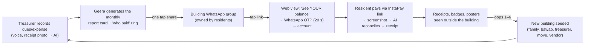

# B — Zero-Budget Go-To-Market, Growth & Monetization Strategy
## How Geera · جيرة becomes the default building network in Egypt with no ad budget, then turns that network into a services business

> **Document type:** GTM + growth + monetization plan (companion to `A-product.md`)
> **Version / date:** v1.1 (revised after red-team critique `D-critique.md`) · 2026-10-12 · **Market: Egypt only.** Arab and international players appear only as sources of ideas.
> **Author role:** Senior Product Manager + Growth Strategist
> **Inputs:** every file in `research-app/research/` (01–20) plus `data/16-model.csv` and `data/16-model.py`.
> **Model calendar:** M1 = **Nov 2026**. The build runs M1–M4, the pilot runs M5–M6 (Mar–Apr 2027), and scale-up starts at M7 (F16 §4.1 G1).
> **Rules used:** key facts are cited to a research file (tag `Fxx §y`) and, for the most important ones, to the original URL. My own extrapolations are tagged **[GTM-ESTIMATE]** (a number I derived, with the reasoning shown) or **[GTM-DESIGN]** (a design or plan choice). All projections come from the reconciled model in F16, which **supersedes** the older forecasts in F08, F13 and F14 (F16 §1).
> **Number rule:** every headline figure in this document is the canonical set in `D-critique.md` §1. Any other figure is labelled as a scenario, sensitivity or [GTM-ESTIMATE].

### Citation legend (same as `A-product.md`)

| Tag | Research file | Tag | Research file |
|---|---|---|---|
| F01 | 01-egypt-building-apps | F11 | 11-ai-opportunities |
| F02 | 02-egypt-developer-compound-apps | F12 | 12-ux-research |
| F03 | 03-egypt-home-services | F13 | 13-growth-zero-budget |
| F04 | 04-arab-competitors | F14 | 14-costs-business-model |
| F05 | 05-international-competitors | F15 | 15-social-voc-deep (V### = verbatim item) |
| F06 | 06-reviews-egypt-apps | F16 | 16-unified-feasibility-model (+ `data/16-model.csv`) |
| F07 | 07-social-voice-egypt | F17 | 17-prices-commissions-payments |
| F08 | 08-market-size | F18 | 18-competitor-teardown-entrants |
| F09 | 09-legal-regulatory | F19 | 19-whatsapp-2026-update |
| F10 | 10-whatsapp-bot | F20 | 20-bawab-supply-and-legal-enablers |

---

## Page 1 — Founder decision box (read this before anything else)

**"Zero marketing budget" is only partly true in this plan.** Paid media stays at **EGP 0**. But the biggest growth engine is people on the ground (field champions, bawab bonuses, launch kits, meetups). In the base case that costs **EGP 15.5 M over 36 months, 34% of the total cost of EGP 45.7 M**. The base plan also needs **peak cash of $568 k (reached at M44)** and a pre-seed raise, in a weak funding market (Egypt −11% y/y in H1 2026, C §8). The founder must choose one of three paths:

| Path | Year-1 cash (M1–M12) | Field team | Growth you should expect | Money needed after M12 | Who it suits |
|---|---|---|---|---|---|
| **(a) Bootstrap** | **EGP 4.1 M ≈ $77 k** (Option A in-house team, 2 champions) | 2 champions, mostly paid on outcome | About the conservative case: **200–300 Live buildings at M12**; 2,286 Live / 16,059 active HH at M36 | None required. Survive on compound SaaS + building-contract referrals with a 2–3-person team (§13.4) | Founder who will not raise |
| **(b) Base** (this plan) | **EGP 5.6 M ≈ $104 k** | 2 → 22 champions | **636 Live at M12; 11,069 Live / 92,601 active HH / 166,581 downloads at M36** | **$400–600 k pre-seed at M10–M14**; peak need **$568 k at M44**; sustained break-even **M45 (Jul 2030) at ~135 k active HH** | Founder ready to raise if the gates in §13.4 pass |
| **(c) Seed-funded aggressive** (upside only) | Same as base until the raise | 3 → 32 champions | 36,369 Live / 350,280 active HH at M36 | Peak **$320 k at M25** *if* every aggressive input holds; it is **not** a plan, it is the upside if a seed round arrives early | Only after a raise |

**We fund against a "planning case", not the base case.** The base assumes "great" virality (K = 0.45). We **commit spend in 6-month tranches** sized for a planning case of **K = 0.30, 18 seeds per champion per month and 50% activation**, which breaks even around **M50–M53** with a peak need of about **$600–650 k** (C §9). Each tranche is released only if the measured inputs for the previous six months support it (§13.4).

**Reframing field spend as operations.** Field champions are booked as **"operations: onboarding"**, paid **mostly on outcome** (≈EGP 8 k base + EGP 300 per verified Live building [GTM-ESTIMATE]). This keeps them within a "development + operations" budget and turns fixed cost into variable cost. Unpaid and low-cost supply (students, union-registration facilitators, vendors' own technicians) is added in §6.2-H.

**Two questions we need answered before the final report:** (1) what is the **actual** cash budget for 12 and 24 months, and may any of it go to paid field operations? (2) will you raise at M10–M14, or take the bootstrap path?

---

## 0. Executive summary: the 15 decisions this plan locks in

| # | Decision | Why (evidence) |
|---|---|---|
| 1 | **The unit of growth is the building, not the user.** We acquire **treasurers (أمين الصندوق), union heads and bawabs**. Residents follow through the dues flow. | Every comparable winner grew one community at a time with a density threshold: MyGate went from 3 free pilot communities to 27k+; Nextdoor needed 10 sign-ups in 21 days (F13 §0, §2). One treasurer brings about 10 occupied households (F16 §3.2). |
| 2 | **North-star metric: "Monthly Active Buildings" (MAB),** meaning Live buildings that ran their monthly dues or expense cycle in the app this month. | Dues are the recurring "aha" that makes the app a habit (F13 §3.3). The dues flow is also the surface where services get sold later (§11). |
| 3 | **The beachhead is Nasr City + Heliopolis (Cairo-East) only, until 150 Live buildings (≈M7); then New Cairo and Maadi.** **"Dominance" means district share,** not national downloads: ≥30% of eligible buildings in the Nasr City + Heliopolis launch zone by M24, and ≥3 districts above 30% by M36 (§4.3). We take mid-tier self-managed compounds as a second front. Premium developer compounds come last, and only as a "resident layer". | Cairo has the largest buildings (8.05 units per building) (F16 §3.1). Nasr City districts have pushed union registration since Jun 2026 (F09 §1.3, F20 §3.1). Mid-tier compounds have no incumbent (F02 §8.1). |
| 4 | **Ettihad is the rival to out-distribute in the next 6–9 months.** The ledger is a commodity (14+ clones in 5 months). The moats are **WhatsApp presence, density and trust data**. | Ettihad: 3,000 installs in 63 days, about 48 per day (F18 §0). The category total is ≈8,900 installs, so nobody has won yet (F18 §2.1). |
| 5 | **Five zero-cash engines, in priority order:** (1) founder plus field champions with treasurers; (2) the **"كابتن العمارة" captain ladder**; (3) the **bawab network**; (4) **WhatsApp share-cards** and the 1:1 bot "سند"; (5) the **Law-119 legal kit** sold through SEO and TikTok. Partners (FM, elevator and tank firms, developers) come in from M9–M13. | Base-case sources of new Live buildings over 36 months: field and pilot 45%, viral K 35%, self-serve content 13%, partners 6% (F16 §7). |
| 6 | **Quantified virality:** intra-building onboarding is deterministic (≈9.6 accounts per Live building). Inter-building lifetime **K = 0.30 / 0.45 / 0.65** (conservative / base / aggressive), built from six designed loops (§5). | The benchmark for "great" consumer K is 0.4 (Saxifrage via F13 §4.1). The model uses lifetime K realized over 6 months (F16 §4.1 G10). |
| 7 | **Projections (F16, base):** 636 Live buildings / 5,167 active HH / 8,652 accounts / 6,762 downloads at M12 · 4,188 / 38,788 / 65,185 / 61,190 at M24 · **11,069 Live buildings + 60 compounds / 92,601 active HH / 154,063 accounts / 84,735 MAU / 166,581 downloads at M36 = 1.2% of SAM households.** 32% of M36 households come from 60 compounds. Conservative M36: 23,743 accounts. Aggressive (upside only, if seed-funded): 638,947. | F16 §0.1, §7. **We stay behind Ettihad on downloads until ~M18** (Ettihad ≈21 k at our M12 if its pace holds vs our 6,762). We lead on Live buildings and active households per building (§2.3). |
| 8 | **Be honest about "zero budget".** Paid ads stay at EGP 0, but the field team is a real cost: **EGP 15.5 M over 36 months (34% of EGP 45.7 M total cost)**. Founder cash M1–M12 = **EGP 5.6 M ≈ $104 k** (bootstrap minimum EGP 4.1 M ≈ $77 k). Peak need **$568 k at M44**; cumulative cash at M36 **−$528 k**. A **pre-seed of $400–600 k at M10–M14** is gated on traction. See the Founder decision box. | F16 §7.2, §13; C §8. |
| 9 | **Non-cash incentives first.** Status ("عضو مؤسس", "كابتن الشارع"), building-level feature unlocks, priority support, a **visible revenue share into the union's fund** in phase 2, and provider-funded service credits. The only cash is a small, verified, often-deferred bawab activation bonus (EGP 100). | Breadfast's referral rewards in Egypt are small and capped (F13 §2.1). NoBrokerHood's payments to societies created "kickback" distrust (F05 §7.4). The bawab bonus design is from F20 §6.1. |
| 10 | **WhatsApp-native, never WhatsApp-hijacking.** The literal "bot as a member of the building group" **is not legally available in 2026**. The compliant ~80% is: **share-cards posted by humans, forward-to-سند and chat-export import**. A ≤8-seat official board group needs an Official Business Account (OBA), which is at Meta's discretion, so it is **upside, not roadmap**. No unofficial group bots, not even as a pilot; instead a consented, non-automated research study (§6.2-E). | The official Groups API is capped at 8 participants, OBA-only and invite-only. Unofficial group bots are being banned (F19 §2, §5). NoBrokerHood launched exactly this 1:1 pattern in Oct 2026 (F19 §5.3). |
| 11 | **Monetize in this order:** building-fund contracts (elevator AMC, tank, pest) → seasonal **building-wide campaigns** (AC in Apr–May) → insurance/BNPL referrals → handyman via **"the building's technician"** → sponsorship/ads → compound SaaS and Pro. This sequence needs the **least marketplace liquidity first**. | Category scoring in F03 §11. Contribution per order and leakage evidence in F17 §7–8. A liquidity calculation is in §4.4. |
| 12 | **We don't force; we make the default the best option.** Services appear **inside existing in-app flows**: the dues statement, the maintenance ticket, the GA agenda, the budget template, the bawab queue and outage reports. **Never in the notification stream, never in any WhatsApp template**, the union head can switch the marketplace off, and "use my own technician" is always free (§11.4–11.5). | MyGate users disable all notifications because ads are mixed in (F12 §0 #11). Contextual offers come from F12 §19. |
| 13 | **Take rates:** **10–12%** on open-ended handyman labour (capped at EGP 150), **15%** on menu-priced AC and pest, **8–12% recurring** on building contracts, **5–8%** on big-ticket work, plus a visible flat fee of EGP 15–20. | Technicians resent 30%. Above ~20%, jobs leak offline (F17 §2, §8; F20 §2.3). |
| 14 | **Legal guardrails are part of GTM:** **no personal data collected until the PDPC filing is lodged and an outsourced, registered DPO is appointed** (PDPL enforcement starts 31 Oct 2026); no paid property leads for bawabs (brokerage law); e-voting only as advisory "pre-polls"; never hold funds; a separate **e-marketing licence and opt-in** before phase 2; **no marketing claim that overstates the law** (§2.1). | F20 §0, §4; F17 §4; F09 §0; D #14–15. |
| 15 | **Pre-seed gates at M10–M14:** ≥500 Live buildings growing ≥15% month on month, seeded→Live **target 55% (kill/fix line 50%)**, coverage ≥60%, measured K ≥0.4, admin M3 retention ≥80%, dues-in-app ≥70%, field cost ≤EGP 2,000 per Live building, launch-zone share on track to 30% by M24. | F16 §13.2; D #5. |

---

## 1. Market reality the GTM is built on

| Fact | Value | Source | GTM implication |
|---|---|---|---|
| Total market (TAM) | **13.0 M households** in multi-unit buildings and compounds (~1.1 M buildings) | F08 §7.3 | Long-run ceiling only. |
| Serviceable market (SAM, free app) | **7.5 M urban and new-city households** in ≈640 k buildings with ≥5 units, plus 1,000–1,500 compounds | F08 §7.3 | The prize is huge. No one holds more than 0.1% of buildings today (F08 §9). Base M36 = **1.2% of SAM households**, so the realistic goal is district dominance (§4.3). |
| Intermediable spend (phase 2) | **EGP 35–53 B a year (~$0.7–1.0 B)** in SAM; revenue pool at a 12–15% take **EGP 4.2–8 B a year** (theoretical ceiling). Top-down: Egypt home services $1.88 B (2025) → $5.11 B (2034) | F08 §6, §7.3 | The money is real, but we capture it only where we are dense. |
| Typical target building | **10 occupied households** (Cairo census mean 8.05 units); **6 active households per Live city building** (base) | F16 §3.1–3.2 | Per-building sales effort is expensive, so onboarding must be self-serve after the first conversation. |
| Building size by city | Cairo 8.05 units/building, Alexandria 7.14, Giza 6.63, Delta 4.1–4.9 | F16 §3.1 | Start in Cairo. Enter the Delta only through partners. |
| Category traction | 19 building apps ≈ **8,900 installs total**; Ettihad 3,000; Ammarty 1,684; Amarati 1,416; Sandooq 961; Imarti 125 | F18 §2.1 | Wide open. Speed and distribution decide the winner, not features. |
| Copycat velocity | 14+ new building-ledger apps May–Oct 2026 | F18 §0 | "Free" is the baseline. A ledger is not a moat. |
| Compound apps | Lyve family ~77k, Milango family ~83k installs; SODIC iOS 2.22★; 35% of compound-app reviews are 1★ | F18 §2.2, F06 §0 | Reliability is a weapon. In premium compounds we coexist as a resident layer (F02 §8.1). |
| Grassroots proof | **Ahl Madinaty**, a volunteer-built directory: **43,668 installs, 4.62★**, with no developer mandate and no marketing | F18 §2.2, F06 §2.2 | The closest local proof that a useful local app spreads organically. |
| WhatsApp | ≈55M Egyptian users; 98% use it, 90% daily (n=400) | F19 §8 | WhatsApp is the distribution layer. |
| InstaPay | ~22M registered (Q2 2026); fee 0.1% (min 0.50, max EGP 20) | F13 §1, F17 §3 | "Pay your dues by InstaPay link" is the strongest reason to join. |
| TikTok / Facebook | TikTok 48.8M adult ad reach (+25% YoY); Facebook 51.6M | F13 §1 ([DataReportal 2026](https://datareportal.com/reports/digital-2026-egypt)) | Organic short video is the cheapest mass channel. |
| Unions | Exist by law in every building with ≥5 units; ~3% registered; districts are pushing registration (Nasr City, Jun 2026) | F20 §3.1, F09 §1.3 | The **legal kit is our free marketing**. |
| Bawabs | ESTIMATE 300k–700k residential building guards; pay is at or below minimum wage | F20 §1.1–1.2 | Even EGP 100–300 a month of legitimate extra income matters to them. |

---

## 2. Competitive positioning: how we beat each Egyptian competitor

### 2.1 Positioning statement used in every channel

> **«جيرة: عمارتك منظمة على الواتساب — الفلوس بإيصال، والعطل بمتابعة، والقرار بالتصويت. أساسيات العمارة ببلاش للأبد.»**
> ("Geera: your building, organised on WhatsApp. Money with a receipt, repairs with follow-up, decisions by vote. The building core is free forever.")

"Free forever" applies **only to the building core**, listed in the Terms of Service: **ledger, dues, receipts, tickets, notices and pre-polls**. The Pro plan (EGP 250/month for large buildings and FM firms), compound SaaS and paid services are outside the promise. An unqualified «ببلاش للأبد» becomes a binding consumer promise (Consumer Law 181/2018), so we never use it alone.

**Three claims no competitor can make together [GTM-DESIGN, based on F18 §3.1; wording checked against D #15]:**
1. "**Your neighbours don't need to install anything.** Everything arrives in your WhatsApp group." Ettihad has pay links but no WhatsApp presence (F18 §4.1).
2. "**We protect the treasurer.** Every pound has a time-stamped receipt usable as supporting evidence." («إيصال موثّق بختم زمني يصلح كدليل داعم»). Only a *qualified* e-signature is accepted without further proof under Law 15/2004 (F20 caveat), so we **never** say "court-ready" or «يقف في المحكمة».
3. "**Your union's registration file is ready in 7 days.**" («ملف تسجيل الاتحاد جاهز في ٧ أيام»). We control the file preparation (registration kit, GA invitation, weighted vote tally, Schedules 1–3, F20 §3.2); registration itself depends on the district office, so we never say "your union is legal in 7 days".

**The moats, ranked honestly (D #18).** Share-card summaries (Amarati already has one), the 1:1 WhatsApp bot (NoBrokerHood launched it in Oct 2026; Ettihad could add one in weeks) and the legal kit (it is content) can all be copied within a quarter. What is hard to copy, in order: **(1) district density, (2) the bawab network, (3) payment and ledger history and the switching cost it creates, (4) the vendor graph and fair-price data, (5) speed.** Every GTM choice below is judged by which of these it builds.

### 2.2 Competitor-by-competitor battle plan

| Competitor | Their strength (evidence) | Their exploitable weakness | Our specific counter-move | Switching tactic | Timing |
|---|---|---|---|---|---|
| **Ettihad (إتّحاد)** | Free forever; AI "فاري"; QR visitor passes; pay links for non-app users; voting; ~48 installs/day (F18 §4.1) | No group chat **by design**, so it is "another app". No WhatsApp bot, no bawab mode, no marketplace, no offline mode, no Excel import, no Egyptian legal kit. Dutch entity, MSA copy. No revenue model, so survival is uncertain (F18 §4.1) | Be **inside the group's flow** (share-cards, forward-to-سند), Egyptian dialect voice, bawab mode, Law-119 kit, offline ledger | **One-tap import** of Ettihad's Excel export (Ettihad exports Excel, F18 §3.1 #32). An honest comparison page: «مقارنة تطبيقات إدارة العمارة» | **Now to M12.** Lead on Live buildings and density in Cairo-East (≈500 Live by M11). We will trail Ettihad on downloads until ~M18 (§2.3); open a partnership/merger conversation in M3–M6 (§2.4) |
| **Ammarty (HopenWorks)** | ~50 installs/day; flat number + PIN login; offline (F18 §4.10) | Basic features; agency model (custom single-building apps); possible subscription after 1 month (unverified, F06 §2.1) | Copy flat+PIN for elderly users; "building core free forever" promise in writing (ToS list) | Photo-OCR import of its statement screenshots | M5+ |
| **Amarati** | 4.74★; elderly-friendly UI; meter OCR; WhatsApp summary image (F18 §4.8) | Palestinian, Levantine copy; "free **to start**" hints at a paywall; users ask "هيبقي مجاني؟" (F06 §2.1, F01 §2.1) | Same two best ideas (meter split, summary card) in Egyptian dialect, with the core free for life | Import from the shared summary images via AI OCR | M5+ |
| **صندوق العمارة (Sandooq)** | Deepest treasurer features (custody, mosque fund, loans); Egyptian voice "عم أمين"; SEO tools (F18 §4.2) | **No resident app, so no network effect**; Android only; paid EGP 49.99/month (F18 §4.2) | Match treasurer depth **for free** and add resident accounts plus the bot. Out-publish its SEO | Excel import (Sandooq exports Excel). **Consider partnership or acqui-hire** of its solo developer (F18 §4.2) | Partnership talk M6–M9 |
| **Saknna (سَكَنة)** | Polished web SaaS, Arabic AI, InstaPay/Vodafone Cash (F18 §1.4) | **EGP 450/month for ≤5 units** (≈EGP 90/unit), which excludes most Egyptian buildings; no store app; "500+ buildings" unverified (F18 §4.3) | Free core. SEO for «بديل مجاني لإدارة العمارة». Target buildings when their 14-day trial ends | CSV import (Saknna imports and exports CSV) | M5+ (SEO) |
| **Imarti** | Voting, emergency funds, provider countdown offers (F18 §4.9) | 125 installs, no rating, RTL bugs (F18 §4.9) | Adopt countdown offers as **building-level group deals** (§11.4) | — | Phase 2 |
| **Omaraty, Bonian, Homena, Sandouq Online, دفتر العمارة** | Low or no price; local copy (F18 §2.1) | Fewer than 400 installs each; paid tiers EGP 30–840 (F18 §3.2) | Out-distribute them. Treat their buyers as warm leads through SEO | Generic Excel/photo import | Continuous |
| **Unitify** | Broadest product (58 ✅); free tier; Egypt page (F18 §4.5) | 688 global installs; Telegram-centric; built for management companies (F18 §4.5) | Own the volunteer-run عمارة, where its sales motion cannot reach. In year 2, offer FM firms a free dashboard **bottom-up** over buildings already on Geera | — | Watch quarterly. Threat score 12 (F18 §5.1) |
| **Lyve / Milango / developer apps** | Gate contracts; 77k–83k installs per family (F18 §2.2) | Hated for reliability (41% crashes, 23% OTP issues among negative reviews); developer-side in fee conflicts (F06 §0, F02 §0) | **Don't fight the gate.** Be the resident layer inside compounds: neighbours, directory, outage alerts, an expat-owner mode, a union toolkit (F02 §8.2) | Win compound clusters through their WhatsApp/Facebook groups | M9+ (mid-tier compounds first) |
| **Ahl Madinaty-type grassroots apps** | 43.7k installs, 4.62★ (F18 §2.2) | One compound only; no building finance | **Partner, don't fight.** Offer their admins a free "verified compound" layer and revenue share later (F18 §5) | — | M9–M12 |
| **FilKhedma / Taskty / Fixawy** (phase-2 rivals) | Brand recognition; 168k–178k installs (F03 §2.1) | 59–79% of recent reviews are 1★ (overcharging, no-shows, scams) (F06 §0) | Trust infrastructure: locked quotes, parts at receipt price, ID + photo before arrival, **"Geera's guarantee" on top of the legal warranty** for jobs booked in-app (F17 §8) | Recruit their best technicians with lower take (10–12%) and building exclusivity | Phase 2 (M13+) |
| **Breadfast** (phase-2 threat) | 4.79★; $50M raised for "a single app for daily household spending" (F18 §5) | No building context | **Partner:** building drops and bawab pickup. Never build grocery (F03 §0 item 5) | — | Watch from M12 |
| **Meta AI in groups** | "@Meta AI" summarises groups (F19 §1) | No ledger, receipts, tickets or vendor graph | Our moat is structured money and records, not summaries (F19 §10) | — | Continuous |
| **A government union portal** (black swan) | Saudi Arabia runs Mullak (F04 §2.1) | Government UX is poor; Saudi activation only ~60% (F04 §2.1) | Export union documents in a registry-ready format. Position Geera as **the tool that prepares the official file** (F18 §8 item 5), and propose a **free MoU with district offices / Cairo Governorate** (§6.2-I) so that we are part of the official path | — | Hedge from M1 |

### 2.3 The race against Ettihad, in numbers [GTM-ESTIMATE]

| Milestone | Ettihad today (≈48 installs/day, F18 §2.1) | Geera base plan (F16 §7.1) |
|---|---|---|
| Installs or downloads at our M6 (Apr 2027) | ≈3,000 + 48 × ~190 days ≈ **12,000** if its pace holds | 375 cumulative downloads (but 98 Live buildings and 928 WhatsApp-reachable residents) |
| At our M12 (Oct 2027) | ≈ **21,000** | 6,762 downloads; 636 Live buildings |
| At our M18 (Apr 2028) | ≈ **30,000** | 28,322 downloads; 1,964 Live buildings |

**Reading:** we are **behind Ettihad on downloads until about M18** if its pace holds: at M12 our 6,762 downloads are ≈2.3× Ettihad's install base *today* but only ≈0.3× its projected ~21,000. (Earlier drafts said "~5× the largest app at M12"; that compared our M12 with Ettihad's *current* count and is withdrawn.) We aim to lead on **Live buildings and active households per building**: residents active in WhatsApp and the dues flow, where Ettihad is a second app. **Three moves close the gap faster [GTM-DESIGN]:**
1. **Ship the web/PWA first** (ledger, receipts, report card, share-cards, WhatsApp OTP), and the native app after it. This pulls the pilot forward by 4–6 weeks and matches the PWA/OTP fallback in F13 §6.2 and the ~25-feature Wedge MVP in A.
2. **Concentrate.** Fifty Live buildings on 10 streets in Nasr City beat 500 scattered installs, because street density powers the bawab and poster loops (§4).
3. **Absorb, don't only fight** (§2.4): one-tap import from every competitor's export, and acquire or merge with 1–3 small apps.

### 2.4 Battle card: the fastest way to win the category [GTM-DESIGN; D #18, #21]

| Move | What it means | Concrete actions | Moat it builds |
|---|---|---|---|
| **Out-distribute** | Win district density before anyone else does | Nasr City + Heliopolis only until 150 Live; street saturation (§3.3); bawab network; district-office MoU (§6.2-I) | (1) density, (2) bawab network |
| **Absorb** | Make switching to Geera free, and buy the small players | Excel/CSV/photo import from Ettihad, Sandooq, Saknna, Amarati, Ammarty; acquire/merge table below | (3) ledger history |
| **Out-trust** | Be the app that protects the treasurer and the resident | Time-stamped receipts, registration file in 7 days, explainable shares, "who paid" ring (aggregates only), Geera's guarantee in phase 2 | (3), (4) vendor graph and fair prices |

**Consolidate the category cheaply.** The whole category is **~8,900 installs across 19 apps** (F18 §2.1), so buying users is cheap compared with acquiring them one building at a time.

| Target | Installs (F18 §2.1) | Why | Form | Cost [GTM-ESTIMATE, unvalidated; no price data in the research] | Timing |
|---|---|---|---|---|---|
| **Sandooq (صندوق العمارة)** | 961 | Deepest treasurer features; solo developer; Egyptian voice; SEO tools; paid tier shows willingness to pay | Acqui-hire or partnership (developer joins; product folded into Geera) | ≈$10–30 k cash + equity | M6–M9 |
| **Ammarty (HopenWorks)** | 1,684 | ~50 installs/day; flat+PIN login liked by elderly users | Buy the consumer app and user base; HopenWorks keeps its agency business | ≈$15–40 k | M6–M12 |
| **Ettihad** | ~3,000 (≈48/day) | The leader; AI and pay links already built; Dutch entity with no revenue model | Merger or partnership (equity swap), only if its founders lack a revenue path | Mostly equity; ≤$50 k cash | Open the conversation M3–M6 |
| Amarati / Imarti | 1,416 / 125 | Good ideas (meter OCR, summary image, countdown offers) but non-Egyptian teams | Licence or partner, not acquire | Small | Opportunistic |

Rules: any user-base transfer needs PDPL notice and consent to each user (we migrate buildings, not raw data); due diligence on store ratings and data quality; no deal above the tranche budget without a raise.

---

## 3. Beachhead selection: where to start and why

### 3.1 District scoring [GTM-ESTIMATE; inputs cited]

Each criterion is scored 1–5. The weights reflect what drives Live-building yield and later monetization.

| District / segment | Building size & elevators (×3) | Dues pain & active treasurers (×2) | Legal forcing event (×2) | Digital & payment readiness (×1) | Competitor presence (5 = empty) (×1) | Phase-2 spend potential (×2) | Founder field reach (×1) | **Weighted /60** | Role |
|---|---|---|---|---|---|---|---|---|---|
| **Nasr City (East + West)** | 5 (towers, 8–14 floors) | 5 | **5** (district registration campaign, Jun 2026, F09 §1.3) | 4 | 4 | 4 | 5 | **55** | **Ground zero (M5)** |
| **Heliopolis / Masr El Gedida** | 4 | 5 | 3 | 4 | 4 | 5 | 5 | **50** | Wave 1 (M5) |
| **New Cairo (Tagamoa) + Rehab fringe** | 4 (blocks + mid-tier compounds) | 4 | 3 | 5 (higher iOS share) | 3 (compound apps) | 5 | 4 | **48** | Wave 1b, only after 150 Live in Nasr City + Heliopolis (≈M8). Breadfast's beachhead (F13 §2.1) |
| **Maadi** | 4 | 4 | 3 | 5 | 4 | 5 | 3 | **47** | Wave 1b (≈M9–M11), after New Cairo. Expat-owner mode |
| Mohandessin / Dokki | 4 | 4 | 3 | 4 | 4 | 4 | 3 | 44 | Wave 2 (M13) |
| 6th of October / Sheikh Zayed | 3 | 4 | 3 | 4 | 3 | 4 | 3 | 40 | Wave 2 (M13). Rent growth +17.6% (F08 §2.5) |
| Faisal / Haram (Giza) | 3 | 5 | 3 | 3 | 5 | 2 | 3 | 39 | Wave 2, partner-led |
| Alexandria (Smouha, Sporting, Miami) | 4 | 4 | 2 | 4 | 4 | 4 | 2 | 41 | Wave 3 (M19) |
| **Mid-tier self-managed compounds** (Hadayek October, Obour, Shorouk, Sakan/Dar Masr) | 3 | 5 | 4 (developer-to-union transition) | 4 | **5** (no incumbent, F02 §8.1) | 3 | 3 | **47** | Second front from M9 |
| Premium developer compounds | 2 (gate app owns them) | 3 | 2 | 5 | 1 | 5 | 2 | 34 | Resident layer only, later |
| Delta capitals (Mansoura, Tanta, Zagazig) | 1 (4.1–4.9 units/building) | 4 | 2 | 3 | 5 | 2 | 1 | 27 | Wave 4 (M25), partners only |

### 3.2 Building types, in order of priority

| Priority | Building type | Why | Our first offer |
|---|---|---|---|
| **1** | **Towers or walk-ups of 10–40 flats with an elevator, a bawab and an active volunteer treasurer** | The elevator is the largest recurring shared cost and the most emotional pain (fatal accidents, lift-locking as coercion, F07 P5, F15 V009). It is also the first building contract we can broker later (F17 §7.3) | "Elevator fund + monthly report card in WhatsApp" |
| 2 | **Buildings where a GA is due, or where the district is pushing registration** | They face a forcing event: an 8-document district list and threatened legal measures (F09 §1.3) | "Your union's registration file ready in 7 days" kit |
| 3 | **Mixed owner/tenant buildings** (Cairo renters 39%, F08 §0) and buildings affected by the old-rent reform (≈1.6M units, F09 §0 item 8) | Landlord-tenant friction and frequent move-ins (each one is a growth event) | Tenant/owner split rules, rent receipts |
| 4 | **Mid-tier self-managed compounds** (300–3,000 households) | One deal brings ~540 active households at EGP 50–75 per household, 4–6× cheaper than city buildings (F16 §10.3) | Free resident layer and union toolkit; compound SaaS after a 3-month pilot (EGP 6,000/month base, under Saknna's 7,500, F16 R3) |
| 5 | Small family buildings (5–8 units) | Low yield per visit | Self-serve only (TikTok, SEO) |
| Avoid early | Premium developer compounds as a primary target | Contracts and gate hardware are locked (F02 §8.1) | Resident layer from M18 |

### 3.3 "One street at a time" density rule [GTM-DESIGN]

- **Street saturation target:** ≥30% of buildings on a street Live within 60 days of the first one. Bawabs on one street know each other, posters get seen by neighbours, and one technician can serve the whole street.
- **Geography rule:** **Nasr City + Heliopolis only until 150 Live buildings** (base ≈M7); New Cairo and Maadi open after that. Mid-tier compounds are a separate B2B front from M9.
- **Radius rule for the first 150 Live buildings:** ≤5 km around a single anchor in Nasr City (for example around Abbas El-Akkad / Makram Ebeid) **[GTM-DESIGN; the exact anchor is the founder's call].** This creates visible density for PR, a pool of bawabs and technicians to work with, and a walkable route for champions.

---

## 4. Network effects and critical mass

### 4.1 The four network layers

| Layer | Who connects to whom | Strength | What it unlocks |
|---|---|---|---|
| **L1 Intra-building** | Treasurer ↔ residents ↔ bawab | Very strong (shared money, legal union) | Dues-in-app habit, transparent ledger, votes |
| **L2 Street / district** | Building ↔ building (bawabs, treasurers, families) | Medium | Inter-building K, Building Index data, PR stories |
| **L3 Supply side** | Buildings ↔ technicians and vendors (elevator, tank, pest) | Grows with L2 density | Marketplace liquidity, building contracts |
| **L4 Data / trust** | Every receipt, price and rating | Compounding | "Typical price in your district" (F17 §8 rule 5), vendor ratings, trust that offline technicians cannot copy |

### 4.2 Building-level states (critical mass inside one building)

Thresholds follow F13 §3.2 and F16, with Geera-specific unlocks added [GTM-DESIGN].

| State | Definition | What the building sees | Unlock |
|---|---|---|---|
| **Seeded** | Treasurer or admin created the building; units entered (AI import of the كشكول) as **flat numbers and balances only: no residents' names or phones are stored until each person claims their account** | "تأسيس" mode and a progress bar: «٣ من ١٠ شقق انضموا» | Ledger, receipts |
| **Founding** | ≥3 households joined | Founding-member badges | Notices, tickets |
| **Live** | **≥40% of occupied units joined AND one dues cycle or expense published in-app within 30 days** | "عمارة نشطة" badge; monthly report card | Pre-polls, GA kit, bawab mode |
| **Dense** | ≥70% joined; ≥50% of dues recorded in-app; bawab active | "عمارة منظمة" badge, shareable | Building Index inclusion, street leaderboard |
| **Monetizable** | Dense + ≥1 service ticket per month + union head has not disabled marketplace surfaces | (internal state only) | Building-fund contracts, campaigns |

**One definition of "Live" across A, B and C:** **≥40% of occupied units joined AND one dues or expense cycle published in-app within 30 days.** The bawab activation bonus is paid at **Dense (≥70%)**, not at Live (§6.2-B).

**Caveat on the model.** F16's early ramp counts buildings as Live before they meet the threshold: base M6 is **98 Live buildings with 368 active households = 3.75 per building**, below 40% of 10. Ops reporting uses the strict definition above, so expect the *reported* M6 count to sit below the model's 98 during the age ramp. Gate 1 therefore uses a **pass mark of ≥80 Live (strict definition)** against the canonical M6 target of 98.

**Activation targets:** seeded→Live **target 55%, kill/fix line 50%** within 30 days (base G5); median time to Live ≤10 days; household coverage in Live buildings ≥60% (F13 §13, F16 §13.2).

### 4.3 Street and district thresholds [GTM-ESTIMATE]

| Threshold | Value | Reasoning |
|---|---|---|
| **Street "tipping"** | ≥5 Live buildings on one street | At this level a bawab-to-bawab referral is more likely than not, and posters are seen daily by every household on the street |
| **District "PR-visible"** | ≥150 Live buildings in one district | Enough for a credible district Building Index (≥1,000 households of anonymised data) and a local news story |
| **District "campaign-ready"** (phase 2a) | ≥150 Live buildings **and** ≥30 vetted vendors | A building-wide AC day (10–12 flats in one visit) needs no continuous liquidity |
| **District "on-demand-ready"** (phase 2b handyman) | ≥1,000 Live buildings (≈6,000 active households) | See §4.4 |
| **District "dominant"** (north-star companion) | **≥30% of eligible buildings Live** | **Nasr City + Heliopolis launch zone by M24; ≥3 districts above 30% by M36** (D #5) |

**What "dominance" means in this plan.** The founder's thesis ("own a huge user base, then sell services") needs **local** density for marketplace liquidity, not national downloads. Base M36 is only **1.2% of SAM households**, and **32% of its households come from 60 compounds** (a B2B sales dependency), so national share is the wrong yardstick. We measure **district share** and always report **city-building households and compound households separately**.

**Defining "eligible buildings" honestly [GTM-ESTIMATE].** Eligible = residential buildings with ≥5 occupied units inside a named launch zone (a list of شياخات/sub-districts). The base model has **4,188 Live buildings in all of Egypt at M24**, and the whole of Nasr City + Heliopolis very likely holds well over 10,000 eligible buildings (not counted in the research). So **30% of the full districts is not reachable on the base numbers**. The M24 target applies to a launch zone sized so that 30% ≈ 1,200–1,700 Live buildings (≈30–40% of base M24 Live). **M1 task:** count eligible buildings per شياخة from the CAPMAS 2017 census and fix the zone boundary before the pilot.

### 4.4 Why the marketplace must start with campaigns, not on-demand jobs [GTM-ESTIMATE]

- **Inputs:** base bookings ramp from 1% to 4% of active households per month (F16 R5). A technician needs ≥10 platform jobs a month to treat the platform as a real income source and stay on it **[GTM-ESTIMATE]**.
- **District with 150 Live buildings:** 900 households × 1% = **9 jobs a month** across all trades. That is too thin for on-demand. A **building-wide AC campaign** works anyway: 12 flats in one building in one visit is one technician-day.
- **District with 1,000 Live buildings:** 6,000 households × 2–4% = 120–240 jobs a month. That supports ~10–20 technicians at ≥10 jobs each, so on-demand handyman becomes viable.
- **Conclusion:** sequence the marketplace as **building-fund contracts → seasonal campaigns → on-demand handyman** (§11.3). This is consistent with F03 §12.4.

---

## 5. Viral loops and quantified K-factor

### 5.1 Two-level model

**Level 1: intra-building (deterministic onboarding, not virality).** The treasurer invites ~10 occupied households. 60% join at maturity (with an age ramp of 50% → 80% → 100% over 2 months), giving 6 active households × 1.6 accounts = **≈9.6 accounts per Live building**. A further ~70% of non-registered adults are still **WhatsApp-reachable** through share-cards in the group (F16 §4.1 G12–G14, G22).

**Level 2: inter-building (the real growth constraint).** Lifetime K = new Live buildings caused by one Live building, realized over 6 months: **0.30 / 0.45 / 0.65** (F16 G10). Effective multiplier 1/(1−K) = **1.43 / 1.82 / 2.86** seeded buildings per paid-for building.

### 5.2 Loop-by-loop K decomposition [GTM-ESTIMATE; loops from F13 §4.2, F05 §7.3, F20 §1.2]

K per loop = i (qualified invitations per Live building over its lifetime) × c (conversion of one invitation into a new Live building).

| # | Loop | Mechanism (product hook) | i (base) | c (base) | **K cons / base / aggr** | Active from | How we measure it |
|---|---|---|---|---|---|---|---|
| 1 | **Family & second home** | "ابدأ عمارة أهلك" prompt after the 2nd dues cycle; owners abroad and expats often hold several units (F02 §8.2 item 4) | 0.5 | 0.30 | 0.10 / **0.15** / 0.20 | M5 | Referral link attribution on building creation |
| 2 | **Bawab-to-bawab** | Bawabs from the same home villages know each other (F20 §1.2). Bawab Mode has a "عرّف زميلك" button; EGP 50 bonus when the referred building goes Live (F20 §6.1) | 0.4 | 0.25 | 0.06 / **0.10** / 0.15 | M6 | Bawab referral code |
| 3 | **Treasurer-to-treasurer** | Monthly report card and "عمارة منظمة" badge shared to Facebook compound/district groups and WhatsApp Status; a treasurers' WhatsApp Channel | 1.0 | 0.08 | 0.06 / **0.08** / 0.12 | M5 | UTM on card links; "مين عرّفك؟" field |
| 4 | **Exposure** (MyGate visitor effect) | A4 QR poster in the entrance and elevator; branded receipts shared outside the building; visitors and couriers see it (F13 §5.2-A, F05 §2.1) | many impressions | low | 0.03 / **0.04** / 0.06 | M5 | Poster-specific QR codes |
| 5 | **Move events** | Tenant moves out → "خد جيرة معاك" into the new building; owner sells or rents → new occupant onboarded | 0.15 | 0.27 | 0.03 / **0.04** / 0.05 | M7 | Move-out flag plus new-building link |
| 6 | **Supply side** | Elevator, tank and pest firms send invoices through Geera to *their other buildings*; technicians invite clients (F13 §5.2-E) | 0.3 | 0.13 | 0.02 / **0.04** / 0.07 | M9–M13 | Vendor-originated building creation |
| | **Total lifetime K** | | | | **0.30 / 0.45 / 0.65** | | Tagged attribution on every building (F16 §14) |

**Benchmarks:** good sustainable consumer K is 0.15–0.25, 0.4 is great and ~0.7 outstanding; typical referral programs alone reach only ~0.05 (Saxifrage via F13 §4.1). **The base case (0.45) is "great", not easy**, and no Egyptian building app has yet passed ~3,000 installs. It depends on loops 1–3 being designed into the product rather than bolted on as a referral program. **That is why we plan with the base but fund against the planning case (K = 0.30, 18 seeds per champion, 50% activation; break-even ≈M50–M53, peak ≈$600–650 k).** A combined downside (K 0.30 + bookings 2.5% + no ads) compounds further and is requested in C §9.

### 5.3 The core loop

### 5.4 Virality design rules [GTM-DESIGN]

1. **Every artefact is shareable and carries a link:** report card, receipt, vote result, "elevator fixed" notice, badge (F19 §6 P4).
2. **Never name non-payers in shared content.** Show the aggregate ring only («٣١ من ٤٠ دفعوا»); names go to the board only (F20 §4.4, F12 §16).
3. **Invites go from the admin's own WhatsApp,** never as cold business messages. This avoids WhatsApp's unanswered-message caps and marketing-template costs (F19 §10).
4. **Collective unlocks over personal rewards** («لما نوصل ٦ شقق هتتفتح ميزة التصويت»), to be A/B tested against no gating (F12 §11.3). **Gating applies only to convenience features. It never applies to safety, notices or a resident's own balance**, and the test has an ethics stop rule: stop if complaints about pressure on non-joiners rise, or if non-joiners' payment rates fall (D #17).
5. **Invites carry no stored personal data.** Share-cards are posted by the treasurer from their own phone. Geera stores no names or phones of residents who have not claimed an account.

---

## 6. Channel plan (zero paid media)

### 6.1 Channel portfolio

| # | Channel | Role | Start | Cash cost | Expected share of new Live buildings (36-month base, F16 §7) | Lead KPI |
|---|---|---|---|---|---|---|
| 1 | **Founder + field champions → treasurers / union heads** ("operations: onboarding") | Seed dense clusters | M5 (pre-sell from M2) | Model: EGP 18,700/champion/month loaded (F16 C2); base 2→22 champions. **Pay design: ≈EGP 8 k base + EGP 300 per verified Live building** [GTM-ESTIMATE], so most of the cost is variable | **45%** (with pilot) | Seeds per champion per month ≥25 (planning case 18); seeded→Live target 55%, kill line 50% |
| 2 | **Captain program («كابتن العمارة»)** | Self-serve seeding by residents | M6 | Non-cash (§8) | Part of 35% viral + 13% self-serve | Captains with ≥2 buildings |
| 3 | **Bawab network** | Onboarding desk + bawab-to-bawab loop | M6 | EGP 100 activation bonus when the building reaches **Dense (≥70%)** (verified, deferrable) + EGP 50 referral (F20 §6.1); EGP 150 per Live building incl. kit (F16 C3). Programme approved by the union head; earnings shown on the building ledger | Inside viral share (loop 2) | % of Live buildings with an active bawab |
| 4 | **WhatsApp** (share-cards, forward-to-سند, chat import, treasurer Channel; ≤8-seat board group only if OBA is granted) | Activation + intra-building + loop 3 | M5 | **≈$0.36–0.42 (EGP 19–25) per Live building per month**; ceiling **$0.45**; ≤$0.04 per account (see note) | Enabler of every channel | Card shares per Live building per month ≥2 |
| 5 | **TikTok / Reels / YouTube Shorts / Facebook organic** | Awareness + self-serve seeds | M2 (pre-launch) | Phone + time | 13% self-serve (with SEO) | Self-serve seeds/month → 350 by M36 (G6) |
| 6 | **Arabic SEO + free tools + Law-119 kit** | Compounding inbound | M1 | Time | Inside 13% | Organic tool users → signups |
| 7 | **Facebook district & compound groups** | Trust-based distribution | M5 | Time | Inside loops 3 and 13% | Helpful answers per week |
| 8 | **Facility managers, elevator/tank/pest firms** | B2B2C distribution | M9 (pilots), M13 (scale) | BD time | **6%** partner + compounds | Partner seeds/month → 150 by M36 (G8) |
| 9 | **Developers and handover events** | Born-digital buildings | M12+ | BD time | Inside compounds | Units onboarded at handover |
| 10 | **Registered real-estate brokers** | Move-in onboarding | M9+ | Free "verified building profile" pages | Small | Move-in activations |
| 11 | **District technology centres, mosques, churches** | Trust transfer | M6+ | Printing only | Small, high trust | QR scans per location |
| 12 | **PR + Building Index + competitions** | Credibility, OBA notability, fundraising | M5+ | Time | Indirect | Earned articles per quarter |
| 13 | **Fintech, telco and bank partnerships** | Rails + co-marketing | M8+ | BD time | Indirect | Co-marketing placements |
| 14 | **District offices, Cairo Governorate, NUCA / new-city authorities** (free MoU, §6.2-I) | Official path for union registration; trust; hedge against a government portal | M2 (approach), M6 (MoU target) | Time | Inside self-serve + partner | Unions registered with a Geera file |
| 15 | **Low-cost field supply** (student ambassadors, union-registration facilitators, vendors' technicians) | Extra seeding capacity without salaries | M6+ | Credits, certificates, outcome fees | Inside field 45% | Live buildings per unpaid ambassador |
| 16 | Paid ads | — | — | **EGP 0** | 0 | — |

*Note on WhatsApp cost (canonical, D #1).* The unified model (F16 C9) at **10 occupied households and 9.6 accounts per Live building** gives **≈$0.36 per Live building per month at 1 k buildings and ≈$0.42 at M36 (EGP 19–25, ex-VAT)**; with 14% VAT and OTPs the model's all-in line is ≈EGP 26 (≈$0.43–0.47). **KPI ceiling: $0.45 per Live building (ex-VAT) and ≤$0.04 per account per month.** The older "$1.09 per building" from F19 §7 assumed **30-flat buildings with 45 users**; at our building size it equals the model's "WhatsApp ×3" sensitivity, which **never breaks even by M60 (peak need $906 k)**, so it is withdrawn as a budget. The free allowance is **3 numbers = 3,000 free service messages a month** (1,000 per number); each extra number saves only $3.60 a month. Sanad volume is capped at the model assumption: **≈30% of accounts use Sanad, at an average of 6 service replies per user per month**, with a hard monthly cap per account. Marketing templates cost ≈18× utility and are banned in this plan.

### 6.2 Channel playbooks

**A. Treasurers and union heads (founder + champions)**

| Step | Script / asset | Proof point |
|---|---|---|
| Opener | «إنت بتجمع الفلوس وبتكتب في كشكول وبتصور الوصولات في الجروب؟ خلي جيرة تعمل ده ببلاش، وكل ساكن يشوف حسابه لوحده، ومحدش يقولك "أنا دفعت".» (F13 §5.2-A) | Treasurer accusations and invoice disputes are the #1 social pain (F15 §0 item 2) |
| Demo (2 minutes) | Photograph a page of the كشكول → AI creates flats and balances; voice note «شقة ٧ دفعت ٣٠٠» → receipt | F11 §0 item 6 |
| Close | "We set it up now, together; you share the first report card in the group tonight" | Time to Live ≤10 days |
| Leave-behind | A4 QR poster + door hangers (≈EGP 5 each, F16 §10.2) + registration-kit checklist | — |
| Follow-up | Day 3: WhatsApp check-in from سند. Day 10: "first cycle done?" Day 30: Live/not Live review | — |

Champion productivity assumption: ~3 treasurer meetings a day × 20 days × ~40% agree = **25 seeds a month**, of which 55% go Live (F16 G4–G5). Both numbers are untested; the planning case uses 18 seeds and 50%. **Pay on outcome:** ≈EGP 8 k base + EGP 300 per building that passes the strict Live definition and is phone-audited [GTM-ESTIMATE]. At base productivity (≈14 Live a month) that is ≈EGP 12 k, below the model's EGP 18,700 loaded cost; at planning-case productivity (≈9 Live) it is ≈EGP 10.7 k.

**B. Bawab program («برنامج حارس العمارة»)** (F20 §6.1)
- **Bawab Mode:** voice-first, 4 big buttons (requests, deliveries, invitations/signatures, my income). Works offline on low-end Android.
- **What he gains, all legal:** a salary record and payslip; NOSI insurance checklist; a paid task delivering GA invitations against signature (ER 164), paid by the union at a GA-set rate; an EGP 100 activation bonus when his building reaches **Dense (≥70% of occupied units joined, ≥50% of dues in-app)**; EGP 50 for each referred bawab's building that goes Live; in phase 2, 2–3% of service GMV in his building (or 20% of our take), **only on resident-initiated bookings**.
- **Hard rules:** **never** pay for rental or sale leads (illegal without GOEIC registration since Jul 2026; a bawab was arrested Apr 2026, F20 §0 item 3); never show residents' phone numbers; misconduct reporting.
- **Conflict-of-interest guardrails (D #17):** the **union head must approve** the bawab programme for the building (paying a union employee to onboard the union is otherwise an undisclosed inducement); **all bawab earnings from Geera are shown on the building ledger**; commission comes only from bookings a resident started; in Bawab Mode the check-in of an **outside technician is exactly as easy** as one of ours; residents can report steering or pressure (especially of elderly residents), and a confirmed report ends the commission.
- **Recruiting route:** Friday-afternoon "bawab tea" meetups in the anchor district, with a champion and two Live-building bawabs as testimonials [GTM-DESIGN].

**C. Facility managers, elevator, tank and pest firms (B2B2C)**

| Partner type | Example | What we give | What we get | Start |
|---|---|---|---|---|
| FM firms | **Egypro FME (800 buildings, 1,500+ technicians)** (F18 §2.3) | Free ops console, technician app, AI ticket classifier | Their buildings onboarded; supply for phase 2 | M9 pilot |
| Elevator maintenance firms | Misr Elevator-type SMEs (AMC from EGP 350/lift/month, F17 §1) | Free invoicing to buildings through Geera; maintenance log | They onboard their client buildings (loop 6) | M9 |
| Tank cleaning / pest control | City Clean-type firms (F17 §1) | Building-wide booking, reviews | Seeds + phase-2 supply | M10 |
| Mid-tier compound management | Self-managed compound boards (F02 §8.1) | Free 3-month pilot, then EGP 6,000/month SaaS (F16 R3) | ~540 active households per deal (F16 §10.3) | M9 |
| Developers at handover | 212k new-city units/yr (F13 §1) | "Union-ready" toolkit for the developer-run first 3 years (draft amendment, F20 §4.9) | Born-digital buildings | M12+ |

**Compound-BD capacity check (D #20).** Compounds deliver **32% of base M36 households (29,507 of 92,601)** from **60 compounds** (37% at M12: 1,929 of 5,167). Signing 60 compounds between M9 and M36 (27 months) with a 3-month free pilot each means **≈3 active negotiations or pilots at any time, every month**, plus renewals. That is more than the 0.5 → 1 FTE of BD in the model. **Fix:** a dedicated compound BD lead from M9 (from the champion budget), a standard pilot pack (console, resident layer, union toolkit, EGP 6,000/month after 3 months), and a monthly pipeline review. If BD capacity slips, the base M36 household number falls by up to a third, which is why we report compound and city households separately.

**D. Registered real-estate brokers** [GTM-DESIGN, legal basis F20 §4.8]
- **Offer:** a free "verified building profile" (fees, rules, bawab, elevator status) that brokers can share with prospective tenants, which raises the broker's credibility.
- **Ask:** the broker gives every new tenant the building's Geera join link at move-in.
- **No commission flows in either direction** until the operating company registers as a broker. Rentals stay as free listings or flat-fee classifieds after a legal opinion.

**E. WhatsApp (the distribution layer)**

| Pattern | Status | Growth role | Cost control |
|---|---|---|---|
| Share-cards + deep links (P4) | Launch | Main invite loop | Free (posted by humans) |
| Forward-to-سند (P1) | Launch | Turns group chaos into tickets, payments and polls | Service replies $0.0036 each after the free allowance (3 numbers × 1,000 = 3,000 a month). **PDPL minimisation:** keep only the extracted task; drop the third party's identity unless it is needed; privacy-notice line in the share-card footer |
| Chat-export import with AI (P2) | V2 (M7–M12; not in the Wedge MVP) | Builds a building in minutes | Handle Advanced Chat Privacy blocks; PDPL consent; **delete the raw file within 24 h**; keep only the extracted roster as flat numbers plus a salted hash of each phone for matching at claim time (no plaintext names or phones before claim) |
| Treasurer Community template (P3) | Launch | Announcements + chat groups that the treasurer controls | Free |
| **Treasurers' WhatsApp Channel** («نشرة أمين الصندوق»), posted manually | M3 (content only; no personal data) | Legal updates, Building Index, tips → loop 3 | Free (manual posting; no Channel API, F19 §1) |
| Official board group ≤8 seats (P6) | **Upside only, if OBA is granted** (apply at day 30, re-apply after press; OBA is at Meta's discretion, with no paid shortcut, and new Egyptian startups are often refused) | Feels like "bot in the group" for the committee | +≈$0.75/building/month (F19 §7). The same coordination ships **in-app** (board chat + WhatsApp deep links) so nothing depends on OBA |
| Unofficial bot in the real group (P8) | **Rejected, with no pilot exception** | — | Ban risk scored 25/25 (F19 §10); breaches WhatsApp's terms; processes non-consenting members' messages (PDPL); bans can spread to our official WABA |
| **Consented "Sanad in the group" research study** | M3–M6 | Tests whether residents *want* a bot inside the group, with no automation | 10 groups, every member opts in; run on the **WhatsApp Business app** (not the API) by a **human moderator acting as Sanad**. Output: acceptance rate and the top requests, to shape the in-app and 1:1 product |

**Hard template rule (D #11a).** **No commercial content in any WhatsApp template, ever.** Dues statements, receipts and reminders are utility templates; if offer text rides in one, Meta re-categorises it as marketing at ≈18× the cost and our quality rating falls. Service offers live only inside the app.

**Sanad stays a building assistant (D #12).** Meta has banned general-purpose AI providers on the Business Platform since 15 Jan 2026 (terms updated 23 Sep 2026). Sanad's topic-lock lives in the system prompt and an output classifier, with a logged refusal rate; AI stays "incidental or ancillary" to building operations. Owner: the product lead, with a quarterly review against Meta's terms changelog.

**Messaging-limit ramp (D #11b) [GTM-ESTIMATE; Meta tier values to re-verify at launch].** Business-initiated messages (utility templates to WhatsApp-only accounts, 4 a month each in the model) count against a cap on **unique recipients per rolling 24 hours**. New portfolios start low (historically **250**), and the cap steps up (1 k → 10 k → 100 k) after business verification and while quality stays high. We **stagger dues reminders over 5 days** so that the daily peak is ~1/5 of WhatsApp-only accounts:

| Month | WhatsApp-only accounts (F16, base) | Peak unique recipients a day (staggered over 5 days) | Tier we must hold | Overflow route |
|---|---|---|---|---|
| M6 | 290 | ≈60 | 250 | Push / SMS |
| M12 | 3,317 | ≈660 | 1 k | Push / SMS |
| M18 | 10,515 | ≈2,100 | 10 k | Push / SMS |
| M24 | 18,387 | ≈3,700 | 10 k | Push / SMS |
| M36 | 30,549 | ≈6,100 | 10 k | Push / SMS |

Business verification is done in M1–M2, so we reach the 1 k tier before the pilot. Anything above the day's cap goes to push (app users) or SMS (OTP fallback).

**F. Facebook groups.** Become the most helpful member in district and compound groups (for example «يلا نغير زايد», 100k+ followers, F07 §2). Answer "how do we split the elevator bill?" and "how do we form a union?" with a free tool link. Never spam. Offer group admins a free "verified compound" layer (F13 §7.3).

**G. Places of worship and district technology centres.** QR boards plus a 2-minute talk on «حقوق الجيران والشفافية في فلوس العمارة» (F13 §5.2-F). At the district technology centres where unions register (F20 §3.1), offer a printed "registration checklist" with a Geera QR. That is goodwill, not a sales pitch.

**H. Low-cost and unpaid field supply (D #4).** To stretch the 45% field share without salaries:
- **Student ambassadors** from engineering and commerce faculties (Ain Shams and Al-Azhar are inside or next to the Nasr City + Heliopolis zone), as a graduation-project or internship credit, with a certificate and the outcome fee per verified Live building.
- **Union-registration "facilitators"**: people who already prepare union files for a fee. They use Geera's free registration file, and the union pays them for the service, not us.
- **Elevator and tank vendors' own technicians** (loop 6): they onboard the buildings they already visit, in return for free invoicing and a maintenance log.

**I. Government distribution: a free MoU (D #19).** Districts are actively pushing union registration (Nasr City, Jun 2026, an 8-document list, F09 §1.3). We propose a **free MoU with the Nasr City and Heliopolis district offices, then Cairo Governorate**: "the free digital file for union registration". Geera prepares the 8-document file, the GA invitation and the vote tally in the district's format; the district points unions to it. This is the **highest-leverage zero-budget channel** and also the hedge against a government portal. The same offer goes to **NUCA / new-city authorities** and to **developers at handover**. Approach in M2, target a signed MoU by M6. No data flows to government without the union's consent.

### 6.3 Partnerships with rails, banks and telcos

| Partner | Give | Get | Revenue later | When |
|---|---|---|---|---|
| **InstaPay (IPN) / issuing banks** | Volume of dues transfers via IPA links | Co-marketing: "ادفع مصاريف العمارة بإنستاباي"; deep-link support | None (rail only) | M5 (use as-is), co-marketing M10+ |
| **Fawry** | Cash payers (elderly) via reference codes; compound biller listings | Reach to 54M users; in-store QR posters | Convenience-fee margin EGP 3 | M10 |
| **Paymob / Kashier** | Marketplace volume | Split payouts so we never hold funds | Fee pass-through | M12–M13 |
| **Banks** (e.g. Banque Misr digital business onboarding, EGP 1,200/yr, F17 §3) | Registered unions as new corporate accounts | "Register your union → open a union account" journey (F20 §4.3) | Referral (TBD) | M12+ |
| **Vodafone / Orange / e& / Telecom Egypt** | Building-level fibre and internet demand (Telecom Egypt is building-centric, F18 §5) | Sponsorship, wallet rails | Fibre lead CPA EGP 50–150 (F17 §8) | M15+ |
| **MoneyFellows** | "Building circle" (جمعية) for big projects (elevator, façade) | Embedded product | Revenue share | M18+ |
| **valU / Halan / Souhoola** | BNPL for big building repairs | Checkout financing | Referral (term sheets not found, F17 §6) | M18+ |
| **Amenli / Fawry Insurance** | Building and elevator liability, home contents | Embedded insurance | 10–20% of premium (unverified, F17 §6) | M18+ |
| **Breadfast / Talabat** | Building drops, bawab pickup point | Co-marketing | Affiliate | M18+ |
| **Karnak (Egypt MCIT sovereign LLM)** | Real-world Egyptian-dialect usage | "Made-in-Egypt AI" PR story; in-country data processing helps PDPL (F11 §2.1) | — | M6+ (evaluate) |

---

## 7. Launch plan

### 7.1 Pre-launch growth track during the build (M1–M4, Nov 2026–Feb 2027)

| Month | Growth actions | Exit criteria |
|---|---|---|
| **M1 Nov-26** | **Hard rule: no personal data is collected until the company exists, the PDPC filing is lodged and an outsourced, registered DPO is appointed** (PDPL enforcement from 31 Oct 2026, F20 §4.7; company formation must start in Oct 2026). Until then the waitlist collects **building and district only, no phone numbers**, and interviews are kept as **anonymous notes**. Register the WhatsApp Business Platform number and start business verification as soon as the entity exists (the OBA clock starts; the messaging tier rises). Ship a web landing page + the **first 3 free tools** (dues-split calculator, union registration checklist, Law 119 explainer). Open TikTok/FB/YouTube accounts. Run **15 treasurer + 15–20 bawab interviews** (F20 §7). Count eligible buildings per شياخة in the launch zone (§4.3) | 100 buildings (address + district only) on the "سجّل عمارتك" waitlist; PDPC filing lodged |
| **M2 Dec-26** | Apply for OBA (day 30+; treat as upside). Post 1 short video a day. Collect LOIs from **40 pilot buildings** (base pilot 15+25, F16 G2), with treasurer contact details only after the PDPC filing. Hire champion #1. Commission the legal opinion pack (GA ops, receipts, collections, bawab program, technician contracts, marketing claims; EGP 40–100k, F20 §6.4). Start the treasurers' WhatsApp Channel. Approach the Nasr City and Heliopolis district offices about the MoU (§6.2-I). Open talks with Sandooq and Ammarty (§2.4) | 40 LOIs; 300 waitlisted buildings |
| **M3 Jan-27** | **Closed alpha in 5 friendly buildings** (founder's family and friends). Print poster and door-hanger kits. Ask InstaPay/bank contacts about deep-link co-marketing. Ramadan content production. Hire champion #2. Optional: web-PWA share-card MVP to pull the pilot forward (§2.3) | 5 alpha buildings running a dues cycle |
| **M4 Feb-27** (Ramadan ≈8 Feb–9 Mar 2027, [GTM-ESTIMATE dates]) | Ramadan series («جيران رمضان»: building iftar, the bawab's عيدية, «زكاة وصدقة للبواب»). Publish the captain program. Prepare store listings and ASO in Egyptian dialect. Ramadan is for content and pre-commitments only; **pilot onboarding starts 14 Mar 2027**, after Eid al-Fitr | 40 pilot buildings booked; 500 waitlisted buildings |

### 7.2 First 90 days after launch, week by week (W1 starts Sun 14 Mar 2027, after Eid al-Fitr ≈10 Mar 2027 [GTM-ESTIMATE])

Live-building targets are from F16 §7: conservative / **base** / aggressive. The **pilot = 40 founder-seeded buildings** (15 in M5 + 25 in M6). The **M6 total Live target is 98** (pilot + early field, self-serve and viral), and the **Gate 1 pass mark is ≥80 Live** under the strict definition (§4.2). The product is the **web/PWA-first Wedge MVP (~25 features)**; Bawab Mode, the legal-kit generator, weighted votes, chat-export import and the status strip arrive in V2 (M7–M12).

| Week | Dates | Actions | Exit criteria (base) |
|---|---|---|---|
| **W1** | 14–20 Mar | Founder + 2 champions onboard the first **15 pilot buildings** in person. AI import of كشكول pages. Each treasurer shares the first report card into the group the same evening. Posters go up | 15 seeded; ≥8 report cards shared |
| **W2** | 21–27 Mar | Onboard the next 15. Run the first dues cycle in pilot buildings with InstaPay links + screenshot reconciliation. Daily standup on the funnel (seeded → founding → Live) | 30 seeded; 10 Founding |
| **W3** | 28 Mar–3 Apr | Fix the top 5 friction points (OTP, flat picker, elderly proxy). **Start the TikTok "before/after كشكول" series using real pilot treasurers** (with consent). Bawab tea meetup #1 | 15 Live; first 3 TikTok videos from real buildings |
| **W4** | 4–10 Apr | Remaining 10 pilot buildings. First **"ابدأ عمارة أهلك" prompt** live (loop 1). Weekly Live review | **≈40 Live** (cons 18 / aggr 80) |
| **W5** | 11–17 Apr | Launch the **captain program** publicly (badges, ladder). Bawab referral codes (web link; Bawab Mode itself ships in V2, ≈M8) | 55 Live; 10 captains |
| **W6** | 18–24 Apr | Publish 3 more SEO tools as simple web pages (GA invitation template per ER 164, weighted vote calculator per ER 157, budget template per ER 171; F20 §6.3). Post helpful answers in 20 FB groups | First organic signups from search and FB |
| **W7** | 25 Apr–1 May | Street-saturation push: 3 streets with ≥5 Live buildings each. Second dues cycle in pilot buildings (measures M2 retention). **Gate 1 review (end of M6)** | **Gate 1: ≥80 Live (pass mark) vs base target 98 at M6 end**; pilot dues-in-app ≥60% |
| **W8** | 2–8 May | **First PR push:** "Egyptian AI app ends building WhatsApp fights" (Enterprise, Wamda, Masrawy property pages). Founder pitches an evening TV talk show on union disputes (F13 §9) | **≈100 Live** (cons 42 / aggr 182 at M6) |
| **W9** | 9–15 May | Eid al-Adha content (≈16 May 2027 [GTM-ESTIMATE]): «عيدية البواب من التطبيق», with tips via InstaPay link. Hire champion #3 | 110 Live |
| **W10** | 16–22 May | Summer prep: **water-cut and outage alerts** (crowd-confirmed), tank-cleaning reminders. First vendor conversations (elevator, tank) for loop 6. Optional AC-season *demand test* with 1 partner, **no commission** (lead-gen only) | 120 Live; 2 vendor LOIs |
| **W11** | 23–29 May | First **mid-tier compound** conversation (Hadayek October / Obour / Shorouk). Treasurer meetup #1 (~50 treasurers in a café, F16 §10.2) | 1 compound pilot agreed in principle |
| **W12** | 30 May–5 Jun | Measure **K by loop** from attribution tags. Run the cohort retention review. Kill or double down on the content series by watch-time | K (90-day) measured; ≥0.15 realized so far |
| **W13** | 6–12 Jun | 90-day board review against gates. Publish the **"مؤشر العمارات" teaser** (first anonymised numbers: average dues, collection rate). Plan wave 1b (New Cairo, Maadi) | **≈150 Live** (cons 61 / aggr 315); ≈1,076 accounts |

### 7.3 Year 1, month by month (base case; targets from F16 §7.1)

| M | Month | Growth focus | Key actions | Product drops that matter for growth | Champions | Live bldgs (end) | Accounts | Cum. downloads |
|---|---|---|---|---|---|---|---|---|
| 1 | Nov-26 | Foundations | PDPL, WABA, landing + 3 tools, interviews | — | 0 | 0 | 0 | 0 |
| 2 | Dec-26 | Waitlist | OBA application, daily video, 40 LOIs | Waitlist bot (1:1) | 0 | 0 | 0 | 0 |
| 3 | Jan-27 | Alpha | 5 alpha buildings, kits, Channel | Share-card engine | 0 | 0 | 0 | 0 |
| 4 | Feb-27 | Ramadan content | Captain program designed; ASO | Report card v1 | 0 | 0 | 0 | 0 |
| 5 | Mar-27 | **Pilot launch** | W1–W4 above | Ledger, receipts, InstaPay links, AI import | 2 | 42 | 204 | 128 |
| 6 | Apr-27 | Captains + bawabs; **Gate 1** | W5–W8 above | Captain badges; bawab referral link | 2 | 98 (pass ≥80) | 589 | 375 |
| 7 | May-27 | Street saturation (150 Live → open wave 1b) | W9–W13 above | V2 starts: GA kit, outage alerts | 3 | 150 | 1,076 | 698 |
| 8 | Jun-27 | PR + Index | Building Index #1; New Cairo wave | Bawab Mode, weighted vote tally, Schedules 1–3 | 3 | 209 | 1,611 | 1,065 |
| 9 | Jul-27 | Compounds + vendors | 2 mid-tier compound pilots; elevator/tank vendor pilots (loop 6) | Vendor invoicing to buildings | 4 | 289 | 2,607 | 1,818 |
| 10 | Aug-27 | Payments | Optional convenience fee (EGP 3–5) on card/wallet, **only where a registered union or compound is the merchant**; InstaPay always free; Fawry reference codes | Payment rails | 4 | 378 | 4,063 | 2,972 |
| 11 | Sep-27 | Credibility | Egypt PropTech Challenge application (Cityscape; 2026 edition closed 3 Sep, F18 §2.3); back-to-school content; Maadi wave | Expat-owner mode | 6 | 503 | 6,105 | 4,631 |
| 12 | Oct-27 | **Gate review + raise** | First paying compound (SaaS); investor deck with §13.4 gates; decide on pre-seed or the no-raise path | Compound console | 6 | **636** | **8,652** | **6,762** |

**Year-1 cash [base, F16 §7.2]:** total founder cash M1–M12 ≈ **EGP 5.6 M ≈ $104 k** (bootstrap minimum EGP 4.1 M ≈ $77 k). Of this, field ops M5–M12 ≈ **EGP 0.73 M (~$14 k)**, which covers champions, the EGP 150 per Live building kit and bonus, and meetups. WhatsApp + SMS ≈ EGP 50 k. Legal, accounting and PDPL ≈ EGP 0.35 M. Paid media: **EGP 0**. Field spend grows fast after M12 (EGP 4.98 M in Y2), which is why it is released in 6-month tranches.

### 7.4 Years 2–3 at a glance (base, F16 §10.1)

| Period | Expansion | Monetization | Team / field |
|---|---|---|---|
| M13–M18 (Nov-27–Apr-28) | Wave 2: Giza (Dokki, Mohandessin, Haram, Faisal) + 6th of October / Zayed | Marketplace starts M13 (building contracts, AC pre-sale for summer 2028); ads/sponsorship and Pro from M15 | 8–10 champions |
| M19–M24 (May-28–Oct-28) | Wave 3: Alexandria (Smouha, Sporting, Miami, Sidi Bishr, Agami) | Referrals (BNPL, insurance, ISP) from M18; handyman on-demand in districts with ≥1,000 Live buildings | 13–15 champions |
| M25–M36 (Nov-28–Oct-29) | Wave 4: Delta capitals + new cities, partner-led. Target ≥3 districts above 30% share | Full stack; sustained break-even at ~135 k active households (base M45, Jul 2030) | 19–22 champions |

---

## 8. Referral and ambassador mechanics (non-cash first)

### 8.1 The captain ladder («كابتن العمارة»)

| Level | Requirement | Non-cash rewards | Phase-2 reward (funded by revenue, not marketing) |
|---|---|---|---|
| **عضو مؤسس** (founding member) | First 3 households of a building | Permanent badge on the building wall and profile | — |
| **كابتن العمارة** | Brings their own building to Live | Verified badge; priority human support line; early access to features; name on the building's printed poster | Share of the visible **union-fund credit** (§8.3) |
| **كابتن الشارع** | 3 Live buildings | "Street captain" title on the street leaderboard; invitation to quarterly treasurer meetups; free "Pro" features for their buildings | 5% of our take from buildings they activated, for 12 months [GTM-ESTIMATE; F13 §5.2-B suggests 5–10%] |
| **سفير الحي** (district ambassador) | 10 Live buildings | Featured in the monthly TikTok "Top Captains" episode; a certificate co-signed with a partner (district centre or NGO, if obtained); a seat on a "Residents' Advisory Board" that votes on the roadmap | 10% of our take from their buildings for 12 months; first right to become a paid field champion |

**Anti-gaming rules [GTM-DESIGN]:** credit only verified Live buildings (≥40% coverage + a dues cycle); one building per address (map pin + unit grid); flag sudden bursts of seeding by one account; audit 5% of Live buildings each month by phone.

### 8.2 Building-level (collective) rewards

| Mechanic | Trigger | Reward |
|---|---|---|
| **Feature unlock** | 6 households joined | Convenience features only (e.g. pre-polls, GA kit) unlock; never safety, notices or a resident's own balance. A/B test vs ungated with an ethics stop rule (F12 §11.3, D #17) |
| **"عمارة منظمة" badge** | Dense for 3 months | Shareable card + inclusion in the district leaderboard (opt-in, building-level only, F12 §16) |
| **Free legal hour** | Building completes the union registration kit | One consultation with a partner lawyer [GTM-DESIGN; depends on a pro-bono or sponsored partner] |
| **Building Index report** | Building in the Index | A private "your building vs your district" benchmark (average dues, collection rate) |

### 8.3 Phase-2 credits that are not "cash for referrals"

| Credit | Who funds it | Legal note |
|---|---|---|
| **Union-fund revenue share:** X% of every service booked by residents is credited **publicly** to the union's fund (Amenify model, F05 §9 #4) | Our commission | Shown on the ledger to every resident, which avoids NoBrokerHood-style kickback suspicion (F05 §7.4). It is an invoice discount or rebate to the union, not stored value. **Guardrails (D #17):** the rebate goes to the **fund, never to a person**; it is the same rate for every vendor, so the union head cannot shop for the biggest rebate; any board-level vendor choice above **EGP 5 k needs ≥3 quotes shown to residents** |
| **Inspection fee credited to the job** if booked in-app (EGP 100–250, F17 §1.1) | Provider/platform | Not a wallet; it is a price reduction on the job |
| **First-job voucher** (first AC cleaning or pest treatment discounted) | Provider as their acquisition cost (Amenify AutoGifts, F05 §9 #20) | A voucher, not stored value. **We never hold residents' money** (CBE PSP rules, F17 §4) |
| **Bawab service commission** 2–3% of building GMV | Our take | Services only, never property (F20 §6.1). Only on **resident-initiated** bookings; disclosed on the building ledger; union head approves the programme (§6.2-B) |

---

## 9. Content plan (organic, phone-made)

### 9.1 Pillars and cadence

| Pillar | Share | Format | Platforms | Goal |
|---|---|---|---|---|
| **Building drama comedy** | 25% | 15–30 s skits | TikTok, Reels, Shorts | Reach + shares to building groups |
| **Law in 60 seconds** (Law 119, ER articles, old-rent law) | 20% | Talking head + captions | TikTok, YouTube, FB | Trust + SEO cross-link |
| **Money transparency** (real anonymised ledgers, "where did the money go") | 15% | Screen recordings | All | Product demo without selling |
| **Before / after** (كشكول → Geera in 20 s) | 10% | Split screen | TikTok, Reels | Conversion to self-serve seeds |
| **Bawab stories** | 10% | Mini-documentary | YouTube, FB | Empathy + bawab recruitment |
| **Price truth** («فاتورة ولا نصباية؟»): typical prices by district | 10% | Data card + voice | All | Phase-2 demand and trust (F17 §8 rule 5) |
| **UGC challenge** #عمارتنا_منظمة | 10% | Residents post their badge or report card | TikTok, FB groups | Loop 3 |

**Cadence:** 1 video a day from M2 (founder's phone), rising to 2 a day from M6 with 3–5 resident creators recruited from captains (F13 §7.2). Repurpose each video to 4 platforms. Post a weekly FB group answer digest. Publish the monthly Building Index card. Add a 600–1,000-word SEO article a week.

### 9.2 Twenty-five ready-to-shoot examples

| # | Hook (Egyptian Arabic) | Pillar | Format | CTA |
|---|---|---|---|---|
| 1 | «لما أمين الصندوق يكتب في الجروب: "ياريت اللي مدفعش يدفع"… والجروب كله يعمل seen» | Drama | Skit | "خلي جيرة تفكّره بأدب" |
| 2 | «تعرف إن اتحاد الشاغلين موجود بالقانون حتى لو مش مسجّل؟ مادة ٧٢» | Law | Talking head | Free registration checklist |
| 3 | «٣ حاجات لازم تتعمل عشان قرار الجمعية العمومية يبقى قانوني» (ER 164, 167) | Law | Carousel | GA invitation generator |
| 4 | «الأسانسير مش سلاح: ممنوع تقفل الأسانسير على اللي مدفعش — وده البديل القانوني» (F20 §4.4) | Law + trust | Talking head | Non-payer legal pack |
| 5 | «صرفنا ٤٢ ألف على الأسانسير — شوف الفواتير كلها» | Transparency | Screen record | "اعمل تقرير زي ده لعمارتك" |
| 6 | «الكشكول ده فيه ٣ سنين حسابات… في ٢٠ ثانية بقوا على الموبايل» | Before/after | Split screen | Start a building |
| 7 | «الدور الأرضي يدفع كام في الأسانسير؟» (V001–V007 in F15) | Law + money | Q&A | Dues-split calculator |
| 8 | «الشقة اللي لسه على الطوب تدفع صيانة؟» | Money | Q&A | Calculator |
| 9 | «يوم في حياة عم سيد البواب» | Bawab | Documentary | Bawab Mode |
| 10 | «البواب بياخد كام فعلاً؟ والتأمينات بتاعته على مين؟» (F20 §4.6) | Bawab + law | Talking head | Bawab payroll guide |
| 11 | «إيصال الموبايل ده ينفع دليل؟ إمتى ينفع وإمتى لأ» (Law 15/2004: a time-stamped receipt is supporting evidence; only a qualified e-signature needs no further proof) | Law + trust | Talking head | Time-stamped receipts |
| 12 | «سعر صيانة الأسانسير الشهرية في ٢٠٢٧ — كام بالظبط؟» | Price truth | Data card | Building Index |
| 13 | «غسيل خزان المية: كل قد إيه ويتكلف كام؟» | Price truth | Data card | Tank reminder |
| 14 | «تنظيف تكييف لـ١٢ شقة في يوم واحد = سعر جماعي» | Price truth (phase 2 teaser) | Explainer | Join the waitlist for the AC day |
| 15 | «المية قاطعة؟ اعرف قبل جيرانك» (summer) | Utility | Screen record | Outage alerts |
| 16 | «الجروب بتاع العمارة لما حد يسأل عن سباك» | Drama | Skit | "جيرة بترشّح سباك الجيران بيثقوا فيه" (phase 2) |
| 17 | «قانون الإيجار القديم: إمتى الزيادة الـ١٥٪؟ ومين يدفع الصيانة؟» (F09 §0 item 8) | Law | Talking head | Owner/tenant split |
| 18 | «ملف تسجيل اتحاد الشاغلين جاهز في ٧ أيام: الـ٨ ورق المطلوبين» (F09 §1.3) | Law | Carousel | Registration file |
| 19 | «أمين الصندوق اللي اتهموه بالسرقة… وإزاي اتبرّأ بإيصالات» | Trust story | Testimonial | Protect yourself |
| 20 | «عيدية البواب من غير ما تنزل» (Eid) | Bawab | Short | Tip via InstaPay link |
| 21 | «جيران رمضان: إفطار العمارة بفلوس شفافة» | Seasonal | Vlog | Event fund |
| 22 | «عمارتنا دفعت ١٠٠٪ الشهر ده 🎉» (UGC) | UGC | Resident post | #عمارتنا_منظمة |
| 23 | «أكتر ٥ خناقات في جروبات العمارات — والحل» | Drama + data | List | Start a building |
| 24 | «مؤشر العمارات: متوسط الصيانة في مدينة نصر كام؟» | Index | Data card | Get your building's benchmark |
| 25 | «من غير ما الجيران ينزلوا تطبيق: كل حاجة في الواتساب» | Product | Screen record | "جرّب سند" (wa.me link) |

### 9.3 Seasonal calendar [GTM-ESTIMATE dates]

| Season | Months | Content and product hooks |
|---|---|---|
| Ramadan + Eid al-Fitr | Feb–Mar 2027; ~Jan–Feb 2028 | Building iftar fund, bawab zakat/عيدية, quiet-hours notices (no reminders on Eid, F11 §6) |
| Spring | Mar–Apr | **AC pre-sale for summer** (from 2028), pest control season |
| Eid al-Adha | ~May 2027; ~May 2028 | Bawab tips; building cleaning after Eid |
| Summer | Jun–Aug | Water cuts and low pressure on upper floors (F07 P6), pump failures, tank cleaning, AC freon |
| Back to school | Sep | Elevator safety, school-run noise, budget for the new year |
| Winter | Nov–Jan | Roof leaks, rain, GA and annual budget season (final account within 2 months of year-end, ER 173) |
| Legal events | Any time | Union-law amendment news (draft reviewed 3 Aug 2026), district registration campaigns, old-rent milestones |

### 9.4 Arabic SEO and free tools ("engineering as marketing")

| Tool / page | Target query | Conversion hook | Ship |
|---|---|---|---|
| Dues-split calculator (by area, floor, equal, exempt flats) | حساب مصاريف الصيانة للعمارة / تقسيم فاتورة الأسانسير | "Send each flat its share" | M1 |
| Union registration kit (8 documents) | تسجيل اتحاد شاغلين / أوراق اتحاد الشاغلين | Pre-filled from app data | M1 |
| Law 119 explainer | قانون اتحاد الشاغلين 119 لسنة 2008 | "Your union exists by law — digitise it" | M1 |
| GA invitation generator (ER 164) | دعوة جمعية عمومية اتحاد شاغلين | Signature sheet + bawab delivery | M6 |
| Weighted vote calculator (ER 157) | نسبة التصويت في اتحاد الشاغلين | In-app tally | M6 |
| Budget template (ER 171) | ميزانية اتحاد الشاغلين | Pre-filled categories → vendors later | M6 |
| Collection schedules 1–3 (ER 172–173) | كشف تحصيل اتحاد الشاغلين | Auto-generated | M8 |
| Non-payer pack (Law 87, 109) | الممتنع عن دفع الصيانة | Notice letter + evidence pack | M8 |
| Bawab contract + insurance guide | تأمينات حارس العقار / مرتب البواب | Bawab payroll | M8 |
| Receipt generator | وصل استلام نقدية مصاريف صيانة | Saving requires signup | M1 |
| Price pages (elevator AMC, tank cleaning, AC) | سعر صيانة الأسانسير الشهرية / تنظيف خزان المياه | Phase-2 demand capture | M10 |
| Comparison page | بديل مجاني لإدارة العمارة / مقارنة تطبيقات إدارة العمارة | Import tools | M6 |

Every tool works **without an account**; saving or sharing requires one (F20 §6.3). Keyword volumes were **not found** in the research (F13 §15). Validate them with Google Keyword Planner in M1.

### 9.5 PR calendar

| When | Story | Outlets | Asset |
|---|---|---|---|
| M5–M6 | "Egyptian app uses AI to end building WhatsApp fights" | Enterprise, Wamda, Egyptian Streets, Masrawy | Pilot numbers + 3 treasurer testimonials |
| M8 | **Building Index #1**: average dues, collection rate, elevator spend by district | Youm7, Al-Watan, Masrawy property pages, TV evening shows | Data card (anonymised, aggregate only) |
| M9–M11 | Bawabs going digital (social impact) | Ahram, Akhbar El-Yom, YouTube channels such as Amr Adib's *El Hekaya*, which covered unions (F15 §2) | Bawab stories |
| M11 | Egypt PropTech Challenge application (Cityscape) | Proptech press | Deck |
| Quarterly | Index updates; "Made-in-Egypt AI" angle if using Karnak (F11 §2.1) | Tech press, MCIT/ITIDA | — |
| At raise (M10–M14) | Funding + traction | Wamda, Enterprise, MENAbytes | Gate metrics |

Earned media also helps **OBA approval**, which depends partly on notability (F19 §9).

---

## 10. Download and user projections (36 months, 3 scenarios)

### 10.1 Assumptions (reconciled model, F16 §4)

| # | Assumption | Conservative | **Base** | Aggressive | Source / reasoning |
|---|---|---|---|---|---|
| G1 | Timeline | Build M1–M4, pilot M5–M6, scale M7+ | same | same | F16 G1 |
| G2 | Founder-seeded Live buildings in the pilot (M5, M6) | 10 + 15 | **15 + 25** | 20 + 35 | F16 G2 |
| G3 | Field champions (start → M36) | 1 → 8 | **2 → 22** | 3 → 32 | F16 G3 |
| G4 | Seeds per champion per month | 18 | **25** | 32 | ~3 meetings/day × 20 days × 40% |
| G5 | Field seed → Live | 45% | **55%** | 62% | F13 §13 |
| G6 | Self-serve seeds per month by M36 (TikTok, SEO, captains) | 150 | **350** | 900 | F16 G6 |
| G7 | Self-serve seed → Live | 25% | **30%** | 35% | Lower intent |
| G8 | Partner seeds per month by M36 (from M13) | 50 | **150** | 400 | F16 G8 |
| G10 | **Lifetime inter-building K** | **0.30** | **0.45** | **0.65** | §5.2 |
| G11 | Live-building churn per month | 2.5% | **1.5%** | 1.0% | F16 G11 |
| G12 | Occupied households per city building | 9 | **10** | 11 | Census-based, F16 §3 |
| G13 | Activation at maturity | 50% | **60%** | 70% | F16 §3.2 |
| G14 | Accounts per active household (city) | 1.4 | **1.6** | 1.8 | F16 G14 |
| G15 | Compounds by M36 | 20 | **60** | 120 | F16 G15 |
| G19 | MAU / accounts | 45% | **55%** | 62% | Monthly dues cycle |
| G20 | App installers / accounts (rest are WhatsApp/web-only) | 45→65% | **50→75%** | 55→80% | F16 G20 |
| G21 | Downloads | 1.25 × new installers + 1%/month re-installs | same | same | F16 G21 |

**What has to be true for each scenario (F16 §6):** the conservative case is the floor if the product is good but treasurers adopt slowly. **The base case needs seeded→Live ≥55%, K ≥0.45 and 6 active households per building.** The aggressive case needs a pre-seed at ~M10 funding 30+ champions, K 0.65 and 7.7 active households per building; it is shown **only as upside if seed-funded**, never as a plan. Note that its M36 Live buildings are 3.3× the base with only 1.45× the champions (32 vs 22), so treat it with extra caution (D #3).

**Planning case (what we fund against).** K = 0.30, 18 seeds per champion per month, 50% seeded→Live, otherwise base. Per C §9 this moves sustained break-even to **≈M50–M53** and peak cash need to **≈$600–650 k**. Spend is released in **6-month tranches**, each tied to the measured values of K, seeds per champion and seeded→Live in the previous tranche (§13.4).

### 10.2 Monthly projections, M1–M24 (C = conservative / B = base / A = aggressive)

Source: `research/data/16-model.csv`.

| M | Month | Live buildings C / B / A | Active households C / B / A | Accounts C / B / A | MAU C / B / A | Cumulative downloads C / B / A |
|---|---|---|---|---|---|---|
| 1–4 | Nov-26–Feb-27 | 0 / 0 / 0 (build) | 0 | 0 | 0 | 0 |
| 5 | Mar-27 | 18 / 42 / 80 | 41 / 128 / 306 | 57 / 204 / 551 | 26 / 112 / 342 | 32 / 128 / 379 |
| 6 | Apr-27 | 42 / 98 / 182 | 118 / 368 / 882 | 165 / 589 / 1,588 | 74 / 324 / 984 | 94 / 375 / 1,111 |
| 7 | May-27 | 61 / 150 / 315 | 207 / 672 / 1,748 | 290 / 1,076 / 3,146 | 130 / 592 / 1,951 | 169 / 698 / 2,239 |
| 8 | Jun-27 | 82 / 209 / 471 | 299 / 1,007 / 3,340 | 419 / 1,611 / 6,065 | 189 / 886 / 3,760 | 249 / 1,065 / 4,573 |
| 9 | Jul-27 | 104 / 289 / 654 | 394 / 1,605 / 5,663 | 552 / 2,607 / 10,353 | 249 / 1,434 / 6,419 | 333 / 1,818 / 8,170 |
| 10 | Aug-27 | 137 / 378 / 925 | 516 / 2,467 / 8,953 | 722 / 4,063 / 16,434 | 325 / 2,235 / 10,189 | 443 / 2,972 / 13,394 |
| 11 | Sep-27 | 172 / 503 / 1,249 | 657 / 3,671 / 13,221 | 920 / 6,105 / 24,329 | 414 / 3,357 / 15,084 | 573 / 4,631 / 20,328 |
| **12** | **Oct-27** | **208 / 636 / 1,614** | **859 / 5,167 / 18,432** | **1,212 / 8,652 / 33,975** | **545 / 4,759 / 21,064** | **780 / 6,762 / 28,992** |
| 13 | Nov-27 | 254 / 810 / 2,101 | 1,132 / 7,036 / 24,815 | 1,613 / 11,837 / 45,783 | 726 / 6,510 / 28,385 | 1,076 / 9,475 / 39,769 |
| 14 | Dec-27 | 301 / 998 / 2,638 | 1,469 / 9,220 / 31,734 | 2,113 / 15,563 / 58,555 | 951 / 8,559 / 36,304 | 1,457 / 12,726 / 51,618 |
| 15 | Jan-28 | 350 / 1,199 / 3,289 | 1,867 / 11,516 / 39,389 | 2,707 / 19,467 / 72,653 | 1,218 / 10,707 / 45,045 | 1,923 / 16,207 / 64,863 |
| 16 | Feb-28 | 410 / 1,440 / 4,002 | 2,341 / 13,970 / 47,622 | 3,417 / 23,625 / 87,791 | 1,538 / 12,994 / 54,431 | 2,492 / 19,981 / 79,325 |
| 17 | Mar-28 | 473 / 1,695 / 4,776 | 2,883 / 16,556 / 56,400 | 4,232 / 27,994 / 103,909 | 1,904 / 15,396 / 64,424 | 3,161 / 24,024 / 94,996 |
| 18 | Apr-28 | 538 / 1,964 / 5,609 | 3,444 / 19,253 / 65,641 | 5,073 / 32,540 / 120,862 | 2,283 / 17,897 / 74,934 | 3,865 / 28,322 / 111,795 |
| 19 | May-28 | 613 / 2,287 / 6,565 | 4,033 / 22,153 / 75,579 | 5,954 / 37,413 / 139,069 | 2,679 / 20,577 / 86,223 | 4,615 / 32,994 / 130,104 |
| 20 | Jun-28 | 691 / 2,624 / 7,582 | 4,642 / 25,206 / 86,124 | 6,863 / 42,529 / 158,369 | 3,088 / 23,391 / 98,189 | 5,404 / 37,989 / 149,836 |
| 21 | Jul-28 | 771 / 2,974 / 8,781 | 5,268 / 28,388 / 97,694 | 7,795 / 47,850 / 179,514 | 3,508 / 26,318 / 111,299 | 6,230 / 43,286 / 171,673 |
| 22 | Aug-28 | 853 / 3,366 / 10,048 | 5,904 / 31,732 / 110,038 | 8,741 / 53,433 / 202,051 | 3,934 / 29,388 / 125,272 | 7,087 / 48,938 / 195,298 |
| 23 | Sep-28 | 936 / 3,770 / 11,385 | 6,548 / 35,205 / 123,080 | 9,699 / 59,221 / 225,846 | 4,365 / 32,571 / 140,024 | 7,974 / 54,911 / 220,648 |
| **24** | **Oct-28** | **1,021 / 4,188 / 12,793** | **7,200 / 38,788 / 136,656** | **10,668 / 65,185 / 250,601** | **4,801 / 35,852 / 155,373** | **8,891 / 61,190 / 247,513** |

### 10.3 Quarterly projections, Q1–Q12 (all three scenarios)

**Base case**

| Q | End month | Live bldgs | Compounds | Active HH | Accounts | MAU | WhatsApp-reachable residents | Cum. downloads | New Live in quarter (field / self-serve / viral / partner) | Quarter revenue (EGP k) |
|---|---|---|---|---|---|---|---|---|---|---|
| Q1 | M3 Jan-27 | 0 | 0 | 0 | 0 | 0 | 0 | 0 | 0 / 0 / 0 / 0 | 0 |
| Q2 | M6 Apr-27 | 98 | 0 | 368 | 589 | 324 | 928 | 375 | 94 / 0 / 3 / 0 | 0 |
| Q3 | M9 Jul-27 | 289 | 2 | 1,605 | 2,607 | 1,434 | 2,719 | 1,818 | 137 / 26 / 34 / 0 | 0 |
| Q4 | M12 Oct-27 | 636 | 9 | 5,167 | 8,652 | 4,759 | 6,593 | 6,762 | 219 / 57 / 87 / 0 | 11 |
| Q5 | M15 Jan-28 | 1,199 | 15 | 11,516 | 19,467 | 10,707 | 12,719 | 16,207 | 330 / 88 / 156 / 25 | 131 |
| Q6 | M18 Apr-28 | 1,964 | 21 | 19,253 | 32,540 | 17,897 | 20,035 | 28,322 | 414 / 119 / 253 / 46 | 342 |
| Q7 | M21 Jul-28 | 2,974 | 28 | 28,388 | 47,850 | 26,318 | 28,650 | 43,286 | 537 / 150 / 360 / 67 | 668 |
| Q8 | M24 Oct-28 | 4,188 | 34 | 38,788 | 65,185 | 35,852 | 38,034 | 61,190 | 618 / 181 / 477 / 88 | 1,140 |
| Q9 | M27 Jan-29 | 5,684 | 41 | 50,758 | 85,031 | 46,767 | 48,712 | 82,696 | 783 / 212 / 602 / 110 | 1,797 |
| Q10 | M30 Apr-29 | 7,334 | 47 | 63,755 | 106,520 | 58,586 | 59,446 | 107,343 | 824 / 242 / 730 / 131 | 2,668 |
| Q11 | M33 Jul-29 | 9,164 | 54 | 77,917 | 129,874 | 71,431 | 70,329 | 135,548 | 906 / 274 / 855 / 152 | 3,790 |
| **Q12** | **M36 Oct-29** | **11,069** | **60** | **92,601** | **154,063** | **84,735** | **80,528** | **166,581** | 906 / 305 / 961 / 173 | **5,177** |

**Conservative case**

| Q | End month | Live bldgs | Compounds | Active HH | Accounts | MAU | WA-reachable | Cum. downloads | Quarter revenue (EGP k) |
|---|---|---|---|---|---|---|---|---|---|
| Q2 | M6 | 42 | 0 | 118 | 165 | 74 | 360 | 94 | 0 |
| Q4 | M12 | 208 | 1 | 859 | 1,212 | 545 | 1,716 | 780 | 0 |
| Q6 | M18 | 538 | 6 | 3,444 | 5,073 | 2,283 | 4,853 | 3,865 | 22 |
| Q8 | M24 | 1,021 | 10 | 7,200 | 10,668 | 4,801 | 9,034 | 8,891 | 100 |
| Q10 | M30 | 1,608 | 15 | 11,401 | 16,886 | 7,599 | 13,529 | 15,182 | 238 |
| **Q12** | **M36** | **2,286** | **20** | **16,059** | **23,743** | **10,684** | **18,150** | **22,894** | **458** |

**Aggressive case (upside only, if seed-funded early)**

| Q | End month | Live bldgs | Compounds | Active HH | Accounts | MAU | WA-reachable | Cum. downloads | Quarter revenue (EGP k) |
|---|---|---|---|---|---|---|---|---|---|
| Q2 | M6 | 182 | 0 | 882 | 1,588 | 984 | 1,876 | 1,111 | 0 |
| Q4 | M12 | 1,614 | 21 | 18,432 | 33,975 | 21,064 | 18,753 | 28,992 | 201 |
| Q6 | M18 | 5,609 | 46 | 65,641 | 120,862 | 74,934 | 58,299 | 111,795 | 2,136 |
| Q8 | M24 | 12,793 | 70 | 136,656 | 250,601 | 155,373 | 113,983 | 247,513 | 6,886 |
| Q10 | M30 | 23,263 | 95 | 232,939 | 425,822 | 264,010 | 179,840 | 448,975 | 16,388 |
| **Q12** | **M36** | **36,369** | **120** | **350,280** | **638,947** | **396,147** | **244,654** | **719,687** | **32,522** |

**City vs compound households (base, F16 csv).** Dominance is measured in districts, so the two sources are always reported separately (D #5):

| Month | Active HH total | City-building HH | Compound HH | Compound share | Compounds |
|---|---|---|---|---|---|
| M6 (Apr-27) | 368 | 368 | 0 | 0% | 0 |
| M12 (Oct-27) | 5,167 | 3,238 | 1,929 | **37%** | ~9 |
| M18 (Apr-28) | 19,253 | 10,574 | 8,679 | 45% | 21 |
| M24 (Oct-28) | 38,788 | 23,167 | 15,621 | 40% | 34 |
| **M36 (Oct-29)** | **92,601** | **63,094** | **29,507** | **32%** | **60** |

Share of SAM households (7.5 M): **0.07% at M12, 0.5% at M24, 1.2% at M36** (conservative 0.2%, aggressive 4.7% at M36).

**"People touched" at M36 (accounts + WhatsApp-reachable non-registered residents):** conservative ≈42k · **base ≈235k** · aggressive ≈884k [GTM-ESTIMATE: sum of two F16 columns].

### 10.4 Benchmark comparison (is this plausible?)

| Comparable | Ramp evidence | Our base vs. comparable |
|---|---|---|
| **Ettihad** (Egypt, free building app) | 3,000 installs in 63 days ≈ 48/day (F18 §2.1) | **We are behind Ettihad on downloads until ~M18** if its pace holds (≈21 k vs our 6,762 at M12, §2.3). We aim to lead on Live buildings and active households per building. No Egyptian building app has yet passed ~3,000 installs, so every number here is unproven |
| **Whole Egyptian building-app category** | ≈8,900 installs total (F18 §2.1) | Base M12 downloads (6,762) ≈ 75% of today's whole category; M24 (61,190) ≈ 7× |
| **Ahl Madinaty** (grassroots compound directory) | 43,668 installs, no marketing (F18 §2.2) | Our base passes this around M22 |
| **MyGate** (India, VC-funded) | 40 communities (2017) → 1,000+ within 18 months → 1.2M homes (Oct 2019) (F16 §12) | Base M36 households ≈ 8% of MyGate's homes at a similar age, with no VC and no sales force |
| **NoBrokerHood** (India, free, parent-funded) | <1,000 → 4,500 societies in ~5 months (2020) (F13 §2.1) | Shows the speed possible when free *and* sales are funded |
| **Nextdoor** (US) | 176 neighbourhoods in year 1 (F13 §2.1) | Base year 1: 636 (smaller) buildings |
| **InstaPay** (Egypt, state-backed) | 2.16M registered in year 1 (F16 §12) | A ceiling for payment-led adoption, not a comparable |
| **MoneyFellows / Thndr / Halan** (Egypt) | Active users are only ~4–11% of downloads (F16 §12) | Our building-led model has ~55% MAU/accounts: fewer downloads, far more active users per download |

**Superseded forecasts:** F08 (1.0M users in year 3), F13 (400k accounts at M36) and F14 (200k households) overstated building size and compounding. Use F16 (F16 §1).

### 10.5 Moving from base toward aggressive (the levers that matter most)

| Lever | Effect on break-even (F16 §11) | GTM action |
|---|---|---|
| WhatsApp volume or price | ×0.5 → M42; ×3 "assistant for everyone" → **no break-even by M60, peak need $906 k**. (The old "$1.09 per building" budget *is* the ×3 case at our building size.) | Push-first routing; WhatsApp mainly for admins and WhatsApp-only users; KPI ceiling $0.45 per Live building; Sanad fair-use cap |
| Bookings per household per month (2.5% vs 6%) | M53 vs M40 | Campaign-led marketplace with building-level deals (§11) |
| Ads/sponsorship yield ($0.5 vs $1.5 per HH per year) | M52 vs M41 | Pre-sell 3 sponsor pilots in Cairo-East (ISP, water filters, pest control) by M12 (F16 §14) |
| K, activation, occupied HH, champion productivity | ±4 months each | Loops 1–3 in product; one-street density; champion scripts |
| Lean team (freeze salaries) | M45 → M42; **peak need $493 k** (C §9) | Keep the field team commissioned where possible |
| Pre-seed raise at ~M10 | Funds 25–30 champions (aggressive) | Gate metrics §13.2 |

---

## 11. From free adoption to monetization

### 11.1 Principles

1. **The building core stays free forever for buildings and residents:** ledger, dues, receipts, tickets, notices and pre-polls, listed in the ToS (D #15). Sanad 1:1 is free within its fair-use cap but is not part of the "forever" promise. Money comes from **services, building contracts, sponsorship, payment convenience, compound SaaS and Pro** (A-product decision #2; F18 §3.2).
2. **Monetize where the money already flows.** Union funds pay for elevators, tanks, cleaning and the bawab every month, and residents pay technicians every year (F08 §0 bottom line; F17 §7.3).
3. **Embed, don't interrupt.** Offers appear only inside flows where the need already exists (F12 §19).
4. **Trust before take.** Fulfilment and warranty before scale (F03 §10 lessons; F06 §0).

### 11.2 When: stage gates and triggers

| Stage | Earliest month (base, F16 R1–R10) | **Trigger (all must be true)** [GTM-DESIGN] | What switches on |
|---|---|---|---|
| **0. Free dominance** | M1–M9 | — | Nothing paid. Build trust and density |
| **1. Compound SaaS + payment convenience** | M9 / M10 | ≥2 compounds finished a 3-month free pilot; InstaPay remains free; for the fee: the union is **registered** (or the compound/management company is a legal entity) and can be a PSP sub-merchant | Compound console EGP 6,000/month; optional EGP 3–5 net fee on card/wallet/Fawry payments **only for registered merchants**. Buildings whose dues go to a treasurer's personal InstaPay get a **ledger-only flow with no fee** |
| **2. Building-fund contracts** (elevator AMC, tank, pest, staircase cleaning, pumps) | M13 | District ≥150 Live buildings; ≥30 vetted vendors; Play rating ≥4.5; ≥70% dues-in-app in Live buildings | 8–12% recurring referral from vendor; contract, invoice and GA approval inside Geera |
| **3. Seasonal building-wide campaigns** (AC in Apr–May, pest in spring, tank 2×/yr) | M13–M18 (first AC pre-sale Apr 2028) | Stage 2 + PDPL e-marketing licence + resident opt-in | 15% + EGP 20 on menu-priced jobs; building-level group price |
| **4. Referrals** (insurance, BNPL, ISP, moving) | M18 | Signed term sheets | CPA EGP 50–150; % of premium or financed amount (TBD) |
| **5. Sponsorship / hyper-local ads + Pro** | M15 | ≥10k active households in a district cluster; firewall verified (no ads in notifications) | Sponsored seasonal offers, on-ground compound activations; Pro EGP 250/month for large buildings and FM firms |
| **6. On-demand handyman via "the building's technician"** | M19+ by district | District ≥1,000 Live buildings (§4.4) | 10–12% of labour (cap EGP 150) + EGP 15 fee; technician Pro EGP 300–500/month alternative |
| **7. Fintech layer via licensed partners** | M24+ | Payment volume + partner appetite | Building circles (MoneyFellows), BNPL for capex, "guaranteed dues" with a licensed lender (Brazil garantidoras, F05 §0 item 6) |

### 11.3 Sequence of service categories (from F03 §11 scoring + F17 economics)

| Order | Category | F03 score /30 | Why this order | Price model | Our take |
|---|---|---|---|---|---|
| 1 | **Water-tank cleaning, pumps, generators** (union-paid) | 26 | Paid from the documented union fund → near-zero leakage; already inside the ledger | Contract | 8–12% recurring |
| 2 | **Elevator AMC brokerage** | 22 | Largest recurring building cost; safety story; EGP 350–800/lift/month (F17 §1) | Monthly contract | 10% recurring → EGP 370–840 per lift per year (F17 §7.3) |
| 3 | **Pest control** (building + flats) | 26 | Company-delivered with warranties; building-wide spraying sold to the union | Fixed menu | 15–20% + EGP 20 |
| 4 | **AC campaign** (seasonal) | 26 | Mass event; 12 flats in one visit lowers technician cost, so 15% holds | Fixed menu (Taskty-style) | 15% + EGP 20 |
| 5 | **Insurance referral** | 26 | Zero operations | Referral | 10–20% of premium (unverified) |
| 6 | **Plumbing / electrical via "the building's technician"** | 21 | Highest frequency; needs density and anti-leakage design | Inspection EGP 120–150 credited to the job; quote approved in-app | 10–12%, cap EGP 150 + EGP 15 |
| 7 | **Home cleaning subscriptions** | 20 | Highest leakage category (Homejoy lesson) | Subscription | 20% first job → 10% repeats |
| 8 | **Moving** (move-in/out events) | 18 | Event-based; ties to loop 5 | 3 quotes | 8–10% or EGP 150–300 lead fee |
| 9 | **Finishing / painting** | 17 | Huge ticket; BNPL | Quote + milestones | 5–8% or lead fee |
| Skip | Grocery, gas cylinders, domestic staff | 13–19 | Taken by giants or high operations | Affiliate only | — |

### 11.4 How residents end up using our services "by default" (ethically)

The founder's brief says «اجبرهم يستخدموا خدماتنا» ("force them to use our services"). This plan deliberately does **not** do that. Forcing would break consumer law, PDPL and WhatsApp rules, and it would destroy the trust our moats depend on. The principle, in both languages:

> **«إحنا مش بنجبر حد؛ إحنا بنخلّي الاختيار الافتراضي هو الأحسن.»** السكان بيستخدموا خدمات جيرة لأنهم أصلاً جوّه نفس الخطوات، ولأنها أرخص للعمارة كلها، ومضمونة، وظاهرة في الحسابات. وعلى طول يقدروا يختاروا الفني بتاعهم ببلاش.
>
> **We don't force; we make the default the best option.** Residents use Geera services because they're already inside the flow, cheaper as a building, guaranteed, and visible on the ledger. They can always choose their own technician, for free.

These are the **embedding points**: flows residents already use every month, where a service offer is the natural next step.

| Existing flow (phase 1) | Natural service moment | Embedded offer [GTM-DESIGN] | Why it isn't a dark pattern |
|---|---|---|---|
| **Monthly dues statement** (in-app view only) | "Elevator contract renews next month" | Union sees 3 verified AMC quotes beside the current contract | Shown to the board only, inside the app; **never inside the WhatsApp dues template**; the vote decides |
| **Maintenance ticket** («الحنفية بتنقط») | Resident needs a plumber | «محتاج سباك؟ ٣ فنيين موثوقين اشتغلوا في عمارتك/شارعك» inside the ticket | Opt-in tap; prices shown before booking; "use my own plumber" button always present |
| **GA agenda / budget template (ER 171)** | Budget line "tank cleaning ×2/year" | Pre-filled with the district's typical price and 2–3 vetted vendors | Price transparency; no default selection |
| **Expense recording (receipt OCR)** | Treasurer paid EGP 4,000 for a gate repair | «السعر ده أعلى من المتوسط في حيّك بـ٤٠٪ — المرة الجاية خد ٣ عروض» | Helps the user even if they never book |
| **Outage report** (water, pump, elevator) | Pump failed | Emergency vendor list with response-time guarantee | Shown only when the outage is confirmed |
| **Bawab request queue** | "Car wash / groceries" | Bawab is credited; partner add-ons | The bawab keeps his role |
| **Move-in / move-out** | New tenant | Movers, internet, deep-cleaning bundle | One card, once |
| **Seasonal pre-poll** | "12 flats want AC cleaning?" | **Building group deal:** price falls as more flats join; real 48-hour deadline (Imarti countdown idea, F18 §4.9) | Real deadline and real price tiers only, never fake scarcity |

**Building-level group deals.** «تنظيف تكييف لـ١٢ شقة في يوم واحد — سعر جماعي». Price tiers by number of flats (for example ≥5, ≥10, ≥15), one technician-day, a bawab-coordinated schedule. This converts density into lower prices residents can see, a moat offline technicians cannot copy (F12 §19).

**Trusted-provider guarantee («ضمان جيرة»)** (F17 §8, F03 §12.2, F09 §0 item 6):
- Locked quote approved in the app; parts at receipt price, photographed; no commission on parts.
- Technician ID + photo before arrival; bawab check-in/check-out log.
- No-show credit; rework within 7–30 days. **"Geera's guarantee" (on top of your legal warranty) applies to jobs booked in-app.** The **statutory** warranty of at least **1 year** on maintenance and installation work (Consumer Law 181/2018 Art. 26) applies whatever the payment channel, and we never imply otherwise; vendor terms must comply.
- **Agent model:** the technician is the named supplier on every pre-work quote and receipt; Geera is the intermediary (platform liability under Law 181/2018 is untested in Egypt, F09).
- Ratings only from verified flats after ticket closure; "building-endorsed" badges («٧ عمارات في الحي بتتعامل معاه»).

**Credits without holding money:** inspection fee credited to the job, provider-funded first-job vouchers, and the union-fund rebate (§8.3). **No stored-value wallet** until a licensed partner provides one (CBE PSP rules, F17 §4).

### 11.5 Ethics charter: no dark patterns [GTM-DESIGN, grounded in F12 §11, §16, §19 and F09]

| # | Rule |
|---|---|
| 1 | **No ads or promotions in the notification stream**, ever in the critical channel, and none at all in the first 30 days of a resident's account (A-product decision #9) |
| 2 | The **union head can switch marketplace surfaces off** for the whole building |
| 3 | Platform fee shown separately and before booking; no drip pricing |
| 4 | No pre-ticked boxes; separate opt-in for marketing under the PDPL e-marketing licence (F09 §0 item 3) |
| 5 | No fake scarcity or fake countdowns; deadlines are real supplier deadlines |
| 6 | No public shaming of non-payers; no service cut-offs (illegal, F20 §4.4) |
| 7 | "Use my own technician" is always one tap away, and logging an outside job in the ledger stays free |
| 8 | Union-fund rebates are visible on the ledger; no hidden kickbacks to individuals |
| 9 | Resident data never sold; Building Index uses only anonymised aggregates |
| 10 | Bawab never paid for property leads; never sees residents' phone numbers; Geera earnings disclosed on the building ledger |
| 11 | **No commercial content in any WhatsApp template**; offers live only in-app |
| 12 | Collective gating only on convenience features, never on safety, notices or a resident's own balance; payment ring shows aggregates only |
| 13 | No names or phones stored for residents who have not claimed an account (flat numbers only) |
| 14 | The bawab "photo-check of the flat" for expat owners needs the tenant's written consent; the elderly "check on me" feature needs explicit consent and a retention limit |
| 15 | Board vendor choices above EGP 5 k show ≥3 quotes to residents; union-fund rebates go to the fund, never to a person |

---

## 12. Revenue streams and take rates

| # | Stream | Payer | Price / take rate | Start (base) | Evidence |
|---|---|---|---|---|---|
| 1 | **Home services marketplace** (handyman) | Technician (+ customer flat fee) | **10–12% of labour, cap EGP 150 + EGP 15** fee | M13 (campaigns), M19+ (on-demand) | F17 §8; leakage above ~20% (F20 §2.3) |
| 2 | Menu-priced services (AC, pest) | Provider + customer | **15% (pest 15–20%) + EGP 20** | M13 | F17 §8 |
| 3 | Cleaning subscription | Provider | **20% first job → 10% repeats** | M19+ | F17 §8 |
| 4 | **Building contracts** (elevator AMC, tank, staircase, pumps) | Vendor | **8–12% recurring** | M13 | F17 §7.3: EGP 1,500–3,000 per building per year from 5 contracts |
| 5 | Big-ticket (painting, finishing) | Contractor | **5–8%** or lead fee | M19+ | F17 §8 |
| 6 | Moving | Mover | **8–10%** or EGP 150–300 lead | M19+ | F17 §8 |
| 7 | **Compound SaaS** | Compound management | **EGP 6,000/month** after a 3-month pilot (cons 4,000 / aggr 9,000) | M9 | Undercuts Saknna's EGP 7,500 (F16 R3) |
| 8 | **Pro plan** (large buildings, FM firms, multi-building) | Admin / FM | **EGP 250/month** | M15 | F16 R4 |
| 9 | **Payment convenience fee** (card, wallet QR, Fawry code) | Resident (optional; InstaPay free) | **EGP 3–5 net** per payment, **only where a registered union or compound entity is the merchant** | M10 | F17 §7.2, F16 R2. **At risk:** ~97% of unions are unregistered and cannot open PSP or bank accounts (F20 §3.1). Forecast this line × registered-union share, and track the union kit → registration → bank account funnel |
| 10 | **Sponsorship / hyper-local ads** (in-feed offers, seasonal sponsors, on-ground compound activations) | Brands, local merchants | **≈$1 per active household per year** at M36 (cons 0.4 / aggr 1.5) | M15 | F16 R9; programmatic AdMob ≈$0.005/MAU/month, so avoid it (F17 §6) |
| 11 | **Referrals** (BNPL, insurance, ISP/fibre) | Partner | CPA EGP 50–150; insurance 10–20% of premium (unverified) | M18 | F16 R10, F17 §6 |
| 12 | Technician Pro subscription | Technician | **EGP 300–500/month** (0% on repeat customers in "their" buildings), **invoiced monthly in arrears** | M19+ | F17 §8 rule 4 |
| 13 | Rental / resale listings | Owner | **Free or flat-fee classifieds only**; commission only after broker registration | M24+ | F20 §4.8 |
| 14 | Guaranteed dues / building capex finance | Licensed lender partner | Revenue share | M24+ | F05 §0 item 6 |
| ✗ | Payment float, programmatic ads, selling data, charging buildings for core | — | **Never** | — | F16 R11, F17 §6, F18 §3.2 |

### 12.1 Revenue mix over time (base, F16 §8.2, quarterly EGP k)

| Quarter | Payments | Compound/Pro SaaS | Marketplace | Ads & sponsorship | Referrals | **Total** | USD k |
|---|---|---|---|---|---|---|---|
| Q4 (M10–M12) | 4 | 7 | 0 | 0 | 0 | **11** | 0.2 |
| Q6 (M16–M18) | 35 | 143 | 117 | 44 | 3 | **342** | 6.1 |
| Q8 (M22–M24) | 116 | 306 | 436 | 225 | 58 | **1,140** | 19.9 |
| Q10 (M28–M30) | 274 | 492 | 1,100 | 609 | 192 | **2,668** | 45.6 |
| Q12 (M34–M36) | 537 | 704 | 2,240 | 1,257 | 439 | **5,177** | 86.6 |

**Unit economics at M36 (base, F16 §9):** revenue ≈ **EGP 20.5 per active household per month** (similar to MyGate's ~$0.33/home/month); contribution per marketplace order ≈ **EGP 56** on card, ≈ **EGP 80–101** when the customer pays cash or InstaPay and the technician pays commission afterwards (F16 §9, F17 §7.1). **Technician commission is invoiced monthly in arrears** (a receivable, not stored value) until counsel and the PSP sign off on any prepaid balance (CBE perimeter, D #16).

**Canonical money numbers (base):** revenue M1–M36 **EGP 15.7 M**; monthly revenue at M36 **EGP 1.90 M**; year revenue Y1 / Y2 / Y3 / Y5 = **EGP 0.01 / 2.28 / 13.43 / 51.2 M** (Y5 ≈ $0.80 M); total cost M1–M36 **EGP 45.7 M** (field 34%); cumulative cash at M36 **−$528 k**; **peak need $568 k at M44**; **sustained break-even M45 (Jul 2030) at ~135 k active households**. Conservative: peak >$859 k and still burning at M60. Aggressive (upside only): break-even M26, peak $320 k at M25. Planning case: break-even ≈M50–M53, peak ≈$600–650 k.

---

## 13. KPIs and north-star metric

### 13.1 North star and its tree

**North star: Monthly Active Buildings (MAB)** = Live buildings where the treasurer recorded a dues cycle or expense in Geera this month.

| Input metric (driver) | Definition | Target M6 / M12 / M24 / M36 (base) | Source |
|---|---|---|---|
| Live buildings | §4.2 definition | 98 (Gate 1 pass ≥80) / 636 / 4,188 / 11,069 | F16 §7.1 |
| **Launch-zone share (north-star companion)** | Live / eligible buildings in the named zone (§4.3) | tracked from M6 / on track / **≥30% (Nasr City + Heliopolis zone)** / **≥3 districts ≥30%** | D #5 |
| Seeded → Live (30 days) | Funnel efficiency | target 55% at every stage; **kill/fix line 50%** | F13 §13, F16 G5 |
| Median time to Live | Days | ≤10 | F13 §13 |
| Household coverage in Live buildings | Joined / occupied units | ≥60% | F16 §13.2 |
| Measured lifetime K (by loop) | §5.2 | ≥0.2 (M6) → ≥0.4 (M12) → 0.45 | F16 §13.2 |
| Dues-in-app ratio | Units with dues recorded in-app monthly | ≥70% | F13 §13 |
| Admin (treasurer) M3 retention | Still active after 90 days | ≥80% | F13 §13 |
| Active households (city / compound) | Always reported split | 368 (368 / 0) / 5,167 (3,238 / 1,929) / 38,788 (23,167 / 15,621) / 92,601 (63,094 / 29,507) | F16 csv |
| Share of SAM households | / 7.5 M | — / 0.07% / 0.5% / 1.2% | D §1.2 |
| Accounts | — | 589 / 8,652 / 65,185 / 154,063 | F16 |
| MAU | — | 324 / 4,759 / 35,852 / 84,735 | F16 |
| Cumulative downloads | — | 375 / 6,762 / 61,190 / 166,581 | F16 |

### 13.2 Phase-2 metrics

| Metric | Target | Source |
|---|---|---|
| Monthly transacting households (phase-2 north star) | 1% of active HH at M13 → 4% at M36 | F16 R5 |
| Marketplace pilot | ≥300 orders, ≥25% repeat, ≤10% disputes | F16 §13.2 |
| Ticket → booking conversion | Track from M13 | F16 §14 |
| Building contracts | 0 → 15% of Live buildings by M36 | F16 R8 |
| Leakage proxy | Repeat customer bookings outside the app (survey) ≤30% | [GTM-ESTIMATE] |
| Revenue per active HH per month | EGP 20.5 at M36 | F16 §9 |

### 13.3 Guardrails (stop-the-line metrics)

| Guardrail | Threshold | Source |
|---|---|---|
| Notification opt-out per category | ≤10% | F12 §20.2 |
| Play rating | ≥4.5 | F12 §20.2 |
| Crash-free sessions | ≥99.5% | F12 §20.2 |
| WhatsApp cost per Live building per month | **≤$0.45 ex-VAT** (model $0.36–0.42); ≤$0.04 per account | F16 C9; D #1 |
| WhatsApp cost as a share of revenue | On or below the model path: ≤40% at M18, ≤25% at M24, ≤15% at M36, **≤10% by M42**. (The base model itself is at 38% / 26% / 15% at M18 / M24 / M36 incl. VAT, so a flat "≤10% from M18" would trip on plan; flagged for reconciliation with A and C) | F16 csv; D #1 |
| Sanad volume | ≤6 service replies per Sanad user per month on average; hard monthly cap per account | F16 C9; D #1 |
| WhatsApp templates with commercial content | 0 | D #11 |
| Messaging-limit tier headroom | Daily peak ≤70% of current tier | §6.2-E |
| Field cost per Live building | ≤EGP 2,000 | F16 §13.2 |
| Bawab steering / pressure complaints | 0 confirmed; any confirmed case ends that bawab's commission | D #17 |
| Burn multiple | Trending below 3× by M18 | F16 §13.2 |
| PDPL incidents / complaints | 0; no personal data before the PDPC filing; chat-export raw files deleted ≤24 h | F20 §4.7; D #14 |
| Building churn per month | ≤1.5% | F16 G11 |

### 13.4 Pre-seed gates (decision at M10–M14)

| Metric | Gate |
|---|---|
| Live buildings | ≥500, growing ≥15% month on month |
| Seeded → Live in 30 days | target ≥55%; below 50% = fix before raising |
| Coverage | ≥60% of occupied units |
| Measured K | ≥0.4 |
| Admin M3 retention | ≥80% |
| Dues recorded in-app | ≥70% of units monthly |
| Field cost per Live building | ≤EGP 2,000 |
| Launch-zone share | On a path to ≥30% of eligible buildings in the Nasr City + Heliopolis zone by M24 |
| Compounds | ≥5 pilots, ≥2 paying or with signed LOIs |
| WhatsApp cost | ≤$0.45 per Live building |

**Tranche rule.** Field and team spend is committed **6 months at a time**. Each tranche is sized on the planning case and released only if the previous six months' measured K, seeds per champion and seeded→Live are at or above planning-case values (0.30 / 18 / 50%).

**The pitch (D #6).** Pitch **district share and the fintech/data angle**, not downloads: dues flows, registered-union bank accounts, building-capex finance and fair-price data. Investors in the current climate want validation, unit economics and repeat purchasing (C §8). **No valuation figure is quoted in this plan**; any range is unvalidated until tested with investors. Note that some likely investors have backed compound-app players (Lyve, Milango), so check conflicts early.

**No-raise survival path.** If the raise fails or the founder chooses not to raise, failing to raise is **not** a kill: contract to Cairo-East, cut to a 2–3-person team, and live on **compound SaaS (EGP 6,000/month per compound) plus building-contract referrals** (elevator, tank, pest at 8–12% recurring), with the bootstrap growth path (≈conservative case). Re-test the gates at M18 (F16 §13.1).

---

## 14. Growth experiments backlog

ICE = Impact × Confidence × Ease, each 1–10 [GTM-ESTIMATE].

| ID | Hypothesis | Experiment | Primary metric | ICE | When |
|---|---|---|---|---|---|
| E01 | AI import of the كشكول cuts time-to-Live | Photo import vs manual entry, 20 buildings each | Median days to Live | 9×7×7=441 | W1–W4 |
| E02 | Collective unlock («لما نوصل ٦ شقق…») raises coverage | Gated vs ungated pre-polls | Coverage at day 30 | 8×6×9=432 | W5 |
| E03 | The report card shared the same evening drives joins | Champion shares with treasurer at visit vs next day | Joins in 72 h | 8×7×8=448 | W1 |
| E04 | Aggregate payment ring raises on-time payment | Ring vs plain reminder | On-time % (target +10–15 pts, F12 §20.2) | 8×7×8=448 | W2 |
| E05 | "ابدأ عمارة أهلك" after 2nd cycle beats after 1st | Prompt timing A/B | Loop-1 seeds per Live building | 7×6×9=378 | W4 |
| E06 | Bawab EGP 100 bonus paid now vs deferred to phase 2 | Two districts | Bawab-referred Live buildings, cost per building | 7×6×6=252 | M6–M8 |
| E07 | Web view + WhatsApp OTP beats app-install-first | Funnel split | Link tap → verified account (≥60%) | 9×8×7=504 | W1 |
| E08 | Flat number + PIN for elderly residents raises coverage in older buildings | Opt-in proxy/PIN | Coverage in buildings with ≥30% owners 55+ | 6×6×7=252 | M6 |
| E09 | "Your union's registration file ready in 7 days" landing converts treasurers | SEO landing vs generic | Self-serve seeds from search | 8×6×7=336 | M6 |
| E10 | Street saturation beats scattered seeding | 3 streets saturated vs 3 random clusters | Viral seeds per Live building at 90 days | 8×5×6=240 | M6–M8 |
| E11 | Treasurer café meetups yield more seeds than door-to-door | Meetup vs 20 visits | Seeds per champion-hour | 7×5×6=210 | M7 |
| E12 | Bawab "tea meetups" recruit bawab captains | 3 meetups | Bawab Mode activations | 6×5×7=210 | M8 (V2) |
| E13 | Forward-to-سند reduces group chaos and grows MAU | Feature on/off in 20 buildings | Tickets per building; MAU/accounts | 7×6×6=252 | M6 |
| E14 | Chat-export import creates richer buildings faster | Import vs manual | Units + residents created in day 1 | 7×5×6=210 | M8 (V2) |
| E15 | TikTok "before/after كشكول" outperforms comedy for seeds | Series test, 10 videos each | Self-serve seeds per 10k views | 7×5×8=280 | W3–W8 |
| E16 | Law-in-60-seconds builds more search traffic | Video → SEO page link | Tool users from video | 6×5×8=240 | M6 |
| E17 | Building Index PR earns coverage | Pitch 10 outlets | Earned articles, signups in 7 days | 7×5×6=210 | M8 |
| E18 | Elevator firms onboard their client buildings | 2 vendor pilots | Vendor-originated Live buildings | 8×4×5=160 | M9 |
| E19 | Compound free pilot converts to paid at EGP 6,000 | 5 pilots | Paid conversion after 3 months | 8×5×5=200 | M9–M12 |
| E20 | Broker move-in link adds tenants | 5 brokers | Move-in activations | 5×4×7=140 | M9 |
| E21 | Treasurer WhatsApp Channel drives loop 3 | Weekly bulletin | Channel → seeds | 6×5×8=240 | M3 |
| E22 | Optional EGP 3 convenience fee doesn't hurt dues-in-app | Fee shown vs hidden-free | Dues-in-app ratio, complaints | 7×6×7=294 | M10 |
| E23 | AC group deal hits ≥5 flats per building | Pre-sale in 30 Live buildings | Flats per building deal | 9×5×6=270 | Apr 2028 (or M7 lead-gen test) |
| E24 | Union-fund rebate raises board approval of vendors | Rebate shown vs not | Contracts signed | 7×5×7=245 | M13 |
| E25 | Inspection fee credited to the job reduces leakage | Credit vs no credit | Quote → in-app booking | 8×6×7=336 | M13 |
| E26 | "Building's technician" badge retains technicians | Badge + exclusivity vs open | Technician 90-day retention | 7×5×6=210 | M19 |
| E27 | Price-truth card on expenses increases 3-quote behaviour | Card on vs off | Tickets with ≥2 quotes | 6×5×7=210 | M10 |
| E28 | Expat-owner mode adds owners abroad | Feature launch in Maadi | Accounts with non-+20 numbers | 5×5×6=150 | M11 |
| E29 | Push-first routing cuts WhatsApp cost without hurting response | Routing rule A/B | WhatsApp $ per Live building; response rate | 8×7×7=392 | M8 |
| E30 | Karnak (Egyptian LLM) matches frontier quality on our eval set | 300-message eval | Field-level accuracy | 5×4×6=120 | M6 |
| E31 | Residents accept a "Sanad" inside the building group | Consented study: 10 groups, all members opt in, human moderator on the WhatsApp Business app, no automation | Acceptance rate; top requests | 7×6×7=294 | M3–M6 |
| E32 | A district MoU drives registration-led seeds | Free registration file promoted by the Nasr City district office | Unions registered with a Geera file; seeds per month | 9×4×5=180 | M2–M8 |
| E33 | Student ambassadors produce Live buildings at low cost | 20 students for credit + outcome fee | Live buildings per ambassador; cost per Live building | 6×5×7=210 | M7 |
| E34 | Outcome-based champion pay keeps productivity | EGP 8 k + 300/Live vs flat salary (2 champions each) | Seeds and Live per champion; cost per Live | 7×6×6=252 | M7–M12 |

---

## 15. GTM risks and mitigations

| Risk | L×I | Mitigation |
|---|---|---|
| Ettihad consolidates the free segment first | 5×4 = 20 (F18 §5.1) | Street density, WhatsApp-native loops, import tools, pull the pilot forward (§2.3) |
| Field cost exceeds EGP 2,000 per Live building | 3×4 | Commissioned captains; partner channels from M9; kill low-yield districts |
| K stays below 0.3 | 3×4 | Loops 1–3 designed in the product; measure by loop from W12; re-prioritise experiments |
| WhatsApp policy or price change | 3×3 (F19 §10) | Push-first; no marketing templates; no unofficial bots; Sanad topic-lock with quarterly terms review |
| WhatsApp cost drifts to the old $1.09/building design | 3×5 | Ceiling $0.45 per Live building; Sanad fair-use cap; push-first routing (E29). At ×3 there is no break-even by M60 |
| Messaging-limit tier blocks reminders | 3×3 | Business verification in M1–M2; staggered reminders; push/SMS overflow (§6.2-E) |
| OBA refused | 4×2 | Everything OBA-dependent is upside; board coordination built in-app; PR plan builds notability |
| Unregistered unions cannot use payment rails | 4×3 | Ledger-only flow with no fee; union registration file + MoU raise the registered share; payment revenue forecast × registered share |
| Competitors copy the 1:1 bot, share-cards and legal kit within a quarter | 4×3 | Rank moats honestly (§2.1): density, bawab network, ledger history, vendor graph, speed; absorb small players (§2.4) |
| Conflicts of interest (bawab commission, union-fund rebate, collective gating) | 3×4 | Guardrails in §6.2-B, §8.3 and the ethics charter §11.5 |
| PDPL timing (enforcement from 31 Oct 2026, before the company exists) | 4×4 | No personal data until the PDPC filing and outsourced DPO; start company formation now |
| Compound BD under-resourced (32% of M36 households) | 3×3 | Dedicated compound BD lead from M9; pipeline review (§6.2-C) |
| Admin resistance ("I don't want transparency") | 3×3 | Position as protecting the treasurer; private items for the board; time-stamped receipts as supporting evidence |
| Bawab program misread as brokerage | 2×5 | Written program terms; services-only commissions; legal opinion before launch (F20 §6.4) |
| PDPL e-marketing violation in phase 2 | 3×4 | Licence + separate opt-in before stage 3 (F09 §0 item 3) |
| Monetization backlash (MyGate ad anger) | 3×4 | Ethics charter §11.5; union kill switch |
| Founder budget runs out before the gates | 3×5 | Self-fund only M1–M12 (EGP 5.6 M ≈ $104 k; bootstrap EGP 4.1 M ≈ $77 k); 6-month tranches; pre-seed at M10–M14 if gates met; otherwise the no-raise survival path (§13.4) |
| Government union portal | 2×5 (F18 §5.1) | Registry-ready exports; position as the tool that prepares the official file |

---

## 16. What the founder does this week (Oct 2026)

| # | Action | Why |
|---|---|---|
| 0 | **Answer the Founder decision box:** the actual 12- and 24-month budget, whether any of it may go to paid field operations, and raise vs bootstrap | Every number in this plan depends on it (D §5) |
| 1 | **Start company formation this week**, then lodge the PDPC filing and appoint an outsourced, registered DPO (enforcement from 31 Oct 2026) | No personal data collection, not even phone numbers on a waitlist, until both are done (F20 §4.7; D #14) |
| 2 | Register the WhatsApp Business Platform number and start business verification as soon as the entity exists | Starts the 30-day OBA clock (F19 §9) and lifts the messaging tier |
| 3 | Install Ettihad, Ammarty, Amarati and Sandooq; create a 6-flat test building; screenshot every limit and paywall | F18 §1.3 gap; also the first step of the acquire/merge screen (§2.4) |
| 4 | Book 15 treasurer and 15 bawab interviews in Nasr City and Heliopolis, recorded as **anonymous notes** | Validate 10 HH/building, bawab phones and wallets, incentive preference (F20 §7) |
| 5 | Record the first 10 TikTok scripts from §9.2 (claims checked against §2.1) | Content compounds; start now |
| 6 | Ship the dues-split calculator and union registration checklist as web pages; the waitlist takes **building + district only** | First SEO assets; waitlist capture without personal data |
| 7 | Tell us which district you have real reach in | Confirms the Nasr City anchor assumption (D §5 Q4) |

---

## Appendix A — Key formulas used

| Formula | Definition |
|---|---|
| Accounts per Live building | occupied HH (10) × activation (60%) × accounts/HH (1.6) = **9.6** (base) |
| WhatsApp messages per month (F16 C9) | utility = WhatsApp-only accounts × 4 + installers × 0.5; service = max(0, accounts × 30% × 6 + Live buildings × 60 + compounds × 200 − 3,000 free); OTP = new accounts × 1.3 + 2% of accounts; × $0.0036 per message → ≈$0.36–0.42 per Live building ex-VAT (the model's cash line adds 14% VAT) |
| Share of SAM | active households ÷ 7.5 M |
| Launch-zone share | Live buildings in zone ÷ eligible (≥5 occupied units) buildings in zone |
| Inter-building K | Σ over loops (i × c); lifetime, realized over 6 months; multiplier 1/(1−K) |
| New Live buildings per month | champions × seeds/champion × field conversion + pilot + self-serve × 30% + partner × 40% + viral (K/6 × new Live in previous 6 months) (F16 §5) |
| Downloads | 1.25 × net new app installers + 1% of installers per month |
| Marketplace contribution per order | AOV × take + flat fee − VAT − payment cost − support − guarantee reserve (F17 §7.1) |

## Appendix B — Sources

All facts trace to `research-app/research/` files F01–F20 (legend at the top). The most load-bearing external URLs:
- Reconciled model: `research/16-unified-feasibility-model.md`, `research/data/16-model.csv`
- Competitor install counters: Google Play pages, e.g. [Ettihad](https://play.google.com/store/apps/details?id=com.ittihad.ettihad), [Amarati](https://play.google.com/store/apps/details?id=com.amarati.app), [Imarti](https://play.google.com/store/apps/details?id=com.craftfuture.imarti), [Sandooq](https://play.google.com/store/apps/details?id=com.amrem.sandooqelamara); [saknna.com/ar](https://saknna.com/ar) (F18)
- Digital reach: [DataReportal Digital 2026 Egypt](https://datareportal.com/reports/digital-2026-egypt) (F13)
- WhatsApp rules and prices: [Meta Groups API](https://developers.facebook.com/docs/whatsapp/cloud-api/groups), [Meta pricing updates](https://developers.facebook.com/documentation/business-messaging/whatsapp/pricing/non-template-messages), [NoBrokerHood WhatsApp Notice AI](https://www.nobrokerhood.com/blog/whatsapp-notice-ai/) (F19)
- Union law: [Law 119/2008 + ER 144/2009, Andersen translation](https://eg.andersen.com/wp-content/uploads/2026/08/Law-No.-119-of-2008.pdf); Nasr City campaign [El Watan](https://www.elwatannews.com/news/details/8298565) (F20, F09)
- Bawab brokerage arrest: [Almasdar](https://www.almasdar.com/169576), [Ahram Gate](https://gate.ahram.org.eg/News/5608267.aspx) (F20)
- Prices and payment fees: [Taskty offers](https://taskty.com/Offers), [Paymob pricing](https://paymob.com/en/pricing), [FawryPay pricing](https://atfawry.com/pricing) (F17)
- K benchmarks: [Saxifrage](https://www.saxifrage.xyz/post/k-factor-benchmarks); MyGate economics: [Inc42](https://inc42.com/buzz/mygate-trims-fy25-loss-by-61-to-₹15-4-cr/) (F13)

---

## Revision notes (v1.1, 2026-10-12, after `D-critique.md`)

- **Numbers aligned to D §1:** removed "~5× the largest app" (we trail Ettihad on downloads until ~M18); WhatsApp budget $1.09 → **$0.36–0.42 per Live building, ceiling $0.45, ≤$0.04 per account**; 3 numbers = 3,000 free messages; building size → 10 occupied households; lean-team need $473 k → **$493 k**; Year-1 cash **$104 k** (bootstrap $77 k); added TAM/SAM/spend pool, SAM share, city vs compound split, full cost/revenue/cash set.
- **Page-1 Founder decision box** (bootstrap / base / seed-funded aggressive), planning case (K 0.30, 18 seeds, 50%) and 6-month tranches; field champions reframed as outcome-paid operations; low-cost field supply (§6.2-H).
- **Dominance = district share** (≥30% launch zone by M24, ≥3 districts by M36), with an honest note that the launch zone must be sized because full districts exceed base M24 Live.
- One **Live** definition; bawab bonus at **Dense**; M6 target 98 / pass mark 80; pilot = 40 founder-seeded; seeded→Live 55% target, 50% kill line; Nasr City + Heliopolis only until 150 Live; pilot onboarding 14 Mar 2027; web/PWA-first Wedge MVP, V2 items moved.
- **Legal claims fixed** ("court-ready", "legal in 7 days", "free forever", warranty); PDPL hard rule before the PDPC filing; chat-export raw files ≤24 h; no names/phones before claim.
- **WhatsApp:** unofficial-pilot door closed and replaced by a consented human-moderated study; OBA features = upside; no commercial content in templates; messaging-limit ramp; Forward-to-Sanad minimisation; Sanad topic-lock owner.
- **Ethics:** "we don't force; we make the default the best option" (AR + EN); guardrails for bawab commission, union-fund rebate, collective gating and consent-dependent features.
- **New:** battle card + acquire/merge table (§2.4), government MoU channel (§6.2-I), compound-BD capacity check, payment fee tied to registered unions, technician invoicing in arrears, no-raise survival path, pitch on district share/fintech, honest moat ranking, new experiments E31–E34 and risks.
- **Open conflict flagged:** D's "WhatsApp ≤10% of revenue from M18" is breached by the base model itself (38% at M18, 15% at M36), so B uses a trajectory guardrail reaching ≤10% by M42; A and C need to agree on this.

