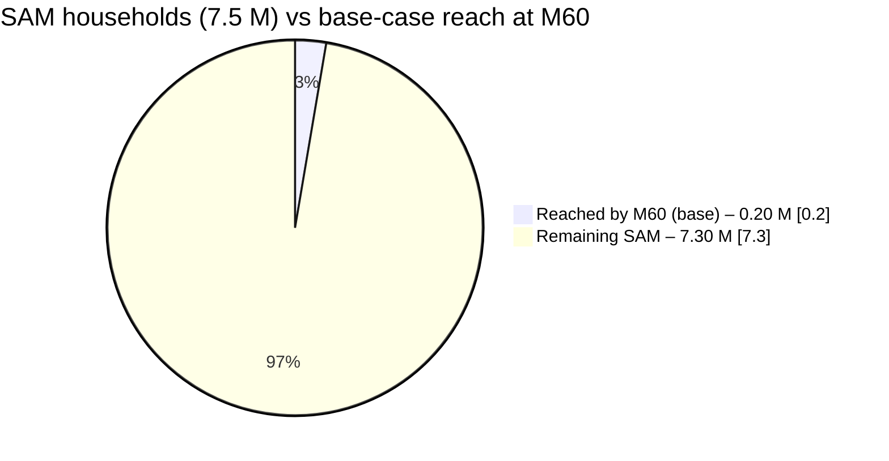
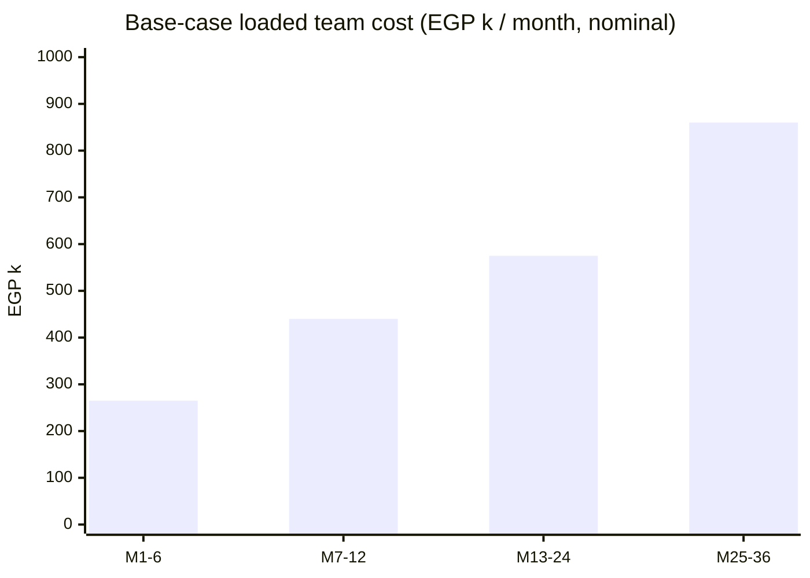
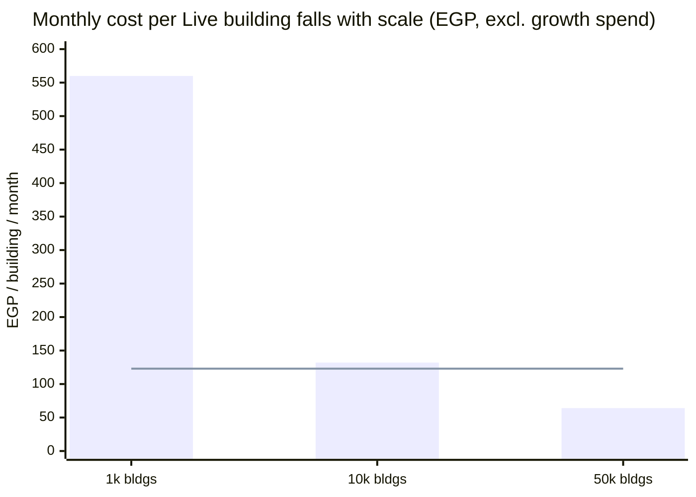
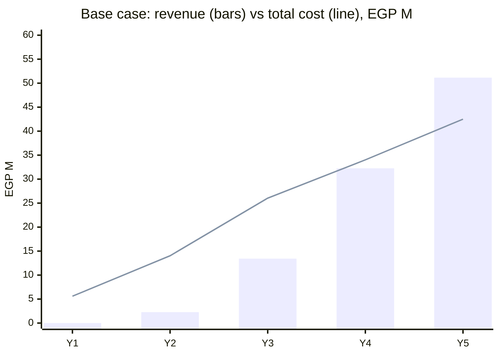
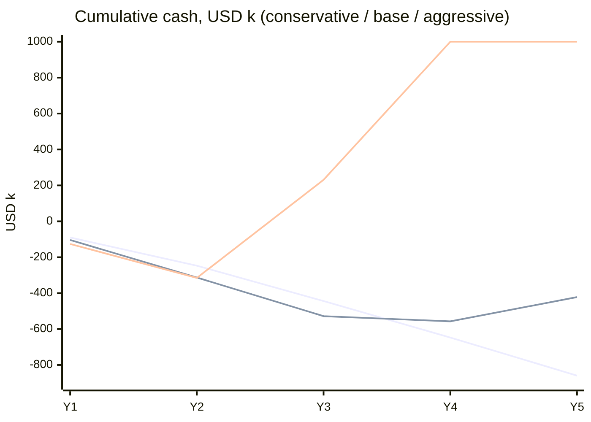
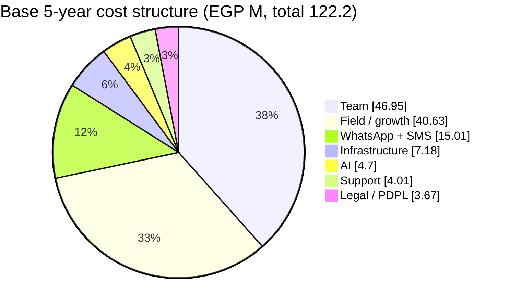
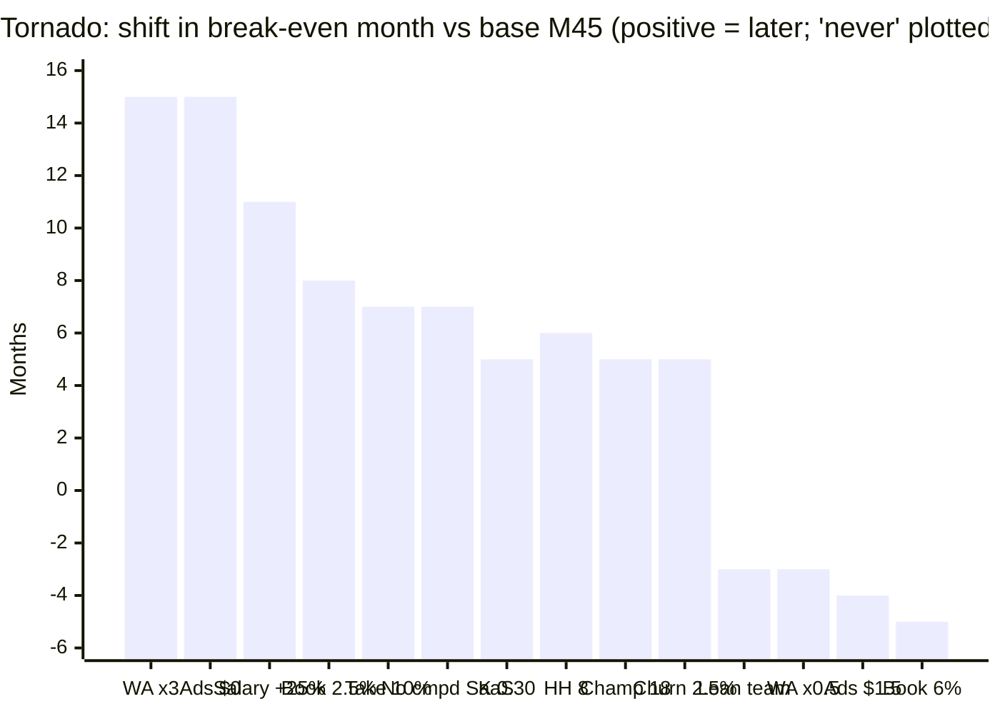
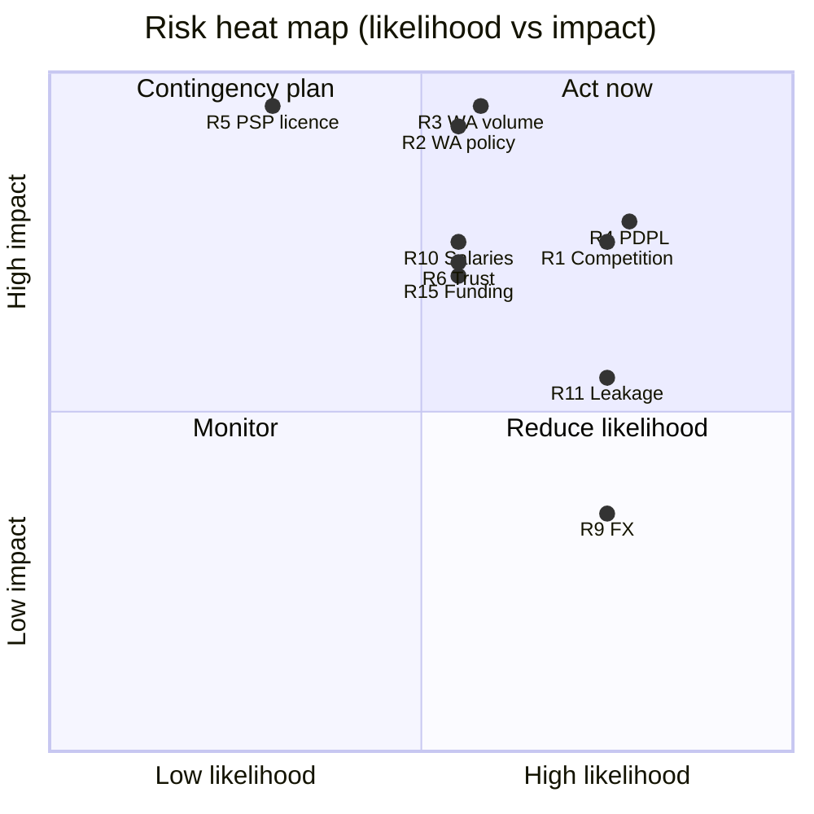

# C — Feasibility Study (دراسة الجدوى): Egypt Building & Compound Super-App

> **Date:** 2026-10-12 · **Market:** Egypt only · **Author role:** senior product manager and strategist
> **Model month M1 = November 2026.** Year 1 (Y1) = Nov 2026 to Oct 2027, Y2 = Nov 2027 to Oct 2028, and so on to Y5 = Nov 2030 to Oct 2031.
> **Currency:** EGP first, USD second. FX path 52.5 at M1 → 60.0 at M36 → ~65 at M60 (file 16 §2; the M37–M60 extension is a straight-line ESTIMATE).
> **Labels:**
> - **[src: file / URL]** means a number taken from the research folder `research/`.
> - **ESTIMATE** means my own derivation, with the reasoning shown.
> - **EXTRAPOLATION** means file 16's unified monthly model (`research/data/16-model.py`) re-run unchanged from 36 to 60 months. The files have no data past M36.
>
> **Superseded numbers:** file 16 overrides the older forecasts in files 08, 13 and 14 (16 §1). Where those files disagree with this study, this study follows file 16.
> **Canonical numbers:** this revision follows the canonical headline set in `strategy/D-critique.md` §1. Any other figure is labelled as a scenario, sensitivity or illustration.
> **Definitions used throughout:**
> - **Live building** = **≥40% of occupied units joined, and one dues or expense cycle recorded within 30 days.** (The model's early ramp counts some buildings as Live before they meet this threshold: M6 = 368 households in 98 buildings = 3.75 per building. Pilot reporting must use the strict definition.)
> - **Dense building** = ≥70% of occupied units joined. The bawab bonus pays at Dense, not at Live.
> - **Target building** = 10 occupied households (Cairo census mean 8.05 units); 6 active households per Live city building at maturity.

---

## 0. Executive summary

### 0.1 The verdict

**GO, but only as a gated, district-first plan.** The idea is feasible in Egypt. It is a slow-burn, land-grab business rather than a quick win. Five things must be true from day one:

1. **"Zero marketing budget" is not true in this plan, and the founder must decide on it now.** There is no paid media. But field champions, bawab bonuses and city launches cost **EGP 15.5 M over 36 months, 34% of all cost (EGP 45.7 M)**. The base case also needs **$568 k peak cash** and a pre-seed, in a weak funding market (Egypt −11% y/y in H1 2026) [src: 16 §7.6, §13.3]. See the decision box in §0.2.
2. **Free for every resident and every small building, forever.** Charge compounds, FM firms and services instead. MyGate had to go free when NoBrokerHood did [src: 13 §2.2, The Ken]. Ettihad, Amarati and others are already free [src: 18 §0]. The "free forever" promise covers a listed building core (§11 item 20).
3. **Never touch residents' money.** Use a ledger plus licensed PSPs. Holding funds needs a CBE licence with **EGP 10 M capital** [src: 09 §6, 17 §4].
4. **WhatsApp must be a routed, cost-policed channel, not the core.** The official API **cannot join a 20–200-member building group** (8-participant cap, OBA only) [src: 19 §2]. The founder's literal "bot as a group member" is **not legally available in 2026**. Group Mirror, Forward-to-Sanad and the ≤8 board group deliver the compliant 80%. Budget WhatsApp at **≈ $0.36–0.42 per Live building per month (KPI ceiling $0.45; ≤ $0.04 per account)**. An AI WhatsApp assistant for every resident (×3 volume) means **no break-even by M60** (§9).
5. **Dominance means district share, not national downloads.** At M36 the base case reaches only **1.2% of SAM households**, and **32% of its households come from 60 compounds**. The north-star companion metric is **≥30% of eligible buildings in Nasr City + Heliopolis by M24, and ≥3 districts above 30% by M36** (§1.4).

### 0.2 Founder decision box (answer before any build spend)

The founder said the budget covers **only development and operations**. Nobody has yet confirmed that this budget is $104 k. **Question 1 to the founder: what is the actual cash budget for 12 and 24 months, and may any of it pay for field operations?**

| Option | Year-1 cash | Field model | Raise | Expected outcome | Risk |
|---|---|---|---|---|---|
| **(a) Bootstrap** | **EGP 4.1 M ≈ $77 k** | Option A team all year, 2 champions from M5 | None | About conservative-case growth: **200–300 Live buildings at M12** | Ettihad or a funded clone takes the districts first |
| **(b) Base (recommended)** | **EGP 5.6 M ≈ $104 k** | Option A → B team; 2 → 6 champions, paid mostly on outcome (§2.6) | **$400–600 k pre-seed at M10–M14**, released in 6-month tranches | 636 Live at M12; 11,069 at M36; break-even **M45**; peak need **$568 k at M44** | Pre-seed may not close (R15). The no-raise path in §8.5 limits the damage |
| **(c) Seed-funded aggressive** | ≈ EGP 7.0 M Y1, pre-seed by ~M10 | 3 → 32 champions | Pre-seed by M10 + seed at M24–M30 | **Upside only if seed-funded**: peak need ~$320 k at M25, break-even M26 | Needs every growth input to land in the top band. Never plan on it |

**Plan against a "planning case", not the base.** The base case assumes lifetime K = 0.45, which B itself calls "great", and no Egyptian building app has passed ~3,000 installs. Fund against **K = 0.30, 18 seeds per champion per month and 50% seeded → Live**. This study's re-run gives **break-even M54 and a peak need of $652 k at M53** (§9). Commit spend only in **6-month tranches** tied to the measured inputs (§8.1).

### 0.3 Canonical headline numbers

All numbers below are the canonical set used across documents A, B and C (D §1). Anything else in this study is labelled as a scenario or sensitivity.

| Metric | M12 (Oct 2027) | M24 (Oct 2028) | **M36 (Oct 2029)** | M60 (Oct 2031, EXTRAPOLATION) |
|---|---|---|---|---|
| Live buildings | 636 | 4,188 | **11,069** | 24,770 |
| Paying or onboarded compounds | ~9 | 34 | **60** | 111 |
| Active households | 5,167 | 38,788 | **92,601** | 202,346 |
| … of which city buildings / compounds | 3,238 / 1,929 (37%) | 23,167 / 15,621 (40%) | **63,094 / 29,507 (32%)** | 145,068 / 57,279 (28%) |
| Accounts (app, web or WhatsApp-verified) | 8,652 | 65,185 | **154,063** | 335,210 |
| MAU | 4,759 | 35,852 | **84,735** | ~184 k |
| Cumulative downloads | 6,762 | 61,190 | **166,581** | 392,483 |
| Share of SAM households (7.5 M) | 0.07% | 0.5% | **1.2%** | 2.7% |

M6 pilot: **98 Live buildings, 368 active households** (base). Gate 1 pass mark **≥ 80 Live**.

| Money metric (base) | Canonical value |
|---|---|
| Founder cash needed, M1–M12 (dev + ops + field) | **EGP 5.6 M ≈ $104 k** |
| Minimum bootstrap path, M1–M12 | **EGP 4.1 M ≈ $77 k** (200–300 Live at M12) |
| MVP build (Option A in-house, 6 months) | **EGP 1.59 M ≈ $30 k** of team cost |
| Total cost M1–M36 | **EGP 45.7 M**, of which field/growth **EGP 15.5 M (34%)** |
| Revenue M1–M36 | **EGP 15.7 M**; monthly revenue at M36 **EGP 1.90 M** |
| Revenue Y1 / Y2 / Y3 / Y5 | **EGP 0.01 / 2.28 / 13.43 / 51.2 M** (Y5 ≈ $0.80 M) |
| Cumulative cash at M36 | **−$528 k** |
| **Peak cash need** | **$568 k at M44** |
| **Sustained break-even** | **M45 (Jul 2030) at ~135 k active households** |
| Platform run cost per Live building per month (excl. team and field) | **EGP 89 at 1 k buildings; EGP 46 at 10 k** |
| WhatsApp cost per Live building per month | **≈ $0.36–0.42 (EGP 19–25); KPI ceiling $0.45** |
| AI cost | ≈ $0.015 per MAU per month (about EGP 1), < 6% of cost (voice caveat in §4.3) |
| Revenue per active household per month at M36 | **EGP 20.5** |

**Scenario band (label every use):**

| Scenario | Live M36 | Active HH M36 | Downloads M36 | Break-even | Peak cash need |
|---|---|---|---|---|---|
| Conservative | 2,286 | 16,059 | 22,894 | none by M60 | > $859 k, still burning at M60 |
| **Planning case** (K 0.30, 18 seeds, 50% Live) | 7,095 | 69,989 | 130,310 | M54 | $652 k at M53 |
| **Base (canonical)** | **11,069** | **92,601** | **166,581** | **M45** | **$568 k at M44** |
| Aggressive (*upside if seed-funded*) | 36,369 | 350,280 | 719,687 | M26 | $320 k at M25 |

### 0.4 What the founder must do with this

| # | Decision | Why (evidence) |
|---|---|---|
| 1 | **Answer the decision box (§0.2) first:** the actual budget, and bootstrap vs base vs seed | Field ops are 34% of 36-month cost. "Dev + ops only" funds option (a) at best |
| 2 | Self-fund **M1–M12 only** (EGP 5.6 M / $104 k in the base). Release money in **6-month tranches** tied to the gates in §13 | Base burn M1–M12 = $104 k [src: 16 §13.1] |
| 3 | Raise a **pre-seed of $400–600 k at M10–M14**. Pitch the **fintech and data angle** (dues flows, union bank accounts, building capex finance) and district share, not downloads | Base peak need $568 k; planning case $652 k [src: 16 §13.1; §9] |
| 4 | Build **in-house** and ship a **~25-feature Wedge MVP** (web/PWA first) by M4, not the full 70–87-feature list | 4.5 engineers cannot build the full list in 4 months (§3.1). An agency costs 2–4× as much [src: 14 §2.3] |
| 5 | Make compounds and FM firms pay from M9: **EGP 6,000 per month per compound**, with a real BD capacity plan (§2.3) | Compound households cost EGP 50–75 each to acquire, 4–6× cheaper than city households [src: 16 §10.3] |
| 6 | Police **WhatsApp volume** as the #1 cost line and salary inflation as #2 | WhatsApp ×3 means no break-even. Salary steps of +25%/yr push break-even to M56 (§9) |
| 7 | **Start company formation this week** and collect **no personal data until the PDPC filing is lodged and a registered DPO is appointed** | Full PDPL enforcement starts 31 Oct 2026, 19 days from today (§11) |
| 8 | Win **Nasr City + Heliopolis first** (≥30% of eligible buildings by M24), and consider **acquiring or partnering with 2–3 small competitors** | Ettihad has ~3,000 installs in 63 days; the whole category totals ~8,900 [src: 18 §0, §2.1] |

---

## 1. Market sizing (TAM / SAM / SOM)

### 1.1 Assumptions

| # | Assumption | Value | Source / reasoning |
|---|---|---|---|
| A1 | Egyptian households | 26.5 M (11.8 M urban) | CAPMAS via CairoScene [src: 08 §1] |
| A2 | Share living in apartments | 75.7% | ERF census microdata [src: 08 §2.3] |
| A3 | Households in multi-unit buildings or compounds | 65% of apartment households | ESTIMATE [src: 08 §7.2] |
| A4 | Occupied households per *target* building | **10** (census mean is 5.3 units per urban building, 8.05 in Cairo; 72% occupancy in target districts) | [src: 16 §3] supersedes 08's figure of 12 |
| A5 | Accounts per active household | 1.6 (city), 1.8 (compound) | [src: 16 §4.1 G14, G18] |
| A6 | Marketplace-addressable spend per household per year | EGP 8,500 (city), EGP 22,500 (compound) | [src: 08 §8.2] |
| A7 | Building shared costs (bawab, elevator, cleaning) | ~EGP 6,000 per flat per year (city) | [src: 08 §8.2] |
| A8 | Compounds nationally | 1,000–1,500 (350–600 k occupied households) | ESTIMATE [src: 08 §2.5] |
| A9 | Top-down cross-check | Egypt home services USD 1.88 B (2025) → 5.11 B (2034) | Deep Market Insights [src: 08 §6] |

### 1.2 The funnel

| Tier | Households | Buildings | Accounts (×1.6) | Marketplace spend / yr | Revenue pool at 12–15% take |
|---|---|---|---|---|---|
| **TAM** | 13.0 M | ~1.1 M multi-unit + 1,000–1,500 compounds | ~20.8 M | EGP 96 B (~$1.9 B); EGP 166 B including building fees | — |
| **SAM** (urban and new-city ≥5-unit buildings and compounds) | 7.5 M | ~640 k + ~1,000 compounds | ~12 M | EGP 71 B (~$1.4 B) | — |
| **SAM, realistically intermediable** (50–75% goes online) | 7.5 M | — | — | **EGP 35–53 B (~$0.7–1.06 B)** | **EGP 4.2–8 B / yr** |
| **SOM M36, base** | 92.6 k (1.2% of SAM) | 11,069 + 60 compounds (1.7%) | 154 k | GMV Y3: EGP 42.8 M | Revenue Y3: EGP 13.4 M |
| **SOM M60, base** (EXTRAPOLATION) | 202 k (2.7%) | 24,770 + 111 compounds (3.9%) | 335 k | GMV Y5: EGP 178 M | Revenue Y5: EGP 51.2 M |
| SOM M60, aggressive (*upside if seed-funded*) | 862 k (11.5%) | 93,238 + 219 compounds | 1.57 M | GMV Y5: EGP 1.19 B | Revenue Y5: EGP 357 M |

TAM, SAM and the intermediable range come from file 08 §7.3 and §8.3. The SOM rows come from file 16 and its M60 extension.



### 1.3 Competitive capacity: can we win?

| Factor | Evidence | Read-out |
|---|---|---|
| Category size today | 19 Egyptian building and union apps total about **8,900 installs**. The leader, Ettihad, has ~3,000 (≈ 48 a day) [src: 18 §2.1] | Nobody has won. Base M12 is 6,762 downloads, which is 2.3× Ettihad *today* but only **~0.3× Ettihad's projected M12 (~21 k at its current pace)**. **We stay behind Ettihad on downloads until ~M18, and lead on Live buildings and active households per building.** Do not claim a download lead |
| Paid SaaS incumbents | Saknna charges EGP 450–7,500 a month and claims "500+" buildings (self-claimed) [src: 18 §1.4] | A free core undercuts it. Saknna's per-unit price is close to many buildings' whole monthly fee |
| Compound apps | Lyve family has ~77 k installs, Milango family ~83 k, but ratings are 2.2–3.9★ [src: 18 §2.2, 02 §0] | Be the resident layer on top of them, or partner. Do not fight the gate vendors |
| Home-services supply | FilKhedma 3.07★ (59% one-star since 2025); Taskty 2.07★ [src: 06 §0] | Trust is the product in phase 2 |
| Real incumbent | The WhatsApp group, the paper notebook and the bawab [src: 08 §9] | Be WhatsApp-native, not WhatsApp-dependent [src: 19 §11] |

### 1.4 What "dominance" means, and the cheapest way to beat competitors

**Dominance is district share.** The phase-2 marketplace needs local density for liquidity (B §4.4: ≥1,000 Live buildings per district for on-demand services). National download counts do not create that density.

| North-star companion KPI | Target | Reported how |
|---|---|---|
| Share of eligible buildings (≥5 units) Live in **Nasr City + Heliopolis** | **≥30% by M24** | Monthly, per district |
| Districts above 30% share | **≥3 by M36** | Quarterly |
| Active households, **city vs compound** | Reported separately in every chart | Base M36: 63,094 city / 29,507 compound (32%) |

**Moats, ranked honestly.** Most product features can be copied within a quarter: Amarati already has share-card summaries, NoBrokerHood launched the 1:1 WhatsApp pattern in Oct 2026, Ettihad already ships AI and pay links, and the legal kit is content anyone can clone [src: 18 §0, §3]. What is hard to copy:

1. **District density** (network effects inside a neighbourhood);
2. **the bawab network**;
3. **payment and ledger history**, which creates switching cost;
4. **the vendor graph and fair-price data**;
5. **speed of execution**.

**Battle card: three ways to win.**

| Move | How | Cost |
|---|---|---|
| **Out-distribute** | District density in Nasr City + Heliopolis; bawab programme; building-to-building share cards; compound B2B from M9 | Field ops (in budget) |
| **Absorb** | Chat-export and Excel import from any rival app; acquire or partner with small rivals (table below) | Tens of thousands of dollars |
| **Out-trust** | Union-registration file kit; hash-stamped receipts; explainable shares; no surprise paywall | Product work |

**Consolidate the category cheaply (ESTIMATE).** With ~8,900 installs across 19 apps, buying or partnering with 2–3 of them is the cheapest way to take the lead [src: 18 §2.1].

| Target | Why | Shape | Cost ESTIMATE |
|---|---|---|---|
| **صندوق العمارة (Sandooq El-Emara)**, solo Egyptian developer, 961 installs, EGP 49.99/mo | Deepest treasurer features (custody, mosque fund, voice); no resident app, no iOS [src: 18 §3, §4.2] | Acqui-hire, or a revenue share to migrate users | $10–30 k plus equity or a role |
| **Ammarty (HopenWorks)**, 1,684 installs, ~50 a day | Fast-growing ledger; offline sync; WhatsApp receipts [src: 18 §2.1, §4.10] | Asset purchase plus user migration | $15–40 k |
| **Ettihad**, ~3,000 installs, free, AI | The category leader. Worth a conversation only if its founders lack a revenue model | Merger (equity swap) | Equity, not cash |
| **Ahl Madinaty** (neighbourhood app, 43,668 installs) | Compound reach in Madinaty [src: 18 §5] | Partnership or content deal | Revenue share |

These cost figures are not in the research; validate them in conversations. Fund an acquisition only from a raise or from the M12 tranche, never from the Year-1 build budget.

**Government distribution (the highest-leverage zero-budget channel).** District offices are actively pushing union registration (Nasr City, Jun 2026, an 8-document list) [src: 09 §1.3, 20 §4]. Propose a **free MoU with district offices or Cairo Governorate**: "the free digital file for union registration". Add NUCA and the new-city authorities, and developers at handover. This is also the hedge against a government union portal (R16).

---

## 2. Team plan by phase

Salaries are net EGP per month at Oct-2026 prices [src: 14 §2.2]. **Loaded cost = net × 1.30–1.40** (gross-up, social insurance, equipment). Salaries step up +15% every 12 months [src: 16 §2].

### 2.1 Phase 0: build and pilot (M1–M6), "Option A, lean"

| Role | Count | Net EGP / mo | Notes |
|---|---|---|---|
| Founder (CEO + PM) | 1 | 0 (founder) | Owns product, treasurer interviews, pilot field work |
| Senior full-stack / tech lead (Flutter + Supabase/Postgres) | 1 | 70,000 | Owns architecture, payments, WhatsApp |
| Mid Flutter developer | 1 | 40,000 | Android-first, RTL |
| Mid backend / AI engineer | 1 | 50,000 | LLM router, OCR, voice-to-ticket |
| UI/UX designer (50%, M1–M4) | 0.5 | 15,000 | Arabic-first design system |
| QA (from M3) | 1 | 22,000 | Low-end device matrix |
| Field champions (from M5) | 2 | 18,700 loaded each (model); outcome-based contract proposed in §2.6 | Pilot in Nasr City + Heliopolis [src: 16 §4.3 C2] |
| **Team loaded cost** | | **≈ EGP 265 k / mo (~$5.0 k)**, plus champions | [src: 14 §2.3] |

### 2.2 Phase 1: scale-up and monetization prep (M7–M12), "Option B"

| Add / change | Count | Net EGP / mo | Why |
|---|---|---|---|
| Second Flutter developer, AI engineer (senior), full-time designer, QA | +3–4 | 25–80 k each | Ship the marketplace, compound dashboard, bawab mode and notifications v2 in parallel |
| Support agent (Arabic, AI-assisted) | 1 | 15,000 loaded | 1 agent per 30 k MAU [src: 16 §4.3 C6] |
| Field champions | 3 → 6 | 18,700 loaded each | Cairo-East density |
| Part-time DPO / privacy counsel | retainer | 15,000 (from M10) | PDPL [src: 16 §4.3 C10] |
| **Team loaded cost** | | **≈ EGP 440 k / mo (~$8.4 k)** plus field | [src: 14 §2.3; 16 §4.3 C1] |

### 2.3 Phase 2: multi-city and marketplace (M13–M24)

| Add | Count | Why |
|---|---|---|
| Backend #2 (payments, PSP split, scale) | +1 | Marketplace and split payouts |
| Marketplace ops lead plus trust & safety (2–3 agents by M24) | +3 | Disputes drive headcount [src: 14 §2.4] |
| B2B / compound BD (0.5 → 1 FTE, **raise to 1.5 FTE if the pipeline check fails**) | +1 | 0.5 FTE per 10 compounds a year [src: 16 §10.3]. **Capacity check:** 60 compounds between M9 and M36 (27 months), each with a 3-month free pilot, means about **3 live negotiations every month**. One person can carry that only with a standard contract and the self-serve compound dashboard. If fewer than 2 compounds a month are signing by M15, add a second BD hire, or accept fewer compounds and a lower M36 household total (32% of M36 households depend on this line) |
| City leads (Giza/October at M13, Alexandria at M19) | +2 | EGP 35 k / mo each [src: 16 §4.3 C4] |
| Field champions | 8 → 15 | [src: 16 §4.1 G3] |
| **Core team loaded** | | **EGP 500 k / mo at Oct-2026 prices (≈ EGP 575 k after the step)** [src: 16 §7.2] |

### 2.4 Phase 3: national scale (M25–M36 and beyond)

| Add | Count | Why |
|---|---|---|
| Data/ML engineer (self-hosted ASR, ranking), growth PM, ads/sponsorship sales (2) | +4 | The ads line (MyGate earns 65–70% of revenue from ads [src: 14 §6.1]) needs a sales team |
| Trust & safety and support | to ~9 + 3–8 | 1 agent per 30 k MAU, plus disputes |
| City leads (Delta, new cities) | +1–2 | Wave 4 at M25 |
| Field champions | 19 → 22 | [src: 16 §7.1] |
| **Core team loaded** | | **EGP 650 k / mo at Oct-2026 prices (≈ EGP 860 k nominal by M25–M36)** [src: 16 §7.2] |

### 2.5 Headcount summary (base)

| | M1–M6 | M7–M12 | M13–M24 | M25–M36 | Y4–Y5 (ESTIMATE) |
|---|---|---|---|---|---|
| Product and engineering | 4.5 | 7–8 | 9–10 | 12–14 | 16–20 |
| Support, trust & safety | 0–1 | 1 | 2–4 | 4–8 | 8–15 |
| Field (champions + city leads) | 2 | 3–6 | 8–17 | 19–25 | 22–30 |
| BD, sales, compliance | 0 | 0.5 | 1.5–2 | 3–4 | 5–6 |
| **Total (excluding founder)** | **~6.5** | **~12–15** | **~21–33** | **~38–51** | **~51–71** |



### 2.6 Field operations: reframed as "operations: onboarding", paid on outcome

The founder's mandate is "development and operations only". Field champions are therefore framed and budgeted as **onboarding operations**, and paid mostly on outcome so that fixed cost becomes variable.

| Item | Model assumption | Proposed contract (ESTIMATE) | Effect |
|---|---|---|---|
| Champion pay | EGP 18,700 loaded per month, fixed [src: 16 §4.3 C2] | **Base ≈ EGP 8,000 + EGP 300 per verified Live building** (strict definition) | At model productivity (25 seeds × 55% ≈ 13.75 Live a month) ≈ EGP 12,100 + loading, below the model cost. At half that productivity the cost falls with it |
| Bawab bonus | Paid per building | Paid at **Dense (≥70% joined)**, not at Live or 60% | Pays for real density; reduces gaming |
| Verification | — | A Live building is verified by the system (joined units + one dues cycle), not by the champion | No paying for empty buildings |

**Unpaid and low-cost field supply** (adds to the 45% field share of new Live buildings; not in the model, so treat as upside):
- **Student ambassadors** from engineering and commerce faculties, earning graduation-project or internship credit;
- **union-registration "facilitators"** paid by the union for the legal-kit filing service, not by us;
- **elevator and tank vendors' own technicians**, who visit buildings anyway (growth loop 6 in B).

---

## 3. Development cost estimate (MVP, V2, V3)

### 3.1 Scope per release

**The full feature list does not fit the MVP window.** Document A lists about 70–87 "MVP" features. For 4.5 engineers in a 4-month build that is 12–18 months of work, before the 300-message AI evaluation and the 99.5% crash-free gate on 6 device families. The MVP is therefore cut to a **~25-feature "Wedge MVP"** that ships at **M4**, **web/PWA first** (the claim link and treasurer admin work in any browser), with the native Android app following within the pilot and iOS before Wave 1 widens to New Cairo and Maadi (high iOS share).

| Release | Window | Scope |
|---|---|---|
| **Wedge MVP** (~25 features) | Build M1–M4, pilot M5–M6 | Building setup from a **notebook photo or Excel import**; unit grid; **dues and expense ledger with receipts**; **InstaPay link + screenshot OCR + confirm card**; **monthly report-card share card**; WhatsApp OTP and web claim link (with SMS fallback, any country code); **tickets by voice note**; announcements; basic push + WhatsApp utility routing; **Sanad 1:1 limited to 5 intents** (balance, pay, report a fault, notice, help); PDPL consent UX; data export [src: 14 §2.3, 11 §0, 19 §6] |
| **V2** | M7–M12 | Bawab Mode (voice-first, offline); union-registration legal kit (8-document generator) and GA operations (weighted, arrears-aware tally, QR attendance); chat-export import; building status strip; passkeys; SOS; per-user notification engine v2 (send-time optimisation, fatigue budget); compound dashboard plus paid compound SaaS; marketplace v1 (inspection-fee menu, Paymob split, technician app, **job chat + WhatsApp deep links**); Fawry/Kashier links per **registered** union [src: 20 §4, 17 §8, 11 §5] |
| **V3** | M13–M24 | Marketplace v2 (warranty and milestone payments through the PSP, BNPL); B2B contracts module (elevator AMC, tanks); sponsorship and ads platform; partner APIs (BNPL, insurance, ISP); self-hosted Arabic ASR; analytics warehouse; multi-city operations tooling [src: 14 §7.1] |
| **Upside only (not roadmap)** | If and when Meta grants an OBA | Official Board Groups and per-job WhatsApp micro-groups via the Groups API. OBA approval rests on notability at Meta's discretion, with no paid shortcut, and new Egyptian startups are routinely refused [src: 19 §2, §9]. The in-app job chat in V2 already covers the need |

The cost figures in §3.2 assume the same team-months, so the cut changes **what** ships by M4, not the budget.

### 3.2 Cost by build option (EGP and USD; FX 52.5 for MVP and V2, ~55 for V3)

| Release | **In-house Egyptian team** | **Egyptian agency** ($25 / $37 / $50 per hour) | **Hybrid** (in-house core + agency/freelance for design system, admin web, QA) |
|---|---|---|---|
| **MVP** (6 mo) | Option A: 6 × 265 k = **EGP 1.59 M ($30 k)**; Option B: EGP 2.64 M ($50 k) | ~4,500 h → **$112 k / $166 k / $225 k** (EGP 5.9 / 8.7 / 11.8 M) | Option A + ~1,200 h × $25 = **EGP 3.2 M ($60 k)** |
| **V2** (6 mo) | Option B: 6 × 440 k = **EGP 2.64 M ($50 k)** | ~3,500 h → $87.5 k / $129.5 k / $175 k (EGP 4.6 / 6.8 / 9.2 M) | Option A + ~1,500 h × $25 = **EGP 3.56 M ($68 k)** |
| **V3** (12 mo) | 12 × 575 k = **EGP 6.9 M ($126 k)** | ~6,000 h → $150 k / $222 k / $300 k (EGP 8.3 / 12.2 / 16.5 M), **plus** an in-house ops team you still need | In-house 12 × 505 k (EGP 6.06 M) + ~1,500 h × $25 (EGP 2.06 M) = **EGP 8.1 M ($148 k)** |
| **Total, 24 months** | **EGP 11.1 M (~$206 k)** | **$350–700 k** (EGP 18.8–37.5 M) + ops team | **EGP 14.9 M (~$276 k)** |

Sources: in-house team costs and agency hours/rates from file 14 §2.3 ($37/h median, GoodFirms). V2 and V3 agency hours are ESTIMATES scaled from the MVP's 4,500 h.

**Recommendation:** build **in-house** [src: 14 §2.3]. Hybrid is defensible only for the MVP design system and admin web, and only if hiring takes longer than 6 weeks. Agencies cost 2–4× as much, own none of the product thinking, and still leave you needing a team. **Keep the AI and WhatsApp core in-house, because it is the moat.**

### 3.3 One-off non-team setup costs

| Item | EGP | Source |
|---|---|---|
| Company formation (LLC or OPC), lawyer | 25,000–60,000 | [src: 14 §3.7] |
| Legal opinion pack (payments model, GA operations, bawab and technician terms) | 40,000–100,000 | [src: 20 §6.4] |
| Privacy notice, terms, DSR flow (Arabic and English) | 15,000–50,000 | [src: 09 §16] |
| Apple Developer $99/yr; Google Play $25 | ~6,500 | [src: 14 §3.6] |
| Pilot kit (QR posters at ~EGP 5 each, door hangers, 2 treasurer meet-ups) | 60,000 | [src: 16 §10.2] |
| **Total** | **≈ EGP 150–280 k (~$3–5 k)** | |

---

## 4. Monthly operating costs at 1 k / 10 k / 50 k Live buildings

**Basis:**
- Each Live building has 6 active households, 9.6 accounts, 5.3 MAU (55%) and 75% app installers [src: 16 §4.1].
- Unit prices:
  - infrastructure: $150 + $0.025 per MAU;
  - AI: $0.015 per MAU + $0.02 per building;
  - WhatsApp: $0.0036 per utility, service or authentication message, after 3,000 free service messages (3 numbers), plus 14% VAT [src: 16 §4.3 C7–C9, 19 §3].
- Oct-2026 prices at EGP 52.5 per USD.

### 4.1 Run-cost table (EGP per month)

| Line | **1,000 buildings** (6 k HH, 5.3 k MAU) | **10,000 buildings** (60 k HH, 52.8 k MAU) | **50,000 buildings** (300 k HH, 264 k MAU) | Basis |
|---|---|---|---|---|
| Cloud backend (Postgres/Supabase, API, workers) | 12,900 ($245) | 57,800 ($1,100) | 257,400 ($4,900) | [src: 14 §4] split of C7 |
| Storage + CDN (receipts, photos) | 1,400 | 13,900 | 69,300 | ~4 MB/MAU/month [src: 14 §4] |
| Monitoring, logging, email | 600 | 5,600 | 27,700 | [src: 14 §4] |
| AI / LLM (router, OCR, voice → ticket, digests) | 5,200 ($99) | 52,100 ($992) | 260,400 ($4,960) | [src: 16 C8; 14 §3.4] |
| **WhatsApp** (utility + service + OTP, incl. VAT) | 19,000 ($362; ~88 k msgs) | 196,100 ($3,734; ~0.91 M msgs) | 982,900 ($18,722; ~4.6 M msgs) | [src: 16 C9; 19 §3.2] |
| SMS OTP fallback (5% of OTPs at $0.015) | 30 | 300 | 1,600 | [src: 14 §3.2] |
| Push (FCM) | 0 | 0 | 0 | Free [src: 14 §3.1] |
| Support agents (1 per 30 k MAU × EGP 15 k) | 15,000 (1) | 30,000 (2) | 135,000 (9) | [src: 16 C6] |
| Marketplace trust & safety (once live) | 0 | 45,000 (3) | 120,000 (8) | ESTIMATE from 14 §2.4 |
| Payments, fixed platform side (PSP % fees are passed to the payer) | 600 | 600 | 600 | FawryPay EGP 499 minimum + bank [src: 17 §3] |
| Legal, accounting, DPO | 35,000 | 45,000 | 60,000 | [src: 16 C10] scaled (ESTIMATE) |
| PDPL licence (amortized) | 0 (<100 k records) | 12,500 | 12,500 | [src: 16 C11] ESTIMATE |
| **Subtotal: platform run cost** | **≈ 89 k (~$1.7 k)** | **≈ 459 k (~$8.7 k)** | **≈ 1.93 M (~$36.7 k)** | |
| Core product / engineering team (loaded) | 470,000 | 860,000 | 1,256,000 | Base M12–15; base M25–36; aggressive cost base M25+ [src: 16 §7] |
| **Total excluding growth spend** | **≈ 560 k (~$10.7 k)** | **≈ 1.32 M (~$25.1 k)** | **≈ 3.18 M (~$60.6 k)** | |
| Growth / field ops (champions, city leads, bawab bonuses) | 136,000 | 853,000 | 1,496,000 | Base M12; base M36; aggressive M36 [src: 16 §7] |
| **Total including growth** | **≈ 696 k (~$13.3 k)** | **≈ 2.17 M (~$41.4 k)** | **≈ 4.68 M (~$89.1 k)** | |
| **Per building per month (excl. growth)** | **EGP 560** | **EGP 132** | **EGP 64** | |
| Platform run cost only, per building | EGP 89 | EGP 46 | EGP 39 | |

### 4.2 What the table says

- **WhatsApp is 21–51% of platform run cost**, which is more than cloud and AI combined. With app-first routing (×0.5 volume), the base case breaks even 3 months earlier (§9).
- AI is cheap at **≈ EGP 1 per MAU per month**. That matches the "mandatory AI everywhere" brief at under 6% of total cost [src: 16 §7.6: AI was EGP 1.0 M of the 36-month base cost]. Voice is the one line that could grow faster (§4.3).
- Maturity revenue is about EGP 20.5 per household per month, or about EGP 123 per building per month [src: 16 §9].
- **Illustration only (not the break-even figure):** at a *fixed* building count and M36 prices, 10 k buildings bring ≈ EGP 1.23 M a month against EGP 1.32 M of non-growth cost, so the run-rate covers non-growth cost at ≈ 11 k Live buildings. This static view ignores compounds, salary steps and the continuing growth spend. **The canonical break-even is the model's: M45 at ~135 k active households** (§5.4).

### 4.3 WhatsApp budget and voice cost (the canonical unit budgets)

**WhatsApp.** The model (F16 C9) uses **9.6 accounts per Live city building**. File 19's figure of **$1.09 per building assumed 30-flat buildings with 45 users** and must not be used as a budget: at our building size it is 2.6–3× the model, which is the "WhatsApp ×3" scenario that **never breaks even** (§9).

| Budget line | Canonical value | Model check (base, all-in incl. compound accounts) |
|---|---|---|
| WhatsApp cost per Live building per month | **≈ $0.36–0.42 (EGP 19–25); KPI ceiling $0.45** | $0.47 at M12, $0.50 at M18, $0.43 at M36, $0.42 at M48 |
| WhatsApp cost per account per month | **≤ $0.04** | $0.030–0.034 |
| Free service messages | **3 numbers × 1,000 = 3,000 a month** | Each extra number saves only $3.60 a month [src: 19 §3] |
| Sanad replies | **Average 6 per account per month, with a hard monthly cap per account** | Not "15 turns per user per day", which allows ~75× the modelled volume |
| WhatsApp cost as a share of revenue | **≤ 25% at M24, ≤ 15% from M36, ≤ 10% by Y5** (stop-the-line guardrail) | 38% at M18, 26% at M24, 15% at M36, 14% at M48, 13.5% at M60 |

*Note on the revenue-share guardrail.* D proposes "≤ 10% of revenue from M18". The base model itself runs at 38% at M18 (revenue is still tiny) and ~15% at M36, so that rule would halt the base case. This study sets the glide path above instead. Hitting ≤ 10% needs the app-first routing of the ×0.5 sensitivity (≈ 7% at Y5). The per-building ceiling of $0.45 is tight in M12–M24 because compound accounts load the average; track city buildings and compounds separately.

**Voice (AI).** $0.015 per MAU covers text and OCR. Voice-first use by bawabs and elderly residents adds speech-to-text at **$0.003–0.006 per minute** [src: 11 §2.2, 14 §3.4].

| Voice assumption (ESTIMATE) | Cost per MAU per month | At M36 (≈ 85 k MAU) |
|---|---|---|
| 40% of MAU use voice, 4 min each, $0.003/min | ≈ $0.005 | ≈ $410 (EGP 25 k) |
| Every MAU, 5 min, $0.006/min (worst case) | ≈ $0.03 | ≈ $2,540 (EGP 152 k) |

Even the worst case keeps AI under 10% of total cost. **Trigger:** move to self-hosted Arabic ASR (Cohere Transcribe Arabic, one GPU at ~$300–600 a month) once hosted voice passes **100 k minutes a month** (§6.3).



*(The line is revenue per building at M36 maturity, EGP 123.)*

---

## 5. Unit economics

### 5.1 Acquisition (CAC ≈ 0 in paid media; field cost is the real CAC)

| Metric | Value | Source |
|---|---|---|
| Paid marketing spend | **EGP 0** | Founder constraint [src: 16 C12] |
| Field cost per new Live building, all channels | **EGP 1,217 (~$22)** | [src: 16 §9] |
| Field cost per field-sourced Live building | EGP 2,688 (~$49) | [src: 16 §9] |
| Field cost per active household | ~EGP 203 (~$3.7) | [src: 16 §9] |
| Cost per activated building, new city wave (Cairo/Giza/Alexandria) | EGP 1,875 (~$36) | [src: 16 §10.2] |
| Cost per activated building, Delta city | ~EGP 2,600 (~$50) | [src: 16 §10.2] |
| Cost per active compound household | EGP 50–75 | [src: 16 §10.3] |
| Share of new Live buildings by channel (36-month base) | Field + pilot 45%, viral K 35%, self-serve content 13%, partners 6% | [src: 16 §7.6] |
| Comparable paid CPI (ME) | ~$0.34, but ads cannot target one building, so density cannot be bought | [src: 16 §10.4] |

### 5.2 Revenue and contribution per household (base)

| Metric | Y3 (Nov-28 to Oct-29) | Y5 (Nov-30 to Oct-31, EXTRAPOLATION) | Basis |
|---|---|---|---|
| Revenue | EGP 13.43 M | EGP 51.15 M | Model |
| Average active households | 65.7 k | 176.4 k | Mean of start and end of year |
| **Revenue per household per year** | **EGP 204 (~$3.5)** | **EGP 290 (~$4.5)** | MyGate ≈ $4 per home per year [src: 14 §6.1] |
| Variable cost (infra + AI + WhatsApp + support) per household | EGP 76 | EGP 82 | Model lines |
| **Contribution margin 1** (before acquisition and team) | 63% | **72%** | |
| Field / growth cost per household | EGP 149 | EGP 76 | |
| **Contribution margin 2** (after growth spend) | −10% | **45%** | |
| Revenue payback per Live building | ≈ 10 months at M36 revenue per household | — | [src: 16 §9] |
| Contribution payback per Live building | ≈ 14 months (1,217 ÷ (123 × 72%)) | — | ESTIMATE |

### 5.3 Per-transaction economics

| Transaction | Customer pays | Platform net revenue | Contribution | Source |
|---|---|---|---|---|
| Marketplace job, AOV EGP 750, 15% take, card | 750 | 112.5 | **≈ EGP 56** | [src: 16 §9] |
| Same job, cash, commission **invoiced to the technician monthly in arrears** | 750 | 112.5 | ≈ EGP 80 (less a bad-debt allowance) | [src: 16 §9] |
| AC freon job EGP 1,200 + EGP 20 fee, 12% take: card / Fawry wallet-QR / cash + invoice in arrears | 1,220 | 143.9 (after VAT) | **64 / 80 / 101** | [src: 17 §7.1] |
| Small plumbing fix EGP 300, card | 315 | 44.7 | ≈ 17.5 (works only via cash or wallet-QR) | [src: 17 §7.1] |
| Dues EGP 600 via InstaPay | 600.6 | 0, or an opt-in EGP 3 receipt fee (**registered unions only**; treasurers' personal accounts get a ledger-only flow with no fee) | ≈ 0–2.6 | [src: 17 §7.2] |
| Elevator AMC referral, 10% recurring | 350–800 / lift / month | 31–70 / month | EGP 370–840 per lift per year | [src: 17 §7.3] |
| Compound SaaS | EGP 6,000 / month | 6,000 | ~90% gross | [src: 16 R3] |

**Design rules that follow:**
1. Steer customers to cash or InstaPay, and **invoice the technician's commission monthly in arrears** (a receivable, not stored value). A technician "prepaid commission balance" may count as stored value under CBE rules; use it only after counsel and the PSP sign off in writing (§11 item 11). Keep cards for BNPL and big tickets.
4. **Agent model:** the technician is the named supplier on every pre-work receipt, so the statutory warranty (Consumer Law 181/2018 Art. 26) attaches to the supplier. Our own guarantee is an extra on top, never a condition of it.
5. **Payment-fee revenue depends on registered unions.** About 97% of unions are unregistered, have no legal personality and cannot open PSP sub-merchant or bank accounts [src: 20 §4.3]. The model's payment-fee line (EGP 5.5 M in Y5) is only reachable if the union kit → registration → bank-account journey works. Track it as a funnel: registered-union share of Live buildings, target ≥ 10% by M24 and ≥ 25% by M36 (ESTIMATE). If registration stalls, cut the payment-fee forecast in proportion (−EGP 1.4 M Y3, −EGP 5.5 M Y5 at worst).
2. Never charge the EGP 120 inspection fee by card, because the fixed EGP 3 PSP fee eats 5.25% of it [src: 17 §3.1].
3. Keep the platform take at or below 15% on everyday jobs [src: 17 §8].

### 5.4 Break-even scale, triangulated

| Method | Break-even point |
|---|---|
| **Unified monthly model (base cost base) — canonical** | **~135 k active households at M45** [src: 16 §9] |
| Aggressive cost base | ~165 k households at M26 [src: 16 §9] |
| Run-cost table (§4), *illustration at a fixed building count* | Run-rate covers non-growth cost at ~11 k Live buildings. Not a break-even estimate: it ignores compounds, salary steps and continuing growth spend |
| File 14 (superseded) | 100–120 k households; left out field ops and salary steps |

---

## 6. Expansion costs by phase

### 6.1 Geographic waves (base timing; aggressive / conservative in brackets)

| Wave | Start | Districts | Why | Champions added | Launch one-off (EGP) | Monthly run (EGP) | First-year cost |
|---|---|---|---|---|---|---|---|
| 1 | M5 (pilot onboarding **14 Mar 2027**, after Eid) | **1a: Nasr City + Heliopolis only** (first 150 Live within ~5 km of one Nasr City anchor). **1b: New Cairo and Maadi** once 150 Live are reached | Density before breadth; Nasr City district is already pushing union registration; Cairo 8.05 units per building [src: 16 §10.1, 09 §1.3]. Ramadan (≈ 8 Feb–9 Mar 2027) is for content and pre-commitments, not onboarding | 2 → 6 | 60,000 (pilot kit) | ~112,000 (6 champions) + bonuses | ≈ EGP 1.0–1.4 M |
| 2 | M13 (M10 / M16) | **Giza (Dokki, Mohandessin, Haram, Faisal) + 6th of October / Sheikh Zayed** | 474,744 urban buildings; compounds; rent growth | +4 | 250,000 | ~127,800 | **≈ EGP 1.78 M (~$34 k)** |
| 3 | M19 (M15 / M28) | **Alexandria** | 424,012 buildings at 7.14 units each; proven home-services demand | +5 | 250,000 (indexed) | ~146,500 | ≈ EGP 2.0 M |
| 4 | M25 (M21 / —) | **Delta capitals + new cities** (Obour, Shorouk, 10th of Ramadan, New Capital) | Smaller buildings, so enter through partners and new-city handovers | +7 | 250,000 (indexed) | ~190,000 | ≈ EGP 2.5–2.8 M |
| 5 (ESTIMATE) | Y4 | Canal cities, Upper Egypt capitals (Assiut, Minya, Sohag), North Coast and Red Sea compounds | Sal7lyy shows Upper Egypt demand [src: 03 §0] | +6–8 | ~350,000 | ~220,000 | ≈ EGP 3.0 M |

Launch one-off breakdown: meet-ups EGP 60 k, printed kits 25 k, onboarding 60 technicians 60 k, city-lead recruitment 30 k, founder travel 40 k, PR and legal templates 35 k [src: 16 §10.2].

### 6.2 Field and expansion cost by year (base, EGP M)

| | Y1 | Y2 | Y3 | Y4 (EXTRAP.) | Y5 (EXTRAP.) |
|---|---|---|---|---|---|
| Field ops (champions, bonuses, city leads, launches) | 0.73 | 4.98 | 9.79 | 11.69 | 13.44 |
| New Live buildings added (approx.) | 636 | ~3,700 | ~7,900 | ~8,700 | ~9,000 |
| Compounds onboarded (cumulative) | 9 | 34 | 60 | 86 | 111 |
| Compound BD cost (EGP 25–40 k each) | 0.2–0.4 | 0.6–1.0 | 0.65–1.0 | 0.65–1.0 | 0.6–1.0 |

### 6.3 Product expansion costs (ESTIMATE)

| Expansion | When | One-off | Run | Gate |
|---|---|---|---|---|
| Marketplace launch per city (technician vetting, 60 pros) | With each wave | EGP 60 k | Trust & safety, 1–3 agents | ≥30% building density in the district [src: 14 §7.4] |
| Ads and sponsorship sales | M15 | — | 2 sales staff (~EGP 60 k / mo loaded) | ≥30 k active households in Cairo-East |
| WhatsApp Groups API micro-groups (**upside, not roadmap**) | Only if Meta grants an OBA; notability is at Meta's discretion and new Egyptian startups are routinely refused | 4–6 dev-weeks | +$0.75 per building per month [src: 19 §7 F] | OBA approval. The PR plan (Building Index, press) should deliberately build the notability evidence |
| Self-hosted ASR (Cohere Transcribe Arabic) | ~M18 | 1 GPU (~$300–600 / mo, ESTIMATE) | Replaces per-minute fees | >100 k voice minutes / month |
| Own PSP licence | Not before Y5 | **EGP 10 M+ capital** | Compliance team | Avoid [src: 09 §6] |

---

## 7. Five-year financial projections (three scenarios)

### 7.1 Base case: P&L by year (EGP M, nominal)

| Line | Y1 | Y2 | Y3 | Y4 | Y5 |
|---|---|---|---|---|---|
| Payments convenience fees | 0.00 | 0.23 | 1.39 | 3.40 | 5.51 |
| Compound + Pro SaaS | 0.01 | 0.74 | 2.19 | 4.03 | 6.30 |
| Marketplace (jobs + building contracts) | 0.00 | 0.84 | 5.66 | 14.34 | 23.29 |
| Ads and sponsorship | 0.00 | 0.39 | 3.15 | 7.65 | 11.47 |
| Referrals (BNPL, insurance, ISP) | 0.00 | 0.08 | 1.04 | 2.83 | 4.59 |
| **Revenue** | **0.01** | **2.28** | **13.43** | **32.26** | **51.15** |
| Team | 4.23 | 6.90 | 10.32 | 11.86 | 13.64 |
| Field / growth ops | 0.73 | 4.98 | 9.79 | 11.69 | 13.44 |
| Support | 0.12 | 0.24 | 0.60 | 1.19 | 1.86 |
| Infrastructure | 0.10 | 0.44 | 1.19 | 2.20 | 3.25 |
| AI | 0.01 | 0.23 | 0.76 | 1.48 | 2.22 |
| WhatsApp + SMS | 0.05 | 0.75 | 2.41 | 4.72 | 7.08 |
| Legal, PDPL, accounting | 0.34 | 0.48 | 0.97 | 0.88 | 1.00 |
| **Total cost** | **5.60** | **14.03** | **26.04** | **34.02** | **42.50** |
| **EBITDA** (= operating result; no capitalized development) | **−5.58** | **−11.75** | **−12.60** | **−1.76** | **+8.65** |
| EBITDA margin | n/m | −515% | −94% | −5% | **+17%** |
| Revenue (USD k) | 0 | 40 | 227 | 524 | 799 |
| EBITDA (USD k) | −104 | −209 | −215 | −29 | +135 |
| **Cumulative cash, end of year (USD k)** | **−104** | **−313** | **−528** | **−557** | **−422** |
| Live buildings (end of year) | 636 | 4,188 | 11,069 | 18,446 | 24,770 |
| Active households | 5,167 | 38,788 | 92,601 | 150,531 | 202,346 |
| Accounts / MAU | 8.7 k / 4.8 k | 65 k / 36 k | 154 k / 85 k | 250 k / 137 k | 335 k / 184 k |
| Marketplace GMV for the year | 0.0 | 6.1 | 42.8 | 109.4 | 177.8 |

Y1–Y3 come from file 16 §7–§8 (annual sums of the monthly CSV). Y4–Y5 are EXTRAPOLATION (the model re-run to M60 with unchanged inputs, all ramps saturated at M36).

### 7.2 Conservative case (EGP M)

| Line | Y1 | Y2 | Y3 | Y4 | Y5 |
|---|---|---|---|---|---|
| Payments / SaaS / Marketplace / Ads / Referrals | 0 / 0 / 0 / 0 / 0 | 0.02 / 0.09 / 0.05 / 0.02 / 0.00 | 0.10 / 0.36 / 0.47 / 0.21 / 0.05 | 0.23 / 0.70 / 1.18 / 0.52 / 0.16 | 0.36 / 1.11 / 1.82 / 0.74 / 0.25 |
| **Revenue** | **0.00** | **0.18** | **1.19** | **2.78** | **4.28** |
| **Total cost** | 4.85 | 9.01 | 12.79 | 15.22 | 17.85 |
| **EBITDA** | **−4.85** | **−8.83** | **−11.60** | **−12.44** | **−13.57** |
| Cumulative cash (USD k) | −90 | −247 | −444 | −647 | −859 |
| Active households (end of year) | 859 | 7,200 | 16,059 | 24,884 | 32,350 |

**Read:** this scenario never breaks even with a growing team. **Do not scale costs on conservative traction** [src: 16 §13.1].

### 7.3 Aggressive case — *upside only if seed-funded* (EGP M; needs a pre-seed by ~M10)

This case is shown as the upside of option (c) in §0.2. It must never be quoted next to the base without that label. It has 3.3× the base Live buildings at M36 with only 1.45× the champions (32 vs 22), so its growth inputs are all top-band.

| Line | Y1 | Y2 | Y3 | Y4 | Y5 |
|---|---|---|---|---|---|
| Payments / SaaS / Marketplace / Ads / Referrals | 0.03 / 0.08 / 0.09 / 0 / 0 | 1.38 / 2.98 / 6.33 / 2.41 / 0.87 | 8.29 / 8.38 / 40.80 / 17.84 / 8.05 | 21.45 / 15.50 / 107.75 / 45.20 / 22.34 | 36.81 / 24.36 / 185.49 / 71.82 / 38.35 |
| **Revenue** | **0.20** | **13.97** | **83.36** | **212.25** | **356.82** |
| **Total cost (model)** | 6.99 | 24.58 | 50.91 | 79.19 | 109.86 |
| **EBITDA (model)** | **−6.79** | **−10.60** | **+32.45** | **+133.06** | **+246.96** |
| Cumulative cash (USD k, model) | −126 | −315 | +231 | +2,393 | +6,248 |
| **EBITDA, capped at a 25–30% margin (use this)** | — | — | — | **+53 to +64** | **+89 to +107** |
| **Cumulative cash, capped (USD k, ESTIMATE)** | −126 | −315 | +231 | **≈ +1,100 to +1,300** | **≈ +2,500 to +2,900** |
| Active households (end of year) | 18,432 | 136,656 | 350,280 | 609,504 | 861,965 |

The model's Y4–Y5 margins (63% and 69%) are not credible for a marketplace at this scale, which carries trust-and-safety, sales, management and brand costs. Y4–Y5 EBITDA is therefore capped at **25–30% of revenue**.

### 7.4 Charts





*(The aggressive line is clipped at +1,000. With the 25–30% margin cap, Y4 ≈ +$1.1–1.3 M and Y5 ≈ +$2.5–2.9 M; the uncapped model shows +$2.4 M and +$6.2 M. Aggressive = upside if seed-funded.)*



### 7.5 Reality adjustments to Y4–Y5 (ESTIMATE)

| Adjustment | Applies to | Effect |
|---|---|---|
| **Scale overhead.** The model freezes headcount growth after M36. Real operations add trust & safety, B2B sales, management and brand spend | Aggressive Y4–Y5 | EBITDA **capped at a 25–30% margin**: Y4 ≈ **EGP 53–64 M**; Y5 ≈ **EGP 89–107 M** (model: 133.1 and 247.0). The earlier 20%-of-revenue overhead adjustment (Y5 49% margin) is withdrawn |
| Base team growth is already in the model (EGP 13.6 M in Y5, roughly 38–45 FTE) | Base | No adjustment. The base Y5 margin of 17% stands |
| **Tax.** The simplified regime (0.4–1.5% of revenue) applies only up to EGP 20 M turnover [src: 09 §7]. Base passes EGP 20 M in Y4. After that, the standard corporate income tax applies to profit. The 22.5% rate and the 5-year loss carry-forward are general knowledge, not in the research files | Base Y4+ | Accumulated losses (~EGP 32 M by Y4) shelter Y5 profit, so ≈ 0 cash tax through Y5 (ESTIMATE; confirm with an accountant) |
| VAT 14% on commissions and fees once turnover passes EGP 500 k [src: 09 §7] | All scenarios, from about Y2 | Model revenue is treated as net of VAT. Price the gross accordingly |

### 7.6 Break-even months

| Scenario | First month with a positive operating result | Sustained break-even | Peak cash need | Month of peak |
|---|---|---|---|---|
| Conservative | none by M60 | none | > $859 k (still burning) | — |
| Planning case (K 0.30, 18 seeds, 50% Live) | M54 | M54 | $652 k | M53 |
| **Base (canonical)** | M45 (Jul 2030) | **M45** | **$568 k** | M44 |
| Aggressive (*upside if seed-funded*) | M26 (Dec 2028) | **M26** | **$320 k** | M25 |
| Combined downside (K 0.30 + bookings 2.5% + no ads) | none by M60 | none | > $1.0 M (still burning) | — |

The aggressive case needs **less** cash in total, because revenue arrives earlier. It does need the cash **earlier** (~M10) to fund 25–32 champions [src: 16 §13.1].

---

## 8. Funding needs and fundraising milestones

### 8.1 Cash need by period (base)

| Period | Cumulative burn (USD) | EGP (approx.) | What it buys | Who funds it |
|---|---|---|---|---|
| M1–M6 | ~$38 k | ~2.0 M | Wedge MVP + 40 founder-seeded pilot buildings (98 Live in total at M6) | **Founder** |
| M1–M12 | ~$104 k | ~5.6 M | 636 Live buildings, first compounds, payments live | **Founder** (dev + ops + field; see the decision box, §0.2) |
| M13–M24 | +$209 k (cum. $313 k) | +11.8 M | Giza/October + Alexandria waves, marketplace | **Pre-seed** |
| M25–M44 | +$255 k (cum. peak $568 k) | +~15 M | Delta wave, ads, break-even run | **Pre-seed remainder + seed or RBF** |

Source: file 16 §13.1, plus the base CSV and its extension. Field/growth is **34% of the 36-month cost** (EGP 15.5 M of 45.7 M).

**Release money in 6-month tranches.** Each tranche is committed only if the measured inputs of the previous one are at or above the planning case:

| Tranche | Months | Release condition (measured, strict "Live" definition) |
|---|---|---|
| T1 | M1–M6 | Gate 0 passed (§13); company formed; PDPC filing lodged |
| T2 | M7–M12 | Gate 1: ≥ 80 Live; seeded → Live ≥ 50% (target 55%); ≥ 18 seeds per champion-month |
| T3 | M13–M18 | Gate 2: pre-seed closed or the no-raise path chosen (§8.5); measured K ≥ 0.30 |
| T4+ | every 6 months | Previous tranche's K, activation, bookings and WhatsApp cost per building at or above the planning case |

**Minimum bootstrap path** (= option (a) in §0.2; ESTIMATE, if the founder's budget is smaller): Option A team for the full 12 months (12 × 265 k = EGP 3.18 M), 2 champions from M5 (EGP 0.30 M), and infrastructure, WhatsApp and legal (~EGP 0.6 M). That totals **≈ EGP 4.1 M ($77 k)**. It is slower: roughly conservative-case growth, about 200–300 Live buildings by M12.

### 8.2 Recommended round plan

| Round | Timing | Amount | Instrument | Valuation (**UNVALIDATED — not in the research files; do not quote to investors until checked**) | Use of funds |
|---|---|---|---|---|---|
| Founder capital | M0–M12 | $77 k (bootstrap) to $104 k (base) | Equity | — | Team, pilot, compliance |
| Accelerator (optional) | M4–M8 | EGP 1.5 M package (historical Flat6Labs Cairo; follow-on up to EGP 3 M) [src: 16 §13.3] | Equity | Program-set | Bridge to the M12 gate |
| **Pre-seed** | **M10–M14** | **$400–600 k** | SAFE or priced equity | **Unvalidated:** $2–4 M post-money (10–20% dilution) | Team 43%, field/waves 37%, WhatsApp/AI/infra 15%, legal 4% (Y2–Y3 cost mix) |
| Seed (only if trending to aggressive) | M24–M30 | $1.5–3 M | Priced | **Unvalidated:** $8–15 M post-money | 25–32 champions, 4 waves, ads sales team, marketplace trust & safety |
| Non-dilutive | M18+ | Revenue-based financing against ≥20 paying compound contracts; ITIDA/TIEC grants (not researched) | Debt / grant | — | Compound BD, city launches |

### 8.3 Investor fit (Egypt, 2024–2026)

| Investor | What they say or show | Fit | Watch-out | Source |
|---|---|---|---|---|
| **Flat6Labs Cairo** | EGP 1.5 M packages, follow-on up to EGP 3 M, sector-agnostic, idea to early revenue | First cheque, M6–M12 | Small cheque | [src: 16 §13.3] |
| **A15** | "Bias remains toward the seed stage"; wants data-driven teams | Pre-seed / seed lead | **Backed Milango** (compound white-label) in 2020: possible conflict, or a strategic intro | [src: 16 §13.3; 01 §2] |
| **Algebra Ventures** | "High growth at any cost is over"; AI only for practical problems | Seed, if unit economics are shown | **Backed Lyve** (2018): possible conflict | [src: 16 §13.3; 02 §1] |
| **Sawari Ventures** | Fund II targets $200 M, ~70% Egypt; fintech focus | Seed or Series A; frame the dues and payment data as fintech | Less active at pre-seed | [src: 16 §13.3] |
| **500 Global** | Backed Circle (later acquired by Milango) | Pre-seed / seed programs | Not researched further (ESTIMATE) | [src: 02 §1] |
| **Global Ventures** (Dubai) | MENA seed to Series A | Seed, if a GCC expansion story exists | Not researched (ESTIMATE) | — |

**Climate:** Egypt raised **$158.9 M across 29 deals in H1 2026 (−11% y/y)** [src: 16 §13.3, Wamda]. Tracxn shows Egypt funding to July 2026 **−62.76%** [src: 14 §7.3]. Investors want "market validation, revenue potential, unit economics, repeat purchasing" [src: 16 §13.3, Arab Finance]. **Bootstrap to the gates. Do not pitch on downloads.**

### 8.4 Fundraising milestones (what to show)

| Milestone | Pre-seed gate (M10–M14) | Seed gate (M24–M30) |
|---|---|---|
| Live buildings | ≥ 500, growing ≥ 15% MoM | ≥ 4,000 (base) / ≥ 10,000 (aggressive) |
| **District share** (Nasr City + Heliopolis, eligible buildings Live) | ≥ 10% and rising | **≥ 30% by M24** |
| Household coverage in Live buildings | ≥ 60% of occupied units | ≥ 60% |
| Inter-building K (lifetime) | ≥ 0.4 | ≥ 0.45 |
| Treasurer M3 retention | ≥ 80% | ≥ 85% |
| Dues recorded in-app | ≥ 70% of units monthly | ≥ 75% |
| Field cost per Live building | ≤ EGP 2,000 | ≤ EGP 1,500 |
| Compounds | ≥ 5 pilots, ≥ 2 paying or LOI | ≥ 30 paying |
| Marketplace | ≥ 300 orders, ≥ 25% repeat, ≤ 10% disputes | ≥ EGP 2 M monthly GMV, take ≥ 12% |
| Burn multiple | trending below 3× by M18 | < 2× |
| Revenue run-rate | — | ≥ EGP 5 M / yr (base M24 ≈ EGP 5.3 M annualized) |

Pre-seed gates come from file 16 §13.2. Seed gates are ESTIMATES derived from the model trajectory.

**The pitch.** The base numbers alone are a weak story (Y5 revenue $0.8 M; cumulative cash −$422 k at M60), and Algebra and A15 have backed Lyve and Milango (conflict risk, §8.3). Lead with:
1. **the fintech and data angle**: monthly dues flows, union bank accounts after registration, building capex finance (fits Sawari's fintech thesis);
2. **district-share metrics** (≥ 30% of eligible buildings in two districts), not downloads;
3. **the ledger history and bawab network** as the hard-to-copy moats (§1.4).

### 8.5 No-raise survival path (ESTIMATE)

Failing to raise must not be a kill. If no term sheet exists by M14:

| Element | Plan |
|---|---|
| Team | Shrink to **2–3 people** (founder + tech lead + one engineer or BD), ≈ EGP 150–200 k a month loaded |
| Geography | Stay in Nasr City + Heliopolis; stop new waves; keep the outcome-paid champions only while they pay back |
| Revenue | **Compound SaaS** (EGP 6,000 a month per compound) plus **building-contract referrals** (elevator AMC at 10% ≈ EGP 31–70 per lift per month; tank cleaning) [src: 16 R3, 17 §7.3] |
| Break-even | ≈ **25–35 paying compounds**, or ~20 compounds plus ~1,000 lifts under referral contracts |
| Product | Freeze to the Wedge MVP + V2 compound dashboard; keep the free building core running (it costs EGP 46–89 per Live building a month to run) |
| Option value | Re-open fundraising at ≥ 30% district share, or sell or license to an FM firm |

---

## 9. Sensitivity analysis

Base case, one variable at a time unless marked as combined, 60-month run (this study's re-run of `16-model.py`). Base reference: break-even **M45**, peak need **$568 k**, Y5 revenue **EGP 51.2 M**, Y5 EBITDA **EGP 8.6 M**, cumulative cash at M60 **−$422 k**.

| Driver | Change | Break-even month | Peak need (USD k) | Households M60 | Y5 revenue (EGP M) | Y5 EBITDA (EGP M) |
|---|---|---|---|---|---|---|
| **WhatsApp volume** | ×3 ("assistant for everyone") | **none by M60** | **906** | 202 k | 51.2 | **−5.5** |
| WhatsApp volume | ×0.5 (app-first routing) | M42 | 523 | 202 k | 51.2 | 12.2 |
| **Ads / sponsorship** | $0 per household (no sales team) | **none by M60** | **788** | 202 k | 39.7 | **−2.8** |
| Ads / sponsorship | $1.5 per household per year | M41 | 512 | 202 k | 56.9 | 14.4 |
| **Salary inflation** | +25% a year (vs 15%) | **M56** | **786** | 202 k | 51.2 | −2.1 |
| Lean team | 400 / 440 / 520 k | **M42** | **493** | 202 k | 51.2 | 11.4 |
| Bookings per household per month at M36 | 2.5% | M53 | 654 | 202 k | 45.0 | 2.4 |
| Bookings per household per month at M36 | 6% | M40 | 500 | 202 k | 59.4 | 16.9 |
| Take rate | 10% (vs 15%) | M52 | 644 | 202 k | 45.6 | 3.1 |
| Compound SaaS | none paying | M52 | 670 | 202 k | 45.4 | 2.9 |
| **Planning case** | K 0.30 + 18 seeds/champion + 50% seeded → Live | **M54** | **652** | 148 k | 38.2 | 0.9 |
| Planning case + 5 of 10 households active | as above, household activation 50% | M56 | 697 | 133 k | 35.4 | −1.2 |
| **Combined downside** | K 0.30 + bookings 2.5% + ads $0 | **none by M60** | **1,002 (still burning)** | 175 k | 29.4 | **−10.5** |
| Planning case + combined downside | all of the above | none by M60 | 1,033 (still burning) | 148 k | 25.3 | −12.0 |
| Viral K | 0.30 / 0.60 | M50 / M42 | 594 / 545 | 175 k / 246 k | 44.7 / 61.2 | 4.8 / 14.5 |
| Occupied households per building | 8 / 12 | M51 / M42 | 615 / 535 | 173 k / 231 k | 45.7 / 56.6 | 4.5 / 12.8 |
| Champion productivity | 18 (vs 25) buildings / month | M50 | 602 | 175 k | 44.7 | 4.7 |
| Building churn | 2.5% / month | M50 | 589 | 179 k | 46.1 | 5.2 |
| FX | 70 at M36 (weaker pound) | M45 | **521** (lower) | 202 k | 53.9 | 8.4 |
| Marketplace launch | 6 months late (M19) | M45 | 582 | 202 k | 51.2 | 8.6 |



**Read-outs:**
1. **The three existential levers:**
   - WhatsApp discipline;
   - a sponsorship and ads sales motion (MyGate earns 65–70% of revenue from ads [src: 14 §6.1]);
   - salary-inflation control.
   
   Any one of these failing alone pushes break-even past M56.
2. **Marketplace frequency beats take rate.** Moving bookings from 2.5% to 6% shifts break-even by 13 months. Moving take rate from 10% to 15% shifts it by 7.
3. **The FX risk is benign.** People make up 83% of costs and are paid in EGP, so a weaker pound *reduces* USD need [src: 16 §7.6].
4. **The lean team is the most controllable lever:** −3 months and −$75 k of peak need.
5. **Risks compound.** A single-variable tornado hides this. Three plausible misses together (K 0.30, bookings 2.5%, no ads sales) mean **no break-even by M60 and more than $1.0 M burned**. That is why spend is released in 6-month tranches against measured K, seeds per champion, activation and bookings (§8.1), and why the no-raise survival path exists (§8.5).
6. **Fund against the planning case** (M54, $652 k), not the base. The base stays the plan's target and the canonical headline.

---

## 10. Risk register

Likelihood (L) and impact (I) are scored 1–5. Score = L × I.

| # | Risk | L | I | Score | Early-warning trigger | Mitigation | Owner |
|---|---|---|---|---|---|---|---|
| R1 | **Competition: Ettihad** (free, AI, ~48 installs/day) or another clone consolidates the category first | 4 | 4 | **16** | A competitor passes 20 k installs, or signs FM firms | Win district share first (Nasr City + Heliopolis); distribution moats (bawab programme, union legal kit, GA tools, share cards); import from rival apps; acquire or partner with 2–3 small rivals (§1.4); compound B2B from M9. Expect to trail Ettihad on downloads until ~M18 [src: 18 §0] | Founder |
| R2 | **WhatsApp policy or pricing:** bans (unofficial), AI-policy drift (Meta's general-purpose AI-provider ban since 15 Jan 2026; terms updated 23 Sep 2026), price changes, 1,000 free service messages per number | 3 | 5 | **15** | Meta changelog; WhatsApp cost above the §4.3 glide path | Official Cloud API only; **no unofficial group bot, in production or as a pilot**; Sanad topic-locked in the **system prompt and an output classifier**, AI kept "incidental or ancillary" to building operations, refusal rate logged; quarterly review against Meta's terms (owner: CTO); cost-aware routing (push first); **3 WABA numbers** (3,000 free service messages a month) [src: 19 §10–11] | CTO |
| R3 | **WhatsApp volume blow-out** (assistant for everyone) | 3 | 5 | **15** | > $0.45 per Live building or > $0.04 per account per month; service messages > 10 per account per month | Sanad averages 6 replies per account per month with a **hard monthly cap per account**; long flows move to app deep links; premium-only WhatsApp assistant for compounds; stop-the-line if the §4.3 revenue-share glide path is breached [src: 14 §3.3; §9] | PM |
| R4 | **Regulatory: PDPL** licence, DPO, cross-border transfer (LLMs, cloud), e-marketing licence; **full enforcement 31 Oct 2026, 19 days from today** | 4 | 4 | **16** | Any personal data collected before the filing | **Hard rule: no personal data until the PDPC filing is lodged and a registered (outsourced) DPO is appointed.** Until then the waitlist collects building and district only (no phone numbers) and interviews are anonymous notes. Start company formation this week. Pseudonymise before LLM calls; separate consent toggles; marketing licence before phase 2. Shadow flat profiles hold **flat numbers only, no names or phones until the person claims the account** [src: 09 §4; 20 §4.7] | Founder → DPO |
| R5 | **Payments licensing:** treated as an unlicensed PSP | 2 | 5 | 10 | Any pooled balance or payout by the platform | Ledger only; InstaPay straight to union or treasurer; Paymob Marketplace split; written opinion from counsel and the PSP [src: 17 §4; 09 §6] | Founder + counsel |
| R6 | **Trust:** treasurer fraud or disputes blamed on the app; data leaks; bawab sells data | 3 | 4 | 12 | Rising dispute tickets; press | Immutable hashed receipts; public aggregate ledger, names only to the board; masked phone numbers; no shaming lists [src: 20 §4.2, §4.4; 15 §0] | PM |
| R7 | **Churn:** buildings go dormant after the founder or treasurer leaves | 3 | 3 | 9 | Live-building churn > 2%/month | Multi-admin; monthly dues habit; bawab as co-admin; churn above 2.5% moves break-even to M50 | Growth |
| R8 | **Union politics:** treasurer vs residents, elevator access used as a weapon, contested GAs | 3 | 3 | 9 | Complaints; GA annulments | Neutral tooling; legal escalation ladder only, no service cut-offs; hybrid GA (paper signature + app tally) [src: 20 §4.1, §4.4; 15 §0] | PM + legal |
| R9 | **FX / inflation:** 13.9% urban CPI; USD-billed APIs | 4 | 2 | 8 | CPI > 20%; FX > 60 before M24 | Keep USD costs ≤ 15%; price as percentages; FX buffer of 10–15% [src: 14 §1.1; 16 §14] | CFO |
| R10 | **Salary inflation / talent loss** | 3 | 4 | 12 | Attrition > 20%/yr | ESOP; product-company pay bands; lean team [src: §9] | Founder |
| R11 | **Marketplace leakage** (technicians go offline) and trust failures (FilKhedma 3.07★) | 4 | 3 | 12 | Repeat bookings outside the app; disputes > 10% | Take ≤ 15% with a cap; warranty only in-app; inspection-fee credit; "building's plumber" badge; technician subscription option [src: 17 §8; 06 §0] | Marketplace lead |
| R12 | **Consumer Protection Art. 26** (1-year warranty, written receipt before work) | 3 | 3 | 9 | Complaints to the CPA | Agent model; the technician is the named supplier; auto work order and warranty card [src: 09 §8] | Legal |
| R13 | **Labour Law 14/2025** platform rules reclassify technicians | 2 | 4 | 8 | Ministerial decisions issued | Contractor design; transparent ratings and appeals [src: 20 §4.5] | Legal |
| R14 | **Brokerage law:** paying the bawab for rental or sale leads is illegal | 3 | 4 | 12 | Any listings feature | Program terms ban it; listings are free or flat-fee only [src: 20 §0, §4.8] | Legal |
| R15 | **Funding climate:** pre-seed not closed by M14 | 3 | 4 | 12 | No term sheet by M12 | Gates-first, fintech-angle pitch; accelerator bridge; no-raise survival path (§8.5); stay in Cairo-East; compound RBF [src: 16 §13.1] | Founder |
| R16 | **Black swan:** a government union e-portal (Saudi "Mullak" precedent) or Meta AI commoditizing summaries | 2 | 4 | 8 | Ministry announcements; draft amendments | Integrate or feed the portal; moat = ledger, payments, vendor graph [src: 18 §0; 19 §10] | Founder |
| R17 | **Adjacent giant enters home services** (Breadfast, $50 M pre-Series C) | 2 | 3 | 6 | Breadfast services launch | Partner as a channel; building-level contracts they cannot reach [src: 18 §0] | BD |
| R18 | **AI errors in Egyptian dialect** (ASR WER 19–28%) | 4 | 2 | 8 | Ticket correction rate > 20% | One-tap confirmation cards; human-written Masri templates [src: 11 §2] | AI lead |
| R19 | **WhatsApp template and messaging-limit risk:** offer text inside a utility template gets re-categorised as marketing (~18× the cost, quality risk); new business portfolios start with a low daily cap on unique recipients that rises only with quality and volume | 3 | 3 | 9 | Template rejections or re-categorisation; hitting the daily cap | **No commercial content in any WhatsApp template; offers live only in-app.** Plan a messaging-limit ramp by month for the launch (expected tier per month) and route overflow to push or SMS. Tier sizes are general knowledge, not in the research files: confirm on Meta's current docs | CTO |
| R20 | **Forward-to-Sanad and Group Mirror process third parties' messages** without their consent | 3 | 3 | 9 | PDPC complaint | Keep only the extracted task; drop the third party's identity unless needed; privacy-notice line in the share-card footer; raw chat-export files deleted **≤ 24 h**, only the roster kept | DPO |
| R21 | **Conflicts of interest in distribution:** bawab commission, union-fund rebate, collective feature gating | 3 | 4 | 12 | Complaints of steering, pressure on elderly residents, or blocked outside technicians | We don't force; we make the default the best option. Bawab earnings disclosed on the building ledger and paid only on **resident-initiated** bookings, with union-head approval; rebate paid to the **fund**, never to a person, and shown to all residents; board vendor choices > EGP 5 k need ≥ 3 quotes; gating only on convenience features, never safety, notices or a resident's own balance; tenant consent for any bawab flat check; explicit consent and retention limits for "check on me" | PM + legal |
| R22 | **Payments rails for unregistered unions** (~97% of buildings) | 4 | 3 | 12 | Registered-union share below the §5.3 funnel targets | Ledger-only, no-fee flow for treasurers' personal accounts; union kit → registration → bank account tracked as a funnel; payment-fee forecast cut in proportion [src: 20 §4.3] | Founder |
| R23 | **Marketing overclaims** under Consumer Law 181/2018 | 3 | 3 | 9 | Any campaign copy | Use the safe wordings in §11 item 20 | Legal |
| R24 | **Compound BD capacity:** 32% of M36 households depend on 60 compounds | 3 | 3 | 9 | < 2 compounds signing a month by M15 | Standard contract; self-serve compound dashboard; second BD hire (§2.3) | Founder |



---

## 11. Legal and licensing checklist

| # | Item | Authority / partner | When | Cost (EGP) | Priority | Source |
|---|---|---|---|---|---|---|
| 1 | Company (LLC or OPC), commercial register, tax card | GAFI / ETA | **Start this week (Oct 2026)**; needed before the PDPC filing | 25–60 k | Must | 09 §13; 14 §3.7 |
| 2 | Simplified tax regime (Law 6/2025, ≤ EGP 20 M turnover) | ETA | At registration | Free | Must | 09 §7 |
| 3 | **PDPC controller/processor licence** (portal live Oct 2026) | PDPC | **Deadline 31 Oct 2026. No personal data (waitlist phones, named interviews) until the filing is lodged** | 0–5 k / yr at < 100 k records (sources conflict) | **Must** | 20 §4.7 |
| 4 | **Registered DPO** (exam, mandatory for legal entities) | PDPC | Before the licence | 8–25 k / mo outsourced, or an internal role | **Must** | 09 §4; 20 §6.4 |
| 5 | Cross-border transfer licence (cloud abroad, LLM APIs, Meta) | PDPC | Before processing | +50% of item 3 | Must | 09 §4.2 |
| 6 | Direct e-marketing licence + consent register | PDPC | Before any phase-2 offer | +10% (own) / +25% (third-party) | Phase 2 must | 09 §4.2 |
| 7 | Cybercrime Law: 180-day system-log retention | — | From launch | Infrastructure | Must | 09 §5 |
| 8 | WhatsApp Business Platform (Cloud API), card on file, Business Verification; OBA request at day 30+ | Meta / BSP | M3–M5 | Per message | Must | 19 §9 |
| 9 | SMS sender-ID registration (fallback OTP) | Operators / aggregator | M4 | Low | Must | 09 §12 |
| 10 | PSP merchant accounts: Paymob (Marketplace split), Fawry/Kashier; per-union sub-merchants (**registered unions only**; unregistered unions have no legal personality) | Paymob, Fawry, Kashier | M9–M12 | 0 setup; 2.75% + 3 per transaction; FawryPay EGP 999 setup + EGP 499 / mo minimum | Must for payments | 17 §3 |
| 11 | Written legal opinion on the fund flow (not a PSP) and on any technician prepaid-commission balance (default until then: **invoice technicians monthly in arrears**) | Counsel + PSP | Before M9 | 20–60 k | Critical | 09 §6.1; 17 §4 |
| 12 | VAT registration (14%) | ETA | When turnover reaches EGP 500 k (~Y2) | Accountant 3–8 k / mo | Must | 09 §7 |
| 13 | E-invoice / e-receipt onboarding | ETA | With B2B invoicing (compound SaaS) | Integration | Phase 2 | 09 §7 |
| 14 | Consumer Protection Law compliance (Art. 26 warranty, Art. 37 disclosure, written receipt before work) | CPA | Marketplace launch | Product work | Phase 2 must | 09 §8 |
| 15 | Technician contractor terms; bawab program terms (no brokerage, no data sale) | Counsel | Before the beta | In item 11 pack | Must | 20 §4.5, §6.1 |
| 16 | Broker registration (GOEIC), **only** if charging rental/sale commissions | GOEIC | Avoid | Class D capital ~EGP 20 k (unverified) | Avoid | 20 §4.8 |
| 17 | CCTV / visual surveillance licence (only if the app runs cameras) | PDPC | Optional | 500 / yr | Optional | 09 §4.2 |
| 18 | NTRA type approval (only for hardware) | NTRA | Optional | Per device | Optional | 09 §12 |
| 19 | Own CBE PSP licence | CBE | Not before Y5 | EGP 10 M+ capital | Avoid | 09 §6 |
| 20 | **Marketing claims review** (Consumer Law 181/2018, misleading advertising). Safe wordings: «إيصال موثّق بختم زمني يصلح كدليل داعم» ("a time-stamped receipt usable as supporting evidence"), not "court-ready"; «ملف تسجيل الاتحاد جاهز في ٧ أيام» ("your union's registration file is ready in 7 days"), not "legal in 7 days"; "**the building core is free forever**: ledger, dues, receipts, tickets, notices, pre-polls" (listed in the ToS), not an open "free forever"; "**our guarantee, on top of your legal warranty**, applies to jobs booked in-app", never implying the statutory 1-year warranty depends on booking channel | Counsel | Before any public copy | In item 11 pack | Must | 09 §8; 20 (Law 15/2004 caveat) |
| 21 | **District office / Cairo Governorate MoU** ("the free digital file for union registration") | District offices, governorate, NUCA | M3–M9 | 0 | High (distribution) | 09 §1.3; 20 §4 |
| **Year-1 compliance budget** | | | | **≈ EGP 200–450 k (~$4–9 k)** | | 20 §6.4 |

---

## 12. 24-month roadmap (Nov 2026 to Oct 2028)

```mermaid
gantt
    title 24-month roadmap (M1 = Nov 2026)
    dateFormat  YYYY-MM-DD
    axisFormat  %b %y
    section Compliance
    Company formation (start this week)  :crit, c0, 2026-10-12, 30d
    PDPC filing + outsourced DPO          :crit, c1, 2026-10-15, 45d
    Payments legal opinion               :c2, 2027-01-15, 60d
    District office MoU outreach         :c4, 2027-01-15, 180d
    E-marketing licence                  :c3, 2027-09-01, 60d
    section Product
    Wedge MVP build (web/PWA first, ~25 features) :p1, 2026-11-01, 120d
    Ramadan content + pre-commitments    :p0, 2027-02-08, 30d
    Pilot 40 founder-seeded, Nasr City + Heliopolis :crit, p2, 2027-03-14, 50d
    V2: bawab mode, legal kit, GA ops, compound SaaS :p3, 2027-05-01, 180d
    Marketplace v1 (Cairo-East)          :p4, 2027-09-01, 120d
    V3: warranty, BNPL, contracts, ads   :p5, 2028-01-01, 300d
    section Growth
    Wave 1a Nasr City + Heliopolis       :g1, 2027-03-14, 590d
    Wave 1b New Cairo + Maadi (after 150 Live) :g1b, 2027-06-01, 500d
    Wave 2 Giza + October/Zayed          :g2, 2027-11-01, 360d
    Wave 3 Alexandria                    :g3, 2028-05-01, 180d
    Compounds BD (first 3 free pilots)   :g4, 2027-07-01, 480d
    section Funding
    Accelerator (optional)               :f1, 2027-03-01, 120d
    Pre-seed raise (or no-raise path)    :crit, f2, 2027-08-01, 150d
```

*OBA-dependent WhatsApp micro-groups are not on the roadmap. They are upside if Meta grants an OBA (§3.1, §6.3).*

| Month | Date | Milestone | Success metric |
|---|---|---|---|
| M0 | Oct 2026 | Company formation starts this week; PDPC filing + outsourced DPO; 30 treasurer and 15 bawab interviews as **anonymous notes**; waitlist by building and district only | ≥ 10 buildings pre-committed (no personal data held) |
| M2 | Dec 2026 | Clickable prototype tested with 10 treasurers | SUS ≥ 70; building created in < 3 minutes |
| M4 | Feb 2027 | Wedge MVP feature-complete (web/PWA + Android); WABA verified; messaging-limit ramp plan | Crash-free ≥ 99.5% |
| M4–M5 | 8 Feb–9 Mar 2027 | Ramadan: content, share cards, pre-commitments only | ≥ 40 buildings committed for the pilot |
| M5 | **14 Mar 2027** | **Pilot onboarding starts:** 40 founder-seeded buildings across M5–M6 (15 + 25) + 2 champions, Nasr City + Heliopolis | 42 Live buildings at end of M5 (model) |
| M6 | Apr 2027 | **Gate 1** (§13) | **98 Live buildings, 368 households** (base); pass mark ≥ 80 Live |
| M7–M9 | May–Jul 2027 | Wave 1b (New Cairo, Maadi) once 150 Live; iOS live | — |
| M9 | Jul 2027 | First compound pilots (3 months free); legal kit + GA operations shipped | 2 compounds; 289 Live buildings |
| M10 | Aug 2027 | Payments convenience fee live (registered unions) | 5% of households paying in-app with a fee |
| M12 | Oct 2027 | **Gate 2: pre-seed close or no-raise path.** First compound SaaS invoices | 636 Live, 5,167 households, 8,652 accounts |
| M13 | Nov 2027 | Wave 2 (Giza / October / Zayed); marketplace v1 in Cairo-East | 8 champions; first 300 orders by M15 |
| M15 | Jan 2028 | Sponsorship and ads pilots (ISP, water filters, pest control) | 3 paying sponsors; ≥ 2 compounds signing a month |
| M18 | Apr 2028 | **Gate 3** (marketplace and monetization) | Revenue run-rate ≥ EGP 1.7 M / yr; 1,964 Live |
| M19 | May 2028 | Wave 3 Alexandria | 13 champions |
| M21 | Jul 2028 | BNPL on big tickets | — |
| M24 | Oct 2028 | **Gate 4** (seed or stay lean) | 4,188 Live; 38,788 households; **≥ 30% district share in Nasr City + Heliopolis**; EGP 443 k revenue in the month |

---

## 13. Go / no-go criteria

| Gate | When | **GO if all hold** | **PIVOT / HOLD if** | **KILL if** |
|---|---|---|---|---|
| **Gate 0: problem validation** | M0 (before build spend) | ≥ 20 of 30 treasurers rate dues collection and transparency ≥ 4/5 pain; ≥ 10 buildings commit to the pilot; payments legal path confirmed | Pain confirmed but treasurers won't commit: start with compounds first | < 10 commitments and no compound interest |
| **Gate 1: pilot** | M6 | ≥ 80 Live buildings (target 98; strict definition: ≥ 40% of occupied units + one dues or expense cycle in 30 days); seeded → Live target 55%, **fix/kill line 50%**; first dues cycle run in-app in ≥ 70% of Live buildings; treasurer week-4 retention ≥ 80% | Activation 30–50%: fix onboarding (AI chat setup, bawab), re-test for 60 days | Activation < 30% after a 60-day fix, or treasurer retention < 50% |
| **Gate 2: pre-seed** | M10–M12 | The full §8.4 pre-seed gate: ≥ 500 Live, ≥ 15% MoM, K ≥ 0.4, field cost ≤ EGP 2,000 per building, ≥ 2 paying or LOI compounds | Live 250–500 or K < 0.3: stay Cairo-East, Option A team + 2 champions, push compound SaaS, re-test at M18 [src: 16 §13.1] | < 200 Live buildings and no compound revenue: stop field spend and sell or license the tech to an FM firm |
| **Gate 3: monetization** | M18 | Marketplace ≥ 25% repeat, ≤ 10% disputes, contribution per order ≥ EGP 50; ≥ 3 sponsors; WhatsApp ≤ $0.45 per Live building and ≤ $0.04 per account, with the revenue share on the §4.3 glide path (≤ 25% by M24); revenue run-rate ≥ EGP 1.7 M | Bookings < 2% of households: pivot to B2B contracts (elevator, tanks) and sponsorship | No revenue line growing ≥ 10% MoM for 3 months |
| **Gate 4: scale** | M24 | Trending to the base case or better (≥ 4,000 Live, ≥ 35 k households, revenue ≥ EGP 400 k / month); **≥ 30% of eligible buildings Live in Nasr City + Heliopolis**; burn multiple < 3×: **raise seed and go aggressive** | Between conservative and base: stay lean (lean-team variant, BE ≈ M42) | At or below conservative (≤ 1,000 Live): stop growth spend, run as a compound-SaaS business |

**Standing kill-switches (any time):**
- an unofficial WhatsApp bot is needed for core value. There is **no "isolated unofficial pilot" exception**: it breaches WhatsApp's terms, processes every group member's messages without consent (PDPL), and risks bans spreading to the official WABA. To test whether residents would accept a bot inside the group, run a **consented research study** instead: 10 groups, every member opts in, a human moderator acting as "Sanad" on the WhatsApp Business *app* (not the API), no automation;
- a counsel opinion says the fund flow needs our own CBE licence;
- a PDPC licence is refused.

---

## 14. Assumption register and data gaps

| Assumption | Value used | Confidence | How to validate (cheap) |
|---|---|---|---|
| Occupied households per target building | 10 | Medium (census plus typology) | Log units, occupied units and joined households in the first 100 buildings [src: 16 §14] |
| Lifetime K | 0.45 (base); **0.30 in the planning case used for funding** | Low | Tag the referring building on every new building |
| Champion productivity / seeded → Live | 25 / 55% (base); 18 / 50% (planning) | Low | Measure from the pilot; tranche release depends on it (§8.1) |
| "Live" building | ≥ 40% of occupied units + one dues or expense cycle in 30 days | Definition | The model's early ramp counts some buildings before they meet it (M6: 3.75 HH per building); report pilot results on the strict definition |
| Registered-union share of Live buildings | Not modelled; payment fees assume rails | Low | Track the union kit → bank-account funnel (§5.3) |
| Voice minutes per MAU | Not in the model | Low | Log ASR minutes from the pilot (§4.3) |
| Acquisition target costs | $10–40 k each | **Not in the research files** | Direct conversations (§1.4) |
| Bookings per household per month (M36) | 4% | Low | Ticket-to-booking conversion in Cairo-East |
| Ads $1 per household per year | Low | Low | Pre-sell 3 sponsors at M15 |
| Compound SaaS EGP 6,000 / month at 50% paid | Medium | Saknna charges EGP 7,500 for compounds | 5 compound LOIs by M9 |
| PDPC fee tiers | 0 to EGP 150 k | Low (sources conflict) | Privacy-lawyer quote |
| Pre-seed / seed valuations | $2–4 M / $8–15 M post | **Not in the research files** | Ask 3 investors; MAGNiTT / Wamda data |
| 500 Global, Global Ventures theses | — | Not researched | Direct outreach |
| Corporate tax 22.5%, 5-year loss carry-forward | — | General knowledge, not in the files | Accountant |
| Y4–Y5 figures | Model extrapolation | Medium-low | Re-run `16-model.py` after the pilot with real inputs |

---

## 15. Method note: reproducing these numbers

- Y1–Y3 come from `research/data/16-model.csv` (file 16, three scenarios × 36 months).
- Y4–Y5, the 60-month break-even and peak-cash figures, and the §9 sensitivities come from re-running `research/data/16-model.py` `run(p, H=60)` with **unchanged** scenario parameters:
  - ramps saturate at M36;
  - FX extends linearly to ~65 at M60;
  - compounds keep onboarding at the same monthly pace;
  - champions and the team schedule hold their M36 values, with the +15% annual salary step continuing.
- The §4 run-cost table applies the model's unit-cost formulas (C6–C9) to fixed building counts at Oct-2026 prices.
- Everything marked ESTIMATE is the author's judgement, with its basis given.

**Key sources:**
- Research files 08, 09, 13, 14, 16, 17, 18, 19 and 20.
- External URLs as cited inside those files: CAPMAS / Statistical Yearbook 2025; ChatMaxima, Zernio and Meta WhatsApp pricing; Paymob, atfawry.com and InstaPay fee coverage; Matouk Bassiouny and Legal500 (CBE PSP rules); Baker McKenzie, AMERELLER and RecordingLaw (PDPL); Andersen (Law 119/2008 + ER); Wamda and Arab Finance (funding climate); Inc42 (MyGate); GoodFirms (agency rates); egytech.fyi via cvpromaker (salaries).

---

## Revision notes

Revised on 2026-10-12 against `strategy/D-critique.md`:

- **Canonical numbers.** §0 rewritten around D §1. A city vs compound household split was added. The M6 target is 98 Live (pass mark 80). "Live" now has one strict definition, and the bawab bonus pays at Dense (≥70%).
- **N1.** The "~2× / 5× the leader" claim was removed (§1.3). We trail Ettihad on downloads until ~M18.
- **N4.** The "~105 k households" figure was relabelled as an illustration (§4.2, §5.4). Break-even = M45 at ~135 k.
- **#4.** Founder decision box added (bootstrap / base / seed-funded). Field = 34% of cost. Champions paid on outcome. Unpaid field supply added (§0.2, §2.6).
- **#2.** Planning case (M54, $652 k) and a combined downside (no break-even, > $1.0 M) re-run from `16-model.py`. 6-month tranches added (§8.1, §9).
- **#3.** Aggressive Y4–Y5 margins capped at 25–30% and labelled "upside if seed-funded".
- **#1 / N2 / N3, #11–#13.** WhatsApp unit budgets set (§4.3). 3 numbers = 3,000 free messages. Sanad capped at 6 replies per account per month. Template, messaging-limit and topic-lock rules added. Voice cost line added.
- **Flag on D's "≤10% of revenue from M18" guardrail.** The base model itself runs at 38% at M18 and 15% at M36, so the rule was replaced with a glide path. Model per-building WhatsApp is $0.43–0.50 including compound accounts.
- **#5, #18, #19, #20.** District-share north star, ranked moats, battle card, acquire/merge table, government MoU and compound BD capacity check added (§1.4, §2.3).
- **#6.** Valuations marked unvalidated. Fintech-angle pitch and no-raise survival path added (§8.4–8.5).
- **#7 / #10.** Wedge MVP (~25 features, web/PWA first) defined. OBA micro-groups moved to upside (§3.1, §6.3, §12).
- **#9.** No unofficial-pilot exception. A consented human-moderator study replaces it (§13).
- **#14–#17.** PDPL hard rule and formation this week. Safe claim wordings added. Payment fees tied to registered unions. Technicians invoiced in arrears. Agent model. Ethics guardrails added (R4, R19–R24, §11 items 20–21).
- **N8 / N9.** Nasr City + Heliopolis until 150 Live. Pilot starts 14 Mar 2027 (§6.1, §12).

